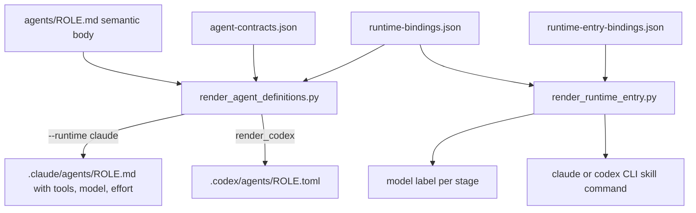

# Sub-Agent Roles and Rendering

The `agents/` tree holds the sub-agent roles that skills and the orchestrator dispatch for autonomous work that returns a result. There are three layers:

1. **Semantic role sources**: `agents/<role>.md`. Each file holds the role's instructions and contains no stack names or vendor names.
2. **Neutral capability contracts**: [`agents/agent-contracts.json`](../../agents/agent-contracts.json). This file says what each role may do, without naming a runtime.
3. **Runtime bindings**: [`agents/runtime-bindings.json`](../../agents/runtime-bindings.json) and [`adapters/runtime-entry-bindings.json`](../../adapters/runtime-entry-bindings.json). These files map each role and each workflow stage to concrete Claude or Codex settings.

Three scripts turn these layers into usable output: `scripts/render_agent_definitions.py`, `scripts/render_runtime_entry.py`, and `scripts/render_skill_prompt.py`. To see how the roles are chained during implementation and review, read [Implementation and Review Chain](../workflows/implementation-and-review-chain.md). For the Codex packaging that uses the rendered TOML profiles, read [Codex Advisory Alpha](../integrations/codex-advisory-alpha.md).

## The four roles

| Role | Purpose | Key contract values (`agent-contracts.json`) | Output contract |
|---|---|---|---|
| `coding` | Implements features, fixes, and refactors end to end with small, scoped diffs | `workspace-write` filesystem, `controlled-execution` shell, `runtime-controlled` network/MCP, nested delegation allowed, `implementation-high-capability` | `files-behavior-validation-followups` |
| `reviewer` | Read-only review passes: correctness-review finders, the correctness scorer, and intent-review | `read-only` filesystem, `read-only-inspection` shell, no network, no MCP, no nesting | `self-contained-findings-only` |
| `task-reviewer` | One read-only review per task, with separate spec and quality verdicts | `read-only` filesystem, **no shell**, no network, no MCP, no nesting | `separate-spec-and-quality-verdicts` |
| `test-runner` | Runs the smallest relevant set of tests, then reports and diagnoses the results | `read-only-with-test-artifacts`, `test-execution` shell, `documentation-read-only` network, no MCP, no nesting, `test-execution-fast` | `test-counts-failures-diagnostics` |

All four roles use `context_policy: fresh-bounded`. The role bodies set the following behavior:

- **`coding`** ([`agents/coding.md`](../../agents/coding.md)) treats `agents/PROJECT.md` and the docs it points to as the source of truth. It must not guess at a convention the repo has not written down. For any change the spec did not authorize, it applies `rules/auto-correct-scope.md`: Rules 1–3 are applied automatically and logged, and Rule 4 stops work and escalates. It returns the summary shape defined by the *Subagent contract* in `rules/orchestration.md`, and the orchestrator acts on that summary without re-reading the work.
- **`reviewer`** ([`agents/reviewer.md`](../../agents/reviewer.md)) returns findings and never applies fixes. It is called *read-only by construction* because its runtime binding leaves out the write, edit, and nested-delegation tools. The role file has an *acknowledged limitation*: the inspection shell can still change state, and only the "never fix" instruction prevents that. Every claim that something is absent must name the paths, globs, or commands that were searched (`not_observed != absent`). A claim the reviewer cannot back with a source is reported as `unknown`.
- **`task-reviewer`** ([`agents/task-reviewer.md`](../../agents/task-reviewer.md)) is stricter than `reviewer` because it has no Bash at all. It must not treat missing evidence as a pass. When it needs a focused test run, it asks the controller to dispatch `test-runner`.
- **`test-runner`** ([`agents/test-runner.md`](../../agents/test-runner.md)) reads the test command and the source→test mapping from `agents/PROJECT.md` → *Test execution*. If that section is empty, it detects the test runner from the repo's manifests and lockfiles. It reports results in fixed PASSED and FAILED formats. It never edits tests or source, never runs migrations, and installs no packages unless told to.

## Skill or agent?

[`agents/README.md`](../../agents/README.md) defines where a capability belongs:

- **Interactive, human-in-the-loop work → skill**, run in the main thread. A sub-agent runs on its own and returns one summary, so it has no way to hold a multi-turn conversation with the user.
- **Autonomous work with a returnable result → agent**, run as a sub-agent with a fresh context. Implementing code and running tests are examples.

For this reason there is no `brainstorming` agent. Brainstorming asks one question at a time and waits for approval at gates, so it exists only as the `brainstorming` skill. The README calls a brainstorming sub-agent a category error. It also notes that the earlier agent was an outdated fork of the skill that kept drifting from it.

## PROJECT.md portability model

Role files are universal. All repo-specific facts go in [`agents/PROJECT.md`](../../agents/PROJECT.md), which is a small **index** and not a copy of other docs:

- **Convention sources (point, don't restate).** The index links to the repo's existing architecture, style, and testing docs (here `skills/README.md`, `CLAUDE.md`, `AGENTS.md`, `rules/behavior.md`). If the index restated their content, it would become a second source of truth that drifts.
- **Test execution.** This section holds the facts other docs usually leave out. For the harness repo, the full-suite command is `bash scripts/run-tests.sh`, which runs L1 syntax and doc-truth lint, L2 hook contract tests, and L3 script integration tests. The section also lists flags for targeted runs and a source→test mapping, for example `hooks/<name>.sh` → `tests/hooks/<name>.test.sh`.
- **Failure diagnosis hints** and an **Inline fallback** section. The fallback is used only when the repo has no convention docs.

To reuse the agents in another repo, copy `agents/` and edit `PROJECT.md` by hand. `PROJECT.template.md` is the clean starting template. The role files do not change. Risk-classification signals are kept out of `PROJECT.md` on purpose: they live in `rules/research-depth.md` and the xia2 skill, which needs no configuration.

## Contracts and bindings

### `agent-contracts.json`

This file declares `required_capabilities`: `filesystem`, `shell`, `network`, `mcp`, `nested_delegation`, `context_policy`, `model_class`, and `output_contract`. Every role must state a value for each one. Each role's `source` must be exactly `agents/<role>.md`.

### `runtime-bindings.json`

This file has exactly two runtimes, `claude` and `codex`, and each must bind the same set of roles as the contracts file.

- **Claude** (`markdown-frontmatter`): each role gets a `model`, an optional `effort`, and an optional `tools` list. Currently `coding`, `reviewer`, and `task-reviewer` bind `claude-opus-5-5` at `medium` effort, and `test-runner` binds `claude-haiku-5-5`. `coding` has `tools: null`, so it inherits every tool. `reviewer` gets `Glob, Grep, Read, Bash`. `task-reviewer` gets `Glob, Grep, Read`. `test-runner` gets `Glob, Grep, Read, WebFetch, WebSearch, Bash`.
- **Codex** (`toml-custom-agent`, emitted by `render_agent_definitions.py`): each role needs `model`, `model_reasoning_effort`, and `sandbox_mode`. `coding` uses `gpt-5.6-sol`/high/`workspace-write`. Both review roles use `gpt-5.6-terra`/high/`read-only`. `test-runner` uses `gpt-5.6-luna`/medium/`workspace-write`, and its policy text describes a read-only sandbox with an exception for test artifacts.
- Each binding has a `capabilities` map whose keys must exactly match `required_capabilities`. Each value is either an explicit string or boolean, or an `unsupported-exception` object that names an `owner` and an `exit_condition`. Codex bindings may not keep any such exception.

### `adapters/runtime-entry-bindings.json`

This file maps workflow **model stages** to agent roles:

| Model stage | Role |
|---|---|
| `implementer`, `correctness_scorer` | `coding` |
| `correctness_finder`, `intent_reviewer` | `reviewer` |
| `task_reviewer` | `task-reviewer` |

It also holds the CLI entry for each runtime. Claude runs `claude -p {prompt} --output-format text` with skill prefix `/`. Codex runs `codex exec {prompt}` with skill prefix `$`.

*Data flow from the neutral sources and bindings to the files and strings each runtime uses.*

## `render_agent_definitions.py`

[`scripts/render_agent_definitions.py`](../../scripts/render_agent_definitions.py) checks the contracts and then renders definitions for each runtime. Use `--check` to validate only. Use `--runtime claude|codex --output-dir DIR` to render. Any `ContractError` exits with code 1 and prints an `agent-bindings:` message on stderr.

`validate()` enforces these rules:

- Semantic role sources must have frontmatter. That frontmatter must not contain runtime policy fields (`model`, `effort`, `tools`, `memory`), because those belong in the bindings.
- The runtime set must be exactly `{claude, codex}`. Each runtime must bind exactly the contract roles, and each capability map must match `required_capabilities` exactly.
- Claude `effort` must be one of `low|medium|high|xhigh|max`. Codex models (`gpt-5.6-sol|terra|luna`), reasoning efforts, and sandboxes are each checked against a fixed list of allowed values.
- **Review-role invariants:** `reviewer` and `task-reviewer` must have `filesystem: read-only`, `nested_delegation: false`, `context_policy: fresh-bounded`, and `mcp: none`.
- **MCP guard:** a Claude role with no tools list, or an empty one, inherits every tool, including MCP tools. So every role with `mcp: none` must have a non-empty, explicit Claude `tools` list of plain names, with no `mcp__` entries.

`render_claude()` reads the role's frontmatter and places `tools:`, `model:`, and `effort:` directly after the `description` line. It does this so the output stays byte-identical to the agent files written before bindings existed. Without that, a re-sync would rewrite every consuming repo's agent files. `render_codex()` writes a TOML profile for each role and changes `-` to `_` in the name, so `task-reviewer` becomes `task_reviewer`. The profile contains:

- the `model`, `model_reasoning_effort`, and `sandbox_mode` values;
- `mcp_servers = {}` when the contract's MCP value is `none`;
- `[agents] enabled = false` when nested delegation is disabled;
- `developer_instructions`. This field starts with a generated policy block listing all eight capabilities, followed by the role body. The block tells the child agent never to widen those limits from inside its session.

Before writing each profile, `parse_codex_profile()` parses it back with a strict TOML-subset parser.

Callers: `scripts/deploy-harness.sh` runs `render_agents()`, which renders the Claude definitions into the deployed `.claude/agents`. `scripts/render_codex_adapter.py` calls `validate()` and then `render_codex()` to produce `project/.codex/agents/*.toml`. `harness-manifest.json` lists the contracts file, the bindings file, and the renderer under `agent_bindings`, along with the four role names.

## `render_runtime_entry.py`

[`scripts/render_runtime_entry.py`](../../scripts/render_runtime_entry.py) is the single place that knows vendor-specific skill syntax and model labels. Shared skill prose stays runtime-neutral by naming a `model_stage`. For example, the implementer, task-reviewer, correctness-scorer, and intent-reviewer prompts carry `model_stage:` lines and name the exact resolve command.

- `--check` validates both binding files. `schema_version` must be 1. Unknown fields are rejected. Each runtime must have a distinct prefix, either `/` or `$`. Each CLI argument list must contain `{prompt}` exactly once, as a whole argument. The stage set must exactly match `EXPECTED_STAGES`. Every stage's role must resolve to a non-empty `model` in both runtimes.
- `--runtime R --skill NAME [--prompt TEXT]` prints a shell-quoted command line. For example, `claude -p '/feature-intake <case prompt>' --output-format text` or `codex exec '$feature-intake <case prompt>'`. Skill names must be kebab-case.
- `--runtime R --model-stage STAGE` prints the bound model, such as `claude-opus-5-5` or `gpt-5.6-terra` for `task_reviewer`.

An earlier rule required the review models to differ from each other. That rule was removed, and roles may now share a model: `test_collapsed_review_models_validate` checks that a scorer may share the finders' model and that an intent reviewer may share the implementer's. Neither `agents/*.json` nor `adapters/` is deployed to consuming repos, so this script runs only in the harness repo. The resolved model reaches consumers already written into each rendered agent's frontmatter.

## `render_skill_prompt.py`

[`scripts/render_skill_prompt.py`](../../scripts/render_skill_prompt.py) does two jobs for isolated sub-agent prompts. It is in `CONSUMER_SCRIPTS`, so it is deployed to consuming repos.

- **Composition.** Pass `--fragment` one or more times and optionally `--values JSON`. The script joins the prompt fragments. Before each fragment it adds a `<!-- source: path -->` comment showing where the text came from, and it fills in `{{key}}` placeholders. It fails if a fragment is missing or if any `{{` or `}}` remains. The correctness-review skill uses it to build its child prompts. Children do not inherit the parent skill's context, so each required policy must be included in the prompt.
- **Delivery contract (`--check-all`).** `CONTEXT_MATRIX` lists each isolated context, such as `implementer`, `task-reviewer`, `correctness-reviewer`, `intent-reviewer`, `spec-document-reviewer`, and `resume`. For each context it names the prompt file and the rule files that prompt must mention. For contexts with `required_reads`, the prompt must also contain an explicit ``Read ... `path` `` line. A context with no required rules must state a `rationale`; `correctness-scorer` is one. The check also validates `skills/correctness-review/review-config.json`: there must be six unique finder angles, and the thresholds must be 75 (default) and 60 (minimum).

## Invariants and failure modes

- Adding a role means doing all of the following: adding `agents/<role>.md`, adding a contract entry, adding bindings for **both** runtimes with full capability maps, and adding the name to the manifest's `agents` list. `render_codex_adapter.py` rejects any mismatch between the manifest's agents and the role files on disk.
- Putting `model:` or `effort:` back into a role source fails validation, because runtime policy belongs only in the bindings.
- Leaving out a Claude `tools` list for a role with no MCP access fails validation. Without the list, the role would silently inherit MCP tools.
- On Codex, a bound model outside the allowed list fails validation. So does a binding that still contains an `unsupported-exception`.

## Tests

- `scripts/test_render_agent_definitions.py` checks that the contracts and bindings cover every role and capability, that role sources contain no vendor fields, and that the Claude render matches the older files. It also checks the strict Codex profiles, the read-only, no-nesting, no-MCP constraints on the review roles, and a set of rejection cases: a missing role, a missing capability, an MCP tool on a role without MCP, an unsupported effort, and an incomplete exception.
- `scripts/test_render_runtime_entry.py` and `tests/scripts/runtime-entry-bindings.test.sh` check the CLI output and model labels against expected values, check shell quoting and the strict skill-name rule, and check that the prompts still declare their `model_stage:` lines.
- `scripts/test_render_skill_prompt.py` checks composition, rejection of unresolved placeholders, and that `CONTEXT_MATRIX` lists every isolated context. It also checks that each required policy is necessary: if a required delivery is removed, the check fails.
- `scripts/test_render_codex_adapter.py` uses the shared `parse_codex_profile` on the rendered reviewer and test-runner profiles.

For behavioral evaluations of these roles (task-review, test-runner, and review-chain evals), see [Behavioral Evals](../testing/behavioral-evals.md).
