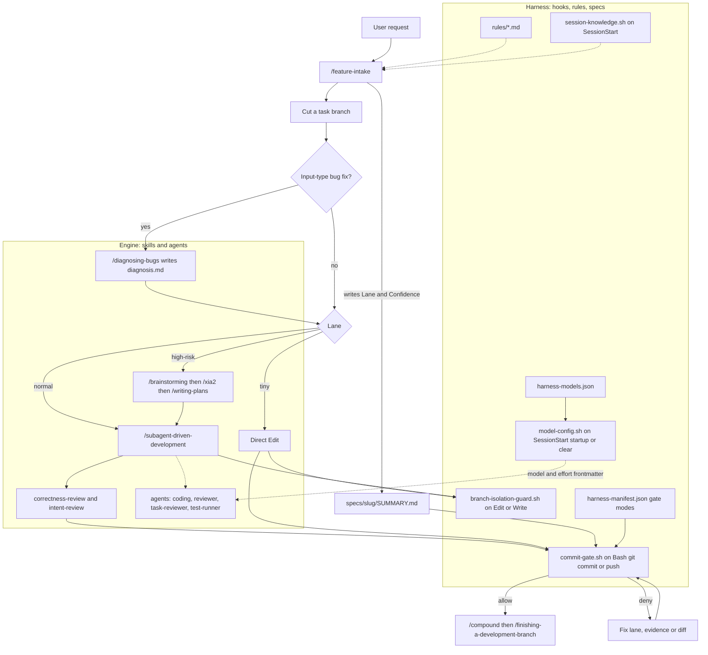
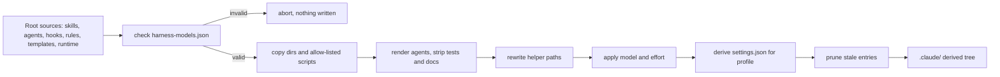

# Architecture Overview

This repository is a **skills framework with a risk/trust harness on top of it**. You can read it as two layers that answer two different questions:

- **The engine** answers *"how do I build this?"* It is made of invocable `/skills` (brainstorm, research, plan, build, review, ship) and sub-agent roles.
- **The harness** answers *"how careful should I be, and who needs to approve?"* It is a thin control layer that decides, *before* the engine runs, how much ceremony a change needs and when to involve a human. Hooks then check, at edit time and commit time, what the agent said it would do.

One principle drives the harness: **ceremony scales with risk, and human interruption scales with ambiguity.** These are two separate dials. Risk (the *lane*) controls how much planning, review and evidence a change carries. Confidence and ambiguity only control whether a human is asked ([HARNESS.md](../../HARNESS.md)).

## The two layers

| Layer | Responsibility | Lives in |
|---|---|---|
| Engine | Skills that do the work. Each has hard gates and a defined handoff to the next skill. Sub-agent roles (`coding`, `reviewer`, `task-reviewer`, `test-runner`) carry out the delegated steps. | `skills/`, `agents/` |
| Harness | Classifies risk and confidence, records the decision, enforces branch isolation and commit evidence, and supplies governance rules. | `skills/feature-intake/`, `hooks/`, `rules/`, `specs/<slug>/SUMMARY.md` |

Around these two layers sit the supporting systems this repo owns: the durable run-state runtime (`runtime/`), deterministic checkers and deploy tooling (`scripts/`), artifact templates (`templates/`), the per-agent and per-skill model/effort config ([`harness-models.json`](../../harness-models.json)), the generated Codex adapter (`adapters/codex/`), behavioral evals (`evals/`), and the knowledge base (`docs/solutions/`). [`harness-manifest.json`](../../harness-manifest.json) is the single machine-readable inventory that ties them together (see [Harness Manifest and Contracts](../concepts/harness-manifest-and-contracts.md)). It holds:

- the hard-gate slugs and their block/warn modes;
- the hook inventory (four wired hooks) and the hook profiles;
- the skill list, which now includes `diagnosing-bugs` and `harness-models`;
- the four agent roles and the agent-binding renderer;
- the contract surface-to-consumer maps.

## Request flow: intake → build → hooks → ship

*Engine skills do the work. Harness hooks check each edit and each commit against the lane that intake declared, before the work can ship. A bug-fix request first goes through `/diagnosing-bugs`. At session start, `model-config.sh` applies `harness-models.json` to the deployed agent and skill frontmatter.*

Step by step:

1. **Intake runs first.** `/feature-intake` classifies the request with a risk checklist and the hard gates. It writes `Lane:` and `Confidence:` into `specs/<slug>/SUMMARY.md`, a file copied from [`templates/SUMMARY.template.md`](../../templates/SUMMARY.template.md). The header block of that template is machine-read: `commit-gate.sh` greps the `Lane:` line.
2. **Every lane cuts a branch before the first edit.** `branch-isolation-guard.sh` denies implementation edits on a shared branch (`HARNESS_SHARED_BRANCHES`, default `main`/`master`), whatever the lane.
3. **A bug fix is diagnosed first.** When intake records `Input-type: bug fix`, `diagnosing-bugs` runs before the lane route, on every lane. Its six gated phases prove the root cause in `specs/<slug>/diagnosis.md`, and `task-reviewer` reviews that file before any fix. On the tiny lane the fix is a red test and then the fix on the branch. On normal and high-risk lanes, `diagnosis.md` becomes an input to the lane's chain ([CLAUDE.md](../../CLAUDE.md)).
4. **The lane picks the path.** *tiny* edits directly with no plan. *normal* runs `/subagent-driven-development` with one task reviewer that gives two verdicts. *high-risk* runs the full chain `/brainstorming → /xia2 → /writing-plans → build`. After the build come `context-propagation-audit` (for workflow-engine diffs), `correctness-review`, and `intent-review`, which compares the diff with the original request and does not see the plan. Then `/compound` and `/finishing-a-development-branch`. See [Skill Chain](../workflows/skill-chain.md).
5. **Escalation follows confidence, not lane.** Low confidence, or a hard gate, stops the work and records a question in `specs/<slug>/ESCALATIONS.md` (deny-on-no-response). A hard gate found mid-task escalates whatever the original lane was.
6. **Hooks check the claim.** At commit time, `commit-gate.sh` compares the staged diff with the declared lane. It reads the lane from a staged `SUMMARY.md`, or else from the SUMMARY beside the active plan. An agent therefore cannot label a risky change "tiny" and commit it: a block-mode hard-gate signal under a lane below `high-risk` is denied, and a warn-mode signal (`workflow-engine`, `weakening-validation`) only prints a note. See [Commit Gate](../enforcement/commit-gate.md).

## Major owned systems

### Hooks (`hooks/`)

Four bash hooks are registered in the root [`settings.json`](../../settings.json):

| Hook | Trigger | Role |
|---|---|---|
| `commit-gate.sh` | PreToolUse `Bash` | The only gate for `git commit`/`push`. Bash calls that are not git exit at once. Shell input it cannot fully parse is denied. It runs the secrets scan, the pending-escalation gate, the lane-evidence gate (`verify_summary.py --lane`), the run-state artifact gate, risk corroboration, and the plan-scope check, plus strict-only app gates. |
| `branch-isolation-guard.sh` | PreToolUse `Write\|Edit` | Blocks implementation edits on a shared branch. It looks at the checkout that owns each edited path, not the directory the session was launched from. Edits whose paths are all under `specs/*` count as bookkeeping and are allowed. |
| `session-knowledge.sh` | SessionStart | Loads `docs/solutions/critical-patterns.md`, an `INDEX.md` pointer, up to 5 active runs from `runtime/run_state.py list --active --json`, and the cached Codex runtime-mode context. It never blocks: every path exits 0. |
| `model-config.sh` | SessionStart, matcher `startup\|clear` | Pipes the SessionStart payload to `scripts/apply_model_config.py --hook`, which validates `harness-models.json` and writes `model`/`effort` into the deployed agent and skill frontmatter. It never blocks: a missing `python3`, applier, or project root is a silent no-op, and hook errors are reported as context, not failures. The running session may pick up a rewritten agent file only from the next session. |

Both PreToolUse hooks pass the raw tool payload through `hooks/lib/normalize-tool-input.py`. This normalizer converts Claude and Codex payloads, including Codex `apply_patch` programs, into one path-set contract. It tells the runtimes apart by the payload shape (`turn_id` means Codex, `session_id` means Claude), and any input it cannot fully resolve is reported as `unknown`. The hooks treat `unknown` as a deny. The commit gate reads per-gate block/warn modes only from the git index (`git show :harness-manifest.json`) or from defaults built into `hooks/lib/gate-modes.default.sh`. It never reads a worktree copy, because an agent could edit that copy just before the gate reads it.

Hook profiles (`minimal`, `standard`, `strict`) are listed in `harness-manifest.json` `hook_profiles`, and `standard` is the default. `minimal` installs only `branch-isolation-guard.sh` and `commit-gate.sh` (the commit gate then runs only the secrets scan). `standard` and `strict` install all four hooks, including `session-knowledge.sh` and `model-config.sh`. `strict` runs `commit-gate.sh --profile strict`, which adds the app gates and the untracked-`.py` deny. The deploy script keeps only the profile's hooks (matched by command basename) when it derives `.claude/settings.json`, and it records the chosen profile in `.claude/.harness-profile` so that a re-sync without `--profile` reuses it.

### Model and effort config (`harness-models.json`)

[`harness-models.json`](../../harness-models.json) is a user-editable file (`schema_version: 1`) that sets `model` and `effort` per agent role (`coding`, `task-reviewer`, `reviewer`, `test-runner`) and per skill (for example `brainstorming` and `writing-plans`). It is applied in two places, both by `scripts/apply_model_config.py`:

- **At deploy time.** `deploy-harness.sh` renders a defaults snapshot from the source agent definitions and validates the target's `harness-models.json` against it (`--check`) *before* anything under `.claude/` is written, also under `--dry-run`. A failed check aborts the deploy. After the helper-path rewrite, the script copies the snapshot to `.claude/harness-models.defaults.json` and applies the config (`--apply`).
- **At session start.** `model-config.sh` re-applies the file on `startup` and `clear`.

The applier writes only `.claude/agents/<role>.md` and `.claude/skills/<name>/SKILL.md` for the names in the snapshot. It never writes a settings file. The `/harness-models` skill is the user entry point for showing, checking, and applying the config. See [Model and Effort Config](../operations/model-and-effort-config.md).

### Rules (`rules/`)

The governance rules are Markdown prose. Loading has two tiers, set by each file's frontmatter. A rule file **without** `paths:` frontmatter loads in every session: `behavior.md`, `architecture.md`, `guidelines.md`, `orchestration.md`, `research-depth.md`. A rule file **with** `paths:` loads only when a matching `specs/**` file is read: `plan-format.md`, `wave-parallelism.md`, `auto-correct-scope.md`, `terminology.md`, `review-policy.md`. So adding `paths:` to a rule takes it out of the always-on set. Rules are what the code cannot check mechanically. Anything that can be checked mechanically becomes a hook or a checker.

### Specs and templates (`specs/`, `templates/`)

`specs/<slug>/` is the tracked record of each unit of work: `SUMMARY.md`, `PLAN.md`, `ESCALATIONS.md`, intent files, review receipts, and the run-state files. `templates/` holds the canonical shapes (`SUMMARY`, `ESCALATIONS`, `INTENT`, `QUESTIONS`, `REVIEW-RECEIPT`). The SUMMARY template defines the evidence contract:

- a five-field header: `Lane`, `Confidence`, `Reason`, `Flags`, `Affects`;
- the verbatim `### Intent`, which `intent-review` uses as its reference;
- a `### Verify` table with one row per check that was actually run;
- a `### Not auto-verified` section that states which claims no gate checks.

The manifest records `templates/SUMMARY.template.md` as a contract surface whose consumers are `scripts/verify_summary.py` and `hooks/commit-gate.sh`.

### Runtime run-state (`runtime/`)

[`runtime/run_state.py`](../../runtime/run_state.py) is a durable, event-sourced state machine for each spec slug. It keeps three files per slug:

- `specs/<slug>/events.jsonl`: an append-only event log;
- `events.jsonl.lock`: an `fcntl` lock around the read-validate-append sequence;
- `RUN.json`: an atomically written projection that can be rebuilt from the event log.

Its states are active (`queued`, `investigating`, `planning`, `implementing`, `verifying`, `awaiting_ci`, `ready_to_merge`, and others), interrupt (`blocked`, `escalated`), and terminal (`shipped`, `cancelled`, `superseded`). Waiting states need `--waiting-on`, and interrupt states need `--resume-event`. The CLI (`init`, `transition`, `status`, `list`, `rebuild`) returns 0 on success, 2 for invalid input or an invalid transition, and 3 for storage, chain, or projection failures. Its callers, as listed in the manifest's `durable-run-state-checkpoints` contract, are the intake, subagent-driven-development, and finishing skills, `session-knowledge.sh`, `scripts/harness-status.sh`, and the post-merge maintenance workflow. `runtime/resume_decision.py` turns run state into a resume action and task cursor for `resume <slug>`. `runtime/runtime_mode.py` stores sanitized Codex doctor results in the gitignored `.harness-state/codex-runtime.json`. Details are in [Run-State Engine](../runtime/run-state-engine.md).

### Scripts and checkers (`scripts/`)

`scripts/` contains three kinds of tool:

- **Evidence checkers** that gates call. `verify_summary.py` decides what counts as lane evidence. Others include `check_plan_contract.py` and `check_review_receipt.py`.
- **Consistency checkers** that CI runs. `check_manifest.py` checks the manifest against the hook and skill inventories. `lint-doc-truth.sh` fails when a documented path is missing or the hooks table contradicts `settings.json`. There are also `check_runtime_neutral_sources.py` and the Codex capability and packaging checkers.
- **Deploy and render tooling**: `deploy-harness.sh`, `install-harness.sh`, `render_agent_definitions.py`, `render_codex_adapter.py`, `deploy-codex-adapter.sh`, `codex_harness_doctor.py`, `apply_model_config.py`.

`scripts/run-tests.sh` is the single test entry point that CI runs. It covers syntax checks, the doc-truth lint, the manifest checks, the hook contract tests in `tests/hooks/`, the script integration tests in `tests/scripts/`, and the Python unit tests.

Not all of `scripts/` reaches consumers. Only an allow-list (`CONSUMER_SCRIPTS`: `verify_summary.py`, `check_plan_contract.py`, `check_review_receipt.py`, `resolve_finish_context.py`, `run_at_commit.py`, `apply_model_config.py`, and a few others), plus `harness-manifest.json` as data, is synced into consumer repos. The rest is harness-development tooling.

### Evals (`evals/`)

`evals/` holds fixture-based *behavioral* evals that measure skill judgment against labeled ground truth:

- `workflow/intake-classifier/` scores how accurately `/feature-intake` assigns lane, confidence, and hard gates;
- `skills/review-chain/` scores how many planted defects `/correctness-review` and `/intent-review` catch;
- `skills/task-review/` checks the per-task reviewer verdicts, and `skills/prompt-refactor/` is a skill activation and behavior corpus for prompt refactors;
- `agents/test-runner/` scores the report accuracy and no-edit discipline of the `test-runner` role;
- `context-boundaries/` holds manual probes of whether a rule reaches a given execution context. It has a manual protocol and no scorer.

The fixtures are labeled, and the skill runs blind (the subagent never sees `truth.md`). Scoring is scripted and deterministic (for example `scripts/score_intake_eval.py`). The LLM runs themselves are triggered by hand, not in CI. This keeps them separate from the deterministic tests (`tests/hooks/`, `tests/scripts/`, `scripts/test_*.py`) that `run-tests.sh` executes in CI. See [Behavioral Evals](../testing/behavioral-evals.md).

### Knowledge base (`docs/solutions/`)

`docs/solutions/<category>/<slug>.md` entries with YAML front-matter record solved problems and decisions. `INDEX.md` is the browsable index, and `critical-patterns.md` is read at planning time. `session-knowledge.sh` loads both at session start, and `/compound` writes new entries after shipping.

## Source tree vs deployed tree

The root directories are the source of truth. Claude Code loads skills, agents, hooks, and rules from `.claude/`, which is a **derived, gitignored copy** built by `scripts/deploy-harness.sh`. For consumer projects, `install-harness.sh` calls the same script with `--target`. The deploy syncs `skills`, `agents`, `hooks`, `rules`, `templates`, `runtime`, and the allow-listed `scripts`. It renders the Claude agent definitions, strips archived skills, skill tests, and maintenance-only docs, rewrites helper paths in the derived Markdown (for example `scripts/verify_summary.py` and `skills/diagnosing-bugs/` become `.claude/...` paths), and applies `harness-models.json`. It then derives `settings.json`: it keeps only the profile's hooks, rewrites hook commands to `$CLAUDE_PROJECT_DIR/.claude/hooks/...`, merges with the consumer's own `settings.json` hooks instead of replacing them, and does not overwrite per-repo files that the consumer owns (`rules/architecture.md`, `rules/guidelines.md`, `rules/behavior.md`, `agents/PROJECT.md`). When such a file differs, the incoming copy is written beside it as `<file>.harness-incoming`. `agents/*.json` and `adapters/` are inputs used only when rendering adapters in this repo, and they never deploy. Entries the harness shipped in the previous deploy but that are gone from source are pruned, using the `.claude/.harness-deployed` list. See [Install, Deploy and Re-sync](../operations/install-deploy-and-resync.md).

*The order of steps in `deploy-harness.sh`. The model config is validated before any write and applied after the path rewrite.*

## Claude Code vs Codex runtime boundary

**Claude Code is the established runtime.** The **Codex advisory alpha** is a generated adapter that does not overwrite existing files. It renders the *same* skills, agents, and hook bodies through checked Codex bindings. It is **not** a peer enforcement runtime and not GA. Full observed evidence exists only for Codex CLI 0.147.0 on macOS arm64.

How the boundary works:

- **Rendering.** `scripts/render_codex_adapter.py` derives `adapters/codex/plugin/hooks/hooks.json` from the root `settings.json`. Each command is rewritten to `bash "$PLUGIN_ROOT/hooks/..."`, the `Write|Edit` matcher becomes `apply_patch|Edit|Write`, and SessionStart handlers get an `additionalContextLimit` of 2500. A hook event that has no mapping aborts the render. **`model-config.sh` is not registered in the Codex adapter:** the renderer skips it on purpose, because it rewrites Claude frontmatter only. The rendered `hooks.json` therefore has one SessionStart handler (`session-knowledge.sh`), and a group whose only handler was skipped is dropped. `adapters/codex/schema.json` is a closed schema (runtime `codex`, packaging `hybrid`) for the rendered inventory. Agent definitions for both runtimes are rendered from `agents/agent-contracts.json` and `agents/runtime-bindings.json`.
- **Installation.** `scripts/install-codex-harness.sh` delegates to `deploy-codex-adapter.sh`. That script installs the plugin, a project overlay, and a bounded `AGENTS.md` block, and it never replaces the Claude `.claude/` deployment.
- **Shared hook bodies.** Codex runs the same `hooks/*.sh` scripts. The input normalizer is what lets one set of scripts handle both payload formats.
- **Diagnosis happens outside hooks.** `scripts/codex_harness_doctor.py` reports `enforced`, `advisory`, or `unsupported`, and only `macos-arm64` is a supported platform. Its result is stored by `runtime/runtime_mode.py`. `session-knowledge.sh` only *displays* the cached result; it never runs the doctor. No current input carries observed hook trust, so a real run today returns `advisory` or `unsupported`. Treat an `enforced` result today as a bug.
- **SUMMARY metadata.** The optional `Runtime-mode` / `Runtime-evidence-id` pair in a SUMMARY is checked only for format by `verify_summary.py`. The doctor, not the commit gate, decides the actual mode.

See [Codex Advisory Alpha](../integrations/codex-advisory-alpha.md) for the install lifecycle and trust model.

## Invariants worth knowing before changing things

- **Each gate enforces one evidence tier.** The tiers are traceability (the structure exists), provenance (the evidence is re-derived from the source of truth), and truth (the check is re-run). A gate must not claim a higher tier than it enforces, and new gates document `Verifies:` / `Does not verify:` ([CLAUDE.md](../../CLAUDE.md)).
- **Some paths are hard gates in their own right.** `settings.json`, `hooks/*`, and core skill engines are `high-blast` (block mode). Skill, agent, and rule prose is `workflow-engine` (warn mode). On PRs, `scripts/ci-strict-gate.sh` blocks diffs to `hooks/`, `settings.json`, `templates/`, or `render_plan.py` unless they come with a high-risk SUMMARY whose Verify rows re-run clean.
- **Edit the manifest, not its copies.** The hard-gate vocabulary is copied into `skills/feature-intake`, `rules/auto-correct-scope.md`, and `commit-gate.sh`. CI checks those copies against `harness-manifest.json`.
- **MCP output is untrusted input.** The harness trusts only its own hooks and scripts.
