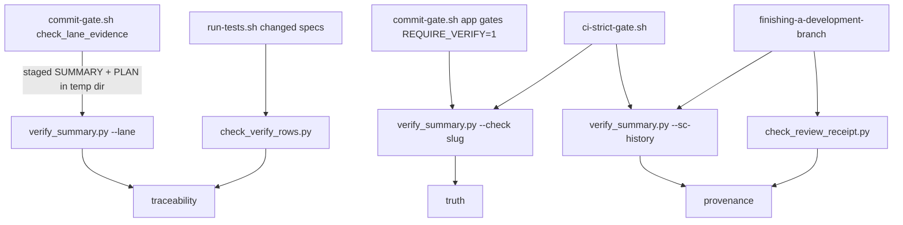

# Evidence Tiers and the SUMMARY.md Contract

Every task the harness runs leaves a record under `specs/<slug>/`. This record is how the
harness checks a change instead of trusting what the agent says about it. `SUMMARY.md` is the
main file. It declares the risk lane, lists the commands that were actually run, and states
which claims no gate checks. A small set of Python checkers reads these files. Hooks and CI
call those checkers to decide whether a commit or PR may go ahead. The rule behind all of
this: **each gate checks exactly one evidence tier and must not claim more.**

Related pages: [Lanes, Risk and Hard Gates](lanes-risk-and-hard-gates.md) (how a lane is
chosen), [Commit Gate](../enforcement/commit-gate.md) (the hook that calls these checkers),
[Run-State Engine](../runtime/run-state-engine.md) (`RUN.json` / `events.jsonl`),
[Bug Diagnosis](../workflows/bug-diagnosis.md) (where red/green evidence comes from), and
[Implementation and Review Chain](../workflows/implementation-and-review-chain.md) (the
skills that write these files).

## The three evidence tiers

`CLAUDE.md` → "Gate verifiability (traceability ≠ provenance ≠ truth)" defines three tiers.
Every gate enforces exactly one of them:

| Tier | What it proves | Typical mechanism |
| --- | --- | --- |
| **traceability** | Structure matches: an ID exists, or a rendered artifact agrees with its ledger | Section/header/format checks |
| **provenance** | The evidence is re-derived from the source of truth | A receipt pinned to a commit, an index rebuilt, git history replayed |
| **truth** | The behavior is re-run | A Verify command runs again and its exit codes are compared |

When you add a gate or hook, document it with two lines: `Verifies:` (what the code checks)
and `Does not verify:` (what it leaves out). The checkers below follow this rule in their
docstrings. This page repeats each pair. The main risk the tiers protect against is a
traceability check being read as proof of truth. For example, the lane-evidence gate checks
that a `### Verify` row *exists*. It does not check that the row is *honest*.

## The `specs/<slug>/` artifact set

| Artifact | Source template | Role | Machine reader(s) |
| --- | --- | --- | --- |
| `SUMMARY.md` | `templates/SUMMARY.template.md` | Audit record: lane header, verbatim intent, Verify table, negative scope, rollback | `verify_summary.py`, `check_verify_rows.py`, `commit-gate.sh`, `ci-strict-gate.sh`, trust-metrics ledger |
| `PLAN.md` | (plan format, `rules/plan-format.md`) | Tasks plus the `## 3. Success Criteria` acceptance contract (`SC-<n>` rows) | `verify_summary.py` (SC coverage, SC history), `check_verify_rows.py` (SC Check cells), commit-gate plan-scope check |
| `intent.md` | `templates/INTENT.template.md` | Optional human-authored intent. Intake proceeds only when `Status:` is approved. | intake; pinned by SUMMARY `Intent-source:` |
| `QUESTIONS.md` | `templates/QUESTIONS.template.md` | Register for non-blocking open questions (`OQ-<n>` with `closes-at`, `decided-by`, `status`) | `check_open_questions.py --slug` (warn-first; `REQUIRE_QUESTIONS_CLOSED=1` blocks) |
| `ESCALATIONS.md` | `templates/ESCALATIONS.template.md` | Blocking decisions. Deny-on-no-response: `decision: pending` keeps work blocked. | `commit-gate.sh` pending-escalation gate |
| `.review-receipt.json` | `templates/REVIEW-RECEIPT.template.json` | Records which reviews passed at which exact commit | `check_review_receipt.py` |
| `RUN.json`, `events.jsonl` | — | Durable run state (see [Run-State Engine](../runtime/run-state-engine.md)) | commit-gate run-state artifact gate |

A blocking question goes in `ESCALATIONS.md`. A question a later phase can close goes in
`QUESTIONS.md`. Both templates state this split.

## The SUMMARY.md shape

The template header block is machine-read. The commit gate greps `Lane:` and compares it with
the staged diff, and the trust-metrics ledger reads Lane / Confidence / Flags. The header
fields are `Lane`, `Confidence`, `Reason`, `Flags`, `Affects` and `Input-type`. Optional
runtime metadata (`Runtime-mode` + `Runtime-evidence-id`) must be supplied as a complete pair.

The body sections:

- **`### Intent`**: the user's request copied verbatim. Alternatively, an
  `Intent-source: specs/<slug>/intent.md @ <sha>` line followed by the request. This text is
  the oracle for intent-review, which reviews the diff without seeing the plan. Keeping the
  intent here rather than in `PLAN.md` keeps that oracle independent of the plan.
- **`### Intake notes`, `## What changed`, `### Rationale`, `### Alternatives considered`**:
  the audit trail for work done without a human in the loop.
- **`### Deviations`**: every Rule 1–3 auto-fix. This is also where a changed Success
  Criterion is acknowledged (see SC history below).
- **`### Verify`**: the part a machine can check. Columns are
  `| Check | Command | Exit | Notes | Criterion |`. Each row is a command that was actually
  run. `Criterion` is optional and names a `SC-n` from `PLAN.md` §3.
- **`### Not auto-verified`**: the negative scope. It lists every claim the change makes
  that no gate checks, each labelled with the tier it reached. The template says that listing
  an unverified claim is not a defect, but leaving one unlisted is. `- none` is valid only
  when a Verify row covers every claim.
- **`### Rollback`**: the exact undo commands. These are required for high-risk work.
- **`### Harness-Delta`**: friction this task revealed in the workflow itself.

## `verify_summary.py`: the authority on lane → evidence

`rules/auto-correct-scope.md` names `scripts/verify_summary.py --lane` the single source of
truth for the lane → evidence mapping. To change the mapping, edit the script, not only the
prose. The script has three modes:

```
python3 scripts/verify_summary.py --lane <slug|path> [more ...] [--plan-dir DIR]  # traceability
python3 scripts/verify_summary.py <slug> [--check] [--timeout N] [--plan-dir DIR] # truth
python3 scripts/verify_summary.py --sc-history <slug> --base <ref>                 # provenance
```

Exit codes: `0` pass, `1` failure or missing evidence, `2` bad invocation. Some combinations
are bad invocations (exit 2): `--lane` with `--check`, `--sc-history` without `--base`, and
`--sc-history` combined with other modes.



*Which caller invokes which checker, and the evidence tier each checker reaches.*

### Lane mode (`--lane`): traceability

`check_lane_evidence` applies these requirements cumulatively:

- **Every lane**: `Lane:` resolves to exactly one of `tiny | normal | high-risk`. An
  option-list value such as `tiny | normal` is rejected. `Lane`, `Confidence` and `Reason`
  must be present and not template placeholders.
- **normal / high-risk**: a `### Verify` section with at least one real (non-placeholder)
  command row.
- **high-risk**: a `### Rollback` with real content. The untouched template line
  `git revert <sha>` does not count. A `### Not auto-verified` section is also required, but
  only as a warning by default.
- **Bug fix, any lane** (`Input-type` starting with `bug fix` / `bug-fix` / `bugfix`): a
  `red` row whose command is `[python3] scripts/run_at_commit.py <7-40 hex sha> -- <test>`
  with a claimed exit of 1–123, plus a `green` row that runs the same test command
  (whitespace-normalized) with claimed exit 0. A `Red test exempt: <non-empty reason>` line
  is the alternative. This is a warning by default.
- **Bug fix, prove the red** (same trigger and same `REQUIRE_RED_TEST` switch): for each
  matched red/green pair, a code change must exist after the red commit, outside `specs/`
  and outside the red test files. See [Fix-diff check](#fix-diff-check-prove-the-red-provenance)
  below. This is the only part of lane mode that calls git.
- **SC coverage**: if the sibling `PLAN.md` has an SC table, every valid `SC-n` must be named
  by at least one Verify row whose claimed exit equals the SC's expected exit. A Criterion
  naming an unknown SC id is an error. If there is no PLAN or no SC table, the check is
  skipped (fail-open).
- **Runtime metadata**: the `Runtime-mode` / `Runtime-evidence-id` pair is either absent or
  complete and well-formed. The mode must be one of `enforced|advisory|unsupported` and the
  id must match `codex-mode-<16 hex>`.

Lane mode never executes Verify commands. Warnings are printed as
`! … (warn-only; set ENV=1 to enforce)` on passing *and* failing runs, because a warning shown
only on failure is a warning nobody reads.

- **Verifies:** the SUMMARY contains the sections, rows and header values its lane requires,
  and its SC references line up with `PLAN.md`. For a bug fix it also checks (provenance) that
  a fix diff exists after the red commit.
- **Does not verify:** that any Verify row is honest or still passes, that rollback steps
  work, or that the Not-auto-verified list is complete or correctly tiered.

#### Warn-first opt-ins

| Env var | Promotes to blocking |
| --- | --- |
| `REQUIRE_NOT_AUTO_VERIFIED=1` | Missing or placeholder `### Not auto-verified` on high-risk |
| `REQUIRE_RED_TEST=1` | Missing red/green pair, or a failed or uncheckable fix-diff check, on a bug-fix SUMMARY |
| `REQUIRE_SC_STABLE=1` | SC-history findings (exit 1 instead of 0) |

`REQUIRE_NOT_AUTO_VERIFIED` and `REQUIRE_RED_TEST` treat any value other than empty, `0` or
`false` as on. `REQUIRE_SC_STABLE` must strip to exactly `1`. The Not-auto-verified check
starts as a warning because most older high-risk specs predate the section. The script
comment says the default should flip in the script itself once that backlog is cleared.

The Not-auto-verified check is itself traceability-tier.
**Verifies:** the section exists and contains at least one bullet that is not a placeholder;
`- none` is accepted on purpose.
**Does not verify:** that the listed claims are complete or that their tier labels are
correct. It makes the author answer the question but cannot check the answer.

#### Fix-diff check (prove the red): provenance

The red/green row check reads only SUMMARY text, so a "fix" that changes nothing could pass
it. The fix-diff check (spec `gh-313-prove-the-red`) closes that gap. It is split into a
text-only step and a git step, and both lane callers (`check_lane_warnings` and
`check_lane_evidence`) run it next to the red/green check under the same `REQUIRE_RED_TEST`
switch:

1. `_red_pairs` returns `(red sha, test command)` for each well-formed red row that has a
   matching green row. It returns nothing for a non-bug-fix SUMMARY or when a
   `Red test exempt:` line has a non-empty reason, so those SUMMARYs never call git.
2. `_red_fix_diff_issue` finds the repo that holds the process **cwd**
   (`git rev-parse --show-toplevel`), not the SUMMARY's location. This is why it works on the
   commit gate's temp copy of the SUMMARY: the hook runs from inside the repo.
3. For each pair it resolves the sha to a commit and lists the paths that differ between the
   red commit and the **index** (`git diff --cached --name-only --no-renames <sha>`). A staged
   but uncommitted fix counts; an unstaged edit does not.
4. The "red test files" are the paths the red commit itself changed
   (`git diff-tree --root --no-commit-id --name-only -r --no-renames <sha>`). The red row's
   command tokens are not parsed (design decision D10, replacing an earlier token-matching
   design), so a directory, absolute or quoted test path makes no difference.
5. Paths under `specs/` and red-commit paths are dropped. If nothing is left for any pair,
   the check reports `bug fix: no code change after red commit <sha> outside specs/ and the
   red test files`. Every pair needs its own non-empty diff.

If the check cannot run, it reports
`bug fix: cannot check the fix diff for red commit <sha> -- <cause>`, where the cause is
`git is not available`, `the current directory is not in a git repository`, or
`the commit does not resolve here`. An unverifiable claim is not a pass: both messages are
`!` advisories by default and errors (exit 1) under `REQUIRE_RED_TEST=1`. A shallow clone with
the switch set therefore blocks bug-fix commits.

- **Verifies:** (provenance) a path outside `specs/` and outside the paths the red commit
  changed differs between the red commit and the index.
- **Does not verify:** that the change fixes the bug, or that the red exit was real
  (`--check` re-runs rows).

Known limits from the design: the diff runs to today's index, so later commits make an old
SUMMARY pass, and the check is meaningful only at the commit that records the fix. If the red
commit also edits source, a fix that touches only that source is reported as no code change.
A merge commit used as the red commit excludes nothing, because `diff-tree -r` prints no
paths for it.

### Verify mode (`<slug>` / `--check`): truth

Verify mode parses the `### Verify` table and runs each command with `shell=True` from the
repository root. The default timeout is 60 s per command, and a timeout is reported as exit
124. The script then compares results:

- A row **passes** when the actual exit equals the claimed exit. A non-zero claim is valid
  negative proof.
- A row **fails** on `MISMATCH` (claimed ≠ actual), `FAIL` (no claimed exit and a non-zero
  actual exit), `TIMEOUT`, or `SC-FAIL`. `SC-FAIL` means a Criterion-mapped row's actual exit
  differs from its SC's expected exit, even if it matches its own claim.
- **Trivial commands** (`true`, `:`, `exit 0`, a bare `echo …`) are rejected as `TRIVIAL` and
  never run. This is best-effort: wrapped no-ops such as `(true)` or `/usr/bin/true` get
  through, and the real defense is human PR review.
- SC coverage errors also fail this mode, even when there are no real rows to run.
  `--check <slug>` is the documented ship gate.
- With no real rows (and no coverage errors), the script prints a warning and exits 0.

Without `--check`, the script rewrites the file. It writes the *actual* exit codes into the
Exit column, consuming results in row order, so duplicate check names cannot collide. It adds
or refreshes a `Verified: <timestamp>` stamp **only if every row passed**. When a run fails,
any existing stamp is removed, so a failing table never looks machine-verified. `--check`
only compares and never writes.

- **Verifies:** each listed command, run now at the repo root, exits with its claimed code
  (and the code its SC expects), within the timeout.
- **Does not verify:** that the rows cover the change, that a command tests what its `Check`
  label says, or that a wrapped no-op is not a no-op.

### SC-history mode (`--sc-history`): provenance

This mode guards against moving the goalposts. It walks the commits in
`merge-base(base, HEAD)..HEAD` that touch `specs/<slug>/SUMMARY.md` or `PLAN.md`. It records
the first commit where a Verify row naming `SC-n` claimed an exit that differs from that
commit's SC expected exit. Under design D9, a row is judged only in the commit where that
exact (Criterion, Check, Command, Exit) row is new or changed. If that SC's Check or Expected
is changed at HEAD, or its row is removed, the script reports
`SC-GOALPOST [SC-n] … after it failed at <sha>`. The exception is when HEAD's
`### Deviations` section names the SC. The script reads committed git objects only, so commit
edits to `PLAN.md` and Deviations before running it.

- **Verifies:** no committed SC failure was later weakened or removed without being
  acknowledged in Deviations.
- **Does not verify:** that the Deviations entry justifies the change, failures that were
  never committed, or weakening inside a command's own test content.

## Supporting checkers

### `check_verify_rows.py`: re-execution lint (traceability)

The Verify table is parsed by splitting rows on `|`, and CI re-runs each command with a 60 s
cap. Two rules follow, applied to changed `SUMMARY.md` Verify rows and to `PLAN.md` SC
`Check` cells:

1. **Pipe-free.** An unescaped `|` changes the column count. An escaped `\|` still means the
   command uses a shell pipe. A `|` inside a quoted span is data and is allowed.
2. **Under 60 s.** Running `run-tests.sh`, `make …test`, `tox`, or a "full suite" is flagged.
   Cite those in prose (the CI `tests` job) instead.

`scripts/run-tests.sh` passes only SUMMARY/PLAN files that changed against the base *and*
since a cutoff commit, so specs shipped before the lint existed are not checked. A Verify
table is a contiguous block of `|` rows; the first non-table line ends it.

- **Verifies:** new or edited rows have a matching column count, no shell pipe, and no
  obviously slow full-suite command.
- **Does not verify:** that a command actually finishes in under 60 s, or that it is correct.

### `run_at_commit.py`: the red half of a bug fix

`python3 scripts/run_at_commit.py <rev> -- <cmd...>` creates a temporary detached
`git worktree` at `<rev>`, runs the command there, and then removes the worktree. It returns
the command's own exit code, `128+n` if the command was killed by signal n, `124` after a
50 s timeout (the whole process group is killed), and `125` if the helper itself fails (bad
usage, unknown rev, worktree error). This range is why a `red` row must claim an exit of
1–123: 124 and 125 mean the run was not a genuine test failure. The repo is resolved from the
current directory, so the helper also works when deployed under `.claude/scripts/`.

### `check_review_receipt.py`: reviews pinned to HEAD (provenance)

`.review-receipt.json` records `reviewed_head_sha` and a `reviews[]` list. Each entry has
`type` (`correctness`, `intent`, `context-propagation-audit`), `reviewer`, `result`,
`blocking_open` and `advisory_open`. `finishing-a-development-branch` runs
`check_review_receipt.py <plan_dir> --require correctness,intent --require-audit-if <base>`
before push. The check fails with one of these one-line reasons:

- `missing` / `malformed`: there is no file, the JSON is invalid, or `reviewed_head_sha` is
  not a full 40-hex sha. Symbolic refs such as `HEAD` are rejected because they would diff the
  repo against itself.
- `stale-sha`: HEAD has moved past the reviewed sha and the change touches anything outside
  `specs/`. A bookkeeping-only advance limited to `specs/`, such as the plan-`shipped` commit,
  keeps the receipt valid. A range that cannot be diffed fails closed.
- `review-failed`: any recorded review has a `result` other than `pass`, including `pending`,
  `skipped`, or a missing result.
- `blocking-open`: `blocking_open > 0`. The value must be a non-boolean integer.
- `missing-required-type`: a type required by `--require` is absent. With
  `--require-audit-if <base>`, a diff from `<base>` to HEAD that touches a workflow-engine
  surface also requires `context-propagation-audit`. Those surfaces are `skills/*/SKILL.md`,
  `skills/*/…prompt*.md`, `agents/*.md` and `rules/*.md`, excluding READMEs and templates.
  The path regex is a byte-identical copy of the `commit-gate.sh` signal, and a parity test
  keeps the two in sync.

- **Verifies:** a passing review of each required type is recorded at the current HEAD (or
  at a commit that differs from it only under `specs/`).
- **Does not verify:** that the review was thorough or that the receipt was not hand-edited.
  The skill says never to edit it to make it pass.

## Where the checks run

- **Commit time** (`hooks/commit-gate.sh`, `standard`/`strict` profiles): `check_lane_evidence`
  copies the *staged* `SUMMARY.md` and `PLAN.md` (`git show :path`) into a temp directory and
  runs `--lane <tmp> --plan-dir <tmpdir>`. The commit is judged against what is being
  committed, not the working copy. A commit that adds the missing evidence unblocks itself.
  `--plan-dir` exists so the SC lookup finds the staged PLAN; without it, coverage would
  silently skip. If `python3` or the script is missing, the check is skipped (fail-open).
  When `REQUIRE_VERIFY=1` and the app gates run, the hook also runs `--check <slug>` (truth).
  See [Commit Gate](../enforcement/commit-gate.md).
- **PR time** (`scripts/ci-strict-gate.sh`): runs `--sc-history` for every slug whose PLAN or
  SUMMARY changed, and checks open questions for phases that ship in the PR. A diff touching
  `hooks/`, `settings.json`, `templates/` or `render_plan.py` must include a changed
  `Lane: high-risk` SUMMARY with at least one real Verify row, and at least one such SUMMARY
  must pass `--check`. `scripts/` changes (excluding `scripts/test_*`) get the same check in
  warn mode unless `REQUIRE_SCRIPTS_PROOF=1`. `scripts/` is gated because `verify_summary.py`
  decides what every other gate accepts as evidence. **Does not verify:** that the passing
  rows cover the change.
- **Before push** (`finishing-a-development-branch`): review receipt, open questions, and SC
  history.

## Invariants and failure modes

- **A stamp cannot outlive a failure.** `Verified:` is written only on an all-pass run and is
  removed on any failure.
- **Placeholder rules are defined once.** `ci-strict-gate.sh` counts rows by importing
  `verify_summary.parse_verify_table`. The table rewriter applies the same skip rules as the
  parser, so results stay aligned with their rows.
- **The tier label must not overstate.** Lane mode, row lint and the Not-auto-verified check
  are traceability, except the bug-fix fix-diff check inside lane mode, which is provenance.
  Receipts and SC history are provenance. Only Verify-mode re-execution is truth.
- **Fail-open spots** are deliberate and documented: no PLAN/SC table means no coverage
  check, and a missing interpreter skips the commit-time check. The fix-diff check is the
  opposite: when git or the red commit is unavailable it reports "cannot check" rather than
  passing.

## Tests

`scripts/test_verify_summary.py` covers:

- table parsing and placeholders;
- trivial-command rejection;
- negative-proof passes;
- removal of the `Verified:` stamp on failure;
- row-order rewriting with duplicate names;
- lane requirements per lane;
- warn versus opt-in blocking for Not-auto-verified and red/green;
- the fix-diff check, in real temp git repos with the cwd inside them: a no-op fix (exit 1
  under `REQUIRE_RED_TEST=1`, a `!` advisory without it), a real fix, test-only and
  specs-only changes, a red commit that also edits source, directory and absolute test paths,
  a staged versus unstaged fix, an unknown sha, no repo, no git, exempt and non-bug-fix
  SUMMARYs (no git call), the commit-gate temp-copy shape, and a regression run on
  `specs/gh-302-red-green-input-type/SUMMARY.md` (skipped when its red sha does not resolve);
- SC coverage, including `--plan-dir` in both modes;
- runtime-metadata pairing.

`scripts/test_check_review_receipt.py` covers:

- stale receipts after a new commit;
- specs-only advances;
- rejection of symbolic shas;
- non-pass and missing results;
- the workflow-engine audit requirement.

`scripts/test_check_verify_rows.py` covers the pipe/slow-command lint.
