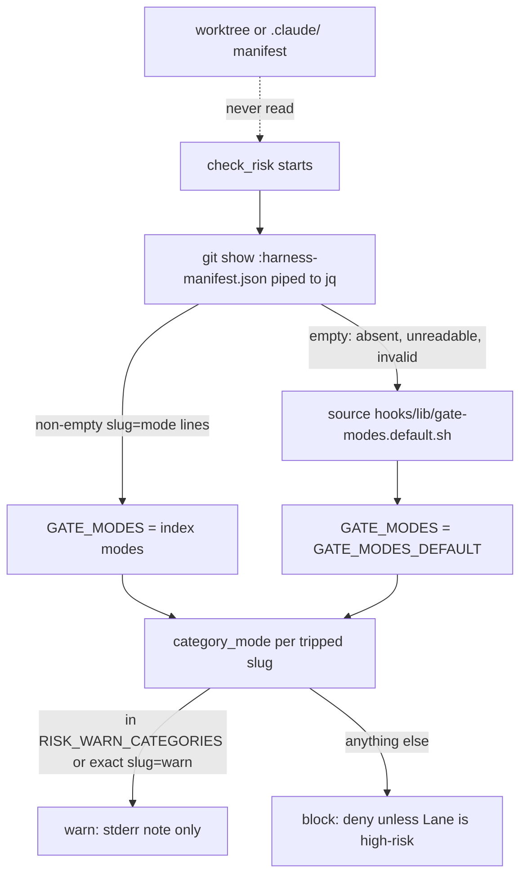
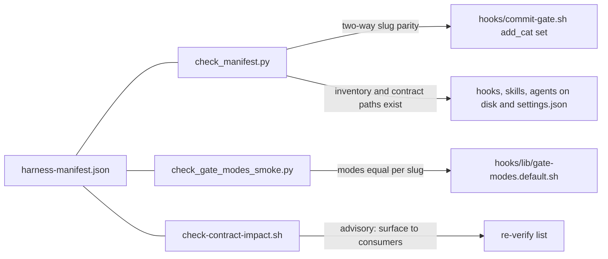

# Harness Manifest and Contract Surfaces

[`harness-manifest.json`](../../harness-manifest.json) is the harness's single source of truth for four things:

1. the **hard-gate vocabulary**: the slug names, the per-gate `block`/`warn` mode, and a description of each gate,
2. the **component inventory**: hooks, skills, agents, hook profiles, and agent bindings,
3. the **contract map**: each contract's surface files and the consumer files that depend on them,
4. free-form **notes** that record policy trade-offs.

Its `__doc__` says to edit the vocabulary here. The copies in `skills/feature-intake`, `rules/auto-correct-scope.md`, and `hooks/commit-gate.sh` must not diverge. The file is JSON, not YAML, so the checkers need only the Python standard library.

The manifest is mostly read by CI checkers and deploy scripts. One runtime consumer matters most: the commit gate reads each hard gate's mode when a commit happens. Because of that read, the rules for *where* the gate may read policy from are security-critical. For more on how lanes and hard gates fit together, see [Lanes, Risk, and Hard Gates](lanes-risk-and-hard-gates.md) and [Commit Gate](../enforcement/commit-gate.md).

## What the manifest contains

| Section | Contents | Main readers |
|---|---|---|
| `hard_gates.detectable` | 9 diff-scannable gates, each with `slug`, `mode` (`block`/`warn`), and `desc` | `hooks/commit-gate.sh` (runtime modes), `check_manifest.py` (slug parity), `check_gate_modes_smoke.py` (mode pinning) |
| `hard_gates.judgment` | Rule-4 STOP items that no regex can detect: `remove-functionality`, `session-scope`, `replace-service` | People and agents (feature intake, auto-correct scope rules) |
| `contracts` | `slug -> {surface[], consumers[], desc}` blast-radius map | `check-contract-impact.sh`, validated by `check_manifest.py` |
| `notes` | Recorded policy trade-offs, such as why a dependency-manifest edit trips `external-provider` even though Rule 3 allows adding a dependency | People |
| `hooks`, `skills`, `agents` | Inventory of hooks with a `wired` flag, skill names, and agent role names | `check_manifest.py` |
| `hook_profiles` | `default` (currently `standard`) plus the `minimal`/`standard`/`strict` hook lists | `check_manifest.py`, `scripts/deploy-harness.sh` |
| `agent_bindings` | Paths to the neutral contract, runtime binding, and renderer files, plus the runtime list (`claude`, `codex`) | `check_manifest.py` |

Today 7 detectable gates block: `auth`, `authorization`, `data-loss/migration`, `audit/security`, `external-provider`, `public-contract`, and `high-blast`. 2 gates warn: `weakening-validation` and `workflow-engine`. Both were moved to warn mode on 2026-07-23 because measurements showed they were noisy. `workflow-engine` fired on 85% of recent commits, and `weakening-validation` had a precision of 0. Moving a gate to warn changes **enforcement only**. Intake still classifies those changes as high-risk ([gate-mode-as-data-decisions.md](../../docs/solutions/harness/gate-mode-as-data-decisions.md), Decision 3).

### Current inventory, profiles, and model configuration

The inventory currently lists four hooks, all with `wired: true`: `commit-gate.sh`, `branch-isolation-guard.sh`, `session-knowledge.sh`, and `model-config.sh`. `model-config.sh` is a SessionStart hook. It applies the user's `harness-models.json` to the deployed agent and skill frontmatter and never blocks (see [Model and Effort Config](../operations/model-and-effort-config.md)). The `default` profile is `standard`. `minimal` contains only `branch-isolation-guard.sh` and `commit-gate.sh`. `standard` and `strict` both contain all four hooks, so a default deploy wires `model-config.sh` and a `minimal` deploy drops it.

The `skills` list has 16 entries. It includes `harness-models`, the skill that pairs with the model-config hook. The `agents` list has the four roles `coding`, `reviewer`, `task-reviewer`, and `test-runner`.

`harness-models.json` is **not** part of the manifest, and no contract lists it. It is a per-project user file with `schema_version` 1 and `agents`/`skills` maps of `model`/`effort` overrides. `scripts/apply_model_config.py` checks it against a defaults snapshot, not against the manifest. `scripts/render_agent_definitions.py --defaults-out` builds that snapshot from the Claude runtime bindings in `agents/runtime-bindings.json` and from the `model`/`effort` frontmatter in `skills/*/SKILL.md`. An unknown role or skill name is rejected. The manifest still constrains model policy in one indirect way: `check_manifest.py` rejects any `model`, `effort`, `tools`, or `memory` field in an `agents/<role>.md` source frontmatter. That keeps runtime model policy in the bindings and the user file. `deploy-harness.sh` validates the target's `harness-models.json` before it writes anything under `.claude/`. It then copies the snapshot to `.claude/harness-models.defaults.json` and applies the overrides.

The manifest also records itself as a contract. `hard-gate-vocabulary` has the surface `harness-manifest.json` and the consumers `hooks/commit-gate.sh`, `rules/auto-correct-scope.md`, and `skills/feature-intake/SKILL.md`.

## Gate mode is data, not code

Gate modes used to live in a `case` statement inside the hook. `check_manifest.py` parsed that statement with a regex to compare it with the manifest. The design was then reversed. The manifest `mode` field is now the runtime input, and the regex bridge was removed ([gate-mode-as-data-decisions.md](../../docs/solutions/harness/gate-mode-as-data-decisions.md), Decision 1). As a result, a durable loosening is a one-field JSON edit.

Only the **detector set** is still mirrored in hook code: the `add_cat "<slug>"` calls in `check_risk`. `check_manifest.py` keeps that set in two-way parity with the manifest.

There are two ways to loosen a gate:

- **Durable:** set the slug's `mode` to `warn` in the manifest. The edit must be staged, so the change is auditable in the same commit.
- **Session-scoped:** set `RISK_WARN_CATEGORIES` (comma- or space-separated) in the hook process's own environment, usually `.claude/settings.local.json -> env`. It can only loosen a gate from block to warn. An inline `VAR=x git commit` prefix never reaches a PreToolUse hook, because the hook runs before the command ([commit-gate.sh](../../hooks/commit-gate.sh) `category_mode`).

## The index-safe policy read rule

At commit time, `check_risk` in `hooks/commit-gate.sh` resolves gate modes from **exactly two index-safe sources**, in this order:

1. `git show :harness-manifest.json`, which is the **git index** copy. `jq` turns it into `slug=mode` lines, with a missing `mode` treated as `block`.
2. If that result is empty (the manifest is absent from the index, unreadable, or invalid JSON), the hook sources `hooks/lib/gate-modes.default.sh` and uses `$GATE_MODES_DEFAULT`.

The hook **never** reads the worktree `harness-manifest.json` or `.claude/harness-manifest.json`.

`category_mode` then returns `warn` only for a slug listed in `RISK_WARN_CATEGORIES` or one with an exact `slug=warn` line. Every other case returns `block`. That includes an unknown slug, a missing mode in a present index manifest, and a missing defaults file, which leaves the mode list empty.


*How the commit gate resolves per-gate modes. Only the index copy or the embedded defaults are trusted.*

### Why never the worktree or `.claude/` (policy TOCTOU)

Every other input to the commit gate comes from the index: the staged paths from `git diff --cached`, the staged diff content, and the `Lane:` value from `git show :<SUMMARY>`. Before commit `880eb15`, the policy was read from the **worktree** file. An agent could leave a `"mode": "warn"` edit unstaged, stage a gated change with `Lane: normal`, and get the commit through. The committed tree still contained block-mode policy. In other words, the artifact being committed and the policy judging it came from two different trees. That is a policy TOCTOU (time-of-check to time-of-use) flaw, rated **critical**. An external review found it after local reviews had passed. The fix reads the index and fails closed ([gate-config-must-read-index.md](../../docs/solutions/harness/gate-config-must-read-index.md); [gate-mode-as-data-decisions.md](../../docs/solutions/harness/gate-mode-as-data-decisions.md), Decision 4). The general rule: a commit-time gate must read **every** policy input from the same tree as the signals it judges. One worktree-side `jq <file>` read is enough to create a bypass.

The same reasoning rules out shipping the manifest to consumer repos as `.claude/harness-manifest.json`, an option called the "B-hybrid" in the decision record. `.claude/` is gitignored in consumer repos. Its files can never be staged, so the index check cannot protect them. Any agent could edit them to loosen the gate for the very tree being committed. Calling a file "harness-owned" or "derived" does not prevent writes. The accepted design, "B3", keeps the consumer policy in hook **code**. Hook code is a high-blast path, so any edit to it is itself gated ([consumer-risk-modes-index-safe.md](../../docs/solutions/harness/consumer-risk-modes-index-safe.md)). A consumer that wants its own policy must track a root `harness-manifest.json` in the index. It must never add a `.claude/` read.

### Embedded defaults and the consumer fallback

Consumer repos usually do not track the manifest, because deploy ships hooks, not the manifest. Under the older fail-safe, a missing manifest meant **block-all**, and consumers had no way past it. B3 replaced that with [`hooks/lib/gate-modes.default.sh`](../../hooks/lib/gate-modes.default.sh). The file holds one `slug=mode` line per detectable gate, copied by hand from the manifest, which gives 2-warn/7-block parity. These values are constants inside the harness's own trust boundary, so an unstaged edit cannot change them.

Tests in [`tests/hooks/commit-gate-risk.test.sh`](../../tests/hooks/commit-gate-risk.test.sh) pin this behavior:

- With no index manifest, the embedded defaults block `data-loss/migration`.
- A `.claude/harness-manifest.json` that sets every gate to warn does **not** loosen `auth`. This is the SC-8 bypass guard.
- A staged index manifest with `auth=warn` does loosen `auth`.
- A malformed staged manifest still produces a block.

## Parity checkers


*Which checker keeps which copy of the manifest's facts in parity.*

### `scripts/check_manifest.py`: inventory and gate-enforcer drift (blocking in CI)

[`check_manifest.py`](../../scripts/check_manifest.py) prints one `manifest: <kind> drift: ...` line per problem and exits 1 if any drift exists. It checks:

- **Inventory against disk**, in both directions. Every manifest hook must exist as `hooks/*.sh`, and every hook on disk must be listed. Skills must match `skills/*/SKILL.md`. Agents must match `agents/*.md`, excluding `README` and `PROJECT*`. Each hook's `wired` flag must match whether `settings.json` registers it.
- **`hook_profiles`.** The keys must be exactly `default`, `minimal`, `standard`, and `strict`. `default` must name a real profile, and every listed hook must be in the inventory. `deploy-harness.sh` reads these profiles to decide which hooks it keeps in a consumer's derived `settings.json`.
- **`agent_bindings`.** The runtimes must be exactly `claude` and `codex`. Contract roles must equal the manifest agents. Every runtime must bind every role with the full `required_capabilities` set. Agent source frontmatter must not keep runtime policy fields (`model`, `effort`, `tools`, `memory`), and the renderer path must exist.
- **Detectable gates against the `commit-gate.sh` `add_cat` set**, in both directions. Every manifest gate needs a detector, and every detector needs a manifest gate. It does **not** compare modes, because the hook reads modes at runtime.
- **Contracts.** Every entry must be an object with non-empty `surface` and `consumers` lists of strings, and every path must exist on disk. A renamed or deleted consumer therefore fails CI until the map is updated.

The script runs in `scripts/run-tests.sh` under "L1: manifest consistency". `scripts/harness-audit.sh` also runs it and reports a `manifest_degraded` finding if it fails.

### `scripts/check_gate_modes_smoke.py`: mode pinning and default drift (blocking in CI)

[`check_gate_modes_smoke.py`](../../scripts/check_gate_modes_smoke.py) has two jobs:

- **Pin the recorded decision.** Exactly `{workflow-engine, weakening-validation}` are warn. It fails if a slug is quietly made strict again, if a new gate ships as warn, or if a mode is something other than `block` or `warn`.
- **SC-9: compare the embedded defaults with the manifest.** It sources `gate-modes.default.sh` with `bash` to get the same value the hook gets, rather than parsing the file with a regex. It then requires `manifest[slug] == default[slug]` across the union of slugs.

Copying modes into the defaults file is a manual step. Change the manifest first, then update the defaults file, and CI enforces that they match. The checker runs right after `check_manifest.py` in `run-tests.sh`.

### `scripts/check-contract-impact.sh`: blast-radius reminder (advisory)

[`check-contract-impact.sh`](../../scripts/check-contract-impact.sh) takes either explicit files or `--changed`. With `--changed`, it uses `git diff --name-only HEAD` plus untracked files that are not ignored. For each changed file listed in a contract's `surface`, it prints:

```
contract <slug>: surface <file> → verify consumers: <consumers...>
```

Matching is exact on the repo-relative path. Changing a consumer file does not trigger anything. The script **always exits 0**: when the manifest is missing, when no files changed, and when the JSON is invalid. `harness-audit.sh` runs it with `--changed` and counts the output lines as `CONTRACT_IMPACT`. That count is a reminder, never drift. This is the "Q3 blast-radius" consumer named in the `contracts.__doc__`. Unlike the commit gate, this tool reads the **worktree** manifest. That is acceptable because it gives advice and makes no allow/deny decision. Tests: [`tests/scripts/check-contract-impact.test.sh`](../../tests/scripts/check-contract-impact.test.sh).

## Changing the manifest safely

- **Add a detectable gate:** add the manifest entry, add an `add_cat "<slug>"` detector in `check_risk`, and add a `slug=mode` line to `gate-modes.default.sh`. If the gate is warn, also update `EXPECTED_WARN` in the smoke check. Then update the copies in `rules/auto-correct-scope.md` and `skills/feature-intake/SKILL.md` (the `hard-gate-vocabulary` consumers).
- **Loosen or tighten a gate durably:** edit the manifest `mode`, update the default file to match, and update `EXPECTED_WARN`. The smoke check deliberately fails until all three agree.
- **Add a contract:** list real paths only. `check_manifest.py` rejects missing paths and empty lists.
- **Add a hook, skill, or agent:** register it in the manifest in the same change, or `check_manifest.py` reports inventory drift. Hook additions also trip the `high-blast` gate.
- **Never** add a commit-time policy read from the worktree or `.claude/`.

CI wiring and the doc-truth lints are covered in [CI Gates and Doc Truth](../enforcement/ci-gates-and-doc-truth.md).
