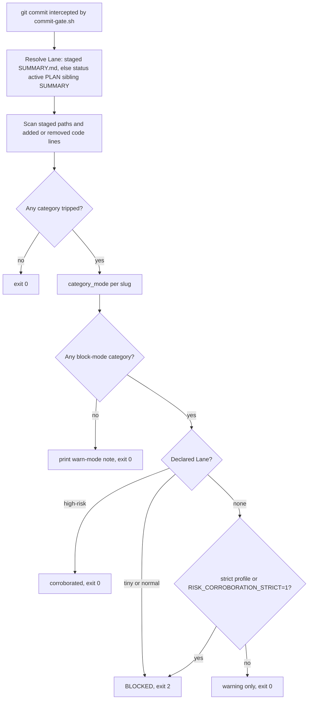
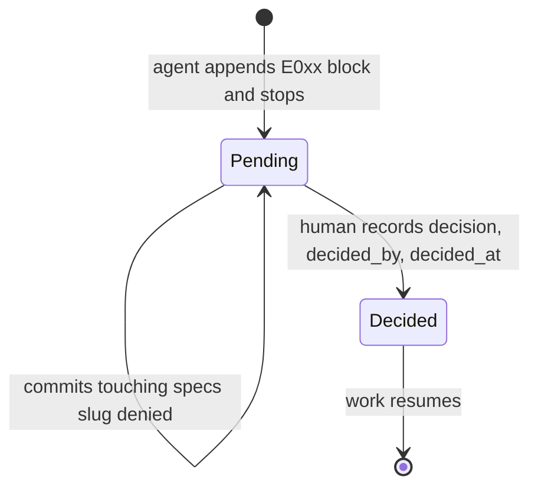

# Lanes, Risk, Confidence, and Hard Gates

The harness classifies every change request on **two independent axes** before it plans or edits anything:

| Axis | Field in `specs/<slug>/SUMMARY.md` | Drives | Values |
|---|---|---|---|
| Risk | `Lane:` | **Ceremony**: how much planning, review, and proof the work needs | `tiny`, `normal`, `high-risk` |
| Ambiguity | `Confidence:` (plus `Escalate:`) | **Interruption**: whether a human must be asked | `high`, `medium`, `low` |

The core principle is stated in both [`rules/orchestration.md`](../../rules/orchestration.md) and [`rules/auto-correct-scope.md`](../../rules/auto-correct-scope.md): **ceremony scales with risk; the human gate scales with ambiguity.** Agents must never ask a human to classify risk. They ask a human only to confirm intent (ambiguity) or to authorize a dangerous boundary (a hard gate).

The vocabulary of "dangerous boundaries" (the hard gates) lives in one machine-readable place, [`harness-manifest.json`](../../harness-manifest.json). The commit hook enforces it, so a lane is not just a note in a file.

## Where classification happens

The `feature-intake` skill ([`skills/feature-intake/SKILL.md`](../../skills/feature-intake/SKILL.md)) is the first gate for any change. Its own `<HARD-GATE>` forbids editing, scaffolding, or dispatching implementation until intake has recorded `Lane:` and `Confidence:` in `specs/<slug>/SUMMARY.md`. The procedure:

1. Read the manifest's hard gates, `rules/orchestration.md`, and `rules/auto-correct-scope.md`. If an approved `specs/<slug>/intent.md` exists, classify from it (with pin and re-pin handling in `references/draft-intent.md` / `references/re-pin.md`).
2. Determine the **input type** (new spec, spec slice, change request, initiative, maintenance, harness improvement, bug fix) and mark **risk flags**: auth, authorization, data model, audit/security, external systems, public contracts, cross-platform, existing behavior, weak proof, multi-domain.
3. **Assign the lane** (Step 3, the canonical classification algorithm):
   - Any manifest hard gate → `high-risk`.
   - Otherwise 0–1 flags → `tiny`, but only for one-file work that adds no new public callable (else `normal`).
   - 2–3 flags → `normal`.
   - 4+ flags → `high-risk`.
   - A human may lower a hard-gated lane **only by narrowing scope**, never by re-labelling it.
4. **Assign confidence** (Step 4): `high` = one clear interpretation; `medium` = a safe, documented default exists; `low` = materially different plausible readings (including chat that conflicts with `intent.md`).
5. Write the intake block (`Lane`, `Confidence`, `Reason`, `Flags`, `Affects`, `Input-type`, `Route`, `Escalate`) into SUMMARY, and run `verify_summary.py --lane <slug>` before handoff.

Both [`rules/orchestration.md`](../../rules/orchestration.md) and [`rules/auto-correct-scope.md`](../../rules/auto-correct-scope.md) explicitly defer to that Step 3–4 as the single source of the algorithm. They only name the fields and describe their consumers.

### Canary cases

[`skills/feature-intake/tests/lane-classification-cases.md`](../../skills/feature-intake/tests/lane-classification-cases.md) and [`confidence-escalation-cases.md`](../../skills/feature-intake/tests/confidence-escalation-cases.md) are prompt-level canaries that pin this behavior:

- Hard-gate prompts (JWT refresh validation, an admin role check, dropping a table, logging auth headers, removing `required=True`, editing `settings.json` or `hooks/commit-gate.sh`) must come back `high-risk` whatever their flag count. A lower lane is a "gate leak".
- An additive, backward-compatible response field trips the public-contract *flag* but no hard gate, so it is `normal` (LC-03 boundary case).
- "Change JWT validation on login" is **high confidence and still escalates** (CE-04), because a clear direction does not skip the boundary authorization. "Make the dashboard better" is **low confidence and escalates even if tiny** (CE-02). "Maybe cache it or add an index, your call" is **medium** and proceeds with the assumption recorded (CE-06).

## The three lanes

The lane decides how much autonomy and ceremony apply ([`rules/auto-correct-scope.md`](../../rules/auto-correct-scope.md) → *Lane-aware autonomy*). The Rule 1–4 auto-correction rules stay the same in every lane.

| Lane | Autonomy | Plan | Human confirm | Route (feature-intake) |
|---|---|---|---|---|
| **tiny** | Full auto: direct patch on a fresh branch | none | none. Machine gates (`commit-gate.sh`, `branch-isolation-guard.sh`) are the safety net | branch → patch → quick-check proof |
| **normal** | Auto with proof gates (one task reviewer, two verdicts) | yes | only if confidence is low or the request is ambiguous | `using-git-worktrees` → `subagent-driven-development` |
| **high-risk** | Auto-plan, gated execute | yes (full chain) | only on ambiguity or a hard gate (Rule 4) | `brainstorming` → `xia2` → `writing-plans` → `using-git-worktrees` → `subagent-driven-development` |

Lane-independent invariants:

- **Branch isolation does not scale with ceremony.** Every lane creates a dedicated branch before the first edit (tiny uses `git checkout -b`, the other lanes use a worktree). `hooks/branch-isolation-guard.sh` enforces this.
- **The record is always on.** Every lane, tiny included, writes `SUMMARY.md`. For autonomous work, a skipped human confirmation is earned by **verification** (a re-runnable `### Verify` row plus independent review), not by extra planning documents. Plan-ahead artifacts (`design.md`, `research-brief.md`, `PLAN.md`) are triggered by signals such as step count, file count, unfamiliarity, or high risk. The lane alone does not trigger them. `FULL_ARTIFACTS=1` forces the full set.
- **The lane sets the required evidence.** `scripts/verify_summary.py --lane` mechanizes the mapping: tiny needs filled `Lane`/`Confidence`/`Reason`, normal adds a real `### Verify` row, and high-risk adds `### Rollback` and an (advisory by default) `### Not auto-verified` section. `commit-gate.sh`'s `check_lane_evidence` enforces this on staged SUMMARY files. See [Evidence and Summary Contract](./evidence-and-summary-contract.md).
- **Reversibility is a precondition for autonomy.** Any high-risk or Rule-4 work that proceeds must record exact undo commands under `### Rollback`. An action that cannot be cleanly undone is not eligible for the autonomous path.
- **Rule 4 fires in every lane.** A hard gate discovered mid-task escalates no matter how intake classified the work.

The commit hook also gives a soft size signal per lane. In `check_risk`, a `tiny` lane with more than 150 changed lines, or a `normal` lane with more than 600, prints a "consider running the simplify pass" note. The note never changes the exit code.

## Hard gates: detectable vs judgment

`harness-manifest.json` → `hard_gates` is the single source of truth for the hard-gate vocabulary. It splits gates into two kinds.

### Detectable gates (diff-scannable)

`commit-gate.sh` `check_risk` can find these gates in a staged diff. Each has a `mode`:

| Slug | Mode | What trips it in `check_risk` |
|---|---|---|
| `auth` | block | added code containing login/logout/`session`/jwt/password/refresh_token/oauth/set_cookie/bcrypt/hashpw |
| `authorization` | block | added code containing role/permission/is_admin/require_role/authorize/rbac/tenant_id/company_id/access_control |
| `data-loss/migration` | block | a `migrations/` or `alembic/` path, or added `DROP TABLE`/`DELETE FROM`/`TRUNCATE`/`ALTER TABLE`/`op.drop`/`drop_table`/`drop_column` |
| `audit/security` | block | added audit_log/access_log/encrypt/decrypt/pii/sensitive_data |
| `external-provider` | block | dependency manifests (`requirements*.txt`, `package.json`, `pyproject.toml`, `go.mod`, `Gemfile`) or added stripe/twilio/sendgrid/boto3/paypal/webhook |
| `public-contract` | block | added `@app.<verb>` / `@router.<verb>` decorators or `openapi` |
| `weakening-validation` | **warn** | *removed* lines containing `assert `, `validator`, `required=True`, or `raise ` |
| `high-blast` | block | `settings.json`, `hooks/*`, `.claude/hooks/*`, `render_plan.py` |
| `workflow-engine` | **warn** | `skills/*/SKILL.md`, skill prompt files, `agents/*.md`, `rules/*.md` (excluding README and `*.template.md`) |

Scan semantics that matter when you change code near these patterns:

- Keyword categories scan only **added code lines**. Removed lines are scanned only for weakening-validation. Prose and self-referential paths (`*.md`, `docs/`, `specs/`, `skills/`, `hooks/`, `.claude/`) are excluded, and full-line `#` comments are stripped. `tests/` is deliberately *not* excluded, so live auth code in a test still trips the gate.
- Path categories (high-blast, migration, dependency manifests, workflow-engine) look at staged file paths.

### Judgment gates (not regex-detectable)

These are Rule-4 STOP items that only a human or agent can recognize:

- `remove-functionality`: removing existing behavior, even if it seems unused.
- `session-scope`: changing request-scoped ↔ isolated/background session or transaction scope.
- `replace-service`: swapping a service or pattern (cache implementation, shared data-access base).

Rule 4 in [`rules/auto-correct-scope.md`](../../rules/auto-correct-scope.md) lists both halves in prose as changes to **never auto-apply**: schema changes, API contract changes not in the spec, removing functionality, a new external service, auth/authz changes, session/transaction scope changes, high-blast files, and service replacement.

### Known tension: external-provider vs Rule 3

Rule 3 lets an agent auto-add a missing dependency, but any dependency-manifest edit trips `external-provider` (block). The manifest `notes.external_provider_vs_rule3` resolves the conflict: a pure dependency bump either runs in the high-risk lane or is recorded as a Rule-3 deviation in SUMMARY. The gate stays broad on purpose, because over-flagging a dependency change is safer than missing a new SDK integration.

## How block and warn modes are chosen and enforced

*Risk corroboration in `check_risk`: the diff is matched against the declared lane, and only block-mode categories can deny the commit.*

### Mode resolution

`category_mode()` decides each tripped category's mode in this order:

1. **Session loosening**: if the slug is listed in `RISK_WARN_CATEGORIES` (comma or space separated), it is `warn`. The variable must be in the hook's own process environment (for example `.claude/settings.local.json` → `env`). An inline `VAR=x git commit` prefix never reaches a PreToolUse hook.
2. **Manifest authority**: otherwise the hook reads `hard_gates.detectable[].mode` from the **git index copy** of `harness-manifest.json` (`git show :harness-manifest.json`). A missing `mode` is treated as `block`.
3. **Embedded defaults**: if the index has no readable manifest (for example in a consumer repo that does not track it), the hook sources `hooks/lib/gate-modes.default.sh`, which carries the same 7-block / 2-warn parity.
4. **Fail safe**: anything that is not an explicit `slug=warn` line blocks.

Invariant: the mode policy comes **only** from the index or from the embedded defaults. The hook never reads a worktree file or `.claude/harness-manifest.json`, so an unstaged `"mode": "warn"` edit cannot loosen a gate for a commit whose tree still ships block mode. `tests/hooks/commit-gate-risk.test.sh` asserts this (SC-8: an all-warn `.claude/` manifest does not loosen auth). The same test file also covers the embedded-default path (SC-7), strict mode, `RISK_WARN_CATEGORIES`, regex precision, and the active-plan lane fallback.

### Why two gates are warn-mode

Modes are set from measured precision, not from intuition. The manifest descriptions record the reasons:

- `weakening-validation` became warn on 2026-07-23. It fired once in the last 40 commits, and that firing was a refactor (precision 0).
- `workflow-engine` became warn on the same date. It fired on 34 of 40 recent commits (85%), because in this meta-repo the workflow files *are* the product, so blocking carried almost no information.

In both cases **intake still classifies the change as high-risk**. Warn mode only stops the commit hook from denying the commit. It does not lower the lane.

The hook's comments give the loosening procedure: for a durable change, edit the category's `mode` in the manifest (never edit the hook). Loosen one category at a time. Never loosen `auth` or `external-provider` first. Revert on any incident.

### Drift guards

- `scripts/check_manifest.py` (check B) fails CI unless the manifest's detectable slugs exactly equal the `add_cat` set in `hooks/commit-gate.sh`, in both directions. Modes are not mirrored. The hook reads them at runtime.
- `scripts/check_gate_modes_smoke.py` asserts that `hooks/lib/gate-modes.default.sh` matches the manifest's modes.
- The manifest `contracts.hard-gate-vocabulary` entry lists `hooks/commit-gate.sh`, `rules/auto-correct-scope.md`, and `skills/feature-intake/SKILL.md` as consumers of the vocabulary for blast-radius checks. See [Harness Manifest and Contracts](./harness-manifest-and-contracts.md).

### Lane resolution for corroboration

`hooks/lib/lane.sh` resolves the lane being corroborated:

1. a `SUMMARY.md` staged in this commit, read from the index;
2. otherwise the sibling `SUMMARY.md` of the one `specs/*/PLAN.md` carrying `status: active`.

There is deliberately no "most recently modified" fallback, because a stale spec would misattribute its lane to unrelated work. A missing lane only **warns** (fail-open) unless the `strict` profile or `RISK_CORROBORATION_STRICT=1` is in effect. See [Commit Gate](../enforcement/commit-gate.md) for the full check order and profiles.

## Confidence-driven escalation (`ESCALATIONS.md`)

The escalation decision runs at intake and continuously during execution ([`rules/orchestration.md`](../../rules/orchestration.md) → *Escalation decision*). The agent **escalates**, writing a block to `specs/<slug>/ESCALATIONS.md` and stopping, when any of these hold:

- a **hard gate** is hit and a human has not yet narrowed it;
- **confidence is `low`** in any lane, or `medium` on a high-risk task;
- the **direction is ambiguous** (more than one materially different interpretation);
- an **in-flight trigger** fires: the same `Verify` check fails twice or more after a fix, a subagent touches files outside its task's declared Files set, a hard gate is discovered mid-implementation, a Rule 1–3 deviation recurs across tasks, or a subagent reports BLOCKED because "the plan itself is wrong";
- the change would **redefine the system** (architecture direction, validation requirements, source-of-truth hierarchy, risk-classification rules, or the workflow itself).

Otherwise the agent **proceeds autonomously**. For high-confidence normal-lane work this means **notify-and-proceed**: post the `PLAN.md` and a short notice. The human may interrupt but is not a gate. Per-task agent reviews stay on in every lane.

### The escalation record

[`templates/ESCALATIONS.template.md`](../../templates/ESCALATIONS.template.md) defines one `E0xx` block per escalation with these fields: `raised_by`, `date`, `trigger` (`hard-gate | low-confidence | ambiguous-direction | in-flight | system-redefinition`), `question`, `context`, `options`, `default_if_no_response: BLOCK`, `decision: pending`, `decided_by`, and `decided_at`. The agent appends the block and stops. A human records the decision.

The channel is **deny-on-no-response**, and the hook enforces it. `commit-gate.sh` `check_escalations` (standard and strict profiles) denies with exit 2 any commit that touches `specs/<slug>/` while that slug's `ESCALATIONS.md` contains `decision: pending`. The check prefers the staged copy, so a commit that records the decision unblocks itself.

*Lifecycle of an escalation block under deny-on-no-response.*

## Changing this system safely

- **Add or rename a detectable gate**: edit `harness-manifest.json`, add the matching `add_cat` detector in `hooks/commit-gate.sh`, update `hooks/lib/gate-modes.default.sh`, and keep the Rule 4 prose in `rules/auto-correct-scope.md` aligned. `check_manifest.py` and `check_gate_modes_smoke.py` catch drift in the first three.
- **Change a gate's mode**: edit only the manifest `mode` (and mirror it in the embedded defaults). Record the precision data that justifies the change in the `desc`.
- **Change the lane algorithm**: edit `skills/feature-intake/SKILL.md` Step 3–4 and the canary tables. The rules only reference it.
- **Change lane evidence requirements**: edit `scripts/verify_summary.py`, the mechanized source (contract `lane-evidence-mapping`). Do not edit only the prose.

Related: [Skill Chain](../workflows/skill-chain.md) for the routes each lane takes.
