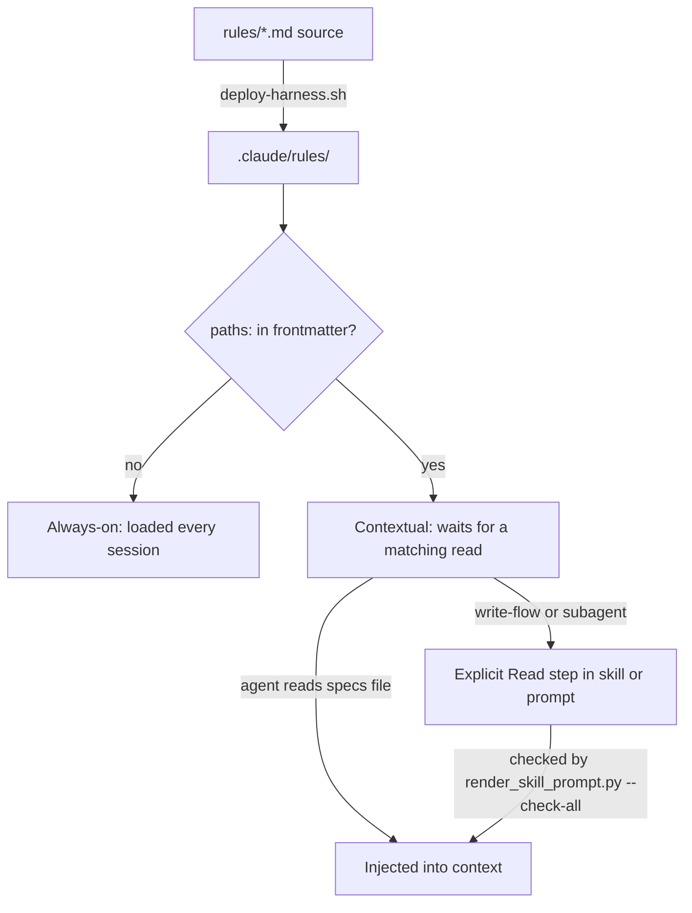

# Rules, Loading Tiers, and Terminology

`rules/*.md` is the harness's policy layer: short prose files that tell every agent how to behave, how to write plans, how to run waves, and how reviewers label findings. The root `rules/` directory is the source of truth. `scripts/deploy-harness.sh` copies it into `.claude/rules/`, which is where Claude Code loads it from. This page covers:

- the two loading tiers and why changing a file's tier is a behavior change,
- the role of each rule file,
- how the controlled-language (STE) terminology policy is enforced, and where it is deliberately *not* enforced.

For lanes, risk classification and hard gates, see [Lanes, Risk, and Hard Gates](lanes-risk-and-hard-gates.md). For how plans are produced, see [Planning](../workflows/planning.md). For the suites that guard these files, see [Test Suite](../testing/test-suite.md).

## Two loading tiers, decided by the file itself

A rule's tier comes from its own frontmatter. No central config sets it.

| Tier | Selector | Files today | When it reaches the model |
|---|---|---|---|
| **Always-on** | no `paths:` frontmatter | `architecture.md`, `behavior.md`, `guidelines.md`, `orchestration.md`, `research-depth.md` | auto-loaded in every session |
| **Contextual (path-scoped)** | `paths:` list in frontmatter | `auto-correct-scope.md`, `plan-format.md`, `review-policy.md`, `terminology.md`, `wave-parallelism.md` | injected when a matching file is **read**, or through an explicit Read step in a consuming skill |

The contextual files and their `paths:` globs:

| Rule | `paths:` |
|---|---|
| `auto-correct-scope.md` | `specs/**` |
| `plan-format.md` | `specs/**/PLAN.md` |
| `wave-parallelism.md` | `specs/**/PLAN.md` |
| `review-policy.md` | `specs/*/SUMMARY.md` |
| `terminology.md` | `specs/**/PLAN.md`, `specs/**/research-brief.md`, `specs/**/SUMMARY.md` |

`CLAUDE.md` states the invariant directly. Adding `paths:` to a rule that lacks it **removes** that rule from the always-on set. That is a behavior change, not a formatting fix. Removing `paths:` does the reverse: the rule then costs context in every session. The `CHANGELOG.md` entry for PR #141 records the original move of `plan-format`, `wave-parallelism` and `auto-correct-scope` to path scoping. It cut about 55% of the always-on rule payload.

### Delivery caveat: `paths:` fires on read, not on write

`paths:` injection fires only when a matching file is *read*. A skill that *writes* a `PLAN.md` never receives `plan-format.md` or `terminology.md` from the frontmatter. `rules/terminology.md` §Delivery records this as verified empirically (v2.1.216), and the PR #141 changelog entry repeats it. So a write-flow or an isolated subagent that needs a contextual rule has to carry an **explicit Read step** or a rule path in its dispatch prompt. For example, `wave-parallelism.md` and `plan-format.md` both say that `subagent-driven-development` and `writing-plans` load them through explicit Read steps.

`scripts/render_skill_prompt.py --check-all` checks this delivery mechanically. Its `CONTEXT_MATRIX` maps each prompt context to the rule files its source must mention (`required`). Some contexts must also contain a literal ``Read ... `rules/<file>.md` `` instruction (`required_reads`). Examples:

- `main.plan-author` (`skills/writing-plans/SKILL.md`) and `plan-document-reviewer` must mention `plan-format.md` and `terminology.md`, and must Read `terminology.md`.
- `main.plan-executor` must mention `plan-format.md`, `wave-parallelism.md` and `auto-correct-scope.md`.
- `task-reviewer`, `correctness-reviewer` and `intent-reviewer` must Read `review-policy.md`.
- `implementer`, `correctness-controller` and `intent-controller` must mention `auto-correct-scope.md`.
- A context with no required rule needs a written `rationale`. Example: `correctness-scorer`.

A missing token prints `prompt-compose: missing required policy delivery` or `missing required policy Read`, and the command exits 1. `tests/scripts/context-propagation-regression.test.sh` runs this check.



*How a rule file reaches an agent. The tier depends on the `paths:` frontmatter, and write-flows need an explicit Read.*

### The tier inventory test

`tests/scripts/rule-loading-tiers.test.sh` sorts `rules/*.md` into tiers with the same selector the runtime uses. It looks for a `paths:` line inside a leading `---` frontmatter block. It then asserts three things:

1. The always-on list is exactly `architecture.md behavior.md guidelines.md orchestration.md research-depth.md`.
2. The contextual list is exactly `auto-correct-scope.md plan-format.md review-policy.md terminology.md wave-parallelism.md`.
3. `CLAUDE.md` still contains the phrases `five always-on files` and `five path-scoped ones`.

A new rule file, or any tier change, therefore fails this test until the test inventory and `CLAUDE.md` are updated together. This is intentional: the change has to be made on purpose.

## Governance of rule files

Several mechanisms treat a rule change as a workflow-engine change, not as ordinary docs:

- **Review receipt.** `scripts/check_review_receipt.py` counts `rules/*.md` as a workflow-engine surface, together with `skills/*/SKILL.md`, dispatch prompts and `agents/*.md`. A diff that touches one needs a passing `context-propagation-audit` before push. The regex is a byte-identical copy of the `workflow-engine` signal in `hooks/commit-gate.sh`. `tests/scripts/workflow-engine-regex-parity.test.sh` keeps the two copies in sync.
- **No re-run proof tier.** `scripts/ci-strict-gate.sh` deliberately does not add `rules/` to its proof tier. The reason given there: rules are prose, so no command re-run proves a sentence correct, and the workflow-engine gate already covers them.
- **Path truth.** `scripts/lint-doc-truth.sh` lints `rules/*.md` alongside `CLAUDE.md` and `agents/*.md` for dangling repository paths, because agents load these files directly.
- **Consumer-owned files.** `deploy-harness.sh` lists `rules/architecture.md`, `rules/guidelines.md` and `rules/behavior.md` as bootstrap-owned. A re-sync into a consuming project never silently overwrites the project's local copies. `architecture.md` and `guidelines.md` are only pointers to the project-owned `techstacks/` folder.

## What each rule governs

### Always-on

- **`behavior.md`** is the behavioral source of truth for all agents. It keeps only rules a capable model does not apply on its own. §1 is `not_observed != absent`: an absence claim must cite the searched paths, and reviewers score findings against this rule. The other sections cover naming ambiguity, confirming a command's interface before relying on it, delivering the full scope asked for, and user-facing text.
- **`orchestration.md`** covers how work is split between the main thread and subagents. It names the intake fields (`Lane`, `Confidence`) and their consumers, the subagent return contract, evidence in `SUMMARY.md` (`### Verify`, `### Rollback`), the artifact policy, and when to escalate to a human.
- **`research-depth.md`** is the canonical research-depth policy. When an intake record exists, `high-risk` maps to **Deep** and `normal` maps to **Standard**. **Quick** is allowed only for a `tiny` lane that meets every Quick condition. Without intake, a portable classifier applies:
  - Deep on migration or data-loss work, high-blast files, new external dependencies, shared config contracts, or auth/session/transaction changes.
  - Quick only for a single-file change with no new shared callable, dependency, API contract, or entry point.
  - Standard otherwise, and whenever a signal is uncertain.

  Depth can move up on evidence but never down. Whether to consult external sources depends on the change's *external surface*, not on depth alone. When there is no external surface, `research-brief.md` must say `- none (local-only; no external surface)` explicitly, because an empty Source Pack looks the same as skipped research.
- **`architecture.md` / `guidelines.md`** are pointers to `techstacks/*.md`. The harness core ships no stack assumptions.

### Contextual

- **`plan-format.md`** defines the `specs/<slug>/PLAN.md` contract. A plan is required when the work has more than 3 steps, touches more than 2 files, takes more than 30 minutes, or spans more than one layer. Each `### Task <id>` section carries `Files / Action / Verify / Done` and an optional `(wave K)` suffix. New plans add a `## Global Constraints` section and per-task `Criteria` / `Interfaces`. Section 3 holds a Success Criteria table (`ID | Behavior | Check | Expected`) whose checks are single, pipe-free commands that finish in under 60 s, with `exit <n>` expectations. Guardrails:
  1. Same-wave tasks have zero file overlap.
  2. Verify commands are automated.
  3. Verify finishes in under 60 s.
  4. Checks follow the layer ladder. The whole suite never goes into a Verify row.

  Code-fenced tasks and tables are illustrations and are ignored. Legacy XML plans stay readable but are never used for new plans. `scripts/check_plan_contract.py` enforces the contract for plans that declare `Global Constraints`.
- **`wave-parallelism.md`** defines how waves run. Same-wave tasks run in parallel, and wave N+1 waits until every wave-N `Verify` exits 0. Each task gets a fresh subagent. All wave-N spawns go in one message, at most 20 calls per message. The collection protocol has to finish before the next wave starts. Its Status Log rule is load-bearing for resume: each entry must name task ids, commit shas and a completion marker, because `render_plan.py` and `runtime/resume_decision.py` derive the done set and the resume cursor from task ids. Shas alone do not work.
- **`auto-correct-scope.md`** lists what an implementer may fix on its own and what needs confirmation. It also holds lane-aware autonomy and branch isolation (see [Lanes, Risk, and Hard Gates](lanes-risk-and-hard-gates.md)).
- **`review-policy.md`** gives task review, correctness review and intent review one shared severity vocabulary. It changes no reviewer's oracle, inputs or blocking rules. An *Important* finding blocks and starts a fix round, or is escalated. A *Nit* is always reported, has no count cap, and never blocks. Each reviewer's native classes map onto the two:
  - task review: `Critical`/`Important` vs `Minor`
  - correctness review: at or above the score threshold vs below it
  - intent review: `gap` or behavior-changing `drift` vs equivalent `drift`. `excess` is report-only.

  Findings are not reported on generated files (`PLAN.html`, `.plan-review.json`, deployed copies, `*.lock`) or on lint issues that wired CI or hooks already catch.
- **`terminology.md`** is the controlled-language policy, described next.

## Terminology: an evidence-labelled STE adaptation

`rules/terminology.md` adapts ASD-STE100 *writing rules* for prose that an agent executes. It deliberately does **not** adopt the STE Dictionary. The allow-list of about 1,700 words would forbid the project's own vocabulary (`worktree`, `lane`, `gate`, `blast radius`). Each section carries its measured evidence, and the file sets a governance rule of its own: **a rule with no measured effect is advisory and must not be turned into a gate.**

| Section | Status | Evidence |
|---|---|---|
| §3 Acceptance criteria must be machine-decidable | **Required** for `PLAN.md` `Verify:`/`Done:`/`Action:` and `SUMMARY.md` `### Verify` rows | With `is it correct?` as the criterion, reviewers accepted a defective artifact in 7 of 8 runs. With the observable stated, 8 of 8 rejected it (`p = 0.0014`). |
| §2 Modality (`must` / `should`) | Advisory | Neither word reliably forces a step. A truly mandatory step belongs in a gate, not in a word. |
| §1 One concept, one word | Advisory only. "Do not build a linter on it." | Mixed and uniform verbs both scored perfectly. |

§3 bans undecidable words in acceptance fields (`correctly`, `properly`, `as expected`, `works`, `is correct`, `looks right`, `appropriate`, `reasonable`). The field must state an observable instead: an exact string, count, exit code, or ordering. §1 still names the preferred word pairs for readability:

- `verify` (produce proof) vs `check` (read state)
- `block` (a hook denies) vs `stop` (an agent halts itself)
- `write` (a file) vs `create` (a branch or worktree)
- `subagent`, never `sub-agent`

It also insists that a *run* (one workflow pass from intake to merge) and a *session* (one Claude Code process) are different concepts.

**Hard exclusions** are hardcoded and never exposed as configuration:

1. `SUMMARY.md` `### Intent` and `specs/<slug>/intent.md` are never rewritten by any rule. They are the verbatim oracle for `intent-review`, the reviewer that never sees `PLAN.md`.
2. §3 does not apply to `design.md` or `research-brief.md`. Hedging is the content there, as `behavior.md` §1 requires.
3. `paths:` loading the rule on a read gives no licence to reopen a closed spec and rewrite it to conform.

## STE enforcement tooling

STE enforcement is layered and almost entirely **advisory**. This follows the rule that an unmeasured rule must not block.

### `asd-ste100` skill and `ste-lint.py`

`skills/asd-ste100/SKILL.md` is a rewrite skill for English that a machine or agent must parse without a human to resolve ambiguity. It has two modes:

- **Strict**: procedures, error messages, tool descriptions, inter-agent instructions.
- **STE-flavored**: READMEs, PRs, explanatory prose.

It splits STE into *structural* rules, which it applies fully: active voice, no phrasal verbs, no semicolons, sentence length caps, noun clusters of 3 words or fewer, and keeping modality. *Lexical* rules are only a direction of travel, because ASD's dictionary is not redistributable. Two invariants: a rewrite never upgrades a hedge to a fact, and it never silently drops a scope qualifier.

`skills/asd-ste100/scripts/ste-lint.py` is the deterministic, stdlib-only linter. It reports a `hard_count`. Advisory findings such as passive voice and compound tenses never fail a run. It accepts `--baseline N` and `--disable rule,...`, and by design it never flags hedges. `scripts/run-tests.sh` runs `ste-lint.py --selftest` as a suite-failing step.

### `check_ste_baseline.py`: per-file ratchet, warn-only

`scripts/check_ste_baseline.py` lints every `skills/*/*.md`, `skills/*/*/*.md`, `rules/*.md` and `agents/*.md` with `ste-lint.py --json`. It compares each file's `hard_count` with `scripts/ste-baseline.json`, a map from file path to an allowed count. A file missing from the baseline counts as 0. Output lines:

- `WARN <file>: hard <n> > baseline <b>`: the file got worse.
- `WARN <file>: in baseline, file is gone`.
- `NOTE <file>: hard <n> < baseline <b>`: the file improved. Lower the entry with `--update`.
- `ste-baseline: skipped (<reason>)`: the linter, git, or the baseline file did not produce usable data.

Modes:

- The default run **always exits 0**. `run-tests.sh` calls it this way, so it never blocks a build or commit.
- `--strict` exits 1 on any WARN or skip. Only specific SC rows, task Done checks and tests use it.
- `--update` rewrites the baseline from the current tree.
- `--against <ref>` reads the baseline from a git ref (`git show <ref>:scripts/ste-baseline.json`). It cannot be combined with `--update`, and an empty ref is rejected.

`synonym-rotation` is disabled in both counting and `--update`. The reason: test H3 measured no effect for the one-word rule, and a rule with a measured null must not block. This is §1's "advisory only" status turned into code. All `rules/*.md` files currently have a baseline of 0, except `orchestration.md`, which has 1.

### `check_scope_qualifiers.py`: dropped-condition detector

An STE rewrite can shorten a sentence by dropping its condition. `scripts/check_scope_qualifiers.py --base <ref> --head <ref>` catches the simplest form of that. It reads `git diff -U0` for changed `.md` files under `skills/`, `rules/` and `agents/`. For each hunk and each condition word (`if`, `unless`, `only`, `when`, `never`, `except`, `for a new`, `without`; whole-word and case-insensitive), it prints one line when a removed line contains the word and no added line in the same hunk does:

```
- <file>:<old start>: dropped "<word>": <removed line, trimmed to 120 chars>
```

It prints `- none` when prose changed and nothing was flagged, prints nothing when no prose file changed, and prints `scope-qualifiers: unavailable (...)` when git fails. It **always exits 0**. Its stated limits: it does not check meaning, does not compare across hunks, and misses a split that moves sentences out of a condition's scope while keeping the word. It pins git config (`core.quotepath`, `color.ui`, `diff.relative`, inter-hunk context, prefixes) so a user's settings cannot change how hunks parse.

### Where the tools surface: the review package

`skills/subagent-driven-development/scripts/review_package.py` builds the `BASE..HEAD` review package for the task reviewer. When the range changes prose under `skills/`, `rules/` or `agents/`, it appends two advisory sections:

- `## STE lint`: base vs head `hard_count` per changed file, with `synonym-rotation` disabled.
- `## Scope qualifiers`: the output of `check_scope_qualifiers.py`.

A linter failure, timeout or non-zero exit becomes an `unavailable (...)` line, and the package still gets written. The reviewer sees each possible regression and decides whether it is real. No hook blocks on these signals.

## Changing rules safely

- **Changing a tier** (adding or removing `paths:`) changes when the rule reaches agents. Update `CLAUDE.md` and `tests/scripts/rule-loading-tiers.test.sh` in the same change, and check that every write-flow or subagent that needs the rule has an explicit Read step (`render_skill_prompt.py --check-all`).
- **Adding a rule file** forces the same inventory update, and also needs an entry in `ste-baseline.json` (`check_ste_baseline.py --update`), otherwise its baseline is treated as 0.
- **Editing rule prose** counts as a workflow-engine change. Expect the context-propagation audit and the advisory STE lint / scope-qualifier sections in review. Keep §3 acceptance wording decidable, and leave intent oracles untouched.
- **Turning an advisory rule into a gate** requires a measured effect, per `terminology.md`.
