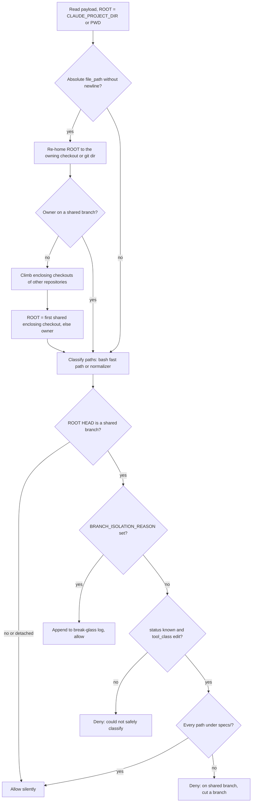

# Branch Isolation and Session Hooks

The harness registers four hook bodies in [`settings.json`](../../settings.json). This page covers three of them:

- **`hooks/branch-isolation-guard.sh`** (`PreToolUse`, matcher `Write|Edit`) stops code edits on a shared branch. Every lane, from tiny to high-risk, has to cut a branch before it starts implementing.
- **`hooks/session-knowledge.sh`** (`SessionStart`, no matcher) puts a short knowledge-base pointer, a summary of active runs, and a cached runtime diagnosis into the session context. It never blocks.
- **`hooks/model-config.sh`** (`SessionStart`, matcher `startup|clear`) applies `harness-models.json` to the deployed agent and skill frontmatter. It never blocks, and it is Claude-only (see below).

The fourth hook, `hooks/commit-gate.sh` on the `Bash` matcher, has its own page: [Commit Gate](commit-gate.md). Both PreToolUse hooks read their payloads through the same normalizer, `hooks/lib/normalize-tool-input.py`, which this page also describes.

## Hook registration

The canonical [`settings.json`](../../settings.json) uses repository-relative commands:

| Event | Matcher | Command |
|---|---|---|
| `PreToolUse` | `Bash` | `hooks/commit-gate.sh` |
| `PreToolUse` | `Write\|Edit` | `hooks/branch-isolation-guard.sh` |
| `SessionStart` | (none) | `hooks/session-knowledge.sh` |
| `SessionStart` | `startup\|clear` | `hooks/model-config.sh` |

Each runtime gets this file in a different form:

- **Claude consumers.** The deployed copy (for example [`.claude/settings.json`](../../.claude/settings.json)) rewrites commands to `$CLAUDE_PROJECT_DIR/.claude/hooks/<hook>`. Commit-gate also gets a `--profile` argument. [`harness-manifest.json`](../../harness-manifest.json) lists all four hooks as wired and defines hook profiles. `minimal` wires only `branch-isolation-guard.sh` and `commit-gate.sh`. `standard` (the default) and `strict` also wire `session-knowledge.sh` and `model-config.sh`. Deployment is covered in [Install, Deploy and Resync](../operations/install-deploy-and-resync.md).
- **Codex plugin.** [`scripts/render_codex_adapter.py`](../../scripts/render_codex_adapter.py) (`expected_codex_hooks`) builds Codex hook registrations from the same `settings.json` (see [Codex Advisory Alpha](../integrations/codex-advisory-alpha.md)):
  - The `Write|Edit` matcher becomes `apply_patch|Edit|Write`, so Codex `apply_patch` edits reach the branch guard. Other matchers, such as `startup|clear`, are copied unchanged.
  - Commands become `bash "$PLUGIN_ROOT/hooks/..."`. A command outside `hooks/` (or an absolute or `..` path) is rejected.
  - `model-config.sh` handlers are skipped, because that hook only rewrites Claude frontmatter. A group left with no handlers is dropped, so the rendered `hooks.json` has no empty groups and no mention of `model-config.sh`. Codex therefore gets only `session-knowledge.sh` at `SessionStart`.
  - `SessionStart` and `UserPromptSubmit` handlers get `additionalContextLimit: 2500`. `SessionEnd` handlers get `timeout: 1`.
  - The renderer knows the events `PreToolUse`, `PostToolUse`, `UserPromptSubmit`, `SessionStart` and `SessionEnd`. If `settings.json` contains any other event, has no `PreToolUse` bindings, or has a non-`command` handler, the render fails.

## Tool-input normalization (`normalize-tool-input.py`)

The normalizer reads one hook JSON payload from stdin. It always prints one JSON object with a fixed schema (`schema_version: 1`) and always exits 0. The object has these fields: `runtime`, `event`, `tool_class`, `status`, `paths`, `command`, `prompt`, `outcome`, `diagnostics`.

**Runtime detection.** A payload with a string `turn_id` is `codex`. A payload with a string `session_id` is `claude`. Anything else is `unknown`.

**Classification order:**

1. **Prompt.** If the event is `UserPromptSubmit`, or the payload has any `prompt` key, the class is `prompt`.
2. **Shell.** If `tool_name` is `Bash` or `exec_command`, the class is `shell`. A payload with no `tool_name` and a `command` that is not a patch is also `shell`. A patch is recognised by a `*** Begin Patch` line *anywhere* in the command, not only at offset 0. This blocks a regression where a leading newline turned a patch into a "shell command with no paths".
3. **Edit.** The class is `edit` if any of these hold: `tool_name` is `apply_patch`, `Edit` or `Write`; a `file_path` (or `tool_response.filePath`) is present; or there is no tool name and the command looks like a patch. For patches, paths come from `*** Add/Update/Delete File:` and `*** Move to:` lines. The normalizer adds a diagnostic when the begin/end markers are missing, when it finds an unknown `*** ` control line, or when the patch names no paths.
4. Anything else is `other` (with `unsupported-tool`) or `unknown` (with `tool-missing`).

**Path safety.** `_safe_relative` resolves each path against `--root` and returns it as a repository-relative POSIX path. It rejects these paths with an `unsafe-path:*` diagnostic: empty paths, paths containing NUL, Windows-absolute paths, paths outside the root, and the repository root itself.

**Status.**

- `known`: there are paths and no diagnostics.
- `partial`: some paths are valid, but at least one diagnostic was raised. Valid sibling paths are still listed.
- `unknown`: anything else, including malformed JSON (`malformed-json:<Exception>`).

**Tool responses.** `tool_response` is reduced to bounded `outcome` metadata: `present`, `exit_code`, `success` and `status`. Large output never passes through.

## Branch isolation guard

### Why it exists

Before this hook, creating a branch depended on the prompt alone. Skills told the model to check its branch first, but nothing enforced it. `commit-gate.sh` does not check the branch either. The guard makes "branch before implementing" a structural rule at write time.

An earlier version only fired when an active `PLAN.md` existed. That let the tiny lane, which has no plan, write straight to `main`. The current hook has **no lane exemption**.

### Decision flow

*Decision flow of `branch-isolation-guard.sh`. Every exit code is 0. A denial is a `permissionDecision: "deny"` JSON object on stdout.*

### Which checkout decides

`ROOT` defaults to `CLAUDE_PROJECT_DIR` (or `$PWD`). When the edit path is absolute, the guard judges it by **where the file lives**, not by where the session was launched:

1. **Find the nearest existing directory.** The guard walks up from the path until it reaches a directory that exists, so a `Write` that creates new directories still resolves.
2. **Find the owning checkout.** The owner is `git rev-parse --show-toplevel`. If the path is inside a git dir (for example `.git/hooks` or a bare or separate git dir), the owner is that git dir's `--git-common-dir`, so the HEAD stored there decides. As a result:
   - An edit inside a linked worktree on a task branch is allowed, even from a session launched on `main`.
   - An edit in the main checkout from a session launched in a worktree is denied.
3. **Climb enclosing checkouts.** If the owner is not on a shared branch, the guard climbs through the checkouts that enclose it. If any one belongs to a *different* repository and is on a shared branch, that checkout decides. This means a nested `git init` or a submodule on a task branch cannot whitelist files inside a `main` checkout.
   - Enclosing checkouts of the same repository are skipped (matched by common dir). So a `.worktrees/` worktree nested in its own main checkout does not inherit the main checkout's branch.
   - Each climb step must reach a strict ancestor, so a gitfile or `core.worktree` loop ends instead of hanging the hook.
4. **Paths containing a newline are not re-homed.** They are judged by the launch root.

The guard then checks whether `ROOT`'s branch (`git symbolic-ref --short HEAD`) is shared. Shared branches come from `HARNESS_SHARED_BRANCHES` (default `main master`). Keep this list in sync with the "Step 0" branch check in the execution skills. On a detached HEAD, outside a repository, or on any other branch, the hook exits silently.

### Path classification: fast path and normalizer

When python3 is not needed, the guard decides in bash and jq alone. This **fast path** (`fast_rel`) only takes a Claude `Write`/`Edit` payload that meets all of these:

- `file_path` is a plain string with no surrounding whitespace, NUL, CR or LF;
- the payload has no `prompt` key;
- the event is `PreToolUse`.

`fast_rel` copies the normalizer's `_safe_relative` rules, comparing paths after symlink resolution with `cd -P`. If it cannot settle the path, the payload goes to the normalizer unchanged. That happens for:

- a path outside `ROOT`, or `ROOT` itself;
- a missing path segment that is a symlink, `.`, or `..`;
- a Windows-absolute path.

Every other payload, including all Codex `apply_patch` payloads, goes to `normalize-tool-input.py --root "$ROOT"`. If python3 or the normalizer file is missing, the result is `status: unknown` with the diagnostic `normalizer-unavailable`. The fast path and the normalizer must stay in sync; comments in both places say so.

### Allow and deny rules on a shared branch

- **Break-glass first.** If `BRANCH_ISOLATION_REASON` is non-empty, the edit is allowed, even when the payload could not be classified. The guard appends a line with a timestamp, the paths, the branch, `ROOT` and the reason to `docs/harness-experimental/break-glass-log.md`, and prints a `[BRANCH-ISOLATION]` note to stderr.
  - The log goes in the *launch* repository when that is a git checkout. Otherwise it goes in the judged `ROOT`.
  - If no paths were parsed, the log records `unparsed-edit-payload`.
- **Fail closed on uncertain input.** If `status` is not `known`, or `tool_class` is not `edit`, the edit is denied with "could not safely classify". This covers `partial` and `unknown` payloads, and also a `known` shell payload that arrived on the edit matcher. Without this check, an empty path set would count as allowed. The deny message tells the user to cut a branch, redeploy the normalizer with `scripts/install-harness.sh` (or run `git restore hooks/lib/` in the harness repo), or use break-glass.
- **Exempt `specs/` bookkeeping.** An edit passes only if *every* path is under `specs/`. This keeps `SUMMARY.md` and `PLAN.md` writable before a branch exists; intake needs this. Ticket-prefixed folders such as `specs/gh-<n>-<slug>/` are covered too. A patch that mixes `specs/` and code paths is implementation work and is denied, including move and delete targets.
- Otherwise the edit is denied. The deny message suggests `git checkout -b <type>/<slug>` for the tiny lane, the `using-git-worktrees` skill for normal and high-risk lanes, and the break-glass override.

On a task branch, the guard allows even `partial` payloads. Classification only matters on a shared branch.

## Session knowledge hook

`session-knowledge.sh` runs at `SessionStart`. It is built never to block:

- It runs with `set +e`, `set +u`, `set +o pipefail`, and stderr redirected to `/dev/null`.
- Every failure path exits 0 and prints nothing.

**Repository root.** The root is `CLAUDE_PROJECT_DIR` if set, otherwise `git rev-parse --show-toplevel` from the current directory. It is never taken from the hook's own directory, because a hook installed inside some other git repository would then resolve to the wrong repository. `HOOK_DIR` is used only to find files that ship beside the hook.

**Missing prerequisites.** The hook exits silently if it cannot resolve a root and neither override (see below) is set. It also exits silently if python3 is missing, because python3 encodes the JSON output.

The hook gathers context from three sources:

1. **Knowledge base** (`docs/solutions/`, override with `SESSION_KNOWLEDGE_DIR`). It reads `INDEX.md`, but only to count table data rows. The body is never injected. The index counts as empty when any of these hold:
   - it contains `0 total entries`, matched with a leading non-digit boundary so that "30 total entries" is not read as empty;
   - it has no data rows;
   - every row is a `_(...)_` placeholder.
   
   When the index is not empty, the hook emits the line `docs/solutions/INDEX.md — N entries`, followed by `critical-patterns.md`. That file is included in full if it has at most 40 lines; otherwise only its `#` heading lines are included. A final line asks the agent to read the full file when relevant. The knowledge base itself is described in [Compound Knowledge Base](../workflows/compound-knowledge-base.md).
2. **Active runs.** If `runtime/run_state.py` exists, the hook runs `python3 runtime/run_state.py list --active --json` (root override: `RUN_STATE_REPO_ROOT`). It lists at most 5 runs as `slug: state (waiting_on=...)`, with a header that gives the total count. If the script is missing or broken, this source adds nothing.
3. **Cached runtime diagnosis.** If `runtime/runtime_mode.py` (or the deployed `.claude/runtime/runtime_mode.py`) exists, the hook runs `runtime_mode.py context --root ... --limit 500` and includes the output. The hook only shows a result that was computed elsewhere; it never runs the doctor itself. The tests show that changed local Codex config makes this output report `STATE_INVALIDATED`.

The non-empty sections are joined with `---` separators. The result is printed as `{"hookSpecificOutput":{"hookEventName":"SessionStart","additionalContext":...}}`, with the string JSON-encoded by python3 (jq is not needed). If all three sources are empty, the hook prints nothing.

## Model config hook

`model-config.sh` is a thin wrapper. It sends the SessionStart JSON from stdin to `apply_model_config.py --hook --project-root "$ROOT"`. The script is found next to the hook (`../scripts/`, which is `.claude/scripts/` in a consumer). The applier only acts when the payload's `source` is `startup` or `clear`. It validates `harness-models.json`, writes the model and effort values into agent and skill frontmatter, and prints a short status. As with the session knowledge hook:

- `ROOT` is `CLAUDE_PROJECT_DIR` or `git rev-parse --show-toplevel`. It never comes from `HOOK_DIR`.
- It never blocks. A missing root, python3 or applier makes it exit 0 silently, and it always exits 0.
- The running session may only see a rewritten agent file in the next session.

The file format, validation and `/harness-models` commands are covered in [Model and Effort Config](../operations/model-and-effort-config.md).

## Configuration summary

| Variable | Hook | Effect |
|---|---|---|
| `HARNESS_SHARED_BRANCHES` | branch guard | Space-separated list of protected branches (default `main master`) |
| `BRANCH_ISOLATION_REASON` | branch guard | Audited override; allows the write and logs it |
| `CLAUDE_PROJECT_DIR` | all three | Launch root (branch guard) and repository root (SessionStart hooks) |
| `SESSION_KNOWLEDGE_DIR` | session hook | Knowledge-base directory override (tests) |
| `RUN_STATE_REPO_ROOT` | session hook | Root for `run_state.py` and `runtime_mode.py` (tests) |

## Tests that pin the behavior

- [`tests/hooks/branch-isolation-guard.test.sh`](../../tests/hooks/branch-isolation-guard.test.sh):
  - a tiny-lane edit on `main` with no plan is denied;
  - `specs/`-only and mixed Codex patches;
  - partial, malformed and shell-classified payloads fail closed;
  - break-glass and log placement;
  - worktree, nested-repo, separate and bare git-dir cases, and the gitfile-loop termination case;
  - a `NOPY` PATH group that proves the fast path decides Claude payloads without python3, while anything outside its scope fails closed.
- [`tests/hooks/normalize-tool-input.test.sh`](../../tests/hooks/normalize-tool-input.test.sh) covers the normalizer contract against fixtures in `tests/fixtures/hook-input/`. It also checks that both PreToolUse hooks use the shared normalizer.
- [`tests/hooks/spec-prefix-compat.test.sh`](../../tests/hooks/spec-prefix-compat.test.sh) checks that ticket-prefixed `specs/` folders keep the exemption.
- [`tests/hooks/session-knowledge.test.sh`](../../tests/hooks/session-knowledge.test.sh):
  - the empty-index formats and the "30 entries" regression;
  - the INDEX body is never injected;
  - the 40-line critical-patterns cap;
  - root resolution from the deployed `.claude/hooks/` location;
  - the 5-run bound and fallbacks;
  - cached runtime-mode display and invalidation.
- [`scripts/test_render_codex_adapter.py`](../../scripts/test_render_codex_adapter.py) checks the `apply_patch|Edit|Write` matcher mapping, the `additionalContextLimit`, that `model-config.sh` is left out of the Codex hooks with no empty group, and that unknown events or missing `PreToolUse` bindings are rejected.
- [`scripts/test_apply_model_config.py`](../../scripts/test_apply_model_config.py) covers the `--hook` path that `model-config.sh` calls.
