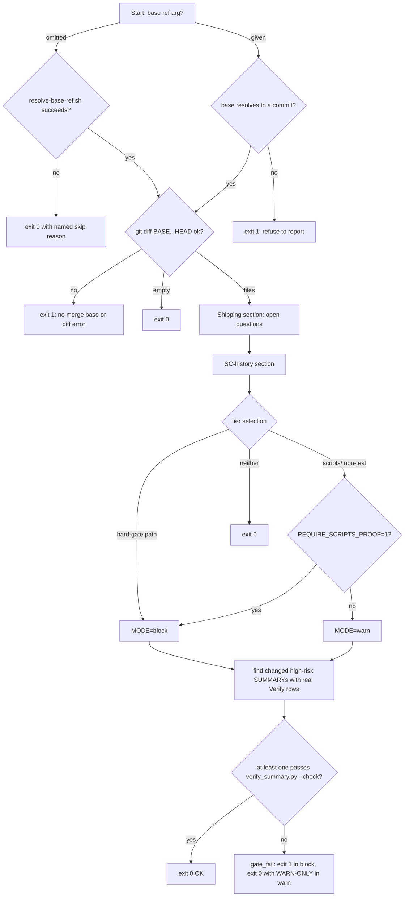

# CI Gates and Doc-Truth Lint

Local commit hooks warn by default. CI is where the harness enforces its rules strictly. The `harness-ci` workflow runs two kinds of checks:

1. **The strict gate** (`scripts/ci-strict-gate.sh`). It runs on pull requests only. When the PR diff touches gated paths, the PR must include a high-risk `SUMMARY.md` whose `### Verify` rows re-run clean.
2. **The test suite** (`scripts/run-tests.sh`). It runs on every push and PR, on Linux and macOS. Its L1 layer holds the static checks: doc-truth lint, `allowed-tools` presence, frontmatter contract, skill tool conformance, runtime-neutral sources, slim surface, and others.

All of these checks share one design rule: **fail closed when the check cannot actually inspect anything.** If a check could not run, it must not report a pass. Many comments in these scripts describe earlier bugs where a check "passed" because its input was empty.

For the local counterpart see [Commit Gate](commit-gate.md). For the manifest that several checkers read see [Harness Manifest and Contracts](../concepts/harness-manifest-and-contracts.md). For the wider test layout see [Test Suite](../testing/test-suite.md).

## The `harness-ci` workflow

[`.github/workflows/harness-ci.yml`](../../.github/workflows/harness-ci.yml) runs on `push` to `main` and on every `pull_request`. It has two jobs:

| Job | When | Runner | What it runs |
| --- | --- | --- | --- |
| `test` | push + PR | matrix `ubuntu-latest`, `macos-latest` (`fail-fast: false`) | `tests/scripts/codex-alpha-contract.test.sh` as its own named step, then `bash scripts/run-tests.sh` with `HARNESS_SKIP_SUITES` set to that suite so it does not run twice |
| `strict-gate` | PR only | `ubuntu-latest` | `bash scripts/ci-strict-gate.sh "origin/${{ github.base_ref }}"` |

Details that matter when you change the workflow:

- **`fetch-depth: 0` is required in both jobs.** The verify-row lint in `run-tests.sh` and the strict gate both diff against a base ref. With a shallow checkout there is no base ref, and the lint once skipped on every run without anyone noticing.
- **The base ref is fetched explicitly** with `git fetch --no-tags origin "$BASE_REF"`. In `test` this happens on PRs only. The branch name is passed through `env`, not an inline `${{ }}`, so shell metacharacters in a branch name cannot be injected into the script.
- **The OS matrix is there to catch BSD/GNU differences** in the bash hooks. On macOS the job runs `brew install shellcheck`, so the shellcheck pass in `lint-skill-bash.sh` really runs in CI. Without shellcheck that script falls back to a syntax-only check.
- **The strict-gate job installs Python and pytest itself** (`actions/setup-python@v5`, then `pip install pytest`). `### Verify` rows it re-runs can call `python3 -m pytest`, and this job cannot rely on pytest already being on the runner.
- **The workflow sets no `REQUIRE_*` variables.** So in CI the strict gate's `scripts/` tier, open-question check, and SC-history check all run in warn mode. Only the hard-gate tier blocks.

## `ci-strict-gate.sh`: the strict-in-CI layer

The script states its own scope. It **verifies** that a PR touching a gated path includes at least one Verify row on a high-risk SUMMARY that is re-run and whose exit code matches. It **does not verify** that those rows actually cover the change. That is left to human review.

*Control flow of `scripts/ci-strict-gate.sh`, from base-ref validation to the tiered proof requirement.*

### Base-ref validation (fail closed)

- **Explicit base** (the CI path): `git rev-parse --verify -q "${BASE}^{commit}"` must succeed. If it fails, the script exits 1 with "does not resolve to a commit". This also rejects a blob sha. In an earlier version, `bash scripts/ci-strict-gate.sh no/such/ref` exited 0 with no output, because only the fallback path was validated.
- **Omitted base**: the script calls [`scripts/resolve-base-ref.sh`](../../scripts/resolve-base-ref.sh). That script tries `VERIFY_ROWS_BASE`, then `origin/$GITHUB_BASE_REF`, then a non-self-tracking `@{upstream}`, then the nearest ancestor ref. If none of these resolve, the gate **skips** (exit 0) and prints the reason. It never guesses a branch name.
- **Diff failure**: `git diff --name-only "$BASE"...HEAD` must succeed. If there is no merge base (for example an orphan branch or a shallow fetch), or git fails for another reason, the script exits 1 (#277). An empty diff from a failed command must not pass as "nothing changed".

### Pre-tier sections (run even for specs-only PRs)

A PR that changes only `specs/` touches no gated path, so it would take the early exit 0. Two checks therefore run *before* tier selection. Neither one exits 0 itself, so a PR that also touches `hooks/` still needs proof.

- **Shipping / open questions.** A slug "ships" when `specs/<slug>/PLAN.md` is in the diff and its frontmatter reads `status: shipped` at HEAD but not at the merge base. The match ignores case and trailing whitespace, and accepts CRLF line endings. For each shipping slug the gate runs `python3 scripts/check_open_questions.py --slug <slug>`. Exit 1 under `REQUIRE_QUESTIONS_CLOSED=1` counts as a finding. Any other non-zero exit is an error in the check itself. If the checker script is missing, the gate prints a skip message. All three outcomes block only under `REQUIRE_QUESTIONS_CLOSED=1`. The awk frontmatter reader consumes its whole input on purpose: a large PLAN.md would otherwise cause a SIGPIPE, and under `pipefail` the plan would read as not shipped.
- **SC-history / goalposts.** For every slug whose `PLAN.md` or `SUMMARY.md` is in the diff, the gate runs `python3 scripts/verify_summary.py --sc-history <slug> --base <BASE>`. The gate also reads renames commit by commit, so it catches a spec directory created and then renamed on the branch. A renamed spec directory counts as an error, because the failure history recorded under the old slug is not followed. Findings and errors block only under `REQUIRE_SC_STABLE=1`. The gate strips whitespace around that value, the same way `verify_summary.py` reads it.

### Tiers

| Tier | Paths (regex) | Missing proof |
| --- | --- | --- |
| BLOCK | `HARD_GATE_RE='(^\|/)settings\.json$\|^hooks/\|(^\|/)\.claude/hooks/\|render_plan\.py$\|^templates/'` | exit 1 |
| WARN | `^scripts/`, excluding `^scripts/test_` | exit 0 with a report that includes `WARN-ONLY`. `REQUIRE_SCRIPTS_PROOF=1` promotes this tier to block |
| none | anything else (including `tests/hooks/`, `rules/`) | exit 0, silent |

- The hard-gate pattern reuses the precision pattern from the local `commit-gate.sh` `check_risk`. The `^hooks/` anchor deliberately excludes `tests/hooks/`, a known source of false positives. The `^templates/` branch exists only in CI: the SUMMARY template is read by machines, so changing it changes a contract.
- `scripts/` is gated because it holds the gate logic itself; for example, `verify_summary.py` decides what counts as evidence. It was rolled out in warn mode first, after measurement showed it would have blocked 9 of the last 80 PRs. The `scripts/test_*` exclusion applies **per file**: a test-only edit next to a real `scripts/` edit is still gated.
- `rules/` is deliberately not gated here. Rules are prose, and the `workflow-engine` signal and the review-receipt check already cover them.
- The tiers stay separate. If a diff touches both `hooks/` and `scripts/`, the hard-gate tier wins and the gate blocks.
- In warn mode `gate_fail` still prints what is missing. A warn tier that stays silent cannot be told apart from having no gate at all.

### Proof requirement

1. Candidates are the changed `specs/*/SUMMARY.md` files that exist at HEAD, match `^Lane:[[:space:]]*high-risk`, and contain at least one non-placeholder `### Verify` row. Rows are counted with `verify_summary.parse_verify_table`, so the placeholder rules are defined in one place.
2. The gate runs `python3 scripts/verify_summary.py --check <slug>` for each candidate. **At least one** must pass. A candidate that fails prints only a warning. The reason: the first-ever `specs/` commit makes every historic SUMMARY count as "changed", and old SUMMARYs whose fixtures are gone must not punish an honest PR.
3. If no candidate passes, `gate_fail` runs, and the result depends on the mode. A trivial row such as `true` counts as a forgery and blocks (DR-6), because `verify_summary.py` marks trivial rows and does not execute them. A row whose claimed exit code does not match the actual one also blocks.

## `lint-doc-truth.sh`: docs must match the tree

[`scripts/lint-doc-truth.sh`](../../scripts/lint-doc-truth.sh) turns the manual docs-vs-code audit into an automatic check. It exists because two PRs in a row (#9, #10) only repaired drift between docs and code. It runs first in L1 of `run-tests.sh`.

**Scope** is the set of docs an agent actually loads: `CLAUDE.md`, `README.md`, `HARNESS.md`, `skills/README.md`, `agents/*.md`, and `rules/*.md`. The globs use `nullglob`, so an empty `agents/` or `rules/` directory does not trigger "core doc missing". The `agents/` and `rules/` entries were added after stale `skills/xia2/PROJECT.md` pointers were found in `agents/` (#119/#121). The test suite guards against this scope shrinking again.

Checks:

1. **Markdown link targets** `](path)`: every one is checked. URLs and `#anchor` links are skipped.
2. **Backticked tokens containing `/`**: checked only when the first segment is a known repo root (`skills rules hooks docs templates agents scripts tests xia2 .github .claude`). The lint skips placeholders (`< > * { [ $ …`) and `specs/`, which is gitignored by design. It maps `.claude/x` back to its root source `x`. A path not found at the repo root is also tried as `skills/<path>` and `skills/*/<path>`.
3. **Hook table vs `settings.json`**: every `` | `name.sh` `` row in the `CLAUDE.md` table must exist in `hooks/`. A row marked ✅ must be registered in `settings.json`, and a row without ✅ must not be. Every `hooks/*.sh` file must appear in the table. Every `.hooks[][].hooks[].command` in `settings.json` (read with `jq`) must exist on disk, after stripping `$CLAUDE_PROJECT_DIR/` and `.claude/`.
4. **Derived-tree check (consumer side).** Unless `SKIP_DERIVED_LINT=1` is set, and when `python3` is available, the lint runs `scripts/deploy-harness.sh --target <tmpdir> --yes`. It then scans every deployed `.claude/**/*.md` for path-like tokens inside backtick spans that do not exist in the consumer repo. This catches docs that cite helpers which are never deployed. It also scans command spans such as `python3 scripts/x.py --flag`. A doc may cite a path that exists only in the harness repo if "harness repo" or "harness checkout" appears within the nearby lines. The fix the lint suggests is to ship the file via `CONSUMER_SCRIPTS`. If the deploy step fails, this check is skipped with a warning rather than failed.

Known limitations, stated in the script: bare tokens without a slash (such as `.mcp.json`) are caught only when written as links, and code blocks are scanned like prose. The script exits 0 with a single ✓ line, or 1 after listing every ✗.

## Static conformance checkers

All of these run in the L1 block of [`scripts/run-tests.sh`](../../scripts/run-tests.sh). The Python checkers run only when `python3` is present. Each checker documents what it verifies and what it does not, and each owns one concern so that two checkers never report the same drift.

| Checker | Verifies | Deliberately does not verify |
| --- | --- | --- |
| `scripts/check-allowed-tools.sh` | every `skills/*/SKILL.md` frontmatter has a non-empty `allowed-tools:` (only the block between the first two `---` lines counts) | that the list is correct |
| `scripts/check_frontmatter_contract.py` | every skill and agent **registered in `harness-manifest.json`** has a frontmatter block with non-empty `name:` and `description:`, and `name:` equals the register key | description quality, `allowed-tools`, whether manifest entries exist on disk (that is `check_manifest.py`) |
| `scripts/check_skill_tool_conformance.py` | every runnable command in a skill's own prose is allowed by a declared `Bash(...)` pattern, and every mandated dispatch of a `*prompt*.md` file has `Agent` or `Task` | over-granting, natural-language write detection, end-to-end success |
| `scripts/check_runtime_neutral_sources.py` | the exact count of runtime-coupled references in the scan roots matches `specs/codex-support/neutralization-inventory.json` | — |
| `scripts/check_slim_surface.py` | the retired skills `executing-plans`, `review-diff`, `create-pr` are absent **both** from disk and from the manifest's `skills[]` | — |

### Frontmatter contract

The checker is driven by the manifest registers, not by globbing, so it needs no allowlist. `agents/README.md` and similar files are simply not registered. Its parser returns `None` for an unterminated frontmatter block instead of treating the whole file as frontmatter. It reads plain, quoted, and block scalar values (`>`/`|`) at column 0. If both registers are empty, it fails closed. Registered files that are missing are skipped quietly, because `check_manifest.py` reports those. The checker uses only the standard library. The docstring explains why it is used instead of `claude plugin validate --strict`: that tool treats every `agents/*.md` file as an agent, and CI runners do not ship it.

### Skill tool conformance

This check was added after five of nine skills shipped with too few permissions in the `allowed-tools` rollout. Presence checks passed, and `claude plugin validate` ignores tool names. Mechanics:

- **Which docs are scanned:** `SKILL.md` plus `references/*.md`, excluding files whose name contains `prompt`. Those are dispatch payloads that run under a subagent's grant. Frontmatter is blanked rather than cut off, so the reported line numbers stay correct.
- **Which commands are extracted:** lines from fenced `bash`/`sh`/`shell` blocks, unless the block contains `<` or `[optional]`, which marks it as illustrative. This is the same convention `lint-skill-bash.sh` uses. Inline backtick spans also count when they start with a command head (`python3`, `bash`, `git`, `grep`, …) or end in `.sh`/`.py`. For inline spans, only the command head, not the arguments, is tested for placeholders.
- **Matching:** the head of the command (up to the first pipe, chain, or redirect) is matched against the `Bash(...)` patterns with `fnmatch`. The match is tried both with and without `.claude/` (because the deploy step rewrites `scripts/x.py` to `.claude/scripts/x.py`), and with `bash `/`python3 ` prepended for bare scripts. A pattern ending in ` *` also matches the bare command. A bare `Bash` entry allows everything. A declared native tool (`Grep`, `Glob`, `Read`) covers `grep`/`rg`/`ls`/`cat`.
- **Exit codes:** 0 means clean, 1 means gaps were found, 2 means the check could not run (manifest missing, unparseable, not an object, or an empty skills register). `--json` prints a payload with `schema_version: 1`, `ok`, counts, and deduplicated `findings` on **every** exit path, so a machine consumer never sees empty stdout and reads it as clean.

### Runtime-neutral sources

This is a ratchet that keeps instruction sources independent of any single runtime. It scans `.md`/`.py`/`.sh` files under the inventory's `scan_roots` for four categories:

- `deployed-rule-path`: `.claude/rules/`
- `deployed-skill-path`: `.claude/skills/`
- `slash-skill-invocation`: `/<skill-name>` for the inventory's `skill_names`
- `vendor-agent-policy`: `model`/`effort`/`tools`/`disallowedTools` keys in `agents/*.md` frontmatter, or vendor model IDs such as `claude-opus-*`, `gpt-5*`, or `model: claude-*`

Every `(path, category)` pair must match the declared `count` **exactly**. Each inventory entry must also have a valid `classification` (`shared-source-violation`, `runtime-entry-binding`, `test-fixture`, `false-positive`), an `owner`, an `exit_condition`, and a path that still exists. A count that drifts in either direction fails and lists the offending lines. `run-tests.sh` runs it against the live tree on purpose, with `--root .`. When it ran nowhere in CI, a hook-test edit silently broke another phase's success criterion.

## Configuration summary

| Variable | Effect |
| --- | --- |
| `REQUIRE_SCRIPTS_PROOF=1` | strict gate: the `scripts/` tier blocks instead of warning |
| `REQUIRE_QUESTIONS_CLOSED=1` | strict gate: open-question findings, errors, or a missing checker block the PR |
| `REQUIRE_SC_STABLE=1` | strict gate: SC goalpost findings, errors, or spec renames block the PR |
| `VERIFY_ROWS_BASE` | first choice for the base ref in `resolve-base-ref.sh` |
| `SKIP_DERIVED_LINT=1` | doc-truth lint: skip the deploy-and-rescan check |
| `HARNESS_SKIP_SUITES` | `run-tests.sh`: space-separated suites to skip (CI uses it for the Codex contract) |

## Tests

- [`tests/scripts/ci-strict-gate.test.sh`](../../tests/scripts/ci-strict-gate.test.sh) builds throwaway git repos with a base commit and a diverging HEAD. It covers the tiers (hooks/templates block, scripts warn and its promotion, the per-file test exclusion, tiers staying separate), forgery (`true`) and mismatched rows, the "at least one passes" rule, bad or blob bases, orphan HEADs, every branch of the shipping and SC-history sections (CRLF, capitalised `Shipped`, a ~1 MB plan, non-ASCII slugs, renames, whitespace in `REQUIRE_SC_STABLE`).
- [`tests/scripts/lint-doc-truth.test.sh`](../../tests/scripts/lint-doc-truth.test.sh) guards the doc scope (`rules/`, `agents/`), placeholder skipping, the nullglob case, and out-of-scope unknown roots.
- The Python checkers have pytest companions in `scripts/test_check_*.py`. `run-tests.sh` discovers them automatically.
