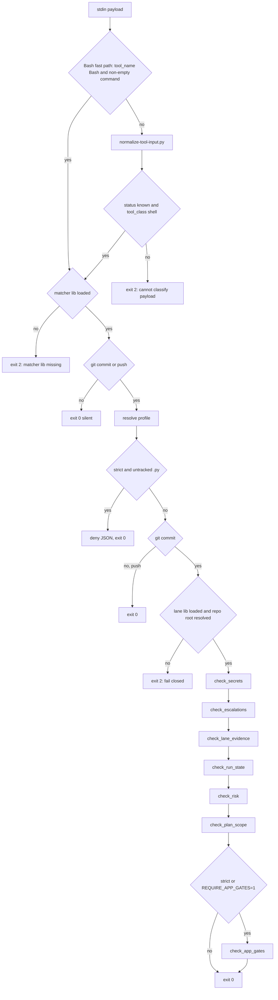

# Commit Gate Hook

`hooks/commit-gate.sh` is the harness's one hook for `git commit` and `git push`. It is registered as a `PreToolUse` hook on the `Bash` matcher, so it runs **before every Bash tool call**. Most of that work is a fast no-op. When the command really is a commit, the hook reads the staged index and runs a fixed sequence of checks. Each check either passes, warns on stderr, or blocks.

The root `settings.json` of the harness repo registers it as a bare `hooks/commit-gate.sh`, which means the `standard` profile. A consumer deploy appends ` --profile 
` to the commit-gate command, and only to that command (`scripts/deploy-harness.sh`). The sibling hooks are covered in [Branch Isolation and Session Hooks](branch-isolation-and-session-hooks.md). For the CI-side counterparts, see [CI Gates and Doc Truth](ci-gates-and-doc-truth.md).

## Exit-code contract

| Outcome | Mechanism |
| --- | --- |
| Allow | exit 0. Notes and warnings may appear on stderr. |
| Block | exit 2 with the reason on stderr. Every block message also carries a `Route:` line or equivalent guidance that says how to clear it. |
| Untracked `.py` deny (strict) | Prints `{"hookSpecificOutput":{"permissionDecision":"deny",...}}` JSON on **stdout** and exits **0**. |

The hook never exits 1, because the runtime treats exit 1 as non-blocking. It does not use `set -e`, so control flow is explicit. It is written to stay compatible with bash 3.2 (the macOS default).

## Check order and exit points

*The order in which commit-gate.sh resolves and runs its checks. Any check from secrets onward can end the hook with exit 2, and profile membership decides which of those checks run.*

## 1. Input parsing and normalization

The common case costs a single `jq` call. If the payload has `tool_name == "Bash"` and a non-empty string `tool_input.command`, the command is taken from it directly and no Python process starts. Any other shape is piped to `hooks/lib/normalize-tool-input.py --root "$ROOT"`. That covers Codex payloads, payloads without `tool_name`, and malformed JSON. The normalizer converts Claude and Codex hook JSON into one conservative contract (`status`, `tool_class`, `command`, `diagnostics`).

The gate **fails closed** with exit 2 unless the normalizer returns both `status == "known"` and `tool_class == "shell"`. The error message lists the normalizer's diagnostics (for example `command-missing` or `malformed-json:...`) and gives a redeploy route. If `python3` or the normalizer file is missing, the gate creates a synthetic `normalizer-unavailable` result, which also blocks. The real Claude Bash shape takes the fast path, so it never depends on `python3`. The tests check that a non-git Bash call passes silently even when python is absent from PATH.

The command is extracted separately with `jq -r '.command'`. The gate does not use a line-oriented `read` here because that would truncate a multi-line command, and the truncated string would be what the matcher tokenizes.

## 2. The git commit/push filter

The gate sources `hooks/lib/git-command.sh`, then requires that both `hook_cmd_is_git_commit_or_push` and `hook_cmd_is_git_commit` exist. If either function is missing, it blocks with exit 2. A test stub that defines only one of them is also rejected.

How the matcher works:
- It strips single-quoted and double-quoted spans, so text inside a commit message or an `echo "…"` string cannot create a fake segment.
- It splits on `&&`, `||`, `;`, `|` and `&` using pure bash parameter expansion. It avoids `sed` because BSD sed does not expand `\n`.
- It tokenizes each segment with `read -ra`.
- It skips leading `cd PATH`, `VAR=value` assignments, and the wrappers `command|builtin|exec|sudo|nice|env`.
- It skips git global options: `-C DIR`, `-c K=V` and any other `-flag`.
- It then compares the subcommand exactly.

This closes the `^git commit` anchor bypass (DR-1): `cd x && git commit`, `git -C . commit` and `echo done; git commit` are all caught. It also ignores `git commit-graph` and `git log --grep=commit`. The documented misses, which are out of scope: subshell, group and substitution forms, `sh -c '…'`, `xargs`, an absolute `/usr/bin/git`, and a quoted command word.

Any command that is not a commit or push exits 0 at this point.

## 3. Profiles

`--profile minimal|standard|strict` and `--profile=
` are both accepted. The default is `standard`. An unknown value prints a warning and the gate runs as `standard`. `profile_allows` stores check membership as data:

| Check | minimal | standard | strict |
| --- | --- | --- | --- |
| `check_untracked_py` (commit **and** push) | – | – | ✓ |
| `check_secrets` | ✓ (always called) | ✓ | ✓ |
| `check_escalations`, `check_lane_evidence` | – | ✓ | ✓ |
| `check_run_state`, `check_risk` | – | ✓ | ✓ (strict implies `RISK_CORROBORATION_STRICT=1`) |
| `check_plan_scope` | – | ✓ (warn) | ✓ (warn, blocks only with `BLAST_RADIUS_STRICT=1`) |
| `check_app_gates` | only with `REQUIRE_APP_GATES=1` | only with `REQUIRE_APP_GATES=1` | ✓ |

## 4. `check_untracked_py` (strict, runs first)

This check runs from the current working directory, before the commit context is resolved, so it applies to `git push` as well. It lists `git ls-files --others --exclude-standard` filtered to `*.py`. It excludes any path under `.claude/`, both at the root and nested (the pattern is `(^|/)\.claude/`), so a fresh consumer whose `.gitignore` does not yet list `.claude/` does not have every commit denied. Any remaining file produces the stdout deny JSON, and the hook exits immediately.

> **Strict-profile gotcha: stage and commit in separate Bash calls.** A PreToolUse hook runs before the command executes, and this check reads the repository state for the whole command string. In `git add x.py && git commit -m …`, the `git add` has not run yet when the hook fires, so `x.py` is still untracked and the commit is denied again. Run `git add <files>` in one Bash call and `git commit` in the next. The deny reason itself says so, and `CLAUDE.md` / `docs/solutions/harness/pretooluse-hook-denies-combined-git-add-commit.md` record it.

After this check, a `git push` exits 0. None of the commit-only checks run for a push.

## 5. Commit context (computed once)

1. **The lane lib must load.** If `hooks/lib/lane.sh` is missing, or `hook_lib_resolve_lane` is undefined, the gate blocks with exit 2. Corroboration must never run against "no Lane" by accident.
2. **Repo root.** The root is `CLAUDE_PROJECT_DIR`, else `git rev-parse --show-toplevel` from the current directory. It is **never** derived from the hook's own directory. A hook installed outside the project, inside some other git repo, would otherwise audit the wrong repo and pass silently. If no root resolves, or the gate cannot `cd` into it, the gate blocks with exit 2.
3. **`STAGED_PATHS`** is `git diff --cached --name-only`, which covers the whole index and not only a commit pathspec. **`SPEC_SLUGS`** holds the unique `specs/<slug>/` prefixes found among the staged paths.
4. **`LANE_VAL`** comes from `hook_lib_resolve_lane`. It prefers a `Lane:` line in a SUMMARY.md staged in this commit, read from the index. If none is staged, it uses the sibling `SUMMARY.md` of the plan marked `status: active`. If there is no active plan, the value is empty. The result is normalized to `tiny|normal|high-risk`. There is deliberately no "most recently modified" fallback, because a stale spec would misattribute its Lane.
5. **`VERIFY_SUMMARY`** is the first of `scripts/verify_summary.py` (harness repo) or `.claude/scripts/verify_summary.py` (consumer) that exists. If neither exists, it is empty. See [Evidence and Summary Contract](../concepts/evidence-and-summary-contract.md).

## 6. The checks

### `check_secrets` (every profile)

This check scans `git diff --cached -U0`. It excludes test trees at any depth (`*tests/*`, `*__tests__/*`), `*.example`, `*.md` and `docs/`. It looks for `sk-…`, `AKIA…`, and quoted assignments to `password`, `api_key`, `apikey`, `client_secret` and `secret`, plus any `passwd =`. A hit blocks, and there is no override. A staged path ending in `.env` also blocks. That includes staged deletions, because `STAGED_PATHS` lists them, so a human must decide on untracking an already-tracked `.env`. The check needs no `python3`.

### `check_escalations`

For each staged slug, this check reads `ESCALATIONS.md` from the index first, then falls back to disk. It blocks if any line matches `decision: pending`. This makes the template's deny-on-no-response rule mechanical. Because the staged copy wins, a commit that records the decision unblocks itself. A pending escalation in a slug the commit does not touch does not block.

### `check_lane_evidence`

This check runs only when the commit touches `specs/`. For each slug it builds a temp directory holding the **index** copies of `SUMMARY.md` and `PLAN.md`. If a file is not in the index, it uses the on-disk copy. If the slug has no SUMMARY, the slug is skipped. It then runs `python3 $VERIFY_SUMMARY --lane <tmp>/SUMMARY.md --plan-dir <tmp>`. The gate therefore judges the tree being committed: editing or removing a staged PLAN in the worktree cannot weaken its SC contract. Output is relabelled from the temp path to the real SUMMARY path. On a passing run, `!`-prefixed advisory lines are still relayed. A failure blocks with the lane mapping (tiny: header fields; normal: plus a real `### Verify` row; high-risk: plus a non-empty `### Rollback`). If `python3` or the script is missing, the check prints a notice and passes (**fail-open**).

### `check_run_state`

For each staged slug, this check looks at `RUN.json` and `events.jsonl` if they exist on disk:
- Staged in this commit: fine.
- Untracked: **block**. `REQUIRE_RUN_STATE_STAGED=0` downgrades this to a warning.
- Tracked but with unstaged changes: warning only.

It checks git state only. It does not check content.

### `check_risk`: risk corroboration

This check compares the declared Lane with what the staged diff actually touches.

**Mode source (invariant #2).** Each category's mode, `block` or `warn`, comes from exactly two index-safe sources:
1. `git show :harness-manifest.json`, which reads `hard_gates.detectable[].mode` from the git **index**.
2. If that is absent, unreadable, or invalid, the embedded defaults in `hooks/lib/gate-modes.default.sh`: seven `block`, plus `weakening-validation=warn` and `workflow-engine=warn`.

A worktree copy or `.claude/harness-manifest.json` is never read, so an unstaged edit cannot loosen a gate. `category_mode` returns `warn` only for an exact `slug=warn` line. Any other value, a missing slug, or an unparsable manifest yields `block`. See [Harness Manifest and Contracts](../concepts/harness-manifest-and-contracts.md).

**Signals.** Path categories read `STAGED_PATHS`:

| Category | Paths that trip it |
| --- | --- |
| `high-blast` | `settings.json`, `hooks/`, `.claude/hooks/`, `render_plan.py` |
| `data-loss/migration` | `migrations/`, `alembic/` |
| `external-provider` | dependency manifests |
| `workflow-engine` | `skills/*/SKILL.md`, prompt `.md` files under skills, `agents/*.md`, `rules/*.md`, excluding `README.md` and `*.template.md` |

Keyword categories (`auth`, `authorization`, `audit/security`, `external-provider`, `public-contract`, `data-loss/migration`) scan only **added code lines**. The scan excludes `*.md`, `docs/`, `specs/`, `skills/`, `hooks/` and `.claude/`, and strips full-line `#` comments first. Tests are deliberately not excluded. `weakening-validation` scans **removed** lines for `assert `, `validator`, `required=True` and `raise `.

**Decision.**
- A warn-mode category only prints a note.
- If any block-mode category trips:
  - `Lane: high-risk` corroborates it, and the commit passes.
  - A lower Lane blocks with exit 2.
  - With no Lane, the check warns and allows, unless `RISK_CORROBORATION_STRICT=1` or the profile is `strict`. In that case it blocks.

`RISK_WARN_CATEGORIES` (comma- or space-separated) loosens categories to warn for one session. It must be in the hook's own environment, for example `.claude/settings.local.json` → `env`. An inline `VAR=x git commit` prefix never reaches a PreToolUse hook. To loosen a category permanently, edit the manifest `mode`.

**Size note.** If the Lane is `tiny` and the full, unfiltered `--numstat` diff exceeds 150 changed lines, the check prints a warn-only suggestion to run the simplify pass. For `normal` the threshold is 600 lines.

`scripts/check_manifest.py` fails CI if the `add_cat` slug set drifts from the manifest. `scripts/check_gate_modes_smoke.py` checks that the embedded defaults stay consistent with the manifest.

### `check_plan_scope`: blast radius

This check is armed only by a `specs/*/PLAN.md` with `status: active` (`hook_lib_find_active_plan`; the first one found in glob order). The declared set is the union of the XML `<files>…</files>` tags and the markdown `- **Files:**` bullets, split on commas.

A staged path counts as in scope if it matches a declared entry exactly, ends with `/<entry>`, or has the same basename. Paths under `specs/` and `docs/`, and `*.md` files, are never flagged. Paths outside the scope produce a `[BLAST RADIUS]` warning. `BLAST_RADIUS_STRICT=1` turns that warning into an exit-2 block. If no plan is active, or the plan declares no files, the check does nothing.

### `check_app_gates` (strict, or `REQUIRE_APP_GATES=1`)

This check applies to staged `app/**/*.py` files:

1. **Debug artifacts.** Added lines containing `breakpoint()`, `import pdb` or `from pdb` block the commit. So do added lines that start with `print(`.
2. **Evidence (`REQUIRE_VERIFY=1` only).**
   - If `app/` Python files are staged, a SUMMARY must contain a `### Verify` block. The gate uses a staged SUMMARY if there is one, otherwise the newest `specs/*/SUMMARY.md`.
   - Then `verify_summary.py --check <slug>` re-runs the table, and a mismatch between claimed and actual exit codes blocks.
   - If `python3` or the script is missing, the gate does a presence check only (fail-open).
3. **Targeted tests.**
   - Each `app/<dir>/<name>.py` maps to `tests/<dir>/test_<name>.py`, or to the same name one directory level up.
   - Matching files run with `python -m pytest … -x -q --tb=short --no-cov -m "not integration" -p no:cacheprovider`.
   - A failure blocks.
   - If five or more `app/` files are staged, the check prints a hint to run the compound skill.

When this check is not enabled, the gate prints a one-line "App checks … skipped" notice.

## Environment toggles

| Variable | Effect |
| --- | --- |
| `CLAUDE_PROJECT_DIR` | Project root. It takes precedence over the git work tree of the current directory. |
| `REQUIRE_APP_GATES=1` | Runs `check_app_gates` in any profile. |
| `REQUIRE_VERIFY=1` | Inside the app gates, requires a `### Verify` block and re-runs it. |
| `RISK_CORROBORATION_STRICT=1` | A hard-gate signal with no Lane blocks. `strict` implies this. |
| `RISK_WARN_CATEGORIES` | Session-scoped downgrade of the listed categories to warn. |
| `BLAST_RADIUS_STRICT=1` | Plan-scope violations block. |
| `REQUIRE_RUN_STATE_STAGED=0` | An untracked `RUN.json` or `events.jsonl` warns instead of blocking. |

All of these must be in the hook process's environment. Inline prefixes on the git command do not reach the hook.

## Fail-closed vs fail-open summary

- **Closed (block):**
  - The payload cannot be classified, or the normalizer is unavailable on the non-fast path.
  - The matcher lib or lane lib is missing.
  - The project root cannot be resolved or entered.
  - A risk-mode lookup fails. Missing or invalid modes resolve to block.
- **Open (pass with a notice):** `python3` or `verify_summary.py` is missing for lane evidence or the `### Verify` re-run.
- **Known fail-open gap:** if `jq` is absent, the untracked-`.py` deny JSON is never printed and the hook exits 0. The `specs/hook-deny-route-lines` review records this as a follow-up.

## Tests

- `tests/hooks/commit-gate.test.sh`:
  - parse and filter behavior, including wrapped commits and fail-closed cases for a malformed payload or missing libs
  - the untracked-`.py` deny and its `.claude/` exclusions
  - secrets and `.env`
  - app gates and the `### Verify` re-run
  - repo-root resolution from a foreign host repo
  - plan scope with XML, markdown and mixed plans
  - profile selection
- `tests/hooks/commit-gate-evidence.test.sh`:
  - escalations, including the staged-copy self-unblock
  - run-state tiers
  - lane evidence against index-materialized SUMMARY/PLAN pairs, with python fail-open
  - intent-only commits passing in both standard and strict
- `tests/hooks/commit-gate-risk.test.sh`:
  - category precision, for example `tests/hooks/` not tripping `high-blast` and comments being stripped
  - workflow-engine surfaces
  - index-only modes, including the SC-8 `.claude/` bypass guard and the rule that an unstaged worktree `mode=warn` does not loosen a gate
  - parity with the embedded defaults
  - the size note
  - active-plan Lane fallback
  - profile interaction
- `tests/hooks/command-matching.test.sh` unit-tests the shared matcher.
