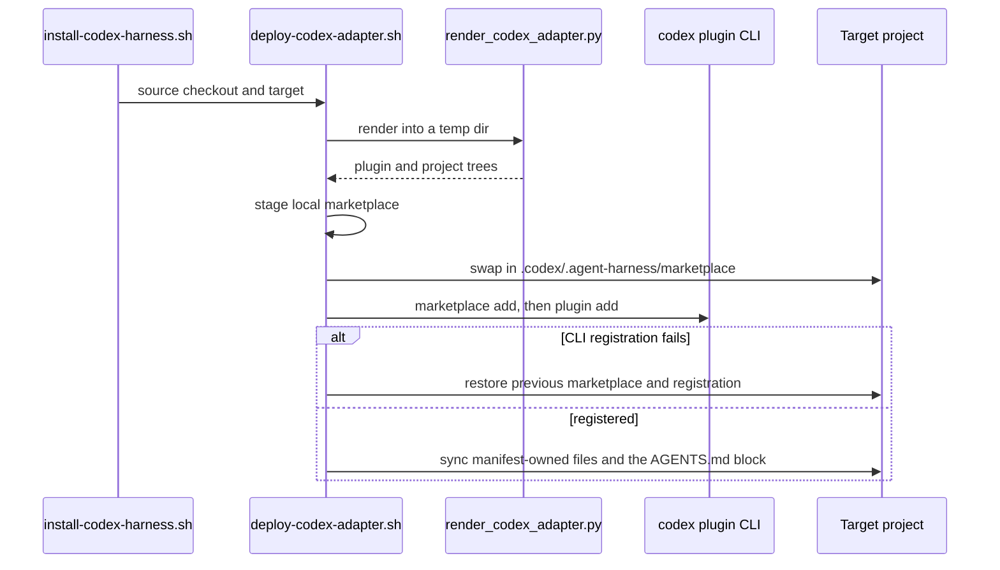
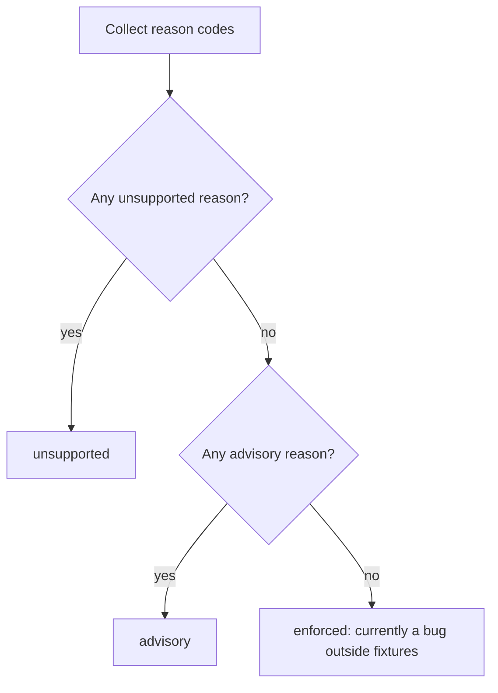

# Codex Advisory Alpha Adapter

The Codex adapter lets a project run the harness's shared skills, lifecycle hooks, and agent roles under OpenAI's Codex CLI. Claude Code is still the established deployment path (see [Architecture overview](../architecture/overview.md) and [Install, deploy, and resync](../operations/install-deploy-and-resync.md)). The Codex path is an **advisory alpha**. It is generated from the same runtime-neutral sources and installed without clobbering user state. It is pinned to the evidence boundary in `specs/codex-support/packaging-decision.md`: observed evidence for **Codex CLI 0.147.0 on macOS arm64**. It is **not GA**, and it does not make Codex a peer enforcement runtime. Linux and WSL are covered by deterministic CI and contract tests, but real Codex runtime behavior there has not been observed. On those platforms the doctor emits `PLATFORM_UNVERIFIED` and cannot return `enforced` ([CLAUDE.md](../../CLAUDE.md), [docs/codex-alpha-install.md](../../docs/codex-alpha-install.md)).

> **Read this first: today, an `enforced` doctor result is a bug.** No input available to this alpha contains *observed hook trust*. Codex 0.147.0's `codex doctor --json` has no trust field. A project `trust_level` read from the user's Codex config means approval, not proof that hooks run, so it adds `TRUST_CONFIG_ONLY` and keeps the result at `advisory`. A real run should therefore return `advisory` or `unsupported`. The `enforced` path exists in code and unit tests, but only a fixture that supplies hook trust can reach it. Phase 6 owns making it reachable in real use. Per [CLAUDE.md](../../CLAUDE.md), treat any live `enforced` claim as a bug.

## Moving parts

| Concern | Entry point | Role |
|---|---|---|
| Adapter sources | `adapters/codex/` | The pinned plugin manifest, the checked-in Codex `hooks.json`, the project instruction file, and a closed JSON schema for the render inventory |
| Rendering | `scripts/render_codex_adapter.py` | Checks every source against the canonical inventories, then renders a `plugin/` and `project/` tree into a temporary root |
| Packaging decision gate | `scripts/check_codex_packaging.py` | Checks `specs/codex-support/packaging-decision.md` and its evidence (hybrid or direct, plus observed runtime) |
| Capability evidence gate | `scripts/check_codex_capabilities.py` | Checks `specs/codex-support/capability-matrix.json` and its version-pinned fixtures |
| Evidence capture | `scripts/capture_codex_capabilities.sh` | Runs sanitized probes against a real Codex binary in a disposable `CODEX_HOME` |
| Install | `scripts/install-codex-harness.sh` → `scripts/deploy-codex-adapter.sh` | Fetches or uses a local checkout, then deploys the adapter through Codex's own plugin/marketplace CLI |
| Diagnosis | `scripts/codex_harness_doctor.py` | Runs outside hooks and classifies the install as `enforced`, `advisory`, or `unsupported` |
| Runtime-mode state | `runtime/runtime_mode.py` | Validates, persists, and invalidates the sanitized record in `.harness-state/codex-runtime.json`, and supplies the SessionStart context line |

## Packaging: the hybrid boundary

The packaging decision in `specs/codex-support/packaging-decision.md` selects **hybrid**, with `direct` as the explicit fallback. Under hybrid, a Codex **plugin** owns the reusable skills, `hooks/hooks.json`, the plugin manifest, and the marketplace lifecycle. The **project adapter** owns `.codex/agents/*.toml`, runtime state, and a bounded `AGENTS.md` integration. The user owns the existing root `AGENTS.md`, local customizations, trust choices, and all unrelated Codex configuration. The direct candidate is deliberately recorded as `unknown`. It becomes selectable only after a probe of its own passes.

`check_codex_packaging.validate_decision` makes this decision executable:

- The front matter must declare `decision`, `fallback`, `cli_version`, `matrix`, both evidence paths, `runtime_execution`, and a concrete `fallback_trigger`. `decision` and `fallback` must differ.
- The selected candidate's evidence must be an `observed`, passing `isolated-local-packaging-probe`. Any packaging evidence that claims `runtime_execution_observed` is rejected as an overclaim.
- When `runtime_execution: observed` is declared, a separate `runtime_evidence` file must show three passing checks: `installed_plugin_skill_invoked`, `plugin_hook_executed`, and `project_agent_dispatched`. It must also disclose `hook_trust_mode: automation-vetted-bypass`. That disclosure is why the runtime evidence does **not** prove persisted user hook trust.
- The matrix row `packaging.plugins` must stay `advisory` with `observed` evidence and must point at the selected evidence file.

## Rendering from runtime-neutral sources

`render_codex_adapter.render(root, output)` is deterministic and runs only after validation passes. It refuses an output path inside the source repository and refuses a filesystem root. `validate_sources` fails closed (`AdapterError`) unless all of the following hold:

- the packaging decision passes `check_codex_packaging` and selects `decision: hybrid` with `runtime_execution: observed`;
- `adapters/codex/schema.json` is a closed object schema that requires exactly `schema_version`, `runtime`, `packaging_decision`, `skills`, `hooks`, and `agents`;
- `adapters/codex/plugin/.codex-plugin/plugin.json` matches the pinned contract exactly (`name: agent-harness`, `version: 0.1.0-alpha.1`, `skills: ./skills/`, `hooks: ./hooks/hooks.json`);
- the checked-in Codex `hooks.json` equals what `expected_codex_hooks` derives from the canonical `settings.json`;
- the `harness-manifest.json` inventories of skills, agents, and hooks exactly match the directories `skills/*`, `agents/*.md` (excluding `PROJECT.md`, `PROJECT.template.md`, and `README.md`), and `hooks/*.sh`;
- the agent role contracts pass `render_agent_definitions.validate`.

`expected_codex_hooks` translates the Claude hook settings into Codex terms:

- It accepts only the events `PreToolUse`, `PostToolUse`, `UserPromptSubmit`, `SessionStart`, and `SessionEnd`, and it requires `PreToolUse`.
- It rewrites the `Write|Edit` matcher to `apply_patch|Edit|Write`.
- It rewrites each handler command to `bash "$PLUGIN_ROOT/hooks/<file>"`, and only commands under `hooks/` are accepted.
- It adds `additionalContextLimit: 2500` to SessionStart and UserPromptSubmit handlers, and `timeout: 1` to SessionEnd handlers.
- It drops any handler whose command is `model-config.sh`, because that hook only rewrites Claude agent/skill frontmatter from `harness-models.json` and has no Codex meaning. A group left with no handlers is dropped too, so no empty group is emitted.

Today `settings.json` registers four hooks, and three of them reach Codex: `commit-gate.sh` on `Bash`, `branch-isolation-guard.sh` on `apply_patch|Edit|Write` (both PreToolUse), and `session-knowledge.sh` on SessionStart. The canonical SessionStart `startup|clear` group that runs `hooks/model-config.sh` is **not registered** in the Codex adapter. The `model-config.sh` body is still copied into `plugin/hooks/` with the rest of `hooks/`, but no Codex event runs it. Codex agent model and effort settings come from the rendered `.codex/agents/*.toml` instead (see [Agent roles](../agents/agent-roles.md)). Branch-isolation behavior under Claude Code is described in [Branch isolation and session hooks](../enforcement/branch-isolation-and-session-hooks.md).

The rendered tree contains:

- `plugin/`: the plugin manifest, a copy of the shared `hooks/` bodies plus the generated `hooks.json`, and each manifest skill. Symlinks are refused, and `__pycache__`, `*.pyc`, and `.DS_Store` are skipped.
- `project/.codex/agents/*.toml`: rendered by `render_agent_definitions.render_codex` from the semantic role sources and the Codex runtime bindings. Each profile carries `model`, `model_reasoning_effort`, `sandbox_mode`, `mcp_servers = {}` when the MCP policy is `none`, and `[agents] enabled = false` when nested delegation is disallowed. See [Agent roles](../agents/agent-roles.md).
- `project/.codex/harness-instructions.md`, and a `render-manifest.json` inventory.

## Install, update, conflict, and removal

`install-codex-harness.sh` is a thin front end. Without `--source`, it shallow-clones `CS_REPO_URL`/`CS_BRANCH` into a temporary directory. It then calls `deploy-codex-adapter.sh --source ... --target ...` and forwards `--codex-bin`, `--codex-home`, `--yes`, `--overwrite-conflicts`, `--dry-run`, and `--remove`.

*Deploy flow: the deployer stages the full render before it touches target state, and it rolls back when registration fails.*

Key behaviors of `deploy-codex-adapter.sh`:

- **Ownership is recorded, not inferred.** The deployer owns only what `.codex/.agent-harness/deployment-manifest.json` records: the local marketplace (`agent-harness-local`, plugin reference `agent-harness@agent-harness-local`), the generated `.codex/agents/*.toml`, `.codex/harness-instructions.md`, and one sentinel-delimited block (`<!-- agent-harness:begin/end -->`) in the root `AGENTS.md`. That block points Codex at `.codex/harness-instructions.md`. The deployer never edits `.codex/config.toml`, trust entries, project hooks, or unrelated plugins. Registration goes through `codex plugin marketplace add` and `codex plugin add`, so Codex merges its own state.
- **Safety refusals.** The deployer refuses `/` as a target. It refuses symlinked managed parents (`.codex`, the state directory, the marketplace) and managed paths that escape the target through a symlink. It also refuses to run when a deployment manifest exists but its marketplace directory is missing.
- **Non-clobber sync.** A managed file is overwritten only in these cases: the file is absent, it already equals the incoming bytes, its current hash equals the hash recorded at the previous install, or `--overwrite-conflicts` is set. Otherwise the local copy is kept, the candidate is written to `<path>.harness-incoming`, and the sidecar is recorded in the manifest. The `AGENTS.md` block follows the same rule. Malformed markers produce `AGENTS.md.harness-incoming` instead of an edit. Retired paths are pruned only when unchanged.
- **Rollback.** The previous marketplace is moved aside before the new one is swapped in. If `marketplace add`, `plugin add`, or the project sync fails, or if a signal arrives, the deployer removes the partial registration and restores and re-registers the previous marketplace.
- **Removal** unregisters the plugin and marketplace and deletes only unchanged generated files and an unchanged block. Edited files remain listed in a reduced manifest.

The user-facing procedure is in [docs/codex-alpha-install.md](../../docs/codex-alpha-install.md). The harness-wide deploy model is covered in [Install, deploy, and resync](../operations/install-deploy-and-resync.md).

## Capability evidence matrix and probes

`specs/codex-support/capability-matrix.json` is the evidence contract. It covers tools, hooks per event and tool, agents, config (project trust, hook config hash, strict config), packaging, and platforms. Each row carries `support_target`, `load_bearing`, `status`, `evidence_level`, `platforms`, a `source` with `checked_at` and `expires_at`, a `config` scope and hash, an `evidence_path`, an `owner`, and an `exit_condition`. The doctor consumes the matrix at runtime. `check_codex_capabilities.validate_matrix` enforces its honesty rules:

- **Unknown must be owned.** `evidence_level: unknown` requires `status: unknown`, `source.kind: unavailable`, a non-empty `exit_condition`, and a null `evidence_path`. `config.project_trust`, `platform.linux`, and `platform.wsl` are load-bearing unknowns of this kind today.
- **Documented means traceability, not truth.** It needs an official OpenAI documentation host and no fixture. With `--require-evidence`, a load-bearing documented row is an error.
- **Observed needs a fixture.** That fixture must sit under `specs/codex-support/evidence/codex-<cli_version>/`. It must match the matrix runtime and CLI version and a platform the row declares. It must use a capture label from a closed vocabulary (only `transcribed-isolated-live-probe` may be written by hand) and record `result.status: observed` with a config hash that matches the row. It must contain no private or absolute paths.
- **Freshness.** Any source whose `expires_at` has passed fails validation. Current rows expire in November 2026, so the committed matrix needs fresh evidence periodically to keep passing.

`scripts/capture_codex_capabilities.sh` produces those fixtures from a real Codex binary in a disposable `CODEX_HOME`. By default it captures only non-model facts: CLI, doctor, dependencies, config hash, and SessionEnd timing. Hook and custom-agent behavior stays unknown unless `--allow-live-model-probe` is passed. The script refuses version or platform overwrites and evidence downgrades.

## The outside-hook doctor

`scripts/codex_harness_doctor.py` is the only authority on runtime mode. It runs **outside any hook**. The `session-knowledge.sh` hook only *displays* a cached result and never runs the doctor or decides enforcement itself. The doctor runs `codex doctor --json` (20 s timeout, honoring `--codex-home`) or reads `--doctor-report`. It then combines that report with local checks in `diagnose()`.

*Mode derivation: an unsupported reason takes precedence, any other reason gives advisory, and only an empty reason set gives enforced.*

**Unsupported reasons** (a precondition is missing):

- `NATIVE_WINDOWS_UNSUPPORTED`.
- `DEPENDENCY_MISSING`, when any of `bash`, `git`, `jq`, or `python3` is absent.
- `INSTALL_MISSING` or `MANIFEST_INVALID`.
- `PACKAGE_UNSELECTED`, when the decision is not hybrid with observed runtime execution.

**Advisory reasons** (usable, but a guarantee is unknown, stale, untrusted, or mismatched):

- **CLI and platform:** `CLI_VERSION_MISMATCH` against the matrix `cli_version`. `PLATFORM_UNVERIFIED` for anything other than `macos-arm64`, which means Linux and WSL can never inherit macOS evidence. `PLATFORM_REPORT_MISMATCH`.
- **Codex's own doctor:** `DOCTOR_UNAVAILABLE`, `DOCTOR_NOT_OK`, `DOCTOR_MALFORMED`, and `DOCTOR_CHECK_FAILED`. `FEATURE_DISABLED` when any of `hooks`, `multi_agent`, `plugins`, or `unified_exec` is not enabled. With the live 0.147.0 report shape, the doctor parses these flags from `checks["config.load"].details["enabled feature flags"]`.
- **Install integrity:** `INSTALL_HASH_MISMATCH` for project files, hook bodies, the plugin manifest, or skill trees compared with the source checkout. `HOOK_COVERAGE_MISMATCH` when the installed `hooks.json` differs from the source. `SKILL_DISCOVERY_MISMATCH` and `AGENT_DISCOVERY_MISMATCH`. `PACKAGE_EVIDENCE_MISMATCH` when the manifest's plugin reference is wrong.
- **Trust:** `TRUST_UNKNOWN`, `HOOKS_UNTRUSTED`, and `TRUST_CONFIG_ONLY`.
- **Evidence:** `EVIDENCE_STALE`, `EVIDENCE_UNKNOWN`, and `EVIDENCE_DOCUMENTED_ONLY`, computed over the load-bearing matrix rows that match the platform. If zero load-bearing rows match, the doctor emits `EVIDENCE_UNKNOWN`, so an emptied or relabelled matrix cannot compute to `enforced`.

**Trust handling.** The doctor's view of trust is deliberately narrow. When the doctor report carries no explicit hook trust, the doctor reads only the `[projects."<root>"] trust_level` table from `$CODEX_HOME/config.toml`. The reader is stdlib-only and conservative. It refuses the whole file if it contains multi-line strings or multi-line arrays, and it treats any comment as the end of a table scope. A `trusted` value replaces `TRUST_UNKNOWN` with `TRUST_CONFIG_ONLY`, which still holds the mode at `advisory`. Any other configured value is recorded as `HOOKS_UNTRUSTED`. The `config.project_trust` matrix row is skipped only when hook trust is explicitly trusted. Because no live input supplies that today, `enforced` is unreachable in real runs. The test `test_enforced_requires_complete_current_trusted_observation` reaches it only with a fixture report that includes `effective_trust`.

**CLI options:** `--root`, `--repo-root`, `--doctor-report`, `--codex-bin`, `--codex-home`, `--platform`, `--dependencies-json`, `--now`, `--summary`, and `--no-persist`. `--codex-home` is exported as `CODEX_HOME` for the whole run. This keeps the config hash written into the record identical to the hash a later reader computes. `--summary` writes `Runtime-mode:` and `Runtime-evidence-id:` lines into a spec `SUMMARY.md`. On an input error, the doctor exits 2.

## Runtime-mode state

`runtime/runtime_mode.py` owns `.harness-state/codex-runtime.json`.

- **Record shape.** `make_record` builds `schema_version: 1` and `runtime: codex`, plus the mode, reason codes, a four-key `input_fingerprint`, `observed_at`, `evidence_expires_at`, a string-only `diagnostic_summary`, and `valid: true`. Reason codes are sorted, unique, and uppercase. The fingerprint keys are `install_hash`, `config_hash`, `cli_version`, and `trust_hash`. The `evidence_id` is `codex-mode-` followed by the first 16 hex characters of a SHA-256 over the record's canonical identity, so any tampered field breaks validation.
- **Fingerprint scope.** `install_hash` covers only harness-owned state: the deployment manifest, the files it lists, and the marketplace tree. `config_hash` covers both the project `.codex/config.toml` and the user-level `$CODEX_HOME/config.toml`, falling back to `~/.codex/config.toml`, because hook trust and feature flags live in the user file.
- **Persistence.** `persist_record` validates the record and writes it atomically through a temporary file and `os.replace`. `load_record` returns `None` for any missing, malformed, or tampered file.
- **Read-time downgrade.** `context_line` produces the bounded `[codex runtime] mode=… evidence=… reasons=…` line that `hooks/session-knowledge.sh` injects at SessionStart. Before formatting, it recomputes `install_hash` and `config_hash`. Any fingerprint change turns the record into `advisory` with `STATE_INVALIDATED`. An expired `evidence_expires_at` turns `enforced` into `advisory` with `EVIDENCE_STALE`. The CLI version and trust are not re-diagnosed at this point, so re-run the doctor after any CLI, config, trust, or install change.
- **Run-state events.** In `runtime/run_state.py`, events may carry `runtime_mode` and `runtime_evidence_id` only together and only with a valid mode and evidence-id format. Chain validation rejects a forged half-pair.

## Invariants worth preserving

- Unknown, stale, documented-only, mismatched, or config-only evidence never computes to `enforced`, and an empty matrix never does either.
- The adapter never edits trust or user-owned Codex configuration. Recovery never involves deleting `.codex/config.toml` or trust entries.
- Rendering refuses to run if the Codex hook registrations drift from `settings.json`, or if the manifest inventories drift from disk.
- An install that passes says nothing about hook enforcement. Only the doctor speaks to that, and today its honest answer is `advisory` or `unsupported`.

## Tests

CI (`.github/workflows/harness-ci.yml`) runs `tests/scripts/codex-alpha-contract.test.sh`. That suite composes:

- `codex-alpha-evidence.test.sh`: the matrix with `--require-evidence`, the packaging decision, and assertions on the committed runtime evidence, including the `automation-vetted-bypass` disclosure and the direct candidate staying `unknown`;
- `scripts/test_render_codex_adapter.py` (including checks that `model-config.sh` is excluded, that no empty hook group is rendered, and that the rendered `hooks.json` equals the checked-in copy) and `scripts/test_render_agent_definitions.py`;
- `codex-install.test.sh` for the install, update, conflict, removal, and rollback lifecycle;
- `scripts/test_codex_harness_doctor.py`, `runtime/test_runtime_mode.py`, and `runtime/test_run_state.py`;
- a check that Linux and WSL cannot inherit macOS enforcement evidence.

`scripts/test_check_codex_capabilities.py` and `scripts/test_check_codex_packaging.py` cover the two evidence gates.
