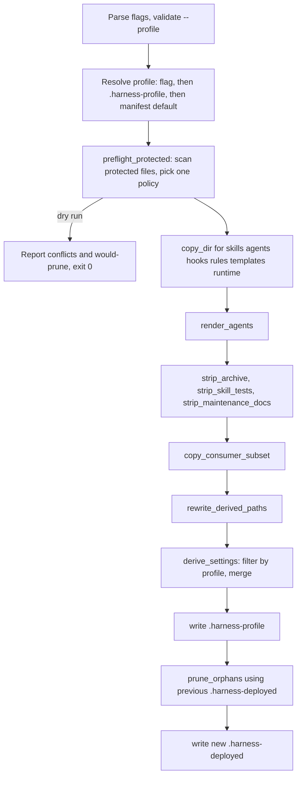

# Install, Deploy, and Re-sync

The harness keeps its source of truth at the repository root: `skills/`, `agents/`, `hooks/`, `rules/`, `templates/`, `runtime/`, and `settings.json`. Claude Code loads project skills, agents, and hooks only from `.claude/`, so the harness builds `.claude/` as a **derived copy** of those sources. Do not edit `.claude/` by hand. It is gitignored and is rebuilt on every deploy.

Three scripts handle this:

| Script | Who runs it | What it does |
|---|---|---|
| [`scripts/install-harness.sh`](../../scripts/install-harness.sh) | A consuming project, usually through the `curl … \| bash -s -- --yes` one-liner | Fetches the harness source, calls `deploy-harness.sh --target`, calls `init-structure.sh`, and appends entries to `.gitignore` |
| [`scripts/deploy-harness.sh`](../../scripts/deploy-harness.sh) | Harness developers after they edit sources (`bash scripts/deploy-harness.sh`), and the installer | Builds or re-syncs `.claude/`. It is idempotent, so the same run handles a first install and an update. |
| [`scripts/init-structure.sh`](../../scripts/init-structure.sh) | The installer, or a person running it directly | Creates the workflow's structural files only when they are missing |

## Installer: `install-harness.sh`

The installer is built so that it **never deletes or overwrites a target file**. It merge-syncs `.claude/` and adds a structural file only when that file is absent. This rule exists because of a past data-loss incident: an older installer staged its payload at the target root and then *pruned* it, which deleted real project files that had the same names.

Steps, in order:

1. **Parse and validate flags.** `--profile` must be empty, `minimal`, `standard`, or `strict`. The check runs before the target directory is created. Deploy then checks the profile a second time against the source manifest. `tests/scripts/deploy-profile.test.sh` asserts that the installer's hardcoded list matches the manifest's `hook_profiles` keys.
2. **Check prerequisites.** `jq` is always required. `git` is required only when cloning, that is, when `--source <local checkout>` is not passed.
3. **Resolve the source.** The installer uses `--source` if given. Otherwise it runs `git clone --depth 1` of `CS_REPO_URL`/`--branch` (default `main`) into a temp directory, which is removed on exit. A source without `skills/` or `scripts/deploy-harness.sh` is rejected.
4. **Gate a re-sync.** If `<target>/.claude/settings.json` already exists (and this is not a dry run), the installer warns that it will re-sync. Without `--yes`, `--force`, or `--overwrite-conflicts`, it asks `Re-sync it? [y/N]` when a controlling terminal exists. With no terminal it fails with "Re-run with --yes". `--force` is an alias of `--yes` and does **not** overwrite anything. `--overwrite-conflicts` counts as consent to the re-sync.
5. **Warn about legacy files.** In a consuming project (any target without `scripts/install-harness.sh`), the installer warns about root-level payload names left by the old layout. It does not touch them.
6. **Deploy.** The installer runs `bash "$SRC/scripts/deploy-harness.sh" --target "$TARGET_DIR"` directly from the fetched source and forwards `--yes`, `--overwrite-conflicts`, `--profile`, and `--dry-run`.
7. **Scaffold.** The installer runs `init-structure.sh --root "$TARGET_DIR"`. In a dry run it only reports what it would do.
8. **Update `.gitignore`.** See [Gitignore handling](#gitignore-handling).
9. **Copy sources (optional).** With `--keep-sources`, the installer copies the payload into `<target>/.harness-source/`. You can then re-sync offline with `bash .harness-source/scripts/deploy-harness.sh --target .`.

With `--dry-run`, the installer prints "Dry run complete … nothing was written" and exits 0. `tests/scripts/install-harness.test.sh` confirms that a dry run on a fresh target leaves the directory empty. It also confirms that the installer never creates or touches a consumer `.mcp.json`.

## Deployer: `deploy-harness.sh`

`deploy-harness.sh` finds its sources **by path** (`$(dirname "$0")/..`), not through git. When it runs from a staged copy inside another project, git would resolve to that project's root, which has no harness sources. `--target <dir>` writes `.claude/` inside `<dir>`. Without it, `.claude/` is written next to the sources (self-dev).

The script treats the run as an update when `$OUT/settings.json` already exists. Otherwise it is a first-time install. The pipeline is the same in both cases:

*The order in which deploy-harness.sh runs its steps. Nothing under `.claude/` is written before the preflight finishes.*

### The derived `.claude/` layout

- **Synced directories.** `copy_dir` merges each source directory one entry at a time. For each top-level entry the harness ships, it runs `rm -rf` and then copies the entry fresh. Entries the consumer added, such as a skill installed separately, are never touched. Local edits to files that are not protected are overwritten without a prompt (resync-conflict case 7).
- **Agents.** `agents/*.json` (contracts and runtime bindings) are source-time adapter inputs and are never copied. `render_agents` runs `scripts/render_agent_definitions.py --runtime claude` to render the `agents/*.md` frontmatter. See [Codex advisory alpha](../integrations/codex-advisory-alpha.md) for the multi-runtime binding side.
- **Stripped from the derived tree only.** The script removes `skills/_archive`, the `skills/<x>/tests/` directories, `test_*.py` files, the `HARNESS_ONLY_DOCS` files (`skills/xia2/README.md`, `skills/compound/README.md`, `agents/README.md`), and any `<!-- harness-only:begin -->…<!-- harness-only:end -->` region in Markdown. The source files keep all of this.
- **Consumer script subset.** The script does not sync all of `scripts/`. It copies only an allow-list (`CONSUMER_SCRIPTS`: `verify_summary.py`, `check_plan_contract.py`, `check_review_receipt.py`, `resolve_finish_context.py`, `rebuild_solution_index.py`, `render_skill_prompt.py`, `check_open_questions.py`, `run_at_commit.py`) into `.claude/scripts/`, and copies `harness-manifest.json` to `.claude/harness-manifest.json`. If an allow-listed file is missing from the source, the script warns and continues. Add a row to the allow-list only when a consumer-facing skill or rule references that helper.
- **Path rewriting.** `rewrite_derived_paths` changes root-relative helper paths in derived **Markdown only**: `scripts/X` becomes `.claude/scripts/X`, `harness-manifest.json` becomes `.claude/harness-manifest.json`, `python3 skills/visual-planner/render_plan.py` gets the `.claude/` prefix, and so does the `asd-ste100` linter path. The rewrite is idempotent, so a second run never produces `.claude/.claude/`. Hooks are left byte-identical to source because `commit-gate.sh` must read policy from the git index (`git show :harness-manifest.json`), never from a derived copy. See [Commit gate](../enforcement/commit-gate.md).
- **Nested checkouts.** The Markdown transforms and the test stripper never descend into `.claude/worktrees/` or into any directory that has its own `.git` entry. Harness worktrees live at `.claude/worktrees/<name>`, and an earlier recursive walk rewrote tracked source docs inside one (issue #276, covered by `tests/scripts/deploy-worktree-isolation.test.sh`). See [Branch isolation and session hooks](../enforcement/branch-isolation-and-session-hooks.md) for why worktrees live there.
- **Bookkeeping files.** `.claude/.harness-profile` records the profile used. `.claude/.harness-deployed` records the deploy manifest.

### Orphan pruning

Each `<dir>/<entry>` the run writes under a synced directory is recorded. At the end of the run, `prune_orphans` reads the **previous** `.harness-deployed` and deletes any entry that was listed there, was not deployed this run, and still exists. Then the new list is written. Only entries the harness itself shipped before can be pruned, so a consumer's own skills and agents are never pruned. A first deploy has no earlier manifest and prunes nothing. `.harness-profile` sits outside the synced-directory pattern, so pruning never removes it (`tests/scripts/deploy-prune.test.sh`, `deploy-profile.test.sh`).

## Hook profiles and `.harness-profile`

The hook profiles are defined in the `hook_profiles` object of [`harness-manifest.json`](../../harness-manifest.json). See [Harness manifest and contracts](../concepts/harness-manifest-and-contracts.md):

| Profile | Registered hooks | `commit-gate.sh` behavior |
|---|---|---|
| `minimal` | `branch-isolation-guard.sh`, `commit-gate.sh` | `--profile minimal`: secrets scan only |
| `standard` (manifest `default`) | the two above plus `session-knowledge.sh` | standard checks (escalations, lane evidence, run state, risk, plan scope) |
| `strict` | same three hooks as standard | `--profile strict`: also the untracked-`.py` deny and the app gates; risk corroboration becomes strict |

The script picks the profile in this order: the explicit `--profile` flag, then the value in `.claude/.harness-profile` if it names a valid profile, then `hook_profiles.default`. An unknown or option-shaped value such as `-eminimal` makes the script abort before anything is written. After the settings step, the chosen profile is written back to `.claude/.harness-profile`. A later re-sync without a flag keeps the same profile, and an explicit flag replaces it.

## Settings derive and merge

`derive_settings` builds the harness's part of `settings.json` from the root [`settings.json`](../../settings.json):

1. It keeps only hook commands whose basename appears in the profile's hook list. Then it drops groups and events left empty. Under `minimal`, the `SessionStart` key disappears.
2. It prefixes each relative command with `$CLAUDE_PROJECT_DIR/.claude/` so the hooks resolve from any launch directory. Commands that start with `$` or `/` are left unchanged.
3. It appends ` --profile 
` to the `commit-gate.sh` command only.

The result is then **merged** into the existing file rather than replacing it:

- Top-level keys the consumer added (`permissions`, `env`, `statusLine`, `enabledPlugins`, …) are kept.
- For each event, the merge removes any command that is either in the current harness command set or under `$CLAUDE_PROJECT_DIR/.claude/hooks/`, which belongs entirely to the harness. Then it appends the newly derived harness groups. As a result, re-syncs are idempotent, a profile change never registers `commit-gate.sh` twice, and hooks that were removed from source (for example the older `pre-bash-dispatch.sh` and `scope-gate.sh`) are pruned. The consumer's own hooks stay because they live outside that directory.
- Events left with no hooks are removed completely, not kept as `[]`.
- If the existing `settings.json` is not valid JSON, the script copies it to `settings.json.invalid-bak-<timestamp>`, prints a warning, and writes a fresh file. It never overwrites an invalid file without that backup.

`tests/scripts/settings-merge.test.sh` and the last cases of `deploy-profile.test.sh` cover this behavior.

## Protected files and `.harness-incoming`

Some files belong to the consuming repo and are maintained by hand. They are listed in `BOOTSTRAP_OWNED_FILES`: `rules/architecture.md`, `rules/guidelines.md`, `rules/behavior.md`, and `agents/PROJECT.md`. A re-sync must never overwrite them with the harness's generic copy without warning.

`preflight_protected` runs **once, before anything is written**. It compares each protected file in `.claude/` with the incoming source and collects the files that differ. Then it picks one policy for the whole batch:

| Condition | Policy | Result |
|---|---|---|
| `--overwrite-conflicts` | `overwrite` | The local copy is replaced, and any stale sidecar is removed |
| `--yes` or no controlling terminal | `keep` | The local copy is kept, the incoming version goes to `<file>.harness-incoming`, and the script prints a warning |
| Interactive terminal | prompt `[k]eep / [o]verwrite / [b]ackup / [a]bort` | `b` copies the local file to `.claude/.harness-backup-<ts>/` and then overwrites it. `a` exits 1 with nothing written. Any other answer means keep. |

To check for a terminal, the script opens `/dev/tty` in a subshell. A plain `[ -r /dev/tty ]` check would succeed even after `setsid()`. The prompt reads from `/dev/tty`, never from stdin.

Protected files are handled differently from ordinary entries:
- A top-level protected file such as `rules/architecture.md` is handled by `sync_protected_file`. The plain `rm`+`cp` is skipped.
- A protected file inside a synced directory, such as `agents/PROJECT.md`, is handled by `sync_protected_dir`. That function saves the protected file and any local `.proposed` draft, copies the whole directory, and then reconciles the file according to the policy. The local `.proposed` file is always restored. This is safe only because the harness ships no `.proposed` files of its own, which resync-conflict case 1 checks.
- When a protected file matches the source, any leftover `.harness-incoming` sidecar from an earlier conflict is deleted.

With `--dry-run`, the script lists the files that would conflict and the entries it would prune, then exits 0 before writing anything. The final summary lists any conflicts and the policy that was applied.

## Structural scaffolding: `init-structure.sh`

`init-structure.sh` copies templates from [`templates/structure/`](../../templates/structure/) to fixed destinations, but only when the destination does not exist yet. For each file it prints `created` or `exists`, and it always exits 0:

| Template | Destination |
|---|---|
| `specs-README.md`, `specs-STATE.md` | `specs/README.md`, `specs/STATE.md` |
| `docs-solutions-README.md`, `docs-solutions-INDEX.md`, `docs-solutions-critical-patterns.md` | `docs/solutions/…` |
| `techstacks-README.md` | `techstacks/README.md` |

This script replaced the scaffolding step of the removed `bootstrap-xia2` skill. It never overwrites existing content.

## Gitignore handling

After a real (non-dry-run) install, the installer appends entries to `<target>/.gitignore`. It never rewrites existing lines. It adds a newline first if the file does not end with one. Each append is wrapped so that a failure only prints a warning: the deploy has already succeeded by then, and the step must not abort the install.

- **`.claude/`**: `.claude/` is derived. It also contains `.py` files, and under the strict profile any untracked `.py` file makes the commit gate deny commits. The installer skips this entry, with a message, in two cases:
  - **tracked:** `git ls-files` shows that the repo already tracks `.claude`. The installer warns you to check `git status`.
  - **declared:** an existing line already scopes the directory: `.claude`, `.claude/`, or `.claude/*`, with an optional `/` or `!` prefix. The pattern is anchored to the end of the line, so comments and narrow per-file rules such as `.claude/settings.local.json` do not count as a match.
- **`specs/**/events.jsonl.lock`**: this is the machine-local lock that the run-state engine takes. The installer asks `git check-ignore --no-index -v -n` which rule decides a probe path. It skips the append only when that rule comes from a `.gitignore` file. If that rule is a negation, the consumer has chosen to track the lock, and the installer leaves it alone. The lock file is separate from the tracked `RUN.json` and `events.jsonl`. See [Post-merge bookkeeping](post-merge-bookkeeping.md).

The harness repo's own `.gitignore` also lists `.claude/`.

## Focused tests

| Test | What it covers |
|---|---|
| `tests/scripts/resync-conflict.test.sh` | keep/overwrite/no-tty policies, nested protected files, `.proposed` survival, dry-run byte-identity, stale-sidecar cleanup |
| `tests/scripts/settings-merge.test.sh` | foreign keys and hooks preserved, idempotent re-sync, invalid-JSON backup, removed-hook pruning |
| `tests/scripts/deploy-profile.test.sh` | profile filtering, `.harness-profile` persistence and override, rejecting unknown profiles before any write |
| `tests/scripts/consumer-subset.test.sh` | allow-listed helpers, path rewriting, test and maintenance-doc stripping, hooks left un-rewritten |
| `tests/scripts/deploy-prune.test.sh`, `deploy-worktree-isolation.test.sh` | orphan pruning safety, nested checkouts left untouched |
| `tests/scripts/install-harness.test.sh`, `install-gitignore.test.sh`, `install-tty-gate.test.sh`, `init-structure.test.sh` | installer end-to-end, `.gitignore` append contract, re-sync consent gate, scaffolding |

Every deploy test passes `--target` with a temp directory and redirects stdin, so a stray prompt fails instead of hanging and the repo's own `.claude/` is never rewritten.
