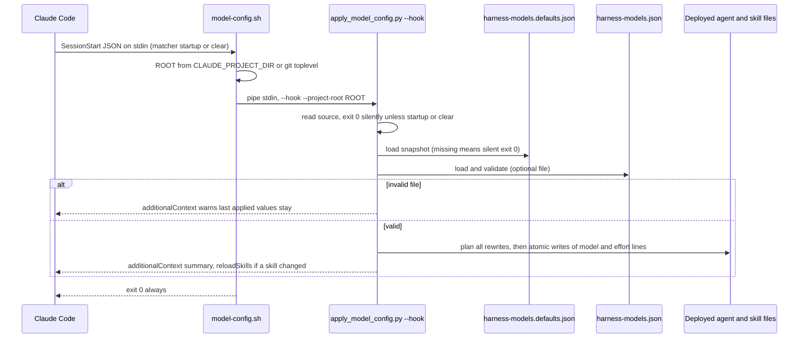

# Model and Effort Configuration

A harness user can set the `model` and `effort` of each harness subagent role and each harness skill in one optional, team-shared file: `harness-models.json` at the repository root. The harness does not read this file at run time. Instead, one applier script, [`scripts/apply_model_config.py`](../../scripts/apply_model_config.py), merges the file with a defaults snapshot and rewrites the `model:` and `effort:` lines in the **deployed** frontmatter under `.claude/agents/` and `.claude/skills/`. Claude Code then reads that frontmatter as usual.

Three entry points call the applier:

| Entry point | When | Mode |
|---|---|---|
| [`scripts/deploy-harness.sh`](../../scripts/deploy-harness.sh) | install, deploy and re-sync | `--check` against a snapshot rendered from source, then `--apply` |
| [`hooks/model-config.sh`](../../hooks/model-config.sh) | SessionStart with `source` `startup` or `clear` | `--hook` |
| `/harness-models` skill ([`skills/harness-models/SKILL.md`](../../skills/harness-models/SKILL.md)) | when the user runs it | `--show` (default), `--check`, `--apply` |

The design and its decisions D1–D13 are recorded in [`specs/model-effort-config/design.md`](../../specs/model-effort-config/design.md). The delivery record and known limitations are in [`specs/model-effort-config/SUMMARY.md`](../../specs/model-effort-config/SUMMARY.md).

## Scope: subagents and skills, never the main session

The file governs subagents and skills only. The main session's model and effort belong to the user (design option A, D10). The applier writes only `<claude-dir>/agents/<role>.md` and `<claude-dir>/skills/<name>/SKILL.md`. It never writes `settings.json`, `settings.local.json` or user settings. No `PreModelSwitch` hook is registered. A `/model` or `/effort` choice made in the middle of a session is therefore never reverted.

Automatic application happens only at install/deploy and at SessionStart `startup` and `clear` (`/clear` counts as a new session). It never happens on `resume`, `compact` or `fork` (D9). The only mid-session apply is `/harness-models apply`. The user runs it, so it is the user's own action.

Only harness-owned agents and skills can be configured (D5). Consumer-owned agents and skills are never targets, and a user file that names one fails validation. Their authors set `model`/`effort` in their own frontmatter. The feature is Claude-only (D3): [`scripts/render_codex_adapter.py`](../../scripts/render_codex_adapter.py) skips the `model-config.sh` registration when it renders the Codex hooks, and Codex keeps its own settings in `agents/runtime-bindings.json`.

## The user file: `harness-models.json`

```json
{
  "schema_version": 1,
  "agents": {
    "coding":        { "model": "claude-sonnet-5-5", "effort": "medium" },
    "reviewer":      { "model": "claude-opus-5-5",   "effort": "medium" },
    "test-runner":   { "model": "claude-haiku-5-5",  "effort": "high" }
  },
  "skills": {
    "brainstorming": { "model": "claude-opus-5-5", "effort": "medium" }
  }
}
```

*An excerpt in the shape of the repository's own [`harness-models.json`](../../harness-models.json).*

Schema rules, as `validate_user` in the applier enforces them:

- **Top-level keys.** Only `schema_version`, `agents` and `skills` are allowed. All three are optional.
- **`schema_version`.** If present, it must be the integer `1`. Any other value gives `unsupported schema_version`.
- **`agents` / `skills`.** Each must be an object. Every key must name a role or skill in the defaults snapshot. Any other name gives `unknown role` or `unknown skill`.
- **Entries.** Each entry must be an object whose only keys are `model` and `effort`, and whose values are strings. `null` is an error, so you cannot clear a default from the file.
- **`model`.** One of the aliases `opus`, `sonnet`, `haiku`, `fable`, `inherit`, or any string that matches `^claude-[a-z0-9.-]+$`. No model ID list is hard-coded, so a model upgrade needs no code change. The applier checks only the shape of the name. It does not check that your account can use the model.
- **`effort`.** One of `low`, `medium`, `high`, `xhigh`, `max`. The applier checks this one fixed list, not what each model supports.
- **Review floor.** The effective `effort` for `reviewer` and `task-reviewer` must be at least `medium`. The floor is a code constant (`REVIEW_EFFORT_FLOOR`), so the JSON file cannot lower it (D4).

Validation is all-or-nothing. Every error is reported, one line each, and when there is any error no file is written.

### Merge per field

For each role and skill in the snapshot, the effective value of each field is the snapshot default, replaced by the user file's field if the file sets it. A skill that is not in the user file keeps its snapshot default. Today no harness skill declares `model` or `effort`, so that default is "no line".

## The defaults snapshot: `.claude/harness-models.defaults.json`

The snapshot lists the configurable names and their default values. It is produced by `render_agent_definitions.py --runtime claude --defaults-out <file>` (`defaults_snapshot` in [`scripts/render_agent_definitions.py`](../../scripts/render_agent_definitions.py)):

- `agents` comes from the Claude roles in `agents/runtime-bindings.json` and keeps each role's `model` and `effort` if set.
- `skills` has one key per `skills/<name>/SKILL.md` in the source, except `skills/_archive/`. Each key holds the `model`/`effort` that the skill's source frontmatter declares (today, every one is empty `{}`).
- The output is `{"schema_version": 1, "agents": ..., "skills": ...}`.

`--defaults-out` cannot be combined with `--check` and needs `--runtime claude`. Deploy copies the snapshot to `.claude/harness-models.defaults.json`. That is a top-level file in `.claude/`, outside the directories that orphan pruning touches. `agents/*.json` still never deploys to consumers, so the snapshot is how the hook and the skill learn the defaults later from inside `.claude/` (D7).

The applier looks for the snapshot at `<claude-dir>/harness-models.defaults.json` unless you pass `--defaults`. If the snapshot is missing or malformed, the applier raises `SnapshotError`.

## How the applier writes frontmatter

`rewrite()` changes only the `model:` and `effort:` lines inside the leading `---` frontmatter block (D8):

- If a line exists, it is replaced where it stands, and its line ending is kept.
- If a line is missing, it is inserted after the last `description:`, `tools:` or `model:` key that is present (skipping indented continuation lines). This matches the order the renderer writes.
- If the effective value is none, the line is deleted.
- Every other byte is kept. A file whose content would not change is not written, so a second apply with the same inputs writes 0 files.

`apply()` plans every target before it writes anything. A target that is not a file is listed as "missing" and skipped. If any target cannot be read, or has missing or unclosed frontmatter, the whole apply stops with **nothing written**. Each write is atomic: a temp file in the same directory, the original mode copied, then `os.replace`. If a write fails part-way (permission or disk), the files already written stay, and the result names the failed file. Because writes are atomic and idempotent, a re-run after you fix the cause converges to the full result.

A hand edit to a `model:`/`effort:` line in a deployed agent or skill file is overwritten at the next deploy or new session.

## SessionStart: `hooks/model-config.sh`

The root [`settings.json`](../../settings.json) registers the hook under `SessionStart` with matcher `startup|clear` and the status message "Applying harness-models.json (agent/skill model + effort)…". [`harness-manifest.json`](../../harness-manifest.json) puts `model-config.sh` in the `standard` and `strict` hook profiles, not in `minimal` (D13). Minimal consumers therefore get the settings only at deploy.



*The SessionStart path from Claude Code through the wrapper and the applier to the rewritten frontmatter. Every path ends in exit 0.*

The wrapper is thin:

- It finds the applier next to its own code at `$HOOK_DIR/../scripts/apply_model_config.py`. That is `scripts/` in the source repository and `.claude/scripts/` in a consumer.
- It takes the project root from `CLAUDE_PROJECT_DIR`, else from `git rev-parse --show-toplevel` of the working directory. The root never comes from the hook's own location; `scripts/check-hook-root-source.sh` enforces this.
- If there is no root, no `python3` or no applier, it exits 0 silently. It discards the applier's stderr and always exits 0.

`run_hook` in the applier repeats the `source` filter on purpose. A consumer can edit the matcher in its settings, and the script must still never apply on `resume`, `compact` or `fork`. Unparseable stdin also exits 0 with no output.

Hook output is a single `hookSpecificOutput` JSON object with `hookEventName: "SessionStart"`, and only when something happened:

| Situation | `additionalContext` | Writes |
|---|---|---|
| Nothing to change, or no user file and defaults already applied | none (no output) | none |
| Defaults snapshot missing or unreadable (for example a worktree session with no deployed `.claude/`) | none (no output) | none |
| User file invalid or below the review floor | `harness-models: harness-models.json is invalid, so the last applied values stay (...). Run /harness-models check.` | none |
| A target has bad frontmatter or cannot be read | `harness-models: nothing applied (...)` | none |
| A write fails part-way | `harness-models: partial apply, N file(s) written, failed ... Run /harness-models apply.` | the files before the failure |
| Success | `harness-models: applied model/effort to N file(s).` | the changed files |
| Any unexpected exception | `harness-models: hook error (...). Run /harness-models check.` | — |

When any `skills/...` file was written, the output also sets `reloadSkills: true`.

### When a change takes effect

- **Skills.** A skill's `model`/`effort` applies at the next invocation of that skill, for that skill's turn only. Then the session goes back to the user's choice.
- **Agents.** Claude Code reads `.claude/agents/<role>.md` at session start, and agent reload after SessionStart is not documented. In headless runs (`claude -p`), the spec's probes showed that an agent file rewritten by the hook takes effect only **from the next session**. The user accepted this lag (assumption A5, option 1). Both the hook header's "Does not verify" note and the `--apply` report say so.
- **Overrides.** The configured model is not guaranteed to be the one that runs. `CLAUDE_CODE_SUBAGENT_MODEL_FORCE`, `CLAUDE_CODE_SUBAGENT_MODEL`, `CLAUDE_CODE_EFFORT_LEVEL`, managed `availableModels`, or an Agent call's `model` parameter can override it. `--show` warns only about the three environment variables.

## Deploy integration

[`scripts/deploy-harness.sh`](../../scripts/deploy-harness.sh) ships `apply_model_config.py` in its consumer script allow-list and runs two steps (D12):

1. **`check_model_config`** runs before `preflight_protected` and before anything is written under `.claude/`, including under `--dry-run`. It renders the snapshot from the **source** bindings and skills into a temp file, then runs `apply_model_config.py --check --project-root "$OUT_BASE" --defaults "$MODELS_SNAPSHOT"`. Because it checks against the incoming names, it also works on a first deploy. If the check fails, deploy prints the errors plus "harness-models.json check failed — nothing written under .claude/" and exits 1.
2. **`apply_model_config`** is a pipeline step right after `rewrite_derived_paths` and before `derive_settings`. It copies the snapshot to `$OUT/harness-models.defaults.json` and runs `--apply --claude-dir "$OUT"`. At that point the agent render, the skill copy and every Markdown path rewrite are done, so no later step changes the applied lines.

If the source has no `scripts/apply_model_config.py`, deploy warns and skips both steps. See [Install, Deploy and Resync](install-deploy-and-resync.md#model-config-application-at-deploy) for the full pipeline.

## The `/harness-models` skill

The skill is a thin wrapper (D6). It reads the mode (`show`, `check` or `apply`; the default is `show`) and stops if the mode is anything else. It runs `git rev-parse --show-toplevel` and then runs the matching applier command with that path as a literal `--project-root` (no `$(...)`, because the `allowed-tools` grant matches only the literal form). It relays the output and the exit status verbatim. In source the commands read `python3 scripts/apply_model_config.py --<mode>`; deploy rewrites them to `.claude/scripts/`. The skill never edits `harness-models.json`; the user edits that file.

CLI behavior of the non-hook modes:

- **`--show`** prints one row per target with a non-empty effective value. The columns are target, model, `model-source`, effort and `effort-source`. Each source is `default` or `harness-models.json`, per field. It also prints a warning for each override environment variable that is set.
- **`--check`** prints `ok: harness-models.json is valid` or one `error:` line per problem, and exits 1 on errors. It writes no file.
- **`--apply`** prints `missing target`, `error:` and `wrote` lines, then a count. After any write it adds "Skill changes apply at the next invocation of that skill." and "Agent changes apply from the next session in headless runs." A frontmatter error or a partial write exits 1.
- All three modes exit 1, with the error, when the snapshot is missing or the file is invalid. Only `--hook` never fails.

Known gap: the skill takes the root from `git rev-parse --show-toplevel`, while the hook prefers `CLAUDE_PROJECT_DIR`. In a session rooted at the main checkout whose working directory is a deployed linked worktree, `apply` edits the worktree's `.claude/` (advisory finding in the SUMMARY). The skill also ships into the Codex plugin, where the applier and snapshot do not exist, so it fails there (accepted under D3).

## Known limitations

These items are recorded in the spec SUMMARY as minor or advisory findings that were not fixed:

- **Partial render on broken frontmatter.** `render_agent_definitions.py` writes the agent files before it builds the snapshot. A skill with broken frontmatter therefore leaves a partial render when the renderer exits 1.
- **Non-atomic `--defaults-out`.** The snapshot write uses a plain `write_text`, not an atomic write. A missing parent folder raises an uncaught `FileNotFoundError`.
- **CRLF insert.** An inserted line always ends in `\n`, even in a CRLF file. A replaced line keeps the file's ending.
- **Duplicate keys.** If a frontmatter block has duplicate `model:`/`effort:` keys, a set rewrites only the first copy, while a delete removes all of them.
- **Trailing newline in a model ID.** `MODEL_ID` uses `$` with `.match`, so `"claude-x\n"` passes validation, and each apply then adds a blank frontmatter line.
- **Deploy abort after a passed check.** If `--apply` fails after the check passed (a write error), `set -e` stops deploy before `derive_settings`, `.harness-profile`, orphan pruning and `.harness-deployed`, and temp files leak.
- **Live proof covers one role.** Only `test-runner` was proven live (SC-22, a headless session ran it on the configured model). Other roles and skill `effort` are not live-proven.

## Focused tests

- [`scripts/test_apply_model_config.py`](../../scripts/test_apply_model_config.py): merge, each class of validation error, the review floor, idempotence, the `--show` table and its env-var warnings, the main-session boundary (`settings.json` and `settings.local.json` stay byte-identical), skill line insert and removal, untouched consumer skills, partial writes, and the hook outputs.
- [`tests/hooks/model-config.test.sh`](../../tests/hooks/model-config.test.sh): in a consumer layout (temp git repo), `startup` and `clear` apply and set `reloadSkills`. `resume`, `compact` and `fork` leave targets byte-identical. An invalid file warns and writes nothing. A missing snapshot, a missing applier and bad stdin are silent. The root comes from `CLAUDE_PROJECT_DIR`, else from git. One `startup` run takes under 1 s.
- [`tests/scripts/model-config-deploy.test.sh`](../../tests/scripts/model-config-deploy.test.sh): a deploy applies exactly the configured line and ships the applier and the snapshot but no `agents/*.json`. A consumer skill stays byte-identical, and a second deploy changes nothing. An invalid file stops re-sync, first deploy and `--dry-run` before any write under `.claude/`.
- [`scripts/test_harness_models_skill.py`](../../scripts/test_harness_models_skill.py): the skill maps exactly `show`, `check` and `apply` to the applier flag of the same name, and its body names no `.claude/` path and no vendor model ID.
- `scripts/test_render_agent_definitions.py -k defaults_out`, `tests/scripts/deploy-profile.test.sh` (profile registration with matcher `startup|clear`) and `scripts/test_render_codex_adapter.py` (Codex exclusion).

## Related pages

- [Install, Deploy and Resync](install-deploy-and-resync.md)
- [Branch Isolation and Session Hooks](../enforcement/branch-isolation-and-session-hooks.md)
- [Harness Manifest and Contracts](../concepts/harness-manifest-and-contracts.md)
- [Agent Roles](../agents/agent-roles.md)
