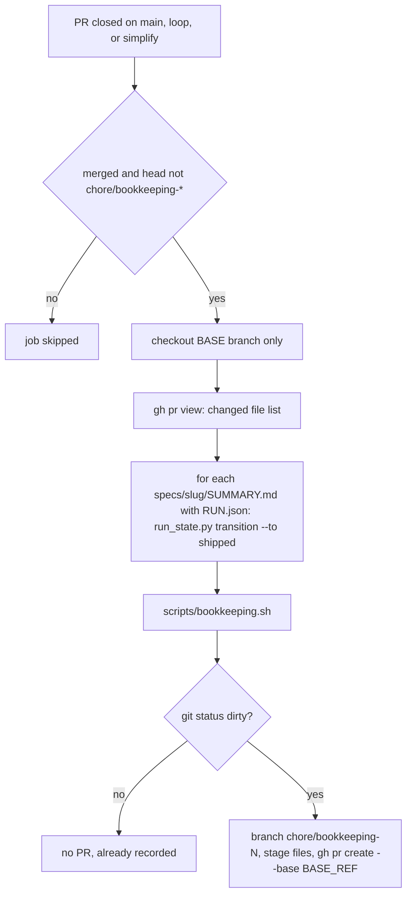

# Post-Merge Bookkeeping and Harness Diagnostics

This harness uses *event-sourced bookkeeping*. A merged PR is recorded by automation, not by hand-written appends that people forget. Each merge into an integration branch produces a follow-up "bookkeeping PR". That PR bumps `VERSION`, inserts a `CHANGELOG.md` section, appends a row to the trust ledger, appends a drift-audit snapshot to a JSONL trend log, and moves the PR's tracked run to `shipped` in the run-state engine. Two read-only scripts let you inspect the results: `scripts/harness-status.sh` and `scripts/harness-audit.sh`. A separate scheduled workflow refreshes this OpenWiki.

Related pages: [CI Gates and Doc Truth](../enforcement/ci-gates-and-doc-truth.md) covers the blocking CI checks. [Run-State Engine](../runtime/run-state-engine.md) covers the `RUN.json` / `events.jsonl` FSM that the workflow drives to `shipped`.

## End-to-end flow



*The post-merge-maintenance job: trust gate, run-state checkpoint, bookkeeping, then a bookkeeping PR only when something changed.*

## The `post-merge-maintenance` workflow

Source: [`.github/workflows/post-merge-maintenance.yml`](../../.github/workflows/post-merge-maintenance.yml).

### Trigger and the integration-branch allowlist

The workflow runs on `pull_request_target` with `types: [closed]`, filtered by `branches: [main, loop, simplify]`. The job guard runs only when `github.event.pull_request.merged == true`. It also skips PRs whose head ref starts with `chore/bookkeeping-`. That second check is a loop guard: merging a bookkeeping PR does not trigger another bookkeeping PR.

The `branches:` list is the single authoritative statement of the base-branch policy. It is scoped on purpose, for two reasons:

- **Security / blast radius.** `pull_request_target` grants a write token and checks out the base branch. Without the filter, the workflow would run with that token on the tip of every branch a PR merged into.
- **Correctness.** A feature→feature merge could terminalize a run too early. The run would get the wrong merge SHA, and the real ship would find nothing left to transition.

**The list fails silently when it goes stale.** If a PR merges into a branch that is not listed, nothing fires: no run, no log, no error. History shows this has happened several times. `[v2]` outlived v2. `[main, v3]` outlived v3. `[main, loop]` excluded `simplify`, so PR #189 (`gate-verifiability-principle`) stayed at `ready_to_merge` (issue #196) until `simplify` was added.

**The list must be synced on `main`.** `pull_request_target` always loads the workflow definition, including the branch list, from the repository's default branch (`main`), whatever the PR's base is. If you edit the list only on an integration branch, the edit does nothing until it reaches `main`. Sync it in a small PR of its own. Earlier syncs were done this way in #36, #44, and #45.

When integration moves to a new branch, do all of the following:

1. Add the branch to `branches:`.
2. Land that change on `main`.
3. Update the branch name pinned in `tests/scripts/post-merge-runstate-staging.test.sh`.

### Security model

- The workflow checks out `github.event.pull_request.base.ref`, never the PR head. Only trusted code runs with the write token.
- PR-controlled strings (title, number, base ref, merge SHA) are passed as `env:` variables (`PR_TITLE`, `PR_NUMBER`, `BASE_REF`, `MERGE_SHA`). They are never interpolated into a `run:` script with `${{ }}`, which prevents Actions expression injection.
- The changed-file list is metadata only, collected with `gh pr view "$PR_NUMBER" --json files`. The PR's code is never fetched.
- The workflow does not push to a protected branch. It pushes `chore/bookkeeping-<N>` and opens a PR against `BASE_REF` with the default `GITHUB_TOKEN`, so no PAT is needed. The job's permissions are `contents: write` and `pull-requests: write`.

### Step order and why it matters

1. **Gather changed files** into `/tmp/changed-files.txt`.
2. **Run-state checkpoint (non-fatal).** The step extracts every `specs/<slug>/SUMMARY.md` slug from the changed files. It skips slugs that have no `specs/<slug>/RUN.json`. For each remaining slug, it runs `python3 runtime/run_state.py transition --slug <slug> --to shipped --event ci.merged --sha "$MERGE_SHA"`. It stops at the **first** successful transition and publishes that slug as the step output `slug`.
   - The FSM decides which candidates qualify: `shipped` is legal only from `ready_to_merge`. A terminal or not-yet-ready slug is skipped with a `::warning::`, and the loop moves on to the next slug. The step does not use `head -1`, because a single untracked or already-terminal slug that sorts first would silently hide the real tracked run. That is the same silent-skip class as #196.
   - The slug is published **only** after a successful transition, so the PR step never stages files the transition did not write.
   - If no candidate transitions, the step logs a message and continues. PRs without a tracked run are not failures.
3. **Run bookkeeping**, which calls `scripts/bookkeeping.sh` (described below). After the script runs, `git status --porcelain` sets `changed=true|false`. This step **must** come after the run-state step. The dirty-tree check decides whether a PR is opened at all. If the check ran first, a change that only touched run state would read as "nothing to record", and the `shipped` transition would be lost with the runner.
4. **Open the bookkeeping PR** (only if `changed == 'true'`). The step stages `VERSION`, `CHANGELOG.md`, `docs/harness-experimental/trust-metrics.md`, and `docs/harness-experimental/audit-log.jsonl`. If a slug was published, it also stages `specs/<slug>/RUN.json` and `specs/<slug>/events.jsonl`. `git commit` runs without `-a`, so any file that is not staged is discarded when the runner exits. The step reports success, but the run stays non-terminal forever. That bug was found in review of PR #176.

## `scripts/bookkeeping.sh`

Source: [`scripts/bookkeeping.sh`](../../scripts/bookkeeping.sh). The workflow is a thin wrapper. The script holds the logic so it can be tested offline:

```bash
scripts/bookkeeping.sh --pr N --title "T" --sha SHA --files "$(printf 'a\nb')" \
  [--date YYYY-MM-DD] [--root DIR]
```

`--pr` is required. `--date` defaults to today. `--root` lets tests point the script at a fixture tree.

| Step | Behavior |
|---|---|
| Idempotency | If `trust-metrics.md` already contains `shipped (PR #<N>, `, the script exits 0 and changes nothing. The check matches the outcome-column marker, not the bare `PR #N`, so a free-text note such as "revert PR #8" cannot block PR #8 from being recorded. A re-run never double-bumps `VERSION`, and it exits before the trend-log append. |
| Ledger fields | The script takes the **first** `specs/<slug>/SUMMARY.md` in the changed-file list. It reads `Lane`, `Confidence`, `Flags`, and `Affects` from that file, accepting both plain `Lane:` and bold `**Lane:**` and stripping trailing CRs. If the PR has no SUMMARY, the slug becomes `pr-<N>` and the fields become `-`. |
| Title sanitizing | CR, LF, and tab are collapsed to spaces. An empty title becomes `(no title)`. In the ledger cell, `|` is escaped so a title cannot add table columns. |
| VERSION bump | **Minor** (patch reset to 0) if any changed path matches `^(hooks/|settings\.json|skills/)`. Otherwise **patch**. |
| CHANGELOG | The script inserts `## [x.y.z] — DATE` followed by `- <title> (PR #N)` before the first `## [` heading that is not `[Unreleased]`. The new entry lands below `[Unreleased]` and above the previous version. If no such heading exists, the section is appended at the end, so the entry is never dropped. The entry text reaches awk through `ENVIRON`, not `awk -v`, because `-v` would expand a literal `\n` in a title into a forged heading. |
| Ledger row | The script appends a 9-column row to `docs/harness-experimental/trust-metrics.md` with date, slug, lane, affects, confidence, flags, `-`, ``shipped (PR #N, `SHA`)``, and the title. |
| Trend log | The script runs `scripts/harness-audit.sh --root "$ROOT" --json`, adds `"pr": N`, and appends the line to `docs/harness-experimental/audit-log.jsonl`. |

Keep two things in mind about the script's behavior:

- **The two "slug" choices are independent.** The ledger uses the first SUMMARY slug. The run-state step uses the first slug that transitions successfully. If a PR touches several specs, these can differ.
- **The bump rule is narrower than the policy in the CHANGELOG preamble.** The preamble says *major* for breaking workflow or schema changes and *minor* for new or changed skill/hook contracts. The script never produces a major bump; a major release needs a manual edit. At the time of writing, [`VERSION`](../../VERSION) is `2.36.0`, and the newest dated section in [`CHANGELOG.md`](../../CHANGELOG.md) is `## [2.36.0] — 2026-10-19`.

## The OpenWiki update workflow

Source: [`.github/workflows/openwiki-update.yml`](../../.github/workflows/openwiki-update.yml). This workflow is independent of merges. It runs daily at 08:00 UTC (`cron: "0 8 * * *"`) and can also be started with `workflow_dispatch`.

1. Checks out the repository with `fetch-depth: 0`. `openwiki code --update` needs the full history to diff `HEAD` against the commit it last documented. A shallow clone would produce an empty change summary.
2. Installs `openwiki@0.7.2` plus `mermaid@11.16.0` and `jsdom@29.1.1` (optional, used for diagram validation) on Node 22.
3. Runs `openwiki code --update --print` with `continue-on-error: true`. It uses the Anthropic provider (`OPENWIKI_MODEL_ID: "opus5.5"`) and `ANTHROPIC_API_KEY`, plus LangSmith keys for connector pulls and tracing.
4. Deletes the transient `openwiki/.run.json`. This step and every later PR step use `if: ${{ !cancelled() }}`, so they still run after an OpenWiki failure.
5. Opens or updates a PR on branch `openwiki/update` with `peter-evans/create-pull-request`. The PR includes `openwiki`, `AGENTS.md`, the workflow file itself, and `CLAUDE.md` if that file exists. `CLAUDE.md` is listed only when present, because `git add` on a missing path stages nothing. The PR body reports the OpenWiki step outcome.
6. **Token choice.** The PR is created with `secrets.OPENWIKI_PR_TOKEN` if it is set, otherwise with `github.token`. A PR opened with the default `GITHUB_TOKEN` triggers no `pull_request` workflows, so `harness-ci` (tests and strict gate) would never run on it. `OPENWIKI_PR_TOKEN` should be a fine-grained PAT or GitHub App token with contents, pull-requests, and workflows write; workflows write is needed because the PR includes this workflow file. The job only exposes whether the token is set (`HAS_PR_TOKEN`), because `secrets` cannot be read in a step `if:`. When a PR was created, the job posts a `::notice` with its URL. If the token is missing, it also emits a `::warning` saying CI did not run and that closing and reopening the PR will trigger it.
7. If the OpenWiki step failed, the job exits 1 **after** the PR is created. The PR keeps the pages that were completed before the failure. Merging it makes that partial progress the baseline for the next run.

## Diagnostics

### `scripts/harness-audit.sh` — advisory drift detector

Source: [`scripts/harness-audit.sh`](../../scripts/harness-audit.sh). It looks for governance drift that other checks do not already catch. Phantom path references and the hook table belong to `scripts/lint-doc-truth.sh`. Orphan `.py` files belong to `hooks/commit-gate.sh`. The audit runs six checks:

1. `specs/*/SUMMARY.md` has no `### Verify` section.
2. A `specs/*/PLAN.md` with `status: active` has a newest date older than `HARNESS_AUDIT_STALE_DAYS` (default 30), or has no dates at all.
3. A `docs/solutions/**/*.md` file has `confirmed_at` older than `HARNESS_AUDIT_CONFIRMED_DAYS` (default 30).
4. An `open` row in `docs/harness-experimental/improvement-backlog.md` is older than `HARNESS_AUDIT_BACKLOG_DAYS` (default 14).
5. `harness-manifest.json` is degraded, meaning `scripts/check_manifest.py` exits non-zero.
6. Contract surfaces are dirty in the working tree, as reported by `scripts/check-contract-impact.sh --changed`. These results are printed as reminders to re-verify consumers. They are **not** counted as findings.

The finding count maps to a band: `healthy` (0), `minor drift` (1–3), or `needs attention` (more than 3). The script always exits 0 unless you pass `--strict`, which exits 1 on any finding (for opt-in CI). `--json` prints one line: `{"date", "findings", "band", "checks": {verify_missing, plan_stale, backlog_stale, manifest_degraded, solutions_stale, contract_impact}}`. Bookkeeping stores that line per merge, so the finding count becomes a trend over time instead of a single sample.

### `scripts/harness-status.sh` — read-only status report

Source: [`scripts/harness-status.sh`](../../scripts/harness-status.sh). It prints these sections in order:

1. Wired hooks from `.claude/settings.json`.
2. Installed skills (directories in `skills/`, excluding `_archive`).
3. The last 5 dated trust-ledger rows.
4. The last 5 audit-trend entries from `audit-log.jsonl` (date, findings, band).
5. Active runs, from `python3 runtime/run_state.py list --active`.
6. The full `harness-audit.sh` report, run only if that script is executable, with `|| true`.

The script runs under `set -euo pipefail`, but its contract is that **every section is advisory**. A missing, unreadable, malformed, or non-UTF-8 input must degrade only its own section (for example `[not found: …]`, `[unreadable: …]`, `[no data rows found]`). It must never abort the script, because an abort would silently drop every section after it.

That guarantee is enforced at the command level with `|| echo` and `|| true`, not with Python exception allowlists. `open()` runs outside any `try`, so an exception allowlist cannot be proven complete. This lesson is recorded in [`docs/solutions/critical-patterns.md`](../../docs/solutions/critical-patterns.md). Both `harness-status.sh` and the post-merge workflow are meta-repo-only tooling. The deploy and install scripts do not ship them to consuming repos.

## Tests that guard this area

- **[`tests/scripts/post-merge-runstate-staging.test.sh`](../../tests/scripts/post-merge-runstate-staging.test.sh)**
  - Checks that the `on:` block has a `branches:` allowlist that includes `simplify` and `main`. It requires those members, not an exact list.
  - Checks that the main-sync caveat is documented.
  - Checks that the shipped decision depends on `RUN.json`, not on the base ref.
  - Measures the files a real `shipped` transition writes in a temp tree (currently `RUN.json` and `events.jsonl`) and asserts the PR step `git add`s every one of them. If the engine gains a third artifact, this test fails instead of the file silently vanishing in CI.
  - Checks that the run-state step comes before `changed=` detection.
  - Checks that the slug is published only inside the successful-transition branch.
- **[`tests/scripts/bookkeeping.test.sh`](../../tests/scripts/bookkeeping.test.sh)** — Offline fixtures for the script:
  - Ledger field parsing, including bold fields.
  - Minor vs. patch bumps.
  - CHANGELOG placement, and the case with no `[Unreleased]` section.
  - Idempotency, including the trend log.
  - The `pr-N` fallback.
  - Literal-`\n` heading injection.
  - Free-text `PR #N` not blocking a real record.
  - Pipe escaping.
- **`tests/scripts/harness-audit.test.sh`** and **`tests/scripts/harness-status.test.sh`**
  - The status tests use a stub audit script that prints a `DRIFT_AUDIT_RAN` sentinel. Every degraded-input case must still reach that sentinel and exit 0.
