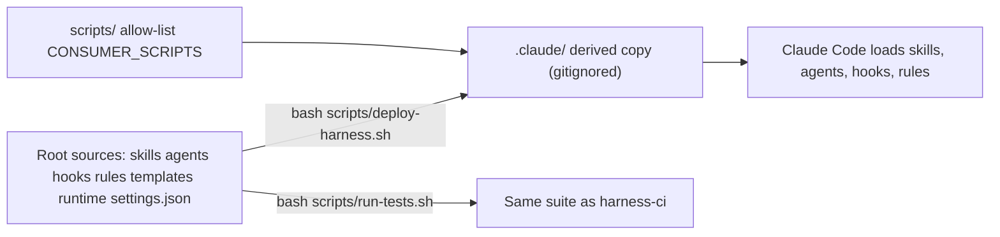

# Quickstart

## What this repository is

The Skill Harness (internally `claude-skills`) is a toolkit of skills, agents, hooks, and rules for the Claude Code CLI. It has two layers ([HARNESS.md](../HARNESS.md)):

| Layer | What it does | Lives in |
|---|---|---|
| **Engine** | Invocable `/skills` that do the work: brainstorm, research, plan, build, review, ship. Each skill has hard gates and a defined handoff. | `skills/`, `agents/` |
| **Harness** | A thin control layer. Before the engine runs, it decides how much process a change needs and when a human must be involved. | `skills/feature-intake/`, `hooks/`, `rules/`, `specs/<slug>/SUMMARY.md` |

Everything turns on one principle: **ceremony scales with risk, and human interruption scales with ambiguity.** `/feature-intake` runs first. It uses a 10-flag risk checklist plus hard gates, and writes a `Lane:` (`tiny | normal | high-risk`) and a `Confidence:` to `specs/<slug>/SUMMARY.md`. At commit time, hooks check the staged diff against the declared lane, so an agent cannot label a risky change "tiny" and slip it through. Two gates, `workflow-engine` and `weakening-validation`, are warn-mode: they print a note instead of blocking. Background: [Lanes, Risk, Confidence, and Hard Gates](concepts/lanes-risk-and-hard-gates.md).

A request with `Input-type: bug fix` first runs the `diagnosing-bugs` skill, which proves the root cause in six gated phases before any fix, and then follows its lane route. A bug fix also needs a red/green `### Verify` pair in `SUMMARY.md` (advisory by default, blocking under `REQUIRE_RED_TEST=1`). See [Bug Diagnosis (diagnosing-bugs)](workflows/bug-diagnosis.md).

**Runtime boundary.** Claude Code is the established runtime. The **Codex advisory alpha** renders the same skills, agents, and hook bodies through Codex bindings. It is pinned to observed Codex CLI 0.147.0 evidence on macOS arm64. It is **not GA** and is not a peer enforcement runtime. The outside-hook doctor (`python3 scripts/codex_harness_doctor.py --root <project>`) reports `enforced`, `advisory`, or `unsupported`. No current input carries observed hook trust, so a real run today returns `advisory` or `unsupported`, and `CLAUDE.md` says to treat an `enforced` result as a bug. See [Codex Advisory Alpha Adapter](integrations/codex-advisory-alpha.md).

## Source at the root, derived copy in `.claude/`

The **root directories are canonical**: `skills/`, `agents/`, `hooks/`, `rules/`, `templates/`, `runtime/`, `scripts/`, and `settings.json`. Claude Code loads project skills, agents, and hooks only from `.claude/`. That directory is a **derived, gitignored copy** built by [`scripts/deploy-harness.sh`](../scripts/deploy-harness.sh). Do not edit `.claude/` by hand, and do not treat `.claude/`, `.claude/worktrees/`, or `.worktrees/` as a source of truth. Worktrees are separate checkouts, and `.claude/` copies are overwritten on the next deploy.

*Root sources are deployed into `.claude/`, which Claude Code loads. Tests run against the root sources.*

What the deploy does, in brief (details in [Install, Deploy, and Re-sync](operations/install-deploy-and-resync.md)):

- It finds its sources by path (`$(dirname "$0")/..`), not through git, and syncs `skills agents hooks rules templates runtime` into `.claude/`.
- It renders the agent frontmatter with `scripts/render_agent_definitions.py --runtime claude`. It strips archived skills, skill tests, and harness-only docs.
- It copies only an allow-listed subset of `scripts/` (`CONSUMER_SCRIPTS`, for example `verify_summary.py`, `check_plan_contract.py`, `run_at_commit.py`, and `apply_model_config.py`) plus `harness-manifest.json`. `agents/*.json` and `adapters/` never deploy.
- Before it writes anything under `.claude/` (also under `--dry-run`), it validates the target's `harness-models.json` against a defaults snapshot rendered from source. A failed check aborts with nothing written. After the copy steps it writes `.claude/harness-models.defaults.json` and applies the per-agent and per-skill model and effort to the deployed frontmatter. See [Model and Effort Configuration](operations/model-and-effort-config.md).
- It derives `.claude/settings.json` from root `settings.json`. Hook commands become `$CLAUDE_PROJECT_DIR/.claude/hooks/...`, only the hooks in the chosen profile are kept, `commit-gate.sh` gets `--profile 
`, and the result is merged with any existing consumer hooks instead of replacing them.
- It resolves the profile (`minimal | standard | strict`) from `--profile`, else `.claude/.harness-profile`, else the `harness-manifest.json` default (`standard`), and writes the result back to `.claude/.harness-profile`. It also prunes entries listed in `.claude/.harness-deployed` from the previous deploy that are no longer in source.
- It never silently overwrites per-repo protected files (`rules/architecture.md`, `rules/guidelines.md`, `rules/behavior.md`, `agents/PROJECT.md`). If a local copy differs, the incoming copy is written beside it as `<file>.harness-incoming`.

## The commands you need

| Situation | Command |
|---|---|
| You edited anything under `skills/`, `agents/`, `hooks/`, `rules/`, `templates/`, `runtime/`, or `settings.json` | `bash scripts/deploy-harness.sh` (idempotent; first run installs, later runs re-sync), then restart Claude Code |
| You edited `harness-models.json` (model or effort per agent or skill) | `bash scripts/deploy-harness.sh`, or start a new session (`startup`/`clear`) so `model-config.sh` applies it |
| You are changing `hooks/` or `scripts/` (or before any PR) | `bash scripts/run-tests.sh` |
| Check doc paths and hook registrations only | `bash scripts/lint-doc-truth.sh` |
| Install into another project | `curl -fsSL ".../scripts/install-harness.sh" \| bash -s -- --yes` (see [README.md](../README.md)) |
| Diagnose a Codex alpha install | `python3 scripts/codex_harness_doctor.py --root <project>` |

> **Two rules to remember.** (1) Editing `skills/`, `agents/`, `hooks/`, `rules/`, `templates/`, `runtime/`, or `settings.json` has no effect on your Claude Code session until you re-run `bash scripts/deploy-harness.sh`. (2) Changes to `hooks/` or `scripts/` require `bash scripts/run-tests.sh` before you commit. CI (`harness-ci`) runs the same suite on ubuntu and macOS.

`scripts/run-tests.sh` runs these layers in order ([Deterministic Test Suite](testing/test-suite.md)):

1. **L1 static:** `bash -n` on every hook, script, and test. Then the doc-truth lint, skill-bash lint, hook root-source check, plugin/frontmatter validation, allowed-tools, manifest consistency (`check_manifest.py` and related checks), runtime-neutral source scan, review-chain eval answer keys, the STE linter self-test (its baseline check only reports), and a verify-row lint on changed `SUMMARY.md`/`PLAN.md` files.
2. **L2/L3 suites:** every `tests/hooks/*.test.sh` and `tests/scripts/*.test.sh`. Each one is hermetic in its own temporary git repo, so they run in parallel. `HARNESS_TEST_JOBS=1` runs them serially, and `HARNESS_SKIP_SUITES` skips named suites.
3. **Python unit tests:** every `test_*.py` under `scripts/`, `runtime/`, and `skills/`, found automatically (`evals/` is excluded on purpose). This layer is skipped when pytest is unavailable.

The script prints `ALL GREEN` or a `FAILURES:` list naming each failed step, and exits non-zero on any failure.

## The four wired hooks

Root `settings.json` registers the standard set (the `standard` and `strict` profiles in `harness-manifest.json` keep all four; `minimal` keeps only `branch-isolation-guard.sh` and `commit-gate.sh`):

| Hook | Trigger | Role | Page |
|---|---|---|---|
| `commit-gate.sh` | PreToolUse (Bash) | The single `git commit`/`push` gate: secrets, escalations, lane evidence, run-state artifacts, risk corroboration, plan scope, and strict app gates | [Commit Gate Hook](enforcement/commit-gate.md) |
| `branch-isolation-guard.sh` | PreToolUse (Write/Edit) | Blocks implementation edits on a shared branch (`main`/`master` by default) | [Branch Isolation and Session Hooks](enforcement/branch-isolation-and-session-hooks.md) |
| `session-knowledge.sh` | SessionStart | Loads `docs/solutions/` critical patterns, the INDEX pointer, and active runs into context | [Branch Isolation and Session Hooks](enforcement/branch-isolation-and-session-hooks.md) |
| `model-config.sh` | SessionStart (matcher `startup\|clear`) | Pipes the payload to `scripts/apply_model_config.py --hook`, which applies the validated `harness-models.json` to the deployed agent and skill frontmatter. It never blocks, and the running session may pick up the change only from the next session. It is not registered in the Codex adapter | [Model and Effort Configuration](operations/model-and-effort-config.md) |

## Task-routing map

| I want to change… | Read first | Then also |
|---|---|---|
| **a hook** (`hooks/*.sh`, `hooks/lib/`) | [Commit Gate Hook](enforcement/commit-gate.md) or [Branch Isolation and Session Hooks](enforcement/branch-isolation-and-session-hooks.md) | [CI Gates and Doc-Truth Lint](enforcement/ci-gates-and-doc-truth.md) (hook edits are high-blast and CI-blocking), [Deterministic Test Suite](testing/test-suite.md) |
| **a skill** (`skills/<name>/SKILL.md`) | [The Skill Chain: Intake to Ship](workflows/skill-chain.md) | [Planning](workflows/planning.md), [Implementation and Review Chain](workflows/implementation-and-review-chain.md), [Compound and the Knowledge Base](workflows/compound-knowledge-base.md), [Behavioral Evals](testing/behavioral-evals.md) |
| **an agent role** (`agents/`) | [Sub-Agent Roles and Rendering](agents/agent-roles.md) | [Codex Advisory Alpha Adapter](integrations/codex-advisory-alpha.md) |
| **a rule** (`rules/*.md`) | [Rules, Loading Tiers, and Terminology](concepts/rules-and-terminology.md) (adding `paths:` is a behavior change) | [Lanes, Risk, Confidence, and Hard Gates](concepts/lanes-risk-and-hard-gates.md) |
| **lanes, hard gates, or block/warn modes** | [Lanes, Risk, Confidence, and Hard Gates](concepts/lanes-risk-and-hard-gates.md) | [Harness Manifest and Contract Surfaces](concepts/harness-manifest-and-contracts.md) |
| **`harness-manifest.json` or a contract surface** | [Harness Manifest and Contract Surfaces](concepts/harness-manifest-and-contracts.md) | [CI Gates and Doc-Truth Lint](enforcement/ci-gates-and-doc-truth.md) |
| **SUMMARY.md evidence or `verify_summary.py`** | [Evidence Tiers and the SUMMARY.md Contract](concepts/evidence-and-summary-contract.md) | [Commit Gate Hook](enforcement/commit-gate.md) |
| **run-state** (`runtime/run_state.py`, `RUN.json`, `events.jsonl`) | [Run-State Engine](runtime/run-state-engine.md) | [Resume Decision](runtime/resume-decision.md), [Post-Merge Bookkeeping](operations/post-merge-bookkeeping.md) |
| **resume behavior** (`runtime/resume_decision.py`) | [Resume Decision](runtime/resume-decision.md) | [Implementation and Review Chain](workflows/implementation-and-review-chain.md) |
| **the Codex adapter** (`adapters/`, `scripts/*codex*`) | [Codex Advisory Alpha Adapter](integrations/codex-advisory-alpha.md) | [Sub-Agent Roles and Rendering](agents/agent-roles.md) |
| **model or effort per agent or skill** (`harness-models.json`, `hooks/model-config.sh`, `scripts/apply_model_config.py`, `/harness-models`) | [Model and Effort Configuration](operations/model-and-effort-config.md) | [Sub-Agent Roles and Rendering](agents/agent-roles.md), [Install, Deploy, and Re-sync](operations/install-deploy-and-resync.md) |
| **a bug fix, or the `diagnosing-bugs` skill** | [Bug Diagnosis (diagnosing-bugs)](workflows/bug-diagnosis.md) | [Evidence Tiers and the SUMMARY.md Contract](concepts/evidence-and-summary-contract.md) (red/green proof), [The Skill Chain: Intake to Ship](workflows/skill-chain.md) |
| **install / deploy behavior** (`install-harness.sh`, `deploy-harness.sh`, profiles) | [Install, Deploy, and Re-sync](operations/install-deploy-and-resync.md) | [Harness Manifest and Contract Surfaces](concepts/harness-manifest-and-contracts.md) |
| **CI workflows or post-merge automation** | [CI Gates and Doc-Truth Lint](enforcement/ci-gates-and-doc-truth.md) | [Post-Merge Bookkeeping and Harness Diagnostics](operations/post-merge-bookkeeping.md) |
| **tests** (`tests/`, `scripts/test_*.py`, `runtime/test_*.py`) | [Deterministic Test Suite](testing/test-suite.md) | [Behavioral Evals](testing/behavioral-evals.md) |
| **the knowledge base** (`docs/solutions/`) | [Compound and the Knowledge Base](workflows/compound-knowledge-base.md) | [Branch Isolation and Session Hooks](enforcement/branch-isolation-and-session-hooks.md) |
| **understand the whole system first** | [Architecture Overview](architecture/overview.md) | [The Skill Chain: Intake to Ship](workflows/skill-chain.md) |

## Key gotchas

- `specs/` is tracked: `PLAN.md`, `SUMMARY.md`, design docs, and run-state files are committed. `PLAN.html` and `.plan-review.json` stay gitignored because they can be rebuilt.
- Every lane cuts a branch before the first edit. The branch-isolation guard denies implementation edits on a shared branch, whatever the lane.
- Under `--profile strict`, run `git add` and `git commit` in separate Bash calls when untracked `.py` files exist. The commit gate scans the whole command string before it runs.
- Consumer gate modes come only from the git index (`git show :harness-manifest.json`, when the consumer tracks a root manifest) or the defaults shipped beside the hook in `hooks/lib/gate-modes.default.sh` (2 warn / 7 block parity). They never come from `.claude/` or worktree files.
- `settings.local.json` overrides `settings.json` for user-specific permissions and env values.
