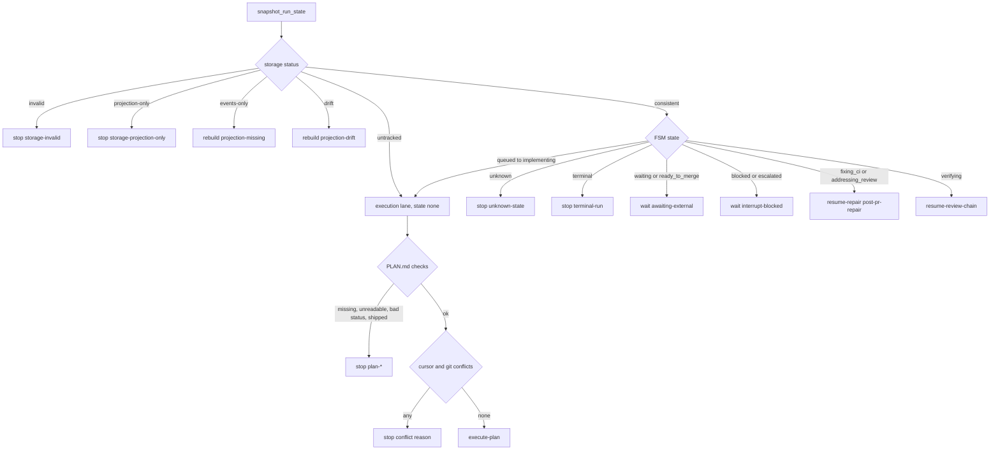

# Resume Decision

`runtime/resume_decision.py` answers one question for a new session that runs `resume <slug>`: what should happen next, and from which task. Its module docstring calls it "the single public resume authority" (design #175). It answers two separate questions from one locked inspection that does not change anything:

1. **Lifecycle route.** One of `execute-plan`, `resume-repair`, `resume-review-chain`, `wait`, `stop`, or `rebuild`. The route comes from durable FSM state owned by [Run-State Engine](run-state-engine.md).
2. **Task cursor.** Which tasks the plan's Status Log claims as complete, which `Verify` commands must be re-run to back those claims, and which task comes next.

The helper never transitions state, rebuilds a projection, or runs a plan-authored command. The caller performs any repair or transition after it reads the result. When evidence contradicts itself or cannot be resolved, the result is a structured `stop`. Missing evidence stays an explicit unknown and is never treated as success.

## Invocation and output contract

```
python3 runtime/resume_decision.py --slug <slug> [--base <ref>]
```

- `--slug` is required. `--base` is an explicit BASE ref, and it must be an ancestor of `HEAD`.
- On success the CLI prints one JSON object (`json.dumps(..., sort_keys=True)`) and exits `0`. Terminal, wait, and rebuild results are also valid decisions, so they exit `0` too.
- If you call it wrongly, argparse exits `2`. An unexpected internal exception prints `resume_decision: unexpected failure: ...` to stderr and exits `3` **with no partial JSON**.
- The helper reads `specs/<slug>/…` and `specs/STATE.md` relative to the current working directory. It also runs `git` in that directory.

Every response has the same top-level keys at `schema_version: 1`, whatever the action:

| Key | Meaning |
|---|---|
| `schema_version`, `slug` | Contract version (`1`) and the slug that was inspected |
| `action`, `reason_code`, `reason` | The route, a stable machine code, and human-readable text |
| `run` | `{status, state}`: the storage topology from `snapshot_run_state` and the projected FSM state |
| `plan` | `{status, format}` (`format` is `xml` or `markdown`), or `null` |
| `cursor` | Task cursor (execution routes only) |
| `git` | `{base_ref, base_reason, range, conflicts}` from commit validation |
| `interrupt` | Interrupt details for `blocked`/`escalated` |
| `required_transition` | The explicit edge the caller must apply after it confirms the named condition |
| `waiting_on` | The blocker identity. It is always at this top-level path on `wait` routes |
| `session_hint`, `deviations`, `warnings` | Advisory context (see below) |

## Route precedence

`decide(slug, base)` takes one snapshot with `rs.snapshot_run_state(slug)`. That function reads under the engine's shared read lock, so a writer cannot interleave with it. `decide` then checks routes in a fixed order. Storage problems come first. Terminal, wait, interrupt, repair, and review-chain states come second. Plan and task evidence is checked only for execution states. So a cursor conflict can never send a waiting or repair run into execution.



*Decision order in `decide()` and `_build_execution()`. Storage topology comes first, then non-execution FSM states, then plan and task evidence.*

### State-to-route matrix

Storage topology (the `SNAPSHOT_STATUSES` vocabulary from `run_state.py`):

| `run.status` | Action / reason_code |
|---|---|
| `invalid` (unreadable storage or illegal event chain) | `stop` / `storage-invalid` |
| `projection-only` (RUN.json with no `events.jsonl`) | `stop` / `storage-projection-only`. A projection with no canonical log cannot be trusted. |
| `events-only` (valid log, RUN.json missing) | `rebuild` / `projection-missing` |
| `drift` (RUN.json differs from the validated fold) | `rebuild` / `projection-drift` |
| `untracked` | Execution lane with `state=None`: `execute-plan` / `untracked-executable` plus warning `run-untracked`. The run is **not** initialized. |
| `consistent` | Routed by FSM state (below) |

FSM state when storage is `consistent` and a valid active plan exists. This matrix is pinned by `EXPECT` in the tests:

| State | Action / reason_code |
|---|---|
| `queued`, `investigating` | `execute-plan` / `catch-up`, with `required_transition = {kind: advance, path: [...→ implementing]}` |
| `planning`, `implementing` | `execute-plan` / `active-plan` |
| `verifying` | `resume-review-chain` / `review-chain`. Tasks passed, so do not re-sweep task waves. |
| `awaiting_confirmation`, `awaiting_ci`, `awaiting_review`, `ready_to_merge` | `wait` / `awaiting-external`. `ready_to_merge` is not an engine waiting state, but resume treats it as an external wait. |
| `fixing_ci`, `addressing_review` | `resume-repair` / `post-pr-repair` |
| `blocked`, `escalated` | `wait` / `interrupt-blocked` |
| `shipped`, `cancelled`, `superseded` | `stop` / `terminal-run` |
| anything outside `rs.ALL_STATES` | `stop` / `unknown-state` |

The repair route does not read the cursor. It attaches only `plan: {status, format}`. A repair loop therefore still routes when the plan is already `status: shipped`, while `implementing` with a shipped plan stops with `plan-shipped`.

### Interrupt recovery

For `blocked`/`escalated`, `_build_interrupt` takes the origin state from the `from_state` of the last event. It lists that origin's successors from `rs.FORWARD_TRANSITIONS`. If the origin was itself a waiting state, it finds the original `waiting_on` by walking back to the latest earlier event that entered that origin. The response carries an `interrupt` block (`origin_state`, `blocker`, `resume_event`, `recovered_waiting_on`, `successors`) and `required_transition = {kind: return-to-origin, to: <origin>, then_successors}`. The top-level `waiting_on` is the interrupt's own blocker, or the recovered origin blocker if there is none.

## Execution lane: plan checks

`_build_execution` handles active execution states and untracked runs. It stops before building any cursor in these cases:

| Condition | reason_code |
|---|---|
| `specs/<slug>/PLAN.md` absent | `plan-missing` |
| PLAN.md exists but raises an encoding or I/O error | `plan-unreadable` |
| `status:` not in `{proposed, active, paused, shipped}` | `plan-unknown-status` |
| `status: shipped` | `plan-shipped` |

A `proposed` or `paused` plan still gives `execute-plan`, but with reason_code `plan-activation-required`, a `plan-status-<status>` warning, and `required_transition = {kind: activate-plan, from_status, to_status: active}`. For `queued`/`investigating` runs it also includes `then_advance: [...]`. The helper never edits the plan itself.

## Task cursor

`_build_cursor` turns PLAN.md into this structure:

```json
{"task_ids": [...], "claimed_complete": [...], "pending": [...],
 "next_task": "<first pending or null>",
 "checks_to_rerun": [{"task_id": "1.1", "command": "<exact Verify>"}],
 "conflicts": [...]}
```

### Parsing tasks

`parse_tasks` copies the task extraction in `skills/visual-planner/render_plan.py`. The XML `<task id=…>` path wins, and Markdown `### Task X.Y` headings are the fallback. Both are scanned on a copy with code fences and inline code masked, so example tasks inside code blocks are ignored. Field values are sliced from the original text. A test checks that the ordered task ids match `render_plan.extract_tasks` exactly for every real `specs/*/PLAN.md`. There is one documented deliberate difference: the XML parser binds the first standalone `id="…"` attribute, not a `wave-id`/`data-id` suffix. If the same id appears twice, the result is a `duplicate-task` conflict.

### Reconstructing completion from the Status Log

`parse_status_completion` reads only the `Status Log` section, one top-level bullet at a time, with its indented continuation lines. An unindented non-bullet line closes the entry. The rules lean toward **under-claiming**. Under-claiming re-dispatches a task, which is safe. Over-claiming would skip real work.

- **Entry gate.** An entry counts only if it carries its own completion evidence: a completion word (`complete`, `done`, `✓`, `merged`, `shipped`, …) or a backticked commit sha. A pure note such as `started Task 1.2` claims nothing.
- **Keyword anchoring.** Only ids that follow a `task`/`tasks` keyword can be claimed. That includes members of a comma, `and`, or slash list, and hyphen or en-dash ranges, which expand to the ids that exist in the plan between the two ends. Bare decimals such as `design 5.4` or `v1.2` are ignored. Reference decimals right after words like `to`, `per`, `design`, `ruff`, or `version`, or followed by `%`, are dropped as well.
- **Per-mention suppression.** Each mention is judged in its own span, limited to its clause. A non-completion marker (`pending`, `blocked`, `wip`, `not yet done`, …) always keeps that mention pending. A future marker (`will follow`, `next`, `upcoming`) keeps it pending unless a completion marker follows the future word. So `Task 1.1 done and Task 1.2 will follow` claims only 1.1.
- **SHA attribution.** A sha belongs to the anchored id it follows. The first id's window extends back to the start of the entry, so `(sha): tasks 1.1–1.4` attributes correctly.
- **Unknown ids.** A keyword-anchored id that is not in the plan is reported as `unknown-task`, and the run stops.

This is why `rules/wave-parallelism.md` requires each Status Log entry to name task ids, commit shas, and a completion marker together. An entry like "all 9 tasks executed" gives zero ids and leaves the resuming session with no cursor.

### Re-run checks

Every claimed-complete task appears in `checks_to_rerun` with its exact `Verify` command. If a claimed task has an empty `Verify`, an empty command would pass without testing anything, so the helper adds a `missing-verify` conflict instead.

### Validating commits against the branch

Each claimed `(task_id, sha)` pair is checked against `BASE..HEAD` by `_validate_commits`. The BASE is resolved by `_resolve_base`, which follows `scripts/resolve-base-ref.sh` conservatively:

1. Explicit `--base`. It must resolve and be an ancestor of `HEAD`. Otherwise the reason is `explicit-unresolved` or `explicit-not-ancestor`.
2. `VERIFY_ROWS_BASE`, then `GITHUB_BASE_REF` (as `origin/<ref>`). If one of these is set, it is **final**. When it does not resolve, the result is a failure and the helper does not fall through to another base.
3. The branch upstream, unless the upstream is the branch's own remote copy.
4. The nearest ancestor ref: the ref with the fewest commits to `HEAD`, with ties broken in alphabetical order. Self, remote copies, and refs that point at `HEAD` itself are excluded.

A declared base (`--base` or one of the env vars) is validated even when there are no claimed commits. If no base is declared and there are no commits, the helper continues with `base_reason: no-claimed-commits`. Conflict types are `base-unresolved`, `range-unavailable` (`git rev-list` failed, for example in a shallow clone), `unresolvable-commit`, and `commit-out-of-range`.

### Conflict to stop

Any cursor or git conflict turns the execution route into `stop`. The `cursor` and `git` blocks are still included so the caller can see why. The reason_code is chosen in this order: `base-unresolved` > `range-unavailable` > `missing-verify` > `git-evidence-conflict` (unresolvable or out-of-range commit) > `cursor-conflict` (duplicate or unknown task).

## Advisory context

These inputs are read-only and never change routing:

- **`deviations`.** The bullets under `## Deviations` in `specs/<slug>/SUMMARY.md`, returned word for word. A lone `none` gives `[]`. The warnings are `summary-deviations-missing` and `summary-unreadable`.
- **`session_hint`.** The `## Active Spec` block of `specs/STATE.md`. It is used only when its `Slug` matches and its `Updated` date is no more than 7 days old. Otherwise there is no hint, and the warning is `state-wrong-slug`, `state-stale`, `state-unparseable`, or `state-unreadable`.

These advisory reads fail softly with warnings. The decision does not crash on one bad byte.

## Use by subagent-driven-development

The `Resume first` section of the `subagent-driven-development` skill runs the authority before any edit. It prefers the source-tree copy:

```
if [ -f runtime/resume_decision.py ]; then python3 runtime/resume_decision.py --slug <slug>; else python3 .claude/runtime/resume_decision.py --slug <slug>; fi
```

The deployed `.claude/runtime/` copy is used **only when the source file is absent**, never as a fallback after a non-zero exit. This keeps a stale deployed copy from answering again after the source copy has failed closed with exit 3. The skill notes that a default consumer install owns `.claude/runtime/resume_decision.py` rather than a root `runtime/`. The skill also requires the caller to:

- treat any non-zero exit as `stop`, keep stderr, and require `schema_version == 1` before acting on `action`;
- branch only on the structured `action`/`reason_code` (`execute-plan`, `resume-repair`, `resume-review-chain`, `wait`, `stop`, or `rebuild`);
- on `execute-plan`, re-run every `cursor.checks_to_rerun` entry first and dispatch no pending task until those claims verify. A failed re-run goes to the repair path;
- apply `required_transition` only after the session has confirmed the external condition it names. The helper supplies the edge, not the judgment;
- never reconstruct the FSM from prose, and never initialize a missing historical run during execution.

The per-action handling lives in the skill's `references/resume.md`, which the skill tells the session to read only when the returned action needs a manual transition or repair. That reference says: only `execute-plan` enters preflight and the wave loop. `resume-repair` follows the named CI or review loop without re-running plan tasks. `resume-review-chain` starts the final delivery, correctness, and intent review. `wait`/`stop` report the reason and make no edits. `rebuild` runs the named non-mutating check first and rebuilds only when that check reports projection drift. The reference also tells the new session to read `rules/plan-format.md` and `rules/wave-parallelism.md` before it interprets an `execute-plan` cursor, because it does not inherit the original controller's rule context.

See [Implementation and Review Chain](../workflows/implementation-and-review-chain.md) for the wave loop and review gates that follow, and [Planning](../workflows/planning.md) for the PLAN.md format and Status Log conventions the cursor depends on. The manifest contract `resume-cursor-decision` in `harness-manifest.json` lists this surface (`resume_decision.py` plus `run_state.py`) and its consumers.

## Tests

- `runtime/test_resume_decision.py` is the main pytest suite:
  - The state matrix is exhaustive over `rs.ALL_STATES`, so adding an unclassified FSM state fails the suite.
  - Storage-topology routes are covered.
  - A shipped plan blocks execution, while repair states still route.
  - Interrupt and waiting-origin recovery are covered.
  - The cursor works for Markdown and legacy XML plans.
  - Git-evidence conflicts are covered.
  - State-hint and deviation handling are covered.
  - All action types keep a stable schema.
  - Canonical files stay byte-identical after `decide()` for every action type.
  - CLI exit codes are checked.
  - Corpus guards check parity with `render_plan` and that completion is never over-claimed relative to the renderer.
  - Many completion-parsing edge cases are pinned.
- `tests/scripts/sdd-resume-cursor.test.sh` checks the same contract at the shell level a resuming session uses. It covers every public action, an out-of-range sha giving `stop`/`git-evidence-conflict`, and the portable command. It shows that the command falls back to `.claude/runtime` only when the source file is missing, and that a source-copy exit 3 is not re-answered by the deployed copy. It unsets `VERIFY_ROWS_BASE`/`GITHUB_BASE_REF` to stay hermetic.

## Changing this component

- A new FSM state in `run_state.py` must get an explicit route here and an entry in the test `EXPECT`/`PATHS` tables.
- Changes to the Status Log vocabulary or plan format should stay at parity with `render_plan.py`. The corpus tests enforce ordered-id parity and no over-claiming.
- New evidence defects should fail closed as a typed conflict that maps to `stop`. Do not guess.
- Any schema change must account for consumers that check `schema_version == 1`.
