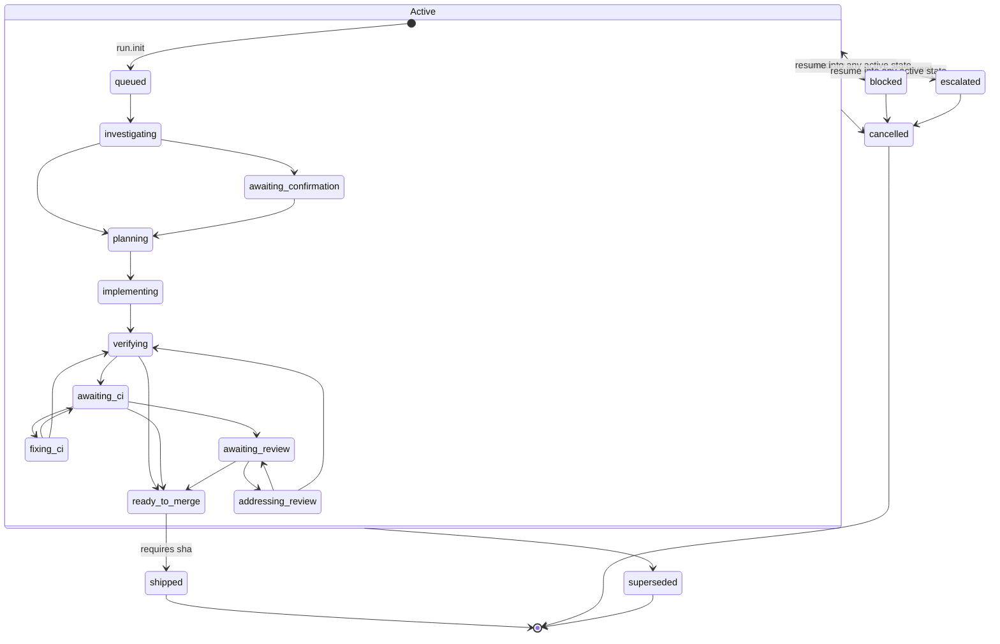

# Run-State Engine

`runtime/run_state.py` is the durable record of where a spec run stands in its lifecycle. Each spec slug gets an **append-only event log**, `specs/<slug>/events.jsonl`, which is the source of truth. `RUN.json` is a **projection** of that log and can always be rebuilt from it. A finite-state machine (FSM) decides which transitions are allowed. The engine is a standalone Python CLI with five subcommands (`init`, `transition`, `status`, `list`, `rebuild`). It also exposes one locked read primitive, `snapshot_run_state`, which the [resume decision](resume-decision.md) engine imports.

Source: [runtime/run_state.py](../../runtime/run_state.py). Tests: [runtime/test_run_state.py](../../runtime/test_run_state.py), [runtime/test_chain_guards_are_load_bearing.py](../../runtime/test_chain_guards_are_load_bearing.py), [tests/scripts/run-state-e2e.test.sh](../../tests/scripts/run-state-e2e.test.sh), [tests/scripts/run-state-chain-validation.test.sh](../../tests/scripts/run-state-chain-validation.test.sh).

## Storage layout

All paths are relative to the **current working directory**. There is no `--specs-root` flag, which is why the shell tests run each case inside its own `mktemp` directory.

| File | Role |
|---|---|
| `specs/<slug>/events.jsonl` | Canonical, append-only log with one JSON object per line. Keys are serialized sorted so diffs stay stable. |
| `specs/<slug>/RUN.json` | Projection of the current state. Written atomically: a `.tmp.<pid>` file, then `fsync`, then `os.replace`. |
| `specs/<slug>/events.jsonl.lock` | fcntl lock file. It is machine-local and git-ignored. The other two files are tracked. |

Each event has these fields: `event_id`, `seq`, `ts`, `slug`, `run_id`, `from_state`, `to_state`, `event`, `waiting_on`, `resume_event`, `sha`, `metadata`.

- `event_id` is the idempotency key. The caller can supply it with `--event-id`; otherwise it is a uuid4.
- `seq` is assigned by the engine, starts at 1, and must be contiguous.
- `event` is a free-form `namespace.action` label such as `ci.merged` or `pr.opened`.
- The genesis event is always `from_state: null`, `to_state: "queued"`, `event: "run.init"`.

`RUN.json` holds `slug`, `run_id`, `state`, `seq`, `waiting_on`, `resume_event`, `sha`, `created_at`, `updated_at`, and `last_event_id`. When a valid runtime diagnosis was recorded, it also holds `runtime_mode` and `runtime_evidence_id`.

### The projection fold

`project(events)` is a pure fold over the events, in order:

- `state`, `waiting_on`, and `resume_event` come from the **last** event. Moving out of `blocked` without passing `--waiting-on` or `--resume-event` therefore clears the blocker's metadata from the projection. The record of why work paused survives only in the log. `test_blocked_to_implementing_clears_blocker_metadata` pins this behaviour.
- `sha` carries forward: it keeps the most recent non-empty `sha`.
- `run_id`, `slug`, and `created_at` come from the first event. `seq`, `updated_at`, and `last_event_id` come from the last event.
- The runtime-diagnosis pair (`runtime_mode` and `runtime_evidence_id` in `metadata`) carries forward from the last event that set it. The pair is projected only when both values are present.

## FSM: states and transitions

There are 16 states in three groups:

- **Active (11):** `queued`, `investigating`, `awaiting_confirmation`, `planning`, `implementing`, `verifying`, `awaiting_ci`, `fixing_ci`, `awaiting_review`, `addressing_review`, `ready_to_merge`
- **Interrupt (2):** `blocked`, `escalated`
- **Terminal (3):** `shipped`, `cancelled`, `superseded`

`valid_targets(state)` determines where a run can go next:

- From an **active** state: its forward edges in `FORWARD_TRANSITIONS`, plus the four interrupts that are always available: `blocked`, `escalated`, `cancelled`, `superseded`.
- From an **interrupt** state: any active state, or `cancelled`. An interrupt state cannot move to `superseded` or `shipped`, and cannot move to the other interrupt state.
- From a **terminal** state: nothing.

Self-loops are never valid. `ready_to_merge` is the only state that can move to `shipped`.

*Run lifecycle derived from `FORWARD_TRANSITIONS` and `valid_targets` in `runtime/run_state.py`. Edges from the Active box apply to each of the 11 active states.*

`validate_transition` adds rules that depend on the target state:

- Entering a waiting state (`awaiting_confirmation`, `awaiting_ci`, `awaiting_review`) requires `--waiting-on`.
- Entering `blocked` or `escalated` requires `--resume-event`.
- On the write path, `cmd_transition` also requires `--sha` for `shipped`, and the value must match `^[0-9a-f]{7,40}$` (case-insensitive).

## CLI commands and control flow

| Command | Lock | Behaviour |
|---|---|---|
| `init --slug S [--run-id R] [--runtime-mode M --runtime-evidence-id E]` | exclusive | Writes the genesis event, then `RUN.json`. If the slug already has a log, the call is an idempotent no-op (exit 0) when `--run-id` is omitted or matches. A different `--run-id` raises `ConflictError` (exit 2). |
| `transition --slug S --to T --event E [--event-id] [--waiting-on] [--resume-event] [--sha] [--meta k=v]... [runtime flags]` | exclusive | Reads the log, validates the chain, folds it, checks idempotency, validates the hop, appends one event with `fsync`, then re-reads the log and writes `RUN.json` atomically. |
| `status --slug S [--json]` | shared | Calls `snapshot_run_state` and applies the status policy described below. |
| `list [--active] [--json]` | none | Lists every `specs/*/RUN.json`. A run whose log exists but fails validation is printed to stderr as `error: <slug>`, left out of the results, and makes the command exit 3. `--active` drops terminal states. |
| `rebuild --slug S [--check] [--allow-invalid-chain]` | exclusive | Folds the validated log into `RUN.json`. With `--check`, it only compares the two and exits 3 on `DRIFT:`. `--allow-invalid-chain` skips validation, prints a warning, and reports the result as "matches an UNVALIDATED fold" so that a stdout-only consumer cannot mistake it for a validated pass. |

`--meta` values are free-form `key=value` pairs. `parse_meta` refuses the reserved keys `runtime_mode` and `runtime_evidence_id`: those can only be set through the validated `--runtime-mode` and `--runtime-evidence-id` flags, which must be supplied together. `--runtime-mode` must be `enforced`, `advisory`, or `unsupported`, and the evidence ID must match `codex-mode-<16 hex>`.

### The append-nothing invariant

Every check runs **before** the append: chain validation, idempotency, FSM legality, required metadata, and sha format. A refused transition therefore leaves `events.jsonl` unchanged byte for byte. The e2e and chain-validation shell tests confirm this by comparing `cksum` fingerprints, because `wc -l` cannot detect a rewrite in place.

## Locking

- `locked_run` creates the spec directory, opens `events.jsonl.lock`, and takes an exclusive `fcntl.flock`. It blocks without a timeout and holds the lock across the whole read, validate, append, and project sequence. It is POSIX-only, matching the macOS and Ubuntu CI.
- `locked_run_readonly` takes `LOCK_SH`, and **only if the spec directory already exists**. A mistyped slug passed to `status` therefore creates nothing on disk. Readers don't block each other but do block behind a writer. Because of this, `status` never sees a fold that is newer than the `RUN.json` it compares against, so it cannot report false drift.
- `list` takes no lock.

`test_concurrent_writers_sequence_contiguously` starts 5 OS processes that all attempt `queued → investigating` with different event IDs. Exactly one exits 0 and four exit 2, because by the time they get the lock `investigating → investigating` is illegal. The log ends with contiguous seqs `[1, 2]`.

## Idempotency (`--event-id`)

When `--event-id` matches an event already in the log, `cmd_transition` compares `to_state`, `event`, `waiting_on`, `resume_event`, `sha`, and the runtime-diagnosis pair. It does **not** compare `from_state`, because by replay time the projection has already moved past that event.

| Match | Result |
|---|---|
| Same payload, and it is the **last** event | `idempotent no-op`, exit 0, nothing appended |
| Same payload, but an older event | `ConflictError` ("stale historical transition"), exit 2 |
| Different payload | `ConflictError` ("already used for a different transition"), exit 2 |

## Chain validation

`read_events` first rejects storage that is missing, empty, unparseable, missing required keys, a directory, unreadable, or not UTF-8. All of these raise `StorageError`. It then runs `validate_chain`, which raises `StorageError("invalid event chain <path>:<n>: ...")` at the first violation of nine invariants:

1. `seq` is an `int` (a `bool` is rejected) and is contiguous from 1.
2. Each `from_state` equals the previous event's `to_state`.
3. `slug` and `run_id` stay the same across the chain, and the chain's slug equals the slug that was requested.
4. The genesis event is `from_state: None` → `to_state: "queued"`.
5. Every later hop is legal according to `validate_transition`. An `InvalidTransitionError` is wrapped as a `StorageError`, so it exits 3 rather than 2.
6. `event_id` is a string and unique within the chain.
7. `event` is a string.
8. Any `shipped` event carries a sha that matches `SHA_RE`.
9. `metadata` is an object, and any runtime-diagnosis pair in it is complete and valid. A forged `enforced` claim therefore makes the chain invalid.

As a result, `project()` folds only histories that could actually have happened, on every validated path: `status`, `list`, `rebuild`, `transition`, and `snapshot_run_state`. `test_real_repo_event_logs_all_validate` checks that every `events.jsonl` committed to the repo still passes. [runtime/test_chain_guards_are_load_bearing.py](../../runtime/test_chain_guards_are_load_bearing.py) is a mutation gate for these guards. For each of 15 mutations, it copies `run_state.py` and `test_run_state.py` into a temporary sandbox, disables one guard, runs `pytest -k chain`, and asserts that the named victim test fails. It first requires a green baseline run without any mutation, and treats a missing pattern or a timeout as failures distinct from a surviving mutation.

### Closing a bricked run

An invalid chain blocks every transition with exit 3. There is one exception: a target in `CLOSEABLE_OVER_INVALID_CHAIN = {cancelled, superseded}`, handled by `_close_run_over_invalid_chain`. `shipped` stays blocked because it claims success. This bypass:

- records `from_state` as the last line's raw `to_state` and does not fold the history;
- sets `seq` to the largest integer seq found plus 1, or to the event count plus 1 if there is none;
- stamps the `_closed_over_invalid_chain: true` sentinel in `metadata`;
- writes `RUN.json` from an unvalidated fold, overriding `slug` with the slug that was requested;
- prints a loud warning on stderr.

Later close calls see the sentinel and do nothing, exiting 0. The engine refuses to close (exit 3) if the first event's `run_id` is not a string. Closing **does not repair** the history: `status` on the closed run still exits 3.

## Snapshot and `status` policy

`snapshot_run_state(slug)` classifies a slug's storage, under the shared lock, into one of `SNAPSHOT_STATUSES`. It never writes anything.

| Snapshot status | Meaning | `status` result |
|---|---|---|
| `untracked` | Neither file exists | exit 3, `missing: RUN.json` |
| `events-only` | Valid log, no `RUN.json` | exit 3, `missing: RUN.json`. Recoverable with `rebuild`. |
| `invalid` | Unreadable storage or an illegal chain | exit 3, with the original `StorageError` message |
| `drift` | Valid log whose fold differs from `RUN.json` | exit 3, a "projection drift" message pointing to `rebuild --check` and then `rebuild` |
| `projection-only` | `RUN.json` exists without a log | exit 0, prints the projection |
| `consistent` | Validated log matches `RUN.json` | exit 0, prints the projection |

The `status` command deliberately stays lenient in the `projection-only` case. The [resume decision](resume-decision.md) engine reads the same snapshot but stops on both `invalid` and `projection-only`.

## Exit codes

| Code | Raised by | Cases |
|---|---|---|
| 0 | — | Success, or an idempotent no-op (repeated `init`, a replayed `--event-id`, closing an already-closed run) |
| 2 | `InvalidTransitionError`, `ConflictError`, base `RunStateError`, argparse | Illegal hop, leaving a terminal state, missing `--waiting-on`, `--resume-event`, or `--sha`, a `run_id` or `event_id` conflict, a bad `--meta` value or runtime pair, an unknown `--to` value |
| 3 | `StorageError`, plus `list` and `rebuild --check` returning 3 | Missing, empty, corrupt, or unreadable storage, an illegal event chain, projection drift, `list` finding any invalid run |

`main()` catches every `RunStateError` and prints its message to stderr. I/O and decoding failures are converted to `StorageError`, so storage corruption produces exit 3 rather than a traceback (exit 1).

## Integrations

- **Skills.** The `feature-intake` skill initializes a run for a new SUMMARY and moves it to `investigating`, then `planning`. The `finishing-a-development-branch` skill moves the run to `ready_to_merge` with `--event pr.opened || true`, as a best effort. Because of `|| true`, an illegal hop (exit 2) is silently ignored. For example, `ready_to_merge` is reachable only from `verifying`, `awaiting_ci`, or `awaiting_review`.
- **Post-merge workflow.** In [post-merge bookkeeping](../operations/post-merge-bookkeeping.md), `.github/workflows/post-merge-maintenance.yml` loops over every `specs/<slug>/SUMMARY.md` in the merged PR that has a `RUN.json`. For each one it runs `transition --to shipped --event ci.merged --sha "$MERGE_SHA"` and stops at the first success. The FSM screens out candidates that are not ready or already terminal, and failures are only warnings. This step runs *before* the dirty-tree check, so that a change to run state alone still opens a bookkeeping PR. That PR then stages `RUN.json` and `events.jsonl` by name.
- **Commit gate.** `check_run_state` in `hooks/commit-gate.sh` (see [commit gate](../enforcement/commit-gate.md)) blocks a commit with exit 2 when it touches `specs/<slug>/` while leaving `RUN.json` or `events.jsonl` untracked. It only warns about unstaged changes. Setting `REQUIRE_RUN_STATE_STAGED=0` turns the block into a warning. The gate checks git state only, not the files' content.
- **Session and status hooks.** `hooks/session-knowledge.sh` runs `list --active --json` and shows up to 5 runs. `scripts/harness-status.sh` runs `list --active`. Both discard stderr and treat an absent or broken engine as contributing nothing.
- **Resume.** `runtime/resume_decision.py` calls `rs.snapshot_run_state` directly, so it uses the same locked, validated view as `status`.
- **Install.** `scripts/install-harness.sh` makes sure consumer repos git-ignore `specs/<slug>/events.jsonl.lock`, while `RUN.json` and `events.jsonl` stay tracked.

## Safe-change notes

- Changing `FORWARD_TRANSITIONS` or the state sets changes which logs count as legal histories. Run `test_real_repo_event_logs_all_validate` and the resume state matrix (`test_state_matrix_is_exhaustive_over_the_fsm`).
- Any edit to the text of a `validate_chain` guard must keep the mutation gate's `old` patterns matching exactly. Otherwise the gate fails with "pattern not found".
- New metadata that should be projected must be added to `project()`. Projection equality is what drift detection compares, so a new field also changes what counts as drift.
