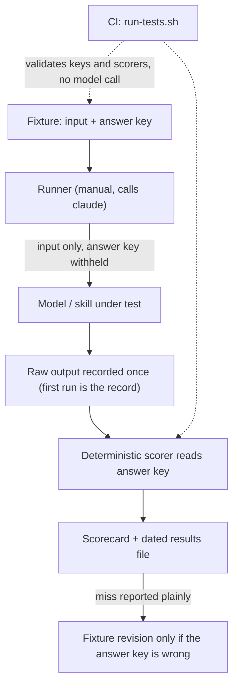

# Behavioral Evals

`evals/` holds fixture-based **behavioral** evaluations of the harness's prompt-driven parts: skills, sub-agent roles, and workflow decisions. They are separate from the deterministic suites (`tests/hooks/*.test.sh`, `tests/scripts/*.test.sh`, `scripts/test_*.py`), which are described in [Test Suite](test-suite.md). The deterministic suites prove that the mechanical pieces work. The evals measure **judgment**, which is non-deterministic, by scoring model output against labeled ground truth ([evals/README.md](../../evals/README.md)).

The rule that holds the whole tree together: **an LLM run happens by hand, and scoring is a deterministic script.** CI never calls a model. CI checks only the fixtures, the answer keys, and the scorers (see [What runs in CI vs manually](#what-runs-in-ci-vs-manually)).

## Layout

| Split | Eval | What it measures | Run / score entrypoints |
|---|---|---|---|
| `evals/skills/` | `review-chain/` | Whether `/correctness-review` and `/intent-review` catch a planted defect, and how many false positives they produce | `scripts/run_review_chain_eval.py`, `scripts/score_review_chain_eval.py`, `scripts/run_review_prompt_eval.py` |
| `evals/skills/` | `task-review/` | Labels from the consolidated task reviewer compared with each fixture's required and forbidden labels | `scripts/run_task_review_eval.py`, `scripts/score_task_review_eval.py` |
| `evals/skills/` | `prompt-refactor/` | Activation, behavior, and end-to-end corpus for every registered skill, used to A/B prompt refactors | `scripts/score_skill_eval.py`, `record_skill_eval.py`, `capture_skill_eval.py`, `run_skill_eval_batch.py` |
| `evals/agents/` | `test-runner/` | Accuracy of the `test-runner` role's reports, and whether it leaves the code unchanged | `scripts/run_test_runner_eval.py`, `scripts/score_test_runner_eval.py` |
| `evals/workflow/` | `intake-classifier/` | The lane, confidence, and hard-gate that `/feature-intake` assigns | `scripts/run_intake_eval.py`, `scripts/score_intake_eval.py` |
| `evals/context-boundaries/` | probes | Whether an instruction actually reaches each execution context | Manual protocol only, with no runner |

Each eval directory has its own `README.md`, a `fixtures/` (or `probes/`) directory, and a `results/` directory. Result files are dated, for example `results/2026-07-17-baseline.md`, and are written from a `results/template.*`.

## Shared honesty model

Every eval follows the same discipline ([evals/README.md](../../evals/README.md)):

- **Labeled fixtures.** Each fixture contains an input (`intent.md`, `request.md`, `task.md` or `input.md`), a `diff.patch` or a tiny `repo/` where needed, and an answer key (`truth.md` and/or `truth.json`).
- **Blind runs.** The model under test never sees the answer key. The runners enforce this mechanically, as described for each eval below.
- **Claim discipline.** A number describes *these fixtures and this skill only*. It says nothing about the full workflow chain or the real-world rate. The shared phrase is `not_observed != absent`: a defect class or request shape with no fixture is **unmeasured**, not "handled".
- **The first run is the record.** A fixture is never re-run until it passes. A miss is a finding about the skill (or about its answer key), not a failure of the benchmark.
- **Auto-score, manual-run.** Scoring is scripted and unit-tested. The LLM runs are started by a person.
- **Fixture revisions break comparability.** When an answer key is found to be wrong or ambiguous, the fixture is revised and the revision is logged in the eval's README. Results from before the revision are marked not comparable on that fixture. For example, the intake `multi-domain` fixture was reclassified to `normal`/`medium` after three blind runs agreed with each other and disagreed with the old key. Review-chain fixtures went through versions v2 to v5.


*How a behavioral eval runs from start to finish: a model is called only on the manual path, while CI checks only the fixtures and the scorers.*

### Blind-run playbook lessons

The solution note [skill-eval-blind-run-scoring.md](../../docs/solutions/harness/skill-eval-blind-run-scoring.md) records the playbook that built the intake-classifier eval. It adds these rules to the shared model:

- **Blindness is the most important integrity rule.** The orchestrator wrote the answer key, so a run that can see `truth.md` makes the number meaningless. In a Claude Code session, "run the eval" means the orchestrator dispatches one blind subagent per fixture, using the session's quota. A standalone or CI runner that needs `ANTHROPIC_API_KEY` is deliberately not built, because an LLM in CI costs tokens and is flaky.
- **Separate the safety-critical dimension from the judgment dimensions.** Report a headline for each dimension, and make the non-negotiable one a hard failure (for intake, `--strict` on hard-gate respect). Lane and confidence accuracy may vary between runs; gate respect must be 100%.
- **Run more than once.** One run hides borderline non-determinism. In four blind intake runs, hard-gate respect was 3/3 every time, while one lane-boundary fixture flipped between `tiny` and `normal` (3 of 4 `tiny`). Only multiple runs show that kind of finding.
- **Normalize the model's free text.** The skill writes its own spelling (`Data model`), and the key may write `data-model`. Comparing on raw strings produced a real false INCORRECT before the scorer compared on alphanumerics only.
- **Suspect the key when runs agree against it.** When several independent runs all disagree with a fixture, revise the key and mark earlier runs not comparable; do not tune the skill to a wrong key. A fixture that only *leans* one way while the literal rule supports the key is a real skill finding, so keep the key and record the finding.
- **Mark decisions the fixture already settles.** Before the first run, read the fixture line by line and mark every decision it states as `settled-by-fixture`, then score only the open rows. In the gh-309 runs the key left such decisions open, so the simulated user was asked about them and each run took extra rounds.

## Review-chain micro-benchmark (`evals/skills/review-chain/`)

**Purpose.** This benchmark checks whether the two review skills catch planted defect classes. It does not measure the whole [implementation and review chain](../workflows/implementation-and-review-chain.md) ([README](../../evals/skills/review-chain/README.md)).

**Fixtures.** Each `fixtures/<name>/` holds four files: `intent.md` (the user request), `diff.patch` (a diff with **exactly one planted defect**), `truth.md` (prose ground truth), and `truth.json` (the machine-readable key). The key gives `expected_oracle` (`correctness`, `intent` or `context-propagation-audit`), `core`, `correctness_clean`, a `planted` pattern (`file`, `match_any`, a non-empty `and_any`), and a list of `false_positives` patterns. Current fixtures cover these planted classes: missing await, None dereference, a missing soft-delete filter, an intent gap, excess scope, two context-propagation-audit escapes seeded from the review-escape ledger (`context-rule-unread`, `stale-inline-policy`), and two non-core "bait" fixtures (`bait-style-naming`, `bait-generated-file`). The bait fixtures tempt reviewers into style findings and findings on generated files.

**Two ways to run, with numbers that cannot be compared:**

1. *Manual protocol.* Apply the diff in a throwaway worktree, run each skill on its own, and score each pass by hand as caught, caught-wrong-reason, missed, or false-positive.
2. *Scripted path.* `run_review_chain_eval.py` sends a fixed two-oracle prompt (`INSTRUCTIONS` plus a request for JSON output) with `intent.md` and `diff.patch` inlined. It calls `claude -p ... --tools ""` from an empty temp directory, so the reviewer has no tools and cannot see the answer key. Run-safety rules:
   - The runner refuses to overwrite an existing output file.
   - It writes a per-process `<out>.<pid>.partial` after each fixture, so an interrupted run keeps its completed cases.
   - Each call has a timeout (default 600 s), recorded as `rc: "timeout"`.
   - A fixture with missing inputs is recorded as `rc: "skipped"`.

**Scoring (`score_review_chain_eval.py`).** The scorer reads findings from the **last** fenced `json` block that parses as a JSON array. The opening fence must start a line, may sit inside a blockquote, may use three or more backticks, and the tag is case-insensitive. A reply that mentions a json fence but has no parseable array is **UNPARSEABLE**; it is never scored as zero findings. Each finding is classified in this order:

1. `class: unknown` → always `other`, so an unconfirmable finding never counts as a catch or a false positive.
2. Matches `planted`, meaning the file matches by path suffix, plus any `match_any` term, plus any `and_any` term in `class`+`summary` → `planted`.
3. Matches a listed false positive → `false_positive`.
4. Any correctness finding on a `correctness_clean` fixture → `false_positive`.
5. Otherwise `other`.

A fixture counts as caught when any finding is `planted`. `oracle_match` records whether that finding came from the expected oracle. Confidence must be a plain decimal; anything else is warned about and treated as 0, and values are clamped to 0–100. False positives at or above `--threshold` (default 75) are counted separately.

The totals report core catches, bonus catches, false positives, other findings, the `unknown` sub-buckets (shown but never counted), and tokens. The token total covers every recorded case, including errored ones, because those calls were paid for. Errored, unparseable, and not-run fixtures are **excluded from the totals**, not scored as misses. If nothing could be scored, the scorer exits 1.

**Runtime A/B of the real prompts.** `run_review_prompt_eval.py run --base-rev ... --head-rev ...` builds the *actual* finder, intent, audit, and task-reviewer prompts from each git revision. It uses `git archive` and that revision's own `render_skill_prompt.py`, then runs both arms under the same fixed conditions:

- `--safe-mode`, with Read as the only tool.
- A fresh temp directory that holds only `rules/` and the diff.
- Per-call and total USD caps.

Each call record is published atomically through a hard link and is never overwritten. A recorded call is never re-run, and a call that failed to start is retried once. `report` scores attempt 1 with the same review-chain scorer.

**Feeding the ledger.** The corpus should grow from real escapes. Each *fixed* row in `docs/review-escapes.md` should point to a regression fixture, test, or documented won't-fix, and each fixture seeded from an escape should point back to its row.

## Test-runner agent eval (`evals/agents/test-runner/`)

This eval measures the `test-runner` role (see [Agent Roles](../agents/agent-roles.md)). Each fixture has `task.md` (the dispatch message), a tiny pytest `repo/` with its own `agents/PROJECT.md`, and `truth.json`. The seven fixtures are `all-pass`, `assertion-fail`, `import-error`, `multi-fail`, `missing-env`, `tempting-fix` and `skip-xfail`. They cover clean runs, boundary failures, collection errors, following `PROJECT.md` to dependent tests, a missing env var, an obvious bug the agent must report instead of fix, and skip/xfail handling ([README](../../evals/agents/test-runner/README.md)).

`run_test_runner_eval.py` copies each `repo/` to a temp directory. It runs `claude -p` with the agent body (frontmatter removed) as the system prompt, only `Bash,Read,Glob,Grep` (no Edit/Write), project-only settings, `--strict-mcp-config`, and `BILLING_API_TOKEN` removed from the environment. It records the report, the Bash commands, usage/cost, and a before/after SHA-256 snapshot of every repo file.

`score_test_runner_eval.py` passes a case only if all of the following hold:

- The verdict matches.
- Every failing test is named under `### Failures`.
- No passing test is claimed as failed.
- `Failed + Errors` matches.
- The required mentions are present.
- The agent ran `pytest` itself.
- **No repo file changed.**

Diagnosis quality is scored separately. A case with non-zero `rc` is reported as errored and not scored.

Not measured: test selection in large suites, non-Python stacks, flaky suites, and the live Agent-tool dispatch path.

## Intake-classifier eval (`evals/workflow/intake-classifier/`)

This eval measures whether `/feature-intake` assigns the right **lane, confidence, and hard gate** ([README](../../evals/workflow/intake-classifier/README.md)). Each fixture has `request.md`, a `truth.md` whose leading `key: value` header holds `expected_lane` (`tiny`/`normal`/`high-risk`/`any`), `expected_confidence`, `expected_hard_gate`, `expected_flags_include`, `expected_escalate` and `must_not_downgrade`, and an `eval.json` that pins a `from` commit and lists `may_change` globs. The seven fixtures are `typo-fix`, `add-validation`, `ambiguous`, `multi-domain`, `edit-hook`, `auth-change` and `db-migration`.

**The one metric that cannot be traded off is hard-gate respect.** A fixture whose truth declares a hard gate (auth, authorization, data-loss/migration, audit, external provider, public contract, high-blast file) must come out `high-risk`. A downgrade is treated as a safety failure, not a scoring miss, and `score_intake_eval.py --strict` exits 1 on it.

### Hardened runner

`scripts/run_intake_eval.py --model M --output-dir DIR` does the following for each fixture:

<!-- openwiki: mermaid parse failed and this diagram was converted to a text fence so it does not break rendering. Fix the diagram source and restore the mermaid fence. Parser error: Heuristic: an unescaped angle bracket inside a label breaks rendering; rephrase the label. -->
```text
flowchart TD
  A["Validate eval.json for each fixture"] --> B["Copy scorer + fixtures to a temp dir"]
  B --> C["git worktree add --detach at pinned from sha"]
  C --> D["Delete evals/ from the worktree"]
  D --> E["deploy-harness.sh --target worktree"]
  E --> F["Snapshot files + repo refs"]
  F --> G["claude -p classify prompt, no --bare"]
  G --> H["Diff snapshot: paths outside may_change or moved refs = stray"]
  H --> I["Remove worktree"]
  I --> J{"status"}
  J -->|ok| K["write fixture.md"]
  J -->|"stray / timeout / client-error"| L["write fixture.raw.txt"]
  K --> M2["After all fixtures: run.json + copied scorer -> scorecard.txt"]
  L --> M2
```
*How the intake runner processes each fixture: blind, pinned, and checked for unauthorized writes, with scoring done by a copy of the scorer taken before any run.*

What each step protects against:

- **Pinning to `from`.** The score does not depend on the current checkout. `from` must be a 40-character lowercase sha that resolves to a commit.
- **Deleting `evals/`.** The agent cannot read `truth.md` or earlier results from the worktree.
- **Copying the scorer first.** The scorer and answer keys are copied out before any fixture runs, and the copy does the scoring. An agent that edits the in-tree scorer therefore cannot change its own score.
- **The stray check.** Any write outside `may_change` (matched with `fnmatch`, where `*` also matches `/`), or any ref created, deleted, or moved, marks the fixture `stray`. This catches an agent that implements the request instead of only classifying it.
- **No `--bare`.** `build_cmd` raises if `--bare` appears, and the branch's harness config is deployed into the worktree, so the eval measures the skill rather than a bare model.

The client runs with `--setting-sources project --permission-mode dontAsk` and tools `Bash,Read,Glob,Grep,Write,Edit,Skill`. The runner refuses an existing `--output-dir`. It exits 1 when any fixture is not `ok` or when the scorer exits non-zero. `--check-fixtures` validates every `eval.json` without running anything.

**Residual risk.** The agent can still *read* the main checkout or git history by absolute path. The stray check detects writes, not reads, so a result is blind only to that extent.

### Scorer

`score_intake_eval.py --run DIR` parses the reply's `Lane:`/`Confidence:`/`Flags:`/`Escalate:` lines (case-insensitive; `yes (reason)` counts as yes) and compares them with the truth header. The rules:

- An `any` lane is not asserted.
- Flags pass when each expected flag appears in a produced flag after both are normalized to alphanumerics, so `Data model`, `data-model` and `auth (1)` all match.
- A fixture with no produced classification is counted as "not run".

The scorecard prints lane accuracy, hard-gate respect, confidence accuracy, and fully-correct counts, followed by an explicit scope disclaimer.

## Context-boundary probes (`evals/context-boundaries/`)

These probes are a **manual protocol with no runner**, and adding a runner is explicitly out of scope. They exist because PR #141 shipped a P1 defect: a path-scoped rule was *referenced* in a subagent dispatch prompt but never *delivered* to that subagent ([README](../../evals/context-boundaries/README.md)).

There are four contexts, each with a probe file: main session, implementer subagent, the read-only reviewer agent, and the cheap-model scorer. Each probe pairs two checks:

- **Positive marker.** After an explicit Read, the context must be able to quote the heading `# Auto-Correction Scope` from `rules/auto-correct-scope.md` (`paths: ["specs/**"]`).
- **Negative control.** The context must *not* be able to quote `# Wave Parallelism Rule` from `rules/wave-parallelism.md` (`paths: ["specs/**/PLAN.md"]`), a rule that is referenced but never read.

A probe is trustworthy only when both halves behave as expected.

The claim rules:

- A main-session result never transfers to a child context.
- The three child contexts are the **load-bearing** boundaries. On a load-bearing boundary, an `unconfirmed` verdict lowers confidence or blocks shipment and is never recorded as "mitigated".
- Every result records `claude --version` and the HEAD sha, and must be re-probed after any Claude Code upgrade.

## Prompt-refactor corpus and `score_skill_eval.py`

`evals/skills/prompt-refactor/` maps every skill registered in `harness-manifest.json` (via `corpus-manifest.json`) to three kinds of cases ([README](../../evals/skills/prompt-refactor/README.md)):

- **Activation cases:** at least 8 should-trigger and at least 8 near-miss, each group with a holdout.
- **Behavior cases:** golden, boundary, and handoff kinds.
- **End-to-end canaries:** `e2e-tiny`, `e2e-normal`, `e2e-high-risk`, `e2e-resume` and `e2e-workflow-engine`.

`scripts/score_skill_eval.py` never calls a model. It has three modes:

- `--validate-corpus` checks corpus completeness against the registered skills.
- `--compare BASELINE CANDIDATE [--suite ...]` fails on any of these: a mismatch in model, client version, or reasoning setting; a `pass` that becomes `missed` or `false-positive`; a new false positive; a miss on a safety-critical case; or, with `--suite`, a drop in that suite's pass count. A candidate verdict of `blocked` produced no observation, so it is printed as **unmeasured coverage** rather than counted as a regression. When both files are the canonical `results/baseline.json` and `results/candidate.json`, every corpus case must be present in both.
- `--candidate` checks that every case in the suite has a first-run `pass`.

Result records must carry `first_run: true` and a non-empty observation. `record_skill_eval.py` appends records and rejects unknown or duplicate first-run cases.

## Canary and replay proofs for reviewer prompt changes

A phrase pin on a reviewer prompt proves only that the new words are present. When a change alters what a reviewer checks (the task reviewer, the correctness finder or scorer, or the intent reviewer), the solution note [reviewer-prompt-change-proven-by-canary-and-replay.md](../../docs/solutions/harness/reviewer-prompt-change-proven-by-canary-and-replay.md) asks for two runs of the real reviewer agent with the real prompt:

1. **Canary (the gate).** A small fixture holds a brief, an implementer report, and a review package; a hand-written diff is enough. Each target defect is planted once next to clean controls, and nothing in the fixture labels them (no `# bad` comments). The run passes only when every planted defect gets the expected severity and no control gets a finding.
2. **Historical replay (evidence, not a gate).** Take a recorded case where the old review approved and a later review found the defect. Rebuild its brief and package from the original commits, add only what the new rule needs, run the new reviewer on the original diff, and compare its findings row by row with the later review. Record the result as it is.

Operating rules:

- Keep the fixture under `specs/<slug>/canary/` and the record in `specs/<slug>/canary.md`, with each reviewer output in a fenced block, so a plan check can be `grep -q "^Canary result: pass$" specs/<slug>/canary.md`.
- Build briefs and packages with the same scripts that subagent-driven development uses (`task_brief.py`, `review_package.py`), so the run sees what a real dispatch sees.
- Set a failure budget before the run (gh-312: two failed runs, then escalate), and state that one canary run is one sample.
- Plant defects in the reviewer's exact terms. "Copied from the output" and "computed by the code under test" are different wordings, and the canary is where a narrow wording shows up.
- In a replay record, say which tree the reviewer could search. A replay against today's tree sees more real inputs than existed at the time.

**Worked example: gh-312 ([canary.md](../../specs/gh-312-test-seams/canary.md)).** Both runs dispatched the `task-reviewer` agent with the task-reviewer prompt that contains the new test-seam check. The canary diff added four tests to a `word_count()` fixture: two clean controls with literal expected values, one off-seam test of the private `_tokens`, and one whose expected value was computed by the code under test. Both planted tests got Important findings, the controls got none, and the reviewer also found a real tab-splitting bug that the circular test hid. The file records `Canary result: pass`. The gh-175 Task 2.1 replay returned `needs_fixes` where the original per-task review had approved. It named the synthetic-only fixtures (seam step 3) and the per-entry SHA association, which match later gh-175 correctness findings [A/B] and [C]. It did not reproduce the other nine findings, which are code defects outside the seam check. The record notes that the replay ran against today's tree, which holds more real `specs/*` runs than existed when gh-175 shipped.

## Skill-local routing canaries

Some skills keep manual canary tables beside their source instead of under `evals/`. [`skills/diagnosing-bugs/tests/routing-cases.md`](../../skills/diagnosing-bugs/tests/routing-cases.md) lists the input, the tool call the session must or must not make, and the expected outcome for the [bug-diagnosis](../workflows/bug-diagnosis.md) skill. A human or a meta-eval session runs these cases; per-commit CI does not.

Because the skill sets `disable-model-invocation: true`, the runtime blocks a Skill-tool call for it, and `feature-intake` routes a bug fix by reading `skills/diagnosing-bugs/SKILL.md`. The cases are:

| ID | Role | Expected behavior |
|---|---|---|
| RC-01 | Over-firing canary | A quick question gets an answer; no Read of the skill and no diagnosis |
| RC-02 | Chaining canary | A bug fix through `feature-intake` reads the skill, intake writes `Input-type: bug fix`, and Phase 1 starts before the lane route. A Skill call here means the route failed |
| RC-03 | Direct invocation | `/diagnosing-bugs` runs the skill, and Phase 1 starts after the isolation step |
| RC-04 | Pins design decision D4 | A tiny-lane bug fix still runs all six phases with all six `diagnosis.md` fields and no "cause known" shortcut |

## What runs in CI vs manually

| Piece | Where it runs |
|---|---|
| `score_review_chain_eval.py --check-truth evals/skills/review-chain/fixtures` (validates the schema of every `truth.json`, the presence of the fixture files, and that `planted.file` appears in `diff.patch`) | **CI**, as the "L1: review-chain eval answer keys" step of `scripts/run-tests.sh` |
| Unit tests for every runner and scorer (`scripts/test_score_review_chain_eval.py`, `test_run_intake_eval.py`, `test_score_intake_eval.py`, `test_score_skill_eval.py`, `test_run_review_prompt_eval.py`, `test_score_test_runner_eval.py`, …), using stub `claude` clients | **CI**, through the pytest step, which collects every `scripts/**/test_*.py` |
| Real-key regression checks inside those tests: `test_real_answer_keys_classify_known_phrasings` checks review-chain keys, `test_answer_key_matches_a_real_pytest_run` re-runs each test-runner fixture's pytest so `truth.json` cannot drift, and `test_stray_real_fixtures_allow_every_intake_write` checks intake `may_change` globs | **CI** (pytest) |
| Pytest collection inside `evals/` | **Never.** It is deliberately excluded because fixture repos contain tests that are meant to fail |
| Every model run: `run_review_chain_eval.py`, `run_review_prompt_eval.py`, `run_test_runner_eval.py`, `run_intake_eval.py`, `run_task_review_eval.py`, `run_skill_eval_batch.py`/`capture_skill_eval.py`, and the context-boundary probes | **Manual.** These need an authenticated `claude` client and cost money |
| `score_skill_eval.py --validate-corpus` / `--compare` / `--candidate` | **Manual or spec Verify rows**; not called by `run-tests.sh` |
| Reviewer-prompt canary and replay runs, and skill-local routing canaries such as `skills/diagnosing-bugs/tests/routing-cases.md` | **Manual.** A plan may gate on the recorded `Canary result: pass` line |

Practical consequences:

- Adding a review-chain fixture without a valid `truth.json`, or with a `planted.file` that is missing from its diff, fails CI.
- Registering a new skill without a prompt-refactor corpus entry does *not* fail `run-tests.sh`. A spec retro found exactly this gap. Run `python3 scripts/score_skill_eval.py --validate-corpus` yourself.

## Extending the evals

- **New review-chain fixture.** Add the four files with exactly one planted defect for the expected oracle, make the key answerable from the fixture's own files, run `--check-truth`, and log a fixture revision if it changes what earlier totals mean.
- **New intake fixture.** Add `request.md`, a `truth.md` header, and an `eval.json` with a real `from` sha and every path intake may legitimately write, including gitignored run-state lock files. Then run `run_intake_eval.py --check-fixtures`.
- **New test-runner fixture.** Add `task.md`, `repo/`, and `truth.json`. The CI pytest re-derives the key from a real pytest run.
- **Recording results.** Write `results/<date>-<label>.md` from the template, state which path produced the number (manual or scripted), state the skill commit sha and client version, and never overwrite a first-run miss.
