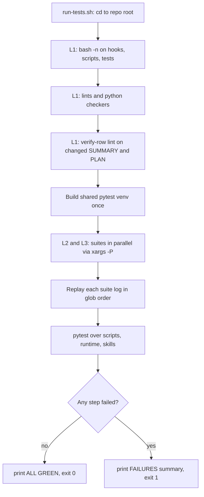

# Deterministic Test Suite

`bash scripts/run-tests.sh` is the single entry point for everything the `test` CI job checks. It needs no model calls and no network beyond an optional one-time `pip install`, and it never changes the real repository. The checks are in layers:

- **L1**: `bash -n` syntax checks plus a set of repository lints and consistency checkers.
- **L2**: hook contract tests (`tests/hooks/*.test.sh`).
- **L3**: script integration tests (`tests/scripts/*.test.sh`).
- **Python unit tests**: pytest, labelled "L2" in the runner output, over every `test_*.py` under `scripts/`, `runtime/` and `skills/`.

Model-driven behaviour is tested separately. See [Behavioral Evals](behavioral-evals.md). For where this suite sits among the CI jobs and the doc-truth checks, see [CI Gates and Doc Truth](../enforcement/ci-gates-and-doc-truth.md). The largest hook suites cover [the commit gate](../enforcement/commit-gate.md).

## Runner control flow

*How `scripts/run-tests.sh` orders its layers. A failing step does not stop the run. It is recorded and the run continues.*

The script uses `set -u` but not `set -e`. Each step that fails calls `fail "<name>"`, which sets `FAILED=1` and adds the step name to `FAILED_STEPS`. The run always goes to the end. It then prints `ALL GREEN` or a `FAILURES:` list and exits with `FAILED`. For a suite or pytest failure, `record_details` greps the captured step log for per-case markers and adds the individual case names to the summary. It strips ANSI colour codes first. For shell suites the marker is `  FAIL  ` or `not ok `. For pytest it is `FAILED ` or `ERROR `. Because of this, a red run names the failing cases without making you search the full log.

### L1: syntax and static checks

- `bash -n` on `hooks/*.sh`, `scripts/*.sh`, `tests/lib.sh` and every `tests/*/*.test.sh`.
- Shell lints: `scripts/lint-doc-truth.sh`, `scripts/lint-skill-bash.sh`, `scripts/check-hook-root-source.sh`, `scripts/check-plugin-validate.sh` and `scripts/check-allowed-tools.sh`.
- Python checkers, which run only when `python3` is available:
  - manifest, frontmatter-contract, skill-tool-conformance, gate-modes smoke and slim-surface checks;
  - the live runtime-neutral source scan (`check_runtime_neutral_sources.py --root .`);
  - the review-chain eval answer-key check (`score_review_chain_eval.py --check-truth`);
  - the STE linter self-test. The STE prose-baseline check only reports and always exits 0.
- **Verify-row lint**. `scripts/resolve-base-ref.sh` resolves a base ref. The runner then uses a three-dot `git diff` to list the `specs/*/SUMMARY.md` and `specs/*/PLAN.md` files changed against that base ref, and sends only those files to `scripts/check_verify_rows.py`. The list is also intersected with the files changed since a hard-coded grandfather cutoff commit (`af869a9`). As a result, a release PR whose base is `main` does not re-lint specs that were written before the lint was active. Every skip states its reason, for example "no base ref", "no python3" or "nothing changed since the cutoff". If `git diff` fails, the step fails. The runner does not treat a failed diff as "no changes". CI uses `fetch-depth: 0` and an explicit `git fetch` of the base ref so that this lint has something to compare against.

### L2/L3: shell suites in parallel

Before any suite starts, the runner calls `ensure_pyenv` once to build the shared venv. Suites that call it later in parallel then do not race to create the venv and run `pip`. The runner also tries to install `pytest-xdist` into the venv, and it continues if that install fails. It then collects `tests/hooks/*.test.sh` and `tests/scripts/*.test.sh` and runs them through `xargs -P "$SUITE_JOBS"`. Each suite writes its own `.log` and `.rc` file into a temporary directory. The logs are replayed in glob order, so the output reads as if the suites ran one after another. Parallel runs are safe only because every suite works in its own `mktemp` directories (see below).

Environment knobs:

| Variable | Effect |
|---|---|
| `HARNESS_TEST_JOBS` | Number of suites to run in parallel. Defaults to `getconf _NPROCESSORS_ONLN`, or 4 if that is unavailable. Set it to `1` for a serial run. |
| `HARNESS_SKIP_SUITES` | Space-separated suite paths to skip. CI sets it to `tests/scripts/codex-alpha-contract.test.sh` because a separate, named CI step already runs that suite. |
| `HARNESS_TEST_COLOR` | Set automatically when stdout is a terminal, so `tests/lib.sh` keeps its colour even though suite output goes through a pipe. |

### Python unit tests

The runner chooses its Python in this order: the shared venv at `${TMPDIR:-/tmp}/harness-tests-venv/bin/python`, then system `python3`. It skips this step if pytest cannot be imported. It finds every `test_*.py` under `scripts`, `runtime` and `skills` (sorted, with `__pycache__` excluded) instead of using a hand-written list. A hand-written list had drifted and left four test files that never ran. `evals/` is excluded on purpose, because its fixture repos contain tests that are meant to fail. When xdist can be imported, the run is parallelised with `-n $SUITE_JOBS`. Flags: `-q --no-header --no-cov -p no:cacheprovider`. One example is `scripts/test_verify_summary.py`. It loads `verify_summary.py` with `importlib`, writes `specs/<slug>/SUMMARY.md` and `PLAN.md` documents under pytest's `tmp_path`, and checks the parser and validator results. Runtime state logic has its own unit tests, such as `runtime/test_run_state.py` and `runtime/test_resume_decision.py`.

Newer unit tests that matter for changes in these areas:

- `scripts/test_apply_model_config.py` builds a fake `.claude/` tree under `tmp_path` and calls `apply_model_config.main()` directly. It clears the `CLAUDE_CODE_EFFORT_LEVEL` and `CLAUDE_CODE_SUBAGENT_MODEL*` variables first. It checks that:
  - every invalid user file and every missing or broken snapshot makes `--show`, `--check` and `--apply` exit 1 and write nothing (checked with file digests);
  - `reviewer` and `task-reviewer` cannot be set to `effort: low`, and consumer-owned skills cannot be configured and are never changed;
  - a second `--apply` writes 0 files, and removing an override restores the original bytes;
  - a write that fails partway is reported and fixed by the next run;
  - main-session settings files are never changed;
  - `--hook` mode is silent for sources other than `startup`/`clear`.

  Two cases copy the real deployed `.claude/agents/coding.md` and `correctness-review` skill, and they skip when those files are absent.
- `scripts/test_check_plan_contract.py` and `scripts/test_check_task_review_contract.py` test the plan-contract and task-review-contract checkers. The task-review tests run the checker on the live repository. They also copy the real prompts into `tmp_path`, remove one required phrase (for example `checked_against` or the seam pins), and check that the checker then fails.
- `skills/subagent-driven-development/scripts/test_task_brief.py` checks that `task_brief.py` matches task ids exactly (`1.1` does not match `1.10`), accepts a `### Task 1.1:` heading, and does not match `SC-10` when asked for `SC-1`. It also runs the script on the live `specs/gh-312-test-seams/PLAN.md` and checks that the brief holds the `- Plan-contract: 2` marker and that task's `Seams:` line. That test depends on the spec file, so moving or editing the spec means updating the test.

## `tests/lib.sh`: hermetic helpers

Hooks have a pure contract: JSON on stdin, plus optional args, produces an exit code and stdout/stderr. Hooks that need git state resolve the repo root from `CLAUDE_PROJECT_DIR`. If that is unset, they use git from the current working directory. They never use the location of the hook file. `tests/lib.sh` relies on this contract. It copies the hook under test into a throwaway git repo and runs the hook with the CWD set to that repo, so the real checkout is never touched.

| Helper | Purpose |
|---|---|
| `new_repo <hook.sh>...` | Creates a `mktemp -d` git repo on branch `main` with a test identity. It copies `hooks/lib/` and the named hooks into `hooks/`, and adds `/hooks/` to `.git/info/exclude` so the copied test files do not look like untracked repo state (for example to `check_untracked_py`). The directory is registered for cleanup. |
| `stage <repo> <path> <content>` | Writes a file and runs `git add -f` on it. |
| `run_hook <repo> <hook> <json> [VAR=val...]` | Pipes the JSON into `bash hooks/<hook>` with the CWD set to the repo and the extra environment applied. Sets `OUT` (stdout and stderr merged) and `RC`. |
| `run_hook_args <repo> <hook> <json> <arg>... -- [VAR=val...]` | Same as `run_hook`, but also passes args such as `--profile strict`. |
| `json_cmd`, `json_file`, `json_prompt` | Build minimal `tool_input.command`, `tool_input.file_path` or `prompt` payloads. |
| `t`, `pass`, `fail`, `skip`, `xfail` | Case bookkeeping. `xfail` records a documented known bug: the case runs and the incorrect result is expected, which keeps the suite green while the bug stays visible. |
| `assert_rc`, `assert_rc_contains`, `assert_rc_not_contains`, `assert_silent_ok` | Check `RC` and `OUT`. `assert_silent_ok` requires `RC=0` and empty output. |
| `ensure_pyenv` | Creates or reuses `${TMPDIR:-/tmp}/harness-tests-venv` with `pytest` and `pytest-cov`, and sets `PYSHIM` to a temporary directory that contains a `python` wrapper. Hooks call `python`, but macOS and CI machines often have only `python3`. It returns non-zero if it cannot create the venv, so callers wrap their cases in `if ensure_pyenv; then …`. |
| `finish` | Prints the counts for passed, FAILED, skipped and xfail cases. It removes every registered temporary directory and exits 1 if any case failed. |

A suite's exit code is the only thing `run-tests.sh` uses to decide pass or fail. Suites that do not source `lib.sh`, such as `tests/scripts/codex-packaging-probe.test.sh`, define their own counters. They must still print `  ok` and `  not ok` lines and exit non-zero on failure, so that the runner's `record_details` markers find the failing case names. Some small contract suites, such as `tests/scripts/sdd-task-review-routing.test.sh` and `tests/scripts/task-reviewer-readonly.test.sh`, are plain `set -euo pipefail` scripts: the first failing `grep` or `test` ends the script with a non-zero exit. The runner still fails the suite, but the summary can only say "(no case names found; see the log above)".

### Limits of L1

`bash -n` checks only shell syntax. It cannot see inside a quoted heredoc such as `python3 - <<'PY'`, so Python embedded in a shell script needs a behavioural suite. The documented case is `scripts/harness-status.sh`: two incomplete fixes to its audit-trend heredoc passed CI because no suite exercised it, until `tests/scripts/harness-status.test.sh` was added with malformed, non-UTF-8 and unreadable log cases. CI runs the `test` job on both `ubuntu-latest` and `macos-latest`. macOS has bash 3.2, where `"${arr[@]}"` on an empty array fails under `set -u`. Use `"${arr[@]+"${arr[@]}"}"` in scripts that may iterate an empty array, and add a suite case for the empty-array path.

## Representative suites

- **Hook contract tests (`tests/hooks/`)**:
  - `commit-gate*.test.sh` cover payload parsing, profiles, secrets, untracked `.py` files, evidence and risk categories. One test builds a mirror of `PATH` without `python`/`python3` to prove that the one-`jq` fast path still gates.
  - `command-matching.test.sh` unit-tests the shared `hooks/lib/git-command.sh` matcher against wrapped `git commit` forms that try to bypass it, and against similar commands that must not match.
  - `repo-root-resolution.test.sh` places the hook inside a decoy "foreign" git repo with staged content and runs it from a different project, to prove that the hook acts on the CWD and `CLAUDE_PROJECT_DIR` and not on the repo that contains the hook.
  - `normalize-tool-input.test.sh` passes recorded payloads through `hooks/lib/normalize-tool-input.py` and checks the canonical output with `jq -e`.
  - `model-config.test.sh` does not use `new_repo`. It builds a consumer layout in a temporary git repo: `.claude/hooks/model-config.sh` next to `.claude/scripts/apply_model_config.py`, a `harness-models.defaults.json` snapshot, one agent and one skill. It runs the deployed hook copy with `CLAUDE_PROJECT_DIR` set. The cases check that:
    - `startup` and `clear` apply `harness-models.json` to agent and skill frontmatter and return SessionStart JSON with `reloadSkills: true` when a skill changed;
    - `resume`, `compact` and `fork` exit 0 silently and leave every target byte-identical;
    - an invalid user file exits 0 with a "last applied values stay" warning in `additionalContext` and writes nothing;
    - a missing snapshot, a missing applier or unparseable stdin all exit 0 silently;
    - the root comes from `CLAUDE_PROJECT_DIR`, or from `git rev-parse` of the working directory when that variable is unset;
    - one `startup` run finishes in under 1 s.
- **Script integration tests (`tests/scripts/`)**: these build a minimal fake repo for the script under test. For example, `lint-doc-truth.test.sh` builds a `lint_repo` that contains one wired hook, a `CLAUDE.md` table and a `settings.json`. The test copies the script in, changes the repo, and checks exit codes and messages. Installer and Codex tests put a fake `codex` binary on `PATH` that logs its arguments and can be made to fail on request.
  - **Deploy tests** run the real `scripts/deploy-harness.sh --target <mktemp dir>` with stdin from `/dev/null`. A stray prompt then fails at once instead of hanging CI, and the repository's own `.claude/` is never rewritten.
  - `consumer-subset.test.sh` checks the consumer side of a deploy, which `lint-doc-truth.sh` cannot see because it checks paths in the harness repo. It checks that:
    - the allow-listed helpers (for example `verify_summary.py`, `check_plan_contract.py`, `check_review_receipt.py`) and `harness-manifest.json` ship to `.claude/`, while harness-development scripts and `test_*.py` files do not;
    - every `.claude/scripts/...` path named in derived Markdown exists, rewrites are idempotent (no `.claude/.claude/`), and hooks are byte-identical to their source because path rewriting is Markdown-only;
    - skill tests and harness-only docs and regions are stripped from the derived tree but stay in the source;
    - the deployed `verify_summary.py` and `check_open_questions.py` resolve the consumer's repo root, not `.claude/`.
  - `model-config-deploy.test.sh` checks that a deploy applies the target's valid `harness-models.json` (for example `coding.md` differs from a default deploy by only its `effort:` line), leaves consumer-owned skills byte-identical, and is idempotent. With an invalid file, the deploy exits non-zero, prints the applier's error, and changes no file under `.claude/`. This is also true on a first deploy and under `--dry-run`, where no `.claude/` is created.
  - **Plan and task-review contract suites** check skill and agent text with `grep`. `writing-plans-contract.test.sh` checks that `writing-plans` loads `rules/plan-format.md`, needs `design.md` and `research-brief.md`, and keeps the assumption-coverage step. `sdd-task-review-routing.test.sh` checks the single-reviewer routing in the `subagent-driven-development` skill and that the old spec-reviewer and code-quality-reviewer prompts are gone. `task-reviewer-readonly.test.sh` renders the Claude agent definitions and checks that the rendered `task-reviewer` has only `Glob, Grep, Read` tools and that `agents/agent-contracts.json` marks the role read-only.

## Fixtures (`tests/fixtures/`)

Fixtures are only for payloads or configs that are realistic and recorded or sanitised. Most suites build their inputs inline.

- `hook-input/`: Claude and Codex hook payloads in their native shapes. These include shell, Write, `apply_patch` (single-file, multi-file, and move/delete), unified-exec, user-prompt, and a `malformed.json`. `normalize-tool-input.test.sh` uses them to prove that both runtimes normalise to the same canonical contract and that malformed input stays machine-readable with an explicit `unknown` status.
- `codex-install/`: a user-customised `AGENTS.md` and `config.toml`, used by `codex-install.test.sh` to check that the Codex adapter installer does not overwrite user content.
- `codex-packaging/`: `marketplace.json`, `plugin.json` and `agents.toml`, read by `scripts/probe_codex_packaging.sh`. The probe stops with an error if any of these files is missing, and it runs Codex against isolated `HOME`/`CODEX_HOME` directories.

## Adding a test

1. **Hook test**: create `tests/hooks/<name>.test.sh`. Start it with `source "$(dirname "$0")/../lib.sh"`. For each case:
   - call `t "description"`;
   - call `repo=$(new_repo my-hook.sh)`, then optionally `stage` files;
   - run the hook with `run_hook` or `run_hook_args`;
   - check the result with an `assert_*` helper.

   End the file with `finish`. Put cases that need pytest inside `if ensure_pyenv; then … fi` and pass `PATH="$PYSHIM:$PATH"` to the hook.
2. **Script test**: create `tests/scripts/<name>.test.sh` in the same way. Build a minimal temporary repo, register it in `_CLEANUP_DIRS`, and set `OUT` and `RC` yourself or through a small wrapper.
3. **Python unit test**: add a `test_*.py` file under `scripts/`, `runtime/` or `skills/`. It is collected automatically.
4. You do not need to register anything. Suites are found by glob and are syntax-checked in L1. Keep each suite hermetic: only `mktemp` directories, no writes to `$ROOT`, and no dependence on the order in which suites run, because suites run in parallel.
