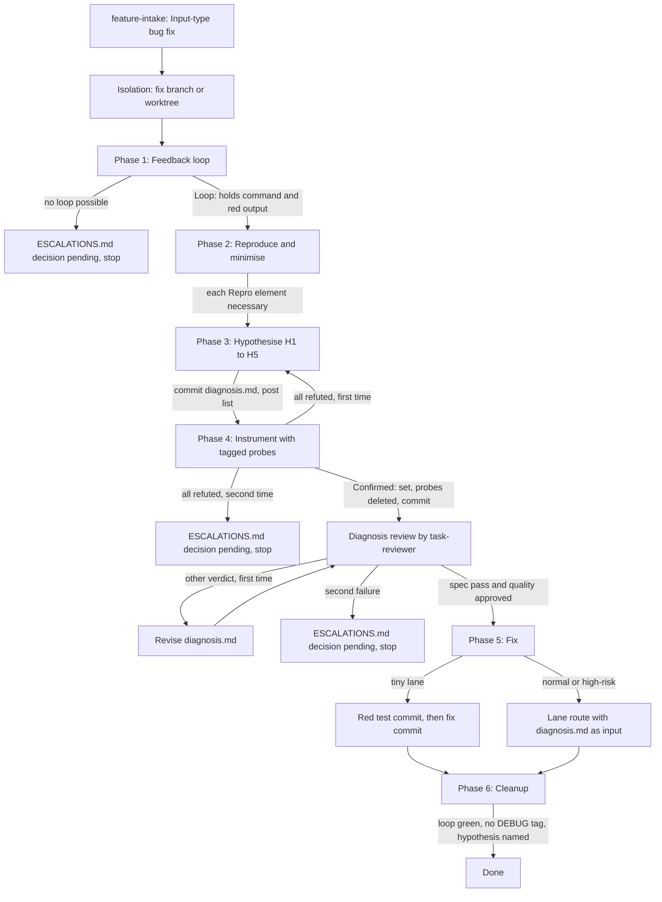

# Bug Diagnosis (`diagnosing-bugs`)

`diagnosing-bugs` is the in-repo skill that every `Input-type: bug fix` runs before the fix. It finds the root cause and proves it in **six gated phases**, and it writes the result to `specs/<slug>/diagnosis.md`. The fix then follows the lane route with that file as an input. After the fix, `scripts/verify_summary.py --lane` checks the red/green pair and the "prove the red" fix diff.

This page describes the workflow. For the SUMMARY evidence contract in general, see [Evidence and Summary Contract](../concepts/evidence-and-summary-contract.md). For the controller and reviewer chain that runs the normal and high-risk fix, see [Implementation and Review Chain](implementation-and-review-chain.md). For the full intake → lane route map, see [Skill Chain](skill-chain.md).

## How a bug fix reaches the skill

- **From intake.** `feature-intake` classifies the input. In its `## Routes`, an `Input-type: bug fix` tells the agent to "use the Read tool on `.claude/skills/diagnosing-bugs/SKILL.md` and follow it. Do not call the Skill tool for it." This happens *before* the tiny, normal, or high-risk lane route continues.
- **From the user.** A user runs `/diagnosing-bugs`.
- **Not by the model alone.** The skill's frontmatter sets `disable-model-invocation: true`. The model cannot pick it through the Skill tool, so a quick question does not load it. That flag also blocks the Skill tool for intake, which is why intake loads the file by path (design decision D1).

The scope rule is strict. Every lane runs all six phases, and the skill has **no "cause known" shortcut** (D4). A tiny bug fix pays the full diagnosis cost.

The behavioural routing cases live in `skills/diagnosing-bugs/tests/routing-cases.md`, in the style of `skills/feature-intake/tests/`. A quick question through intake must not fire the skill. A bug-fix input must route to it. These case files are run by hand. The gh-318 design also recorded one `claude -p` stream-json proof run for the quick-question case. See [Behavioral Evals](../testing/behavioral-evals.md) for how model-behaviour evidence is handled in this repo.

## Isolation and redaction come first

Two rules apply before Phase 1:

- **Redaction.** Replace each secret with `<REDACTED>` before you show or write a command or an output. This is an instruction only. The commit-time secrets scan in `hooks/commit-gate.sh` still runs, but nothing scans chat output.
- **Isolation.** Create the lane's isolation before Phase 1. On the tiny lane, run `git checkout -b fix/<slug>`, but only when you are on a shared branch. On the normal and high-risk lanes, run `using-git-worktrees`. The later route step finds that worktree and reuses it. Every probe, harness, and fix edit happens there, never on a shared branch.

## The six phases and their gates

*The six phases of `diagnosing-bugs`, each gated by its "Done when" criterion, with the review gate between Phase 4 and Phase 5 and the escalation exits.*

Each phase ends with one "Done when" criterion in `SKILL.md`. `references/phases.md` holds the menu of techniques for Phases 1 to 4. It is a menu, not a checklist: use the first item that fits.

### Phase 1 — Feedback loop

Build one fast, deterministic command that an agent can run and that goes red on this bug. Run it as written, **with no pipe**, so that its exit code shows the red. This rule exists because a replay run piped its loop through a command that exited 0, and the red was lost (design DC4 / D17).

Techniques, in order of preference: an existing or new failing test, a command with fixed input, a request to a local service, a replay of a captured input, a throwaway harness (outside the source tree, or deleted in Phase 4), a headless browser, a repeat loop for intermittent failures (the failure rate is the red signal), a `git bisect run` loop, a differential loop against a known-good version, and last, a human-in-the-loop script. Before you trust the loop, fix random seeds and the clock, remove network calls the bug does not need, and run it three times with the same result.

When no loop is possible, write an `ESCALATIONS.md` block with `decision: pending` that lists what you tried and what you need, then stop.

**Done when:** `Loop:` holds the command and its redacted red output.

### Phase 2 — Reproduce and minimise

Delete one input element at a time and rerun the loop. For large inputs, delete half and keep the half that still fails. Simplify the values that remain, remove configuration and flags one at a time, and lower concurrency when the bug does not need it. Add no probe or debug log in this phase.

**Done when:** the loop shows the symptom that the user described, and each element in `Repro:` is necessary.

### Phase 3 — Hypothesise

Write three to five ranked hypotheses, `H1` to `H5`, each with a prediction (what a probe shows when it is true), into `Hypotheses:`. Rank by likelihood first, then by probe cost. Spread the hypotheses across layers (input, state, environment, dependency version, timing). Include one about a recent change, from `git log`. Each pair of hypotheses must predict different things.

**Commit `diagnosis.md` before the first probe**, then post the list to the user and continue without waiting for a reply. The commit is the structural gate. Two replay runs probed before they wrote any list, so the list had to become a committed artifact, not a chat reply (D17).

**Done when:** `Hypotheses:` holds three to five ranked entries, each with a prediction.

### Phase 4 — Instrument

Each probe changes **one variable** and maps to one prediction. Tag each debug log with one `[DEBUG-xxxx]` prefix (four hex characters) for the whole diagnosis. Do not commit a probe. Record each result, including a refutation, next to its prediction.

When the probes refute every hypothesis, return to Phase 3 with a new list. A second full refutation writes an `ESCALATIONS.md` block with `decision: pending` and stops. After one hypothesis is confirmed, delete every probe and throwaway harness, so no probe stays in the tree during planning or implementation (D11). Then commit `specs/<slug>/diagnosis.md`.

**Done when:** `Confirmed:` names one hypothesis that the probe evidence supports, and no probe stays in the working tree.

### Diagnosis review (gate before Phase 5)

The skill dispatches the `task-reviewer` to read `references/diagnosis-review-prompt.md` first and follow it. The skill passes the `diagnosis.md` and `SUMMARY.md` paths, not the prompt text. The reviewer is read-only. It cannot run the loop or a probe, it judges only the text of `diagnosis.md`, and it does not trust claims in `SUMMARY.md`. `cannot_verify` is not a pass.

| Verdict | Fails when |
|---|---|
| `spec_verdict: fail` | a field is missing; `Loop:` has no red output; fewer than three or more than five hypotheses; a hypothesis has no prediction; a probe maps to no prediction; `Confirmed:` names no listed hypothesis; `Seam:` is empty; `Seam: none` has no reason |
| `quality_verdict: needs_fixes` | no probe result supports the confirmed hypothesis; a probe changes more than one variable; the `Seam:` point names no place where a test can observe the symptom; a string looks like a secret and is not `<REDACTED>` |

`Critical` and `Important` findings block. `Minor` findings do not. Phase 5 starts only after `spec_verdict: pass` and `quality_verdict: approved`. On any other verdict, revise and review again. A second failure escalates with `decision: pending` and stops.

This review is the only check of phase order. No hook or script reads `diagnosis.md`, and the reviewer cannot read git history. The design also says plainly that a passing review does not prove the confirmed hypothesis is the true cause.

### Phase 5 — Fix

- **Tiny lane:** write the red test at the `diagnosis.md` `Seam:`, commit it, then commit the fix. Record the `red` and `green` rows that `rules/auto-correct-scope.md` names.
- **Normal and high-risk lanes:** continue the lane route with `diagnosis.md` as an input (see below).
- **No valid seam:** when `diagnosis.md` says `Seam: none — <reason>`, record a finding in `SUMMARY.md` and write `Red test exempt: <reason>` in SUMMARY `### Verify`.

**Done when:** the red test commit comes before the fix commit, or `### Verify` has `Red test exempt: <reason>`.

### Phase 6 — Cleanup

Run the Phase 1 loop again. It must now be green. Search for `[DEBUG-` in the fix diff and in the working tree, untracked files included, and delete each tagged log or throwaway harness that you find. Name the confirmed hypothesis in the commit message and in SUMMARY `Rationale`.

**Done when:** the loop is green, the search finds no tag, and both texts name the confirmed hypothesis.

On the normal and high-risk lanes, the `subagent-driven-development` controller runs Phase 6 after the last wave and before the final reviews (`references/review-chain.md`).

## Artifacts

### `diagnosis.md` template

`references/diagnosis-template.md` defines six fields that must stay in this order:

| Field | Content |
|---|---|
| `Loop:` | the command, then ` — red output:` and the redacted output of one real run |
| `Repro:` | the minimised input; names the deleted elements |
| `Hypotheses:` | `H1`…`H5`, ranked, each `— prediction: …`; committed before the first probe |
| `Probes:` | `DEBUG-xxxx <probe> — tests: H<n> — result: … — supports \| refutes` |
| `Confirmed:` | one hypothesis ID |
| `Seam:` | `<where the red test goes> — catches: …; misses: …`, or `Seam: none — <reason>` |

The `Probes:` field writes the tag **without brackets**, so the Phase 6 `[DEBUG-` search does not match `diagnosis.md` itself. `Seam:` uses the seam form from `rules/plan-format.md`. The seam point is the text before ` — catches:`. The template lives inside the skill, not under `templates/`, so the change avoids the block tier of `scripts/ci-strict-gate.sh` (D10 in gh-318).

### Human-in-the-loop script

`scripts/hitl-loop.template.sh` is the last-resort Phase 1 loop for a bug that needs a human to act. The agent copies it, replaces the example `step` and `capture` calls, asks the human to run the copy, and gets back the pasted output. It was written new in this repo, not copied from upstream (D2).

Its exit code contract makes it work as a red/green loop:

| Exit | Meaning |
|---|---|
| `0` | green: the human answered `SYMPTOM_SEEN=no` |
| `1` | red: the human answered `SYMPTOM_SEEN=yes` |
| `2` | no terminal (`/dev/tty` cannot be opened), end of input, an invalid `capture` variable name, or an answer other than `yes`/`no` |

The script reads answers from `/dev/tty`, not stdin. It checks for the terminal by trying to open it, because a test of the mode bits passes even with no terminal. A copy must keep the `Verdict` block and one `capture SYMPTOM_SEEN` yes/no question.

## Handoff on the normal and high-risk lanes

`skills/subagent-driven-development/references/bug-fix.md` applies when SUMMARY says `Input-type: bug fix` and `diagnosis.md` exists:

- The controller names the `diagnosis.md` path in the fix task's Context, and passes it to the `task-reviewer` as `DIAGNOSIS_PATH`.
- **Seam check before dispatch.** The `PLAN.md` must have `- Plan-contract: 2`, and the fix task must have a `Seams:` line. The seam point of the first seam (before ` — catches:`) must equal the seam point of `diagnosis.md` `Seam:` exactly. A missing marker, a missing `Seams:` line, or two different strings counts as a mismatch.
- **On a mismatch**, the controller does not dispatch. On the normal lane it corrects `Seams:` itself. On the high-risk lane it returns the task to `writing-plans`. The budget is two checks. A second mismatch writes `ESCALATIONS.md` with `decision: pending` and stops. The check sits in the controller so that it also covers the normal lane, which has no `writing-plans` step (D12).
- The implementer makes the red test target the `Confirmed:` hypothesis. When `diagnosis.md` says `Seam: none — <reason>` and `Seams:` is `none` with the same reason, the implementer writes `Red test exempt: <reason>` instead of returning `NEEDS_CONTEXT` (D13).
- `writing-plans` (high-risk) copies `diagnosis.md` `Seam:` into the fix task's `Seams:`. `compound` takes the bug track's root cause from `diagnosis.md`.

## Prove the red: red/green evidence in `verify_summary.py`

The red/green rule in `rules/auto-correct-scope.md` applies to **any lane** with `Input-type: bug fix`. `### Verify` must hold either a `red`/`green` row pair or a `Red test exempt: <reason>` line:

- `red` row: the command is `python3 scripts/run_at_commit.py <red sha> -- <test command>` (the `python3` prefix and a path before `scripts/` are optional, and the sha has 7–40 hex characters). The claimed exit is 1–123. An exit of 124 or more is not a failing test.
- `green` row: the same test command (whitespace-normalised), claimed exit 0.
- **After the red commit, a change must exist outside `specs/` and the red test files.**

Two functions in `scripts/verify_summary.py` check this. `Input-type` is matched by `bug[ -]?fix(?![\w-])` on the lowercased value, so `bug fix`, `bug-fix`, and `bugfix` all count, and extra text may follow.

1. **`_red_green_issue(text)`** (traceability, text only) reports a missing pair, a malformed red command, a red exit outside 1–123, a missing matching green row, or an empty exemption reason.
2. **`_red_fix_diff_issue(text)`** (provenance, the only git caller) is the prove-the-red check from gh-313. `_red_pairs` returns each `(red sha, test command)` that has a matching green row. It returns nothing for a non-bug-fix SUMMARY or a non-empty exemption, and then no git call happens. For each pair, the function:
   - finds the repo that holds the process cwd (`git rev-parse --show-toplevel`);
   - lists the paths that differ between the red commit and the **index** (`git diff --cached --name-only <sha>`), so a staged but uncommitted fix counts and an unstaged one does not;
   - lists the paths that the red commit itself changed (`git diff-tree --root ... <sha>`); these are the "red test files";
   - drops every path under `specs/` and every red-commit path, and reports the pair when nothing is left.

The red test command is **not parsed** (D10, which replaced token matching after review). A directory, absolute, or quoted test path does not change the result. A red command that runs the file under repair does not hide the fix. The trade-off: if the red commit also edits source, a fix that touches only that same source counts as "no code change". Each pair needs its own non-empty diff (D5).

Messages:

- `bug fix: no code change after red commit <sha> outside specs/ and the red test files`
- `bug fix: cannot check the fix diff for red commit <sha> -- <cause>`, where the cause is `git is not available`, `the current directory is not in a git repository`, or `the commit does not resolve here`. An unverifiable claim is not a pass.

### Advisory vs. blocking

Both checks follow the `REQUIRE_RED_TEST` switch. When it is unset (or `0`/`false`), `check_lane_warnings` reports them as `!` advisories ending in `(warn-only; set REQUIRE_RED_TEST=1 to enforce)`, and the exit code stays the same. When it is set, `check_lane_evidence` turns them into errors and `--lane` exits 1. `REQUIRE_RED_TEST=1` is still opt-in. `hooks/commit-gate.sh` runs `--lane` on a temp copy of the staged SUMMARY with its cwd in the repo, which is why the check uses the cwd's repo and not the SUMMARY's location. See [Commit Gate](../enforcement/commit-gate.md).

### What the evidence does not prove

- That the changed code fixes the bug. The check proves only that something changed.
- That the claimed red exit was real. `--check` reruns rows.
- That an old SUMMARY was correct at its own fix time. The diff runs to today's index.
- That a merge commit works as the red commit. `diff-tree` lists no paths for it.

### Focused tests

`scripts/test_verify_summary.py` builds a real git repo in `tmp_path` for the fix-diff check. It covers: the no-op canary (exit 1 under `REQUIRE_RED_TEST=1`, a `!` advisory without it), a real fix (exit 0), test-only and specs-only changes (reported), a red commit that edits source, directory and absolute test paths, a red command that names the fixed file, a staged fix versus an unstaged one, an unknown sha, no repo, no git, the exempt and non-bug-fix cases with no git call, the commit-gate temp-copy shape, and a regression on `specs/gh-302-red-green-input-type/SUMMARY.md` (skipped in a shallow clone). Another test pins the red-row command shape in `implementer-prompt.md` and `rules/auto-correct-scope.md` to the checker.
