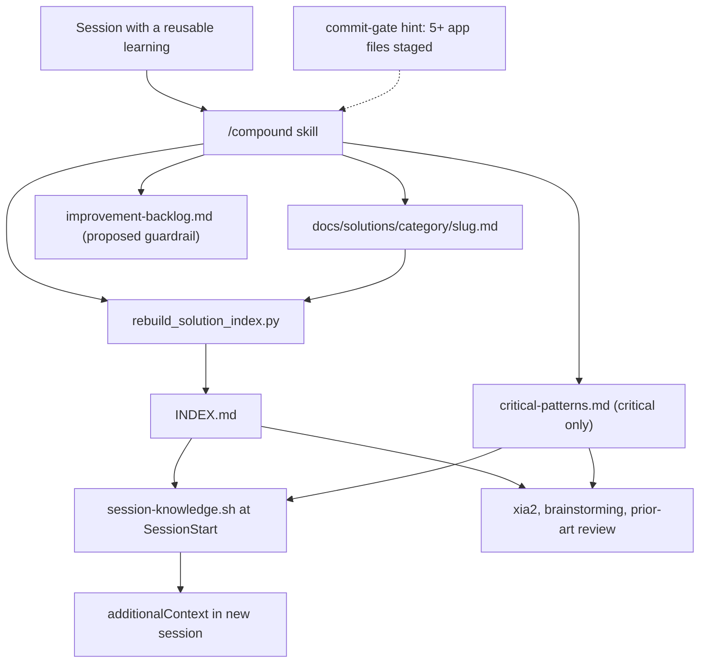

# Compound and the Knowledge Base

`docs/solutions/` is the harness's long-term memory. It holds non-obvious bug fixes, reusable patterns, considered decisions, and failed approaches as one Markdown file per learning. Four pieces work together:

- The **`/compound` skill** writes records after a session that produced a reusable learning.
- **`scripts/rebuild_solution_index.py`** is the only thing that generates `docs/solutions/INDEX.md`.
- **`critical-patterns.md`** is a short file of high-leverage learnings that readers always load.
- **`hooks/session-knowledge.sh`** injects a pointer to the index, plus the critical patterns, into every new session.

Other skills read the knowledge base. `/xia2` and `/brainstorming` consult it when they gather context, and the correctness review's prior-art angle reads it too. For where `/compound` sits in the overall chain, see [The Skill Chain](skill-chain.md). For the other session hooks, see [Branch Isolation and Session Hooks](../enforcement/branch-isolation-and-session-hooks.md).

*How a learning moves from a session into records, the generated index, and the context of later sessions.*

## Layout and record schema

[`docs/solutions/README.md`](../../docs/solutions/README.md) defines the layout: `README.md` (schema), `INDEX.md` (lookup table), `critical-patterns.md` (always read), and `<category>/<slug>.md` records grouped by domain. In this repository the categories in use are `harness/`, `harness-bootstrap/`, and `scripts/`.

The README says every record starts with YAML front-matter containing `problem_type`, `module`, `tags`, `affects`, an optional `supersedes`, `confidence`, and `confirmed_at`. Each `problem_type` has required body sections:

| `problem_type` | Required body sections |
|---|---|
| `bug` | Problem, Root_Cause, Fix |
| `knowledge` | Pattern, How_to_Use |
| `decision` | Context, Options_Considered, Decision_and_Rationale |
| `failure` | symptom, wrong approach, why it failed, correct approach (defined by `/compound`, not in the README) |

The README schema has drifted from what the tools actually use. `/compound` also writes a `failure` track, and the index generator reads `severity` and `applicable_when`, two fields the README never mentions. Current records carry those fields, so the INDEX shows `failure` rows and severities such as `critical` and `standard`. If you add a record, include `severity` and `applicable_when`. Without them its INDEX row shows `—` in those columns.

## `confirmed_at` and staleness

`confirmed_at` (`YYYY-MM-DD`) records when the record was last checked against ground truth. Four mechanisms use it:

- **Confidence decay (README):** `high` means verified within 30 days, `medium` means more than a month old or inferred, and `low` means more than 3 months old or uncertain. Treat a `low` record as a hypothesis. When you re-verify a record, set `confirmed_at` to today and raise its confidence.
- **Agent guidance:** `CLAUDE.md` tells agents to treat records older than 30 days as potentially stale.
- **Advisory audit:** `scripts/harness-audit.sh` check 3 reads the first `confirmed_at:` line of every `docs/solutions/**/*.md` file. It reports any record older than `HARNESS_AUDIT_CONFIRMED_DAYS` days (default 30) as a `solution stale` finding. The audit exits 0 unless you pass `--strict`. Files without a parseable date are skipped. See [Post-Merge Bookkeeping](../operations/post-merge-bookkeeping.md).
- **Index ordering:** the index generator sorts rows by `confirmed_at`, so changing the date moves the row. Always rebuild the index after you change the date.

A past spec (`specs/refresh-stale-solutions/`) set the rule: re-verify a record before you change its date. Moving the date without fixing stale references would hide a false reference from the audit.

## The `/compound` skill

`skills/compound/SKILL.md` (deployed as `.claude/skills/compound/SKILL.md`) is for sessions that produced a non-obvious bug, a reusable pattern, a considered decision, a useful failure, or a `Harness-Delta: backlog` signal. It says explicitly that a session ending is not, by itself, a reason to write a record. The commit gate adds one prompt: after tests pass, if 5 or more `app/**/*.py` files are staged, `hooks/commit-gate.sh` prints a hint to run the compound skill (`CLAUDE.md` says this happens under `--profile strict` or `REQUIRE_APP_GATES=1`).

The skill runs in this order:

1. **Extract.** The orchestrator, which holds the session context, runs the context-analyzer, solution-extractor, and decision-extractor passes itself, using the prompts in `subagents/` as output schemas. It then runs the related-docs pass with the analyzer's module and tags. It dispatches a subagent only when the tree is too large to screen from `INDEX.md`, and must paste in that subagent's inputs.
2. **Select complete tracks.** It writes only complete tracks (bug, knowledge, decision, failure, with the content listed above) and skips incomplete or `[none]` tracks. Spec alternatives and `prediction → measured` pairs count as learning sources.
3. **Check for overlap.** The related-docs finder screens from `INDEX.md` alone and does not open record files. If there is no INDEX, it falls back to reading front-matter. It rates overlap as **high** (same module and at least 2 matching tags), **moderate** (same category or at least 1 matching tag), or **low**.
4. **Write records.** It reads the matching file in `templates/` and writes `docs/solutions/<category>/<slug>.md`. On a high-overlap collision it updates the existing record. Otherwise it picks the next numeric suffix. Several decisions go into one `-decisions` file. Each new record gets an STE-flavored pass (`skills/asd-ste100`) that leaves fenced code and test- or hook-matched strings unchanged.
5. **Promote.** For a critical context, it appends one entry per emitted track to `critical-patterns.md`. A `failure` with a `proposed:` guardrail adds one open row to `docs/harness-experimental/improvement-backlog.md`, unless it duplicates an `existing:` guardrail.
6. **Mistake twice.** A high-overlap match is a second occurrence. The skill updates and promotes the existing record and its critical-patterns entry, adds a `**Recurred:** <date>` line, and never writes a near-duplicate. If the learning applies only to some paths, it *proposes* a path-scoped rule but does not write it, because a human decides changes to `rules/`. Moderate overlap is not a recurrence.
7. **Rebuild the index.** It runs `python3 .claude/scripts/rebuild_solution_index.py` at the end of every run, even when it wrote nothing, and must not build INDEX.md by hand.
8. **Report.** It checks that `CLAUDE.md` and the rules make the knowledge base discoverable, proposing (not adding) a section if they don't. It reports the tracks emitted, collisions, the index result, promotions, and any proposed ratchet or rule.

`tests/scripts/compound-contract.test.sh` enforces parts of this contract by matching text in the skill file: the four track rows, the delegation to `scripts/rebuild_solution_index.py` with the "Do not manually scan/sort/render" wording, the `critical-patterns.md` and `proposed:` handling, and the `prediction → measured` source. Keep these strings if you edit the skill.

## `rebuild_solution_index.py`

`scripts/rebuild_solution_index.py` is the single authority for `INDEX.md`. `scripts/deploy-harness.sh` ships it to consumers under `.claude/scripts/`. In a deployed copy, the default `--root` resolves to the repository that contains `.claude/`.

How it works:

- It reads every `*.md` file under `docs/solutions/` except `INDEX.md` and `critical-patterns.md`. The front-matter parser is a simple line parser: it splits each line on the first `:` and strips quotes. It does not parse YAML, so lists such as `tags: [a, b]` stay as raw text, and the brackets are stripped only when the row is rendered.
- Rows are grouped by their first path segment. Files directly under `docs/solutions/` go into a `—` group. That is why `README.md` shows up in INDEX.md as an uncategorized row and counts toward the total (the 42 entries include it). A unit test locks in this behavior.
- Categories are listed alphabetically. Within a category, rows are sorted newest `confirmed_at` first. Each row shows File, Type (`problem_type`), Severity, Tags, and Applicable When, and missing values render as `—`.
- The header records `Last updated: <today> | <N> total entries`.

Modes:

| Command | Behavior |
|---|---|
| (default) | Write `docs/solutions/INDEX.md` and print `solution-index: wrote …` |
| `--dry-run` | Print the generated index and write nothing |
| `--check` | Compare against the existing file with the `Last updated` date masked out. Exit 1 with `solution-index: INDEX.md is stale` on any other difference, including an edited entry count. |

The research for `specs/gh-261-sdd-report-handoff` noted that no CI step runs the rebuild. The INDEX stays fresh only because `/compound` and the authors who edit records run the script. `scripts/test_rebuild_solution_index.py` covers sorting, `—` placeholders, empty-tree stability (`0 total entries`), the README row, dry-run not writing, and `--check` behavior.

## `critical-patterns.md`

[`critical-patterns.md`](../../docs/solutions/critical-patterns.md) is meant to stay short. An entry belongs there only if the pattern has caused non-obvious bugs in several modules, or if it records a non-negotiable rule that a linter cannot express. Each entry follows the `templates/critical-patterns-entry.md` shape: a `## [date] slug` heading, Type/Module/Tags/Applicable when, a summary paragraph, and a `**Full doc:**` link (plus `**Recurred:**` when the mistake-twice rule applies). The index generator never reads it. Readers load it whole, whatever their query domain.

## Loading at session start: `hooks/session-knowledge.sh`

The hook is registered under `SessionStart` in `settings.json` (status message "Loading knowledge base (INDEX + critical-patterns)…"). It also ships in the Codex plugin's `hooks.json`. A deploy with `--profile minimal` does not register it, while the standard and strict profiles do (`tests/scripts/deploy-profile.test.sh`).

**It never blocks.** It runs with `set +e`, closes stderr, and exits 0 on every path. It needs `python3` only to encode the JSON output and exits silently if `python3` is missing.

**Finding the root.** It takes `CLAUDE_PROJECT_DIR` first and falls back to `git rev-parse --show-toplevel` from the current directory. It never uses the hook's own directory, so a hook installed inside some other git repo cannot load that repo's knowledge base. `tests/hooks/repo-root-resolution.test.sh` covers this. If no root resolves, it exits silently. Tests can override paths with `SESSION_KNOWLEDGE_DIR` and `RUN_STATE_REPO_ROOT`.

**Knowledge-base section.** The hook treats `INDEX.md` as empty, and adds nothing, in three cases: the file contains `0 total entries` with a non-digit before the 0 (so `30 total entries` does not count as empty), it has no data rows, or every data row is a `_(` placeholder. Otherwise the section contains:

1. A pointer line, `docs/solutions/INDEX.md — <N> entries`, where N is the number of table data rows. The INDEX table itself is **not** injected.
2. `critical-patterns.md` in full if it has 40 lines or fewer. Otherwise only its heading lines (`^#`).
3. A closing note: `[session-knowledge] docs/solutions/ — read full file when relevant`.

**Other sources in the same output.** The hook also adds up to 5 active runs from `runtime/run_state.py list --active --json` and a cached runtime diagnosis from `runtime/runtime_mode.py context` (checking both the source and `.claude/runtime/` locations). It only displays these and never decides anything itself. Non-empty sections are joined with `---` separators and printed as `{"hookSpecificOutput":{"hookEventName":"SessionStart","additionalContext":…}}`. If every source is empty, it prints nothing.

`tests/hooks/session-knowledge.test.sh` covers the empty formats, the zero-count boundary, the row count in the pointer line, keeping the INDEX body out of the context, the 40-line limit for critical patterns, and loading from the deployed `.claude/hooks/` location.

## How readers use the knowledge base

The README calls the read pattern **INDEX-first lookup**: read `INDEX.md` to scan domains quickly, then open at most 3 matching records, and always read `critical-patterns.md`. `/xia2` follows this pattern on all tracks. `/brainstorming` consults `docs/solutions/` for decisions. The correctness-review prior-art angle reads INDEX and the whole critical-patterns file. The session hook supports this pattern: it puts the critical patterns and a reminder in context, and agents open INDEX and individual records when they need them.

## Changing this system safely

- Edit records, then run `python3 scripts/rebuild_solution_index.py` (or `.claude/scripts/…` in a consumer). Never edit INDEX.md by hand. Use `--check` in review.
- If you change INDEX formatting, check the hook's empty-detection rules (`0 total entries`, `|` rows, the `File` header, `_(` placeholders) and the related-docs finder's column parsing.
- Adding a front-matter field to the index means editing `build()`. The `FIELDS` tuple is not used to drive rendering.
- Keep the hook's exit-0, no-stderr behavior. A SessionStart hook that fails is worse than one that adds nothing.
