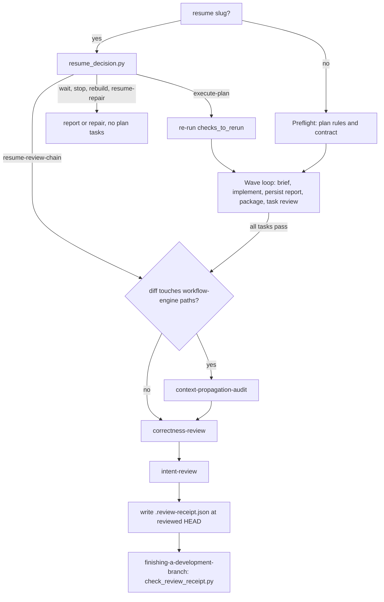
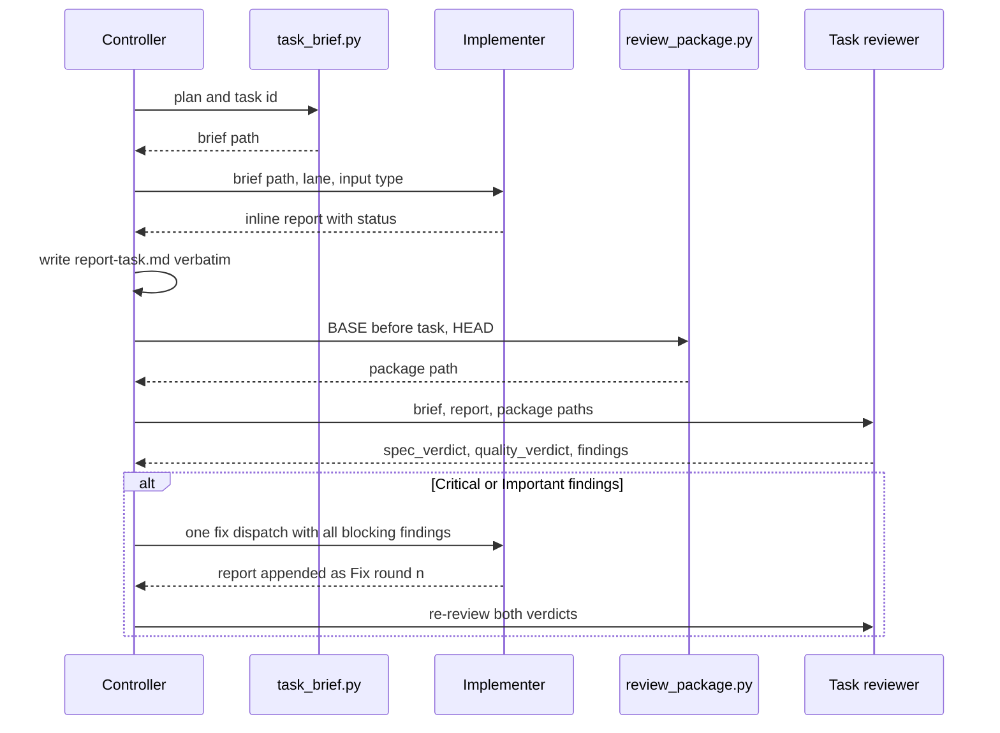

# Implementation and Review Chain

`subagent-driven-development` (SDD) is the skill that turns an approved, multi-task `PLAN.md` into
commits. It runs isolated implementer subagents in waves, gives each task an independent review,
and then runs a final chain of up to three review oracles. A SHA-pinned review receipt records the
result, and the ship gate checks that receipt. The core rule: a task may advance only after its
Verify command passes and both per-task verdicts are green
([SKILL.md](../../skills/subagent-driven-development/SKILL.md)).

This page covers the controller loop, the file-based handoffs between contexts, the task
reviewer, resume, the three final oracles, the shared review policy, and the receipt checker. For
the agents involved see [Agent Roles](../agents/agent-roles.md). For SUMMARY and evidence rules see
[Evidence and Summary Contract](../concepts/evidence-and-summary-contract.md). For the resume
authority itself see [Resume Decision](../runtime/resume-decision.md). For the eval corpora see
[Behavioral Evals](../testing/behavioral-evals.md).

## End-to-end shape



*Overall SDD control flow from a new or resumed session to the receipt-gated ship step.*

## Preflight

Before the first task, the controller reads `rules/plan-format.md`, `rules/wave-parallelism.md`,
and `rules/auto-correct-scope.md`. It stops unless four conditions hold:

- Every task has Files, Action, Verify, and Done. New contract plans also pass
  `scripts/check_plan_contract.py`.
- Tasks in the same wave do not have overlapping file sets.
- Every Verify is one automated command that can be checked by exit code.
- The plan meets the repository's plan threshold.

It then ensures branch isolation, sets the plan `status: active`, and moves the durable run to
`implementing` if one exists. A missing durable run stays honestly untracked; it is not created
during execution.

## Per-task loop and file handoffs

Contexts never share history. The controller passes **paths** to generated files, never pasted
history or report contents. There are three handoff artifacts per task:

| Artifact | Producer | Location | Content |
|---|---|---|---|
| Task brief | `scripts/task_brief.py` | `.harness-state/sdd/<plan-dir>-<task>-<sha12>.brief.md` (mode `0600`) | Plan Global Constraints, the exact `### Task <id>` block, only the SC rows that the task's `**Criteria:**` line names, and the task's `**Interfaces:**` line |
| Implementer report | Controller transcribes the implementer's inline return | `.harness-state/sdd/report-<task>.md` | The structured report verbatim, under a "transcribed by controller" header; fix rounds are appended as `## Fix round <n>` |
| Review package | `scripts/review_package.py --base --head --output` | caller-chosen path (mode `0600`) | `BASE_SHA`/`HEAD_SHA`, commit list, diff stat, `-U10` diff, plus `## STE lint` and `## Scope qualifiers` sections when prose changed |

Details that matter:

- **Brief determinism.** The brief file name hashes `plan-path:task-id`, so a re-run for the
  same task writes the same path. Task lookup matches an exact ID and never a dotted-prefix
  sibling (`Task 1` does not match `Task 1.1`).
- **Report persistence.** The runtime refuses report-file writes from subagents. The implementer
  returns its full report inline, and the controller persists it before the task review
  (`rules/orchestration.md`). A `BLOCKED` or `NEEDS_CONTEXT` return writes no file and deletes any
  existing `report-<task>.md`, so a reviewer never sees a stale report. The next report that is
  written starts fresh, and fix-round numbering restarts. A return with no recognisable status is
  treated as `NEEDS_CONTEXT`.
- **Package range.** For a task review, BASE is the commit before the task's first commit, never
  the branch base. `review_package.py` fails unless BASE is an ancestor of HEAD.
- **Prose evidence never fails the package.** For changed `.md` files under `skills/`, `rules/`,
  or `agents/`, the package runs `asd-ste100`'s `ste-lint.py` on the BASE and HEAD versions. The
  `synonym-rotation` rule is disabled. A file that is new at HEAD reports `base: new`. The package
  also runs `scripts/check_scope_qualifiers.py`. If either tool times out (60 s) or fails, the
  package still exits 0 and writes an `unavailable` line. The reviewer and the controller then act
  on that line.



*One task's handoff sequence. Only file paths cross context boundaries.*

### Implementer contract

The implementer prompt ([implementer-prompt.md](../../skills/subagent-driven-development/implementer-prompt.md))
points at the brief and does not depend on parent history. Notable obligations:

- It must read `rules/auto-correct-scope.md` itself. That rule is path-scoped and is not otherwise
  in its context. It reports every Rule 1–3 self-fix as a `deviations` entry and surfaces every
  Rule 4 situation as `BLOCKED`/`NEEDS_CONTEXT` without patching it.
- For input type `bug fix`, it commits the failing test first and records a `red` row run through
  `scripts/run_at_commit.py <red sha>`. The exit must be 1–123; 124 or more is a setup failure,
  not a red test. It also records a `green` row with exit 0, or writes `Red test exempt: <reason>`.
- It runs lint and type checks, then only the task's Verify command, not the whole suite.
- Status is `DONE | DONE_WITH_CONCERNS | BLOCKED | NEEDS_CONTEXT`. The report also carries
  commits, files, verify result, blockers, lane, and a `Harness-Delta`.

### Controller handling of outcomes

- `cannot_verify` gets one focused context or test-runner retry, then escalation. It is never a
  pass.
- All Critical/Important findings go to the implementer in **one** fix dispatch. Then **both**
  verdicts are reviewed again.
- Minor findings are recorded in SUMMARY and the progress ledger. They are rolled up to the final
  review chain.
- `NEEDS_CONTEXT` gets the missing context. `BLOCKED` is re-dispatched with changed context or
  model, split, or escalated when the plan itself is wrong.
- If the package lacks STE lint counts for changed prose, `review_package.py` is re-run once. If
  the counts are still missing, the task is blocked.

## Task reviewer: one reviewer, two verdicts

A single read-only `task-reviewer` agent returns both a `spec_verdict` (`pass | fail |
cannot_verify`) and a `quality_verdict` (`approved | needs_fixes`)
([task-reviewer-prompt.md](../../skills/subagent-driven-development/task-reviewer-prompt.md)). The
agent definition forbids writes, edits, child agents, and general Bash. It asks the controller to
run any test through `test-runner` ([agents/task-reviewer.md](../../agents/task-reviewer.md)). The
reviewer reads only the brief, report, and package. It does not trust the report. It may perform
one named, focused read-only search for a concrete risk and must state its search surface. The
latest `## Fix round` status in the report is the current one.

The spec verdict covers three checks:

1. **Plan conformance.** Does the change match the task? A defect that the plan mandates is still
   a finding (category `plan-mandated`).
2. **Scope.** Each changed implementation path in the diff stat that the brief's
   `- **Files:**` list does not cover is an Important spec finding. Bookkeeping paths
   (`specs/**`, `docs/**`, any `*.md`) are ignored.
3. **Meaning.** For changed `.md` files under `skills/`, `rules/`, or `agents/`, a dropped
   condition, exception, hedge, or scope qualifier is an Important spec finding. The reviewer
   resolves each `## Scope qualifiers` line as "kept", with a HEAD citation, or as a finding. It
   writes a per-file `meaning:` pass/fail list (`meaning: []` when no prose changed).

The quality verdict includes an **STE ratchet**. A changed prose file whose HEAD hard count is
above its BASE count is an Important quality finding. `base: new` is only a warning. The quality
verdict cannot be approved if a changed prose file has no lint line, or if the section says
`ste-lint: unavailable`.

Every finding carries severity, category, location, rationale, action, and
`checked_against: SC-n | none`. `Critical` and `Important` block; `Minor` does not.

## Resume

`resume <slug>` runs the resume authority before any edit. The source-tree
`runtime/resume_decision.py` runs first. The deployed `.claude/runtime/resume_decision.py` runs
**only when the source file is absent**, never as a fallback after a non-zero exit. This way a
stale deployed copy cannot re-answer a fail-closed exit 3. Any non-zero exit means `stop`, and
`schema_version == 1` is required before the controller acts on `action`.

| `action` | Controller behaviour |
|---|---|
| `execute-plan` | Re-run every `cursor.checks_to_rerun` (the exact Verify of each task the ledger claims complete) before dispatching `cursor.next_task`. A failed re-run goes to repair/escalation. Only this action enters preflight and the wave loop. |
| `resume-review-chain` | Start the final delivery/correctness/intent review. |
| `resume-repair` | Follow the named CI/review loop. Do not re-run plan tasks. |
| `wait` / `stop` | Report the reason. Do not edit. |
| `rebuild` | Run the named non-mutating check. Rebuild only on reported projection drift. |

A `required_transition` is applied only after the session confirms the external condition that
it names. The command supplies the edge, never the judgment. A resumed session re-reads
`rules/plan-format.md` and `rules/wave-parallelism.md`, because it does not inherit the original
controller's path-scoped rule delivery
([references/resume.md](../../skills/subagent-driven-development/references/resume.md)).

## Final review chain

When all tasks pass, the run moves to `verifying` (if tracked), and the controller follows
[references/review-chain.md](../../skills/subagent-driven-development/references/review-chain.md):

1. If the cumulative diff touches workflow-engine paths, run `context-propagation-audit` first.
2. Build **one** branch-level `BASE..HEAD` package and pass the same path to both
   `correctness-review` and `intent-review`. They share only this mechanical evidence. Their oracle
   inputs and blindness rules stay distinct.
3. Each review resolves, escalates, or durably records every finding before the receipt is
   written.

The three oracles answer different questions. The task reviewer asks "does it match the plan?"
Correctness review asks "does it run correctly?" and is plan-blind. Intent review asks "is this
what the user asked for?" It is blind to the plan and ignores bugs.

### Context-propagation audit (delivery oracle)

This audit runs only when the diff trips the `workflow-engine` signal: `skills/*/SKILL.md`, skill
prompt files, `agents/*.md`, or `rules/*.md`, excluding `README.md` and `*.template.md`
([SKILL.md](../../skills/context-propagation-audit/SKILL.md)). For each changed instruction it
builds a matrix: Source, Consumer, Context (main, implementer, reviewer, scorer, new session),
Delivery (always-loaded, paths-triggered, pasted, explicit Read), and Proof. Consumers are found
with graph tools and then confirmed with Grep/Read.

The audit fails when any of these is true:

- A load-bearing instruction is `assumed` or `unconfirmed`.
- Delivery to a child context is inferred from main-session behaviour.
- An inline policy subset has no anchor.

An explicit Read is preferred. An inline copy is allowed only when it is complete and protected by
a drift test. The matrix and PASS/FAIL go to `SUMMARY.md` under `### Context-Propagation Audit`.
Unfixable Rule 4 issues go to `ESCALATIONS.md`. Workflow-engine changes are high-risk at intake,
and the lane must not be lowered to skip the audit. The escape probes live in
`evals/skills/review-chain/fixtures/context-rule-unread/` and `stale-inline-policy/`.

### Correctness review (runtime-bug oracle)

Correctness review is a two-stage FIND → SCORE pipeline. It is configured by
[review-config.json](../../skills/correctness-review/review-config.json):

```json
{ "finder_angles": ["enclosing-function", "removed-behavior", "call-site-impact",
                    "stack-defects", "guard-completeness", "prior-art"],
  "score_anchors": [0, 25, 50, 75, 100],
  "default_threshold": 75, "minimum_threshold": 60, "maximum_fix_rounds": 3 }
```

- **FIND.** One isolated reviewer runs per angle, in parallel. Each child gets only
  `prompts/shared.md` plus one `prompts/angles/<angle>.md`, composed with
  `scripts/render_skill_prompt.py`
  ([correctness-reviewer-prompt.md](../../skills/correctness-review/correctness-reviewer-prompt.md)).
  The shared contract tells the finder to assume a bug exists and to ignore the plan and passing
  tests. Every finding must name a **trigger** and a **wrong outcome**. Each finding also carries
  a P0–P3 severity, a Rule class (after an explicit Read of `rules/auto-correct-scope.md`), and an
  `unmodified-line` flag for bugs on lines the diff did not change. A claim of absence must cite
  its search surface, or it is reported as unknown.
- **Dedup.** Candidates are deduplicated by `(file, line)`. The reporting angles are kept only as
  provenance. Agreement between angles is never evidence and is never shown to the scorer.
- **SCORE.** One independent `reviewer` per location, run under the `correctness_scorer` model
  stage, at most 20 in parallel per batch. Each scorer reads the code and diff, not the finder's
  reasoning
  ([correctness-scorer-prompt.md](../../skills/correctness-review/correctness-scorer-prompt.md)).
  It returns one JSON object: `location`, `score` (an anchor value only), and `justification`.
  - A score of 0 applies to false positives, to bugs that a wired linter or CI check catches,
    and to every `unmodified-line` finding.
  - A score of at most 50 applies when the claim rests on code the scorer cannot read
    (`not_observed != absent`).
- **Routing.** A score at or above the threshold goes to severity × Rule-class classification.
  Rule 1–3 findings can be auto-fixed and are re-reviewed, at most three rounds per finding.
  Escalation is immediate if open blocking findings do not decrease and the reviewed diff hash is
  unchanged. Rule 4 is STOP and goes to `ESCALATIONS.md`. A score below the threshold is recorded
  as advisory under `### Advisory Findings` in SUMMARY. Nothing is dropped.
- **Threshold floor.** The threshold must never be 50 or lower. The unreadable-code cap is exactly
  50, so such a threshold would admit every capped hypothesis. Because the anchors are discrete,
  any threshold above 75 admits only 100. To act on a capped finding, read the missing file to
  raise its score. Do not lower the threshold.

Completion gate: every finding is fixed (with a commit SHA), recorded as advisory or carry-over in
`SUMMARY.md`, or recorded as a STOP or capped blocker in `ESCALATIONS.md`
([SKILL.md](../../skills/correctness-review/SKILL.md)).

### Intent review (intent oracle)

Intent review runs after correctness review and before finishing the branch
([SKILL.md](../../skills/intent-review/SKILL.md)). Its primary oracle is the verbatim
`### Intent` block of `specs/<slug>/SUMMARY.md`. If that block has an
`Intent-source: specs/<slug>/intent.md @ <sha>` pin, the controller first runs
`git diff --exit-code <pin> -- specs/<slug>/intent.md`. Any non-zero exit (including 128) is a
STOP that asks feature-intake to re-pin. On success, the approved `intent.md` body wins over the
chat request where they differ. If both the SUMMARY intent and the design intent are missing, the
reviewer stops and asks the user. It does not reconstruct intent.

The reviewer runs in a fresh read-only context under the `intent_reviewer` model stage
([intent-reviewer-prompt.md](../../skills/intent-review/intent-reviewer-prompt.md)). It is
**forbidden** to read `PLAN.md` or `research-brief.md`. It receives secondary inputs pasted
verbatim: design Success Criteria, the PLAN §3 SC rows, and the SUMMARY `### Verify` table. An SC
without a passing `Criterion` row is reported as a `gap`. Every finding must quote the verbatim
intent sentence it concerns; without one, the finding is dropped as invented intent. Absence
claims and the all-clear must cite their search surface.

| Class | Meaning | Route |
|---|---|---|
| `gap` | Requested outcome missing, or SC unproven | Fix if clear and in scope; otherwise escalate |
| `drift` (equivalent) | Same outcome, different surface | Advisory |
| `drift` (different) | Different outcome | Treated like a gap |
| `excess` | Unrequested behaviour or surface | Report only; removal needs human approval (Rule 4) |

Fixes go through a fresh implementer, followed by a re-review until ✅, and are logged under
`### Deviations`. The following escalate to `ESCALATIONS.md`, which is deny-on-no-response:

- an ambiguous gap or drift
- a finding that survives two or more fix attempts
- a conflict between the intent and design.md

Advisory drift, excess, and deferred gaps go to `### Intent Findings`. A finding in neither place
blocks handoff.

## Shared review vocabulary

[`rules/review-policy.md`](../../rules/review-policy.md) gives the three reviewers one
Important/Nit vocabulary. It does not change any reviewer's oracle, inputs, or blocking rules. An
Important finding blocks and enters a fix round, unless the owning skill escalates it. A Nit is
always reported, with no count cap, never blocks, and is recorded in SUMMARY.

| Reviewer | Important | Nit |
|---|---|---|
| Task review | `Critical`, `Important` | `Minor` |
| Correctness review | Score at or above threshold | Score below threshold |
| Intent review | `gap`, behaviour-changing `drift` | equivalent `drift` (`excess` is report-only) |

All three reviewers skip generated files (`PLAN.html`, `.plan-review.json`, deployed harness
copies, `*.lock`). They also skip lint and format issues that a wired linter already checks.
Correctness and intent review additionally skip style, naming, and maintainability, which belong
to the task reviewer's quality verdict. The labels are `checked_against` for the task reviewer and
the quoted intent sentence for intent review. Correctness review has no label because it never
reads the plan.

## Review receipt and ship gate

After the chain, SDD writes `specs/<slug>/.review-receipt.json` at the reviewed HEAD. This file is
gitignored and machine-local. Handoff needs both a passing
`scripts/verify_summary.py --check <slug>` and a passing receipt with zero blocking findings.
`finishing-a-development-branch` checks it for non-tiny work with a resolved plan, and checks it
again immediately before push:

```bash
python3 scripts/check_review_receipt.py <plan_dir> --require correctness,intent --require-audit-if <base>
```

[`check_review_receipt.py`](../../scripts/check_review_receipt.py) exits 0 when the receipt is
valid, 1 with a one-line reason on any failed check, and 2 on bad invocation. It enforces these
rules:

- **Missing or malformed.** The file must exist, be a JSON object, and contain a `reviews` list.
  `reviewed_head_sha` must be a full 40-hex SHA. A symbolic ref such as `HEAD` is rejected,
  because it would make the stale check diff the repo against itself.
- **Stale SHA.** If HEAD has moved, the receipt stays valid only when every file changed between
  the reviewed SHA and HEAD is under `specs/`. This tolerates the plan-`shipped` bookkeeping
  commit. Any change outside `specs/`, or a range that cannot be diffed, fails.
- **Every recorded review must pass.** Any `result` other than `"pass"` (`fail`, `pending`,
  `skipped`, missing, or a typo) fails. `blocking_open` must be a non-boolean integer and must be
  0.
- **Required types.** Every `--require` type must be present with `pass`. With
  `--require-audit-if <base>`, if `base..HEAD` touches a workflow-engine path,
  `context-propagation-audit` becomes required. An undiffable base fails closed.

The workflow-engine regex in the checker is a literal copy of the `add_cat "workflow-engine"`
signal in `hooks/commit-gate.sh`.
`tests/scripts/workflow-engine-regex-parity.test.sh` keeps the two byte-identical. Any post-review
code commit invalidates the receipt. The fix is to re-run the affected review, never to hand-edit
the SHA.

## Tests and evals

- `scripts/test_check_review_receipt.py` covers the receipt checker: a fresh pass, staleness
  after a new commit, a specs-only advance staying valid, a mixed advance staying stale, rejection
  of symbolic SHAs, non-pass and missing results, `blocking_open`, missing required types, the
  `--require-audit-if` cases (README excluded, bad base fails closed), and malformed or missing
  receipts.
- `skills/subagent-driven-development/scripts/test_task_brief.py` and `test_review_package.py`
  cover the two handoff generators.
- `evals/skills/task-review/` holds a fixture corpus for the consolidated single task reviewer.
  Its `truth.json` is read only by the scorer.
- `evals/skills/review-chain/` is a planted-defect micro-benchmark for `/correctness-review` and
  `/intent-review`. It includes the context-propagation escape probes. Its numbers describe only
  those fixtures. See [Behavioral Evals](../testing/behavioral-evals.md).

## Extension and change notes

- Add or remove a correctness angle in `review-config.json` **and** in
  `prompts/angles/<angle>.md`. The dispatcher reads the list from config.
- Do not lower `minimum_threshold` to 50 or below. That would undo the unreadable-code cap.
- Changing any SKILL, prompt, agent, or rule file trips the workflow-engine signal. Such a change
  needs a passing `context-propagation-audit` in the receipt before push.
- If the workflow-engine regex changes, it must change in both `hooks/commit-gate.sh` and
  `check_review_receipt.py`. The parity test enforces this.
