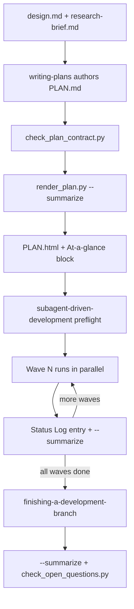

# Planning: Plans, Format, and Visual Planner

Planning turns an approved design and research brief into an executable `specs/<slug>/PLAN.md`. Five parts work together:

- **Authoring skill** — `skills/writing-plans/SKILL.md`.
- **Schema rules** — `rules/plan-format.md` and `rules/wave-parallelism.md`.
- **Static checkers** — `scripts/check_plan_contract.py` validates the plan. `scripts/check_open_questions.py` checks open questions when a slug ships.
- **Deterministic renderer** — `skills/visual-planner/render_plan.py` writes `PLAN.html` and maintains a script-owned "At a glance" block inside `PLAN.md`.

The plan is then consumed by execution (see [Implementation and Review Chain](implementation-and-review-chain.md)), by the commit-time blast-radius check, and by session resume (see [Resume Decision](../runtime/resume-decision.md)). For where planning sits among the other skills, see [Skill Chain](skill-chain.md).

## Lifecycle at a glance

*The planning lifecycle, from authoring through wave execution to the ship step.*

## Authoring: the `writing-plans` skill

`writing-plans` writes `specs/<slug>/PLAN.md`. Before it writes anything, it must explicitly Read `rules/plan-format.md` and `rules/terminology.md`. Both rules are path-scoped (`paths: specs/**/PLAN.md`), so they are not loaded for a plan that does not exist yet. The skill needs `specs/<slug>/design.md` and `specs/<slug>/research-brief.md`. If either is missing, it stops and tells the user. The authoring order matters:

1. Map the files to create or change, and their responsibilities.
2. Write `## 3. Success Criteria` **first**. Each criterion needs a re-runnable, pipe-free check that finishes in under 60 seconds, plus an expected exit code.
3. Add `## Global Constraints`. Decompose the work into `### Task` sections, each with Files, Action, Verify, Done, `Criteria` (`SC-n`), and `Interfaces`.
4. Keep same-wave tasks free of file overlap and unresolved dependencies.
5. If `design.md` has `## What must be true`, add an `### Assumption coverage` list under `## 5. Risks`. It maps each `A<n>` to an SC row, a task, an accepted risk, or a retiring `DC<n>`. The risk bullets must come first, because the renderer cards only the first bullet list. Then run `check_plan_contract.py`, review the plan, save it, and run `render_plan.py ... --summarize`.

At handoff, the skill states the plan path and uses `using-git-worktrees` unless the work is already isolated. It then invokes `subagent-driven-development` in the same session, without asking the user to pick an execution mode. Only an escalation trigger from `rules/orchestration.md` stops the start.

## PLAN.md format (`rules/plan-format.md`)

**When a plan is required.** Use the task format when the work has more than 3 steps, touches more than 2 files, takes more than 30 minutes, or spans more than one layer. These thresholds are the signal for a `PLAN.md` under the artifact policy. A `SUMMARY.md` is written for every lane regardless.

**Document skeleton.** The frontmatter holds `slug`, `status` (`proposed | active | paused | shipped`), `owner`, and `created`. The body has these numbered sections: `1. Motivation`, `2. Non-goals`, `3. Success Criteria`, `4. Tasks`, `5. Risks`, `6. Status Log`. `specs/` is tracked in git. `PLAN.html` and `.plan-review.json` are gitignored derived artifacts.

**Task schema.** A task is a plain-markdown `### Task <id> — Title (wave K)` heading followed by field bullets:

- **Files:** comma-separated paths
- **Action:** imperative instruction; continuation lines are indented under the bullet
- **Verify:** one shell command; exit 0 means pass; under 60 seconds
- **Done:** a measurable acceptance state

Ids follow `<phase>.<task>`, and sub-tasks use `N.M.x`. The optional `(wave K)` suffix assigns a wave. Plans with no parallelism may omit it. Two parsing rules apply. A task inside a code fence is an illustration and is ignored. A `### Task` heading with no field bullets is prose, not a task.

**Context contract (new plans).** A plan opts into the stricter contract by declaring a non-empty `## Global Constraints` section. Each task then also carries:

- `Criteria` — mapped `SC-n` ids.
- `Interfaces` — a consumes/produces statement. The `Produces` clause must name at least one artifact in backticks. `Consumes` may stay prose for external inputs.

**Success Criteria table.** This is the plan's acceptance contract. It is a non-fenced table with exactly the columns `ID | Behavior (observable) | Check (re-runnable) | Expected`. Column rules:

- IDs are sequential `SC-<n>`, with no gaps and no reuse.
- Checks follow the same guardrails as task `Verify`: a single command, no `|`, under 60 seconds, and never a whole-suite run.
- `Expected` starts with a machine-read `exit <n>` token.

The sibling `SUMMARY.md` closes the loop with an optional `Criterion` column in its `### Verify` table. `scripts/verify_summary.py` checks that those ids resolve to real SC rows (see [Evidence and Summary Contract](../concepts/evidence-and-summary-contract.md)).

**Guardrails.** The plan must follow four rules:

1. No file overlap among same-wave tasks.
2. Verify is automated. "Open the browser and check" is not allowed at task level.
3. Verify finishes in under 60 seconds. Split longer work into more tasks.
4. Follow the layer ladder: linter and type-checker, then the smallest touching test. The full suite is never a task Verify, an SC row, or a SUMMARY Verify row. It runs at `finishing-a-development-branch` and in CI.

**Legacy XML plans.** Plans written before 2026-07-16 use fenced `<task id wave><files><action><verify><done>` blocks. The renderer, the execution preflight, and `hooks/commit-gate.sh` still read them, but new plans must not use this format. A task added to an existing XML plan must stay XML. In a mixed file the parser reads only the XML tasks, so a markdown task would be invisible.

## Wave parallelism (`rules/wave-parallelism.md`)

Tasks are grouped into waves. Same-wave tasks run in parallel, and wave N+1 waits for wave N. The rule defines five invariants:

1. Same-wave tasks touch no common files.
2. Every wave-N task must pass Verify before wave N+1 starts.
3. Each task gets a fresh subagent.
4. All of a wave's subagent calls go in one assistant message, at most 20 calls per message. A wider wave is sent in batches.
5. The orchestrator collects every result before it advances.

The collection protocol after each wave:

1. Confirm that every task's Verify passed.
2. Append one `## Status Log` entry that names the **task ids**, their commit shas, and a completion marker (`complete` or `✓`).
3. Run `render_plan.py --summarize`.
4. Record deviations in `SUMMARY.md`.
5. On a blocker, update `STATE.md` and pause.
6. Only then spawn the next wave.

The Status Log entry format is load-bearing. `render_plan.py`'s `_done_task_ids` and `runtime/resume_decision.py` both build the done set from task ids in completion entries. An entry like "all 9 tasks executed" yields no ids, so a resuming session would have no cursor. Single-task waves need none of this machinery.

## Static validation

### `check_plan_contract.py`

`python3 scripts/check_plan_contract.py <PLAN.md>` exits 1 and prints its findings to stderr when the plan has defects. On success it prints `plan-contract: <path> passed`. The behavior:

- **Opt-in.** If the text has no `## Global Constraints`, the plan passes immediately. Legacy markdown and XML plans stay executable.
- **Fence masking.** Fenced code blocks are blanked before every scan, matching the renderer's behavior. Example `### Task` headings in fences are never mistaken for live tasks.
- **Checks.** The script reports an error when:
  - Global Constraints has no bullet;
  - there are no `| SC-n |` table rows;
  - there are no markdown tasks;
  - a task lacks `Criteria` or `Interfaces`;
  - a task's `Criteria` has no `SC-n`, or names an unknown SC id;
  - `Interfaces` does not name both a consume verb and a produce verb;
  - `Produces` names no backticked artifact.
- **Producer tracking.** Every backticked `Consumes` artifact must be produced by some task's `Produces`. Artifacts ending in `.md` or `.json` are exempt. Verb detection masks backticked text, so an artifact named, for example, `produces.py` is not read as a clause separator.
- `--self-test` runs built-in valid and invalid fixtures. The focused tests are in `scripts/test_check_plan_contract.py`. They cover legacy acceptance, fenced examples, dotted consumed artifacts that need a producer, and the verb-masking edge cases.

The execution preflight in `subagent-driven-development` re-runs this script for contract plans. The same preflight also requires Files/Action/Verify/Done on every parsed task, disjoint same-wave file sets, automated Verify commands, and a plan that meets the threshold. `harness-manifest.json` registers `rules/plan-format.md` and `check_plan_contract.py` as the `artifact-schema-plan` contract surface. Its consumers are `render_plan.py`, `writing-plans`, and `subagent-driven-development`.

### `check_open_questions.py`

Multi-phase efforts can keep an optional `specs/<slug>/QUESTIONS.md` register of **non-blocking** open questions. Each question is one `## OQ-<n>` block with these fields: `raised-by`, `closes-at` (`<slug>` or `<slug>#<task>`), `decided-by` (`measurement|owner`), `default-until-closed`, `status` (`open|closed`), and `closed-by` (required once closed). The template is `templates/QUESTIONS.template.md`. Blocking questions go in `ESCALATIONS.md` instead.

`python3 scripts/check_open_questions.py --slug <slug> [--root DIR]` reads **every** `specs/*/QUESTIONS.md`, because a parent spec's question usually closes at a child phase. It reports two kinds of finding:

- **Open questions closing at this slug.** These are blocks with `status: open` whose `closes-at` is exactly the slug or `slug#...`. A slug such as `slug-other` does not match.
- **Malformed blocks.** Examples are a missing field, a bad value set, a duplicate `OQ` id or field, or a near-miss heading such as `### OQ-1`.

Findings go to stderr. The script is warn-only by default (exit 0). With `REQUIRE_QUESTIONS_CLOSED=1` it exits 1, and a missing `--slug` is a usage error (exit 2). `--root` defaults to the current directory, not the script's location, because the deployed copy lives under `.claude/scripts/`.

The check runs at two points:

- `finishing-a-development-branch` runs it before shipping. It lists any findings under "Open questions closing here" in the PR body.
- `scripts/ci-strict-gate.sh` runs it for every `specs/<slug>/PLAN.md` in the PR diff whose frontmatter becomes `status: shipped` (shipped at HEAD but not at the merge base). Under `REQUIRE_QUESTIONS_CLOSED=1`, the gate blocks on findings, on a check error, or when the script is missing.

## Visual planner: `render_plan.py`

`render_plan.py` is a deterministic Python renderer. It replaced the earlier flow in which the model emitted the HTML template verbatim. For a given `PLAN.md` and `template.html`, the output is byte-for-byte reproducible. The visual-planner skill says never to hand-transcribe HTML: `template.html` owns layout, and `render_plan.py` owns parsing.

**Invocation.** `render_plan.py <PLAN.md|slug> [output.html] [--emit-files] [--review sidecar.json] [--summarize]`.

- **Argument resolution.** An argument ending in `PLAN.md` that exists is used directly. Otherwise the argument is treated as a slug and globbed as `**/<slug>/PLAN.md` under `./specs` and under the skill's install-root `specs/`. Zero matches or more than one match is an error.
- **Default output.** The output is a sibling `PLAN.html`, overwritten silently. With `--review`, it is `PLAN.review.html` instead, so a later plain render does not overwrite the review build.

**Task parsing.**

1. The renderer first does a depth-balanced XML `<task>` scan on a copy with fences and inline code masked. It slices blocks from the original text, so an action keeps its own code.
2. If that finds nothing, it scans each fenced block on its own.
3. If that also finds nothing, it falls back to the markdown `### Task` schema. Markdown headings without any Files/Action/Verify/Done bullet are dropped.

XML therefore wins in mixed files. Titles come from the `### Task <id> — Title` heading. Ids with three or more segments nest under their parent. An orphaned sub-task becomes top-level and produces a warning. Tasks without a wave go into a `—` wave, which sorts last.

**HTML rendering.** The renderer fills `{{PLACEHOLDER}}` slots in `template.html`: title, status badge, owner, created, slug, stats, intro card, wave diagram, sections, review, tasks, table of contents, and source links. The stats card counts tasks, waves, distinct files, and parallel waves (waves with two or more tasks). It also shows a progress bar derived from the Status Log. The Status Log is shown as a timeline. Each dated bullet gets a kind (`build`, `decision`, `plan`, `open`, or `note`) by keyword priority, and logs with more than 8 entries fold the older ones. After writing, `self_check` fails the run with `SELF-CHECK FAILED:` and exit 1 when:

- the output is empty;
- any `{{...}}` placeholder is left;
- the slug is missing from the output;
- the count of `<section data-wave=` wrappers does not match the number of waves.

**`--summarize` and the At-a-glance block.** Before rendering, `--summarize` builds a block bracketed by the `<!-- AT-A-GLANCE:BEGIN ... -->` and `<!-- AT-A-GLANCE:END -->` sentinel lines. The block contains:

- a count line (tasks, waves, files, done);
- a wave×task table, with each Done cell truncated to 80 characters;
- a `flowchart LR` Mermaid diagram of one subgraph per wave, chained in order;
- a `### Progress` checklist.

The block replaces an existing block in place. Otherwise it is inserted before the first `## ` heading. Sentinels are matched only as whole lines, so prose that merely mentions them is never corrupted. Orphaned half-blocks are removed before a fresh insert. `PLAN.md` is written only when the text changes, so the operation is idempotent. Done ids come from Status Log entries of kind `build`, or entries that contain `✓` or `complete`. Only real plan task ids count. The HTML render strips this block from the body because the HTML has its own view. The block must never be edited by hand: the Status Log remains the source of truth. Three callers run `--summarize`: `writing-plans` after saving, the wave-boundary protocol, and `finishing-a-development-branch` before the shipped commit.

**Review overlay.** This path is optional.

1. `--emit-files` prints JSON with the slug, a sorted list of files, and each task's id, wave, and files.
2. The agent gathers per-file evidence with Grep/Read.
3. `--review specs/<slug>/.plan-review.json` adds a "Plan Review" section. It contains a stats card (files, new, existing, dependents, untested), a per-file table with status and risk chips, cards for high-risk files with their dependents, affected flows, and a warning for files marked missing.

The skill forbids inventing risk or coverage. `view_plan.py` serves or opens the HTML only when the user asks, because its serving mode blocks.

### Why `render_plan.py` is high-blast

`render_plan.py` is the only skill engine in the **high-blast** risk category. `harness-manifest.json` sets that category to `mode: block`. `hooks/commit-gate.sh` tags staged changes whose path ends in `render_plan.py` as `high-blast`, together with `settings.json` and hook paths. In CI, `scripts/ci-strict-gate.sh` puts `render_plan.py` in its BLOCK tier, so a PR that touches it needs a changed `Lane: high-risk` SUMMARY with Verify rows that re-run clean. The script is invoked by path from three workflow points. `scripts/deploy-harness.sh` rewrites those invocations to `.claude/skills/visual-planner/render_plan.py` in consumer repositories. The renderer's unit tests are in `skills/visual-planner/test_render_plan.py`. They cover clause splitting, frontmatter hardening, risk severity, and success-table rendering. The skill says to re-run them after any parsing change.

## Plans at commit time

`hooks/commit-gate.sh`'s `check_plan_scope` treats the active plan's declared files as an allowlist. The active plan is the `specs/*/PLAN.md` with `status: active`, and the declared files are the union of XML `<files>` and markdown `**Files:**` bullets. Staged paths outside this set produce a `[BLAST RADIUS]` warning, and `BLAST_RADIUS_STRICT=1` turns the warning into a block. Paths under `specs/` and `docs/`, and `*.md` files, are exempt. Only `status: active` arms the check, so a shipped plan's file list never limits later work.
