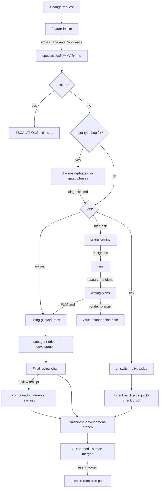

# The Skill Chain: Intake to Ship

Every change request in this harness moves through a chain of named skills. Each skill has one scope, a hard gate, and a fixed handoff to the next skill. The chain is not one fixed pipeline. `feature-intake` picks the path. It classifies the request into a **lane** (`tiny | normal | high-risk`), and the lane decides which skills run. A request with `Input-type: bug fix` first goes through `diagnosing-bugs`, then follows its lane route. The plan-ahead documents appear only when a signal asks for them. The always-on record (`specs/<slug>/SUMMARY.md`) and branch isolation apply to every lane.

The inventory and workflow overview live in [`skills/README.md`](../../skills/README.md). That file calls itself "the single source of truth for overview, workflow, and cross-skill concerns". Each `SKILL.md` stays authoritative for runtime behavior. [`HARNESS.md`](../../HARNESS.md) gives the plain-language version: "Ceremony scales with risk. Human interruption scales with ambiguity." This page follows these sources and points out where they disagree.

Related pages: [Lanes, Risk and Hard Gates](../concepts/lanes-risk-and-hard-gates.md) · [Bug Diagnosis](bug-diagnosis.md) · [Planning](planning.md) · [Implementation and Review Chain](implementation-and-review-chain.md) · [Compound Knowledge Base](compound-knowledge-base.md) · [Run-State Engine](../runtime/run-state-engine.md).

## Lane routing at a glance

*How the intake lane picks the path through the skill chain. Dashed edges are optional side paths. On the tiny lane, `diagnosing-bugs` itself writes the red test and the fix (Phase 5), so the tiny bug path never reaches `using-git-worktrees`.*

## Step by step

### 1. `feature-intake` — classify and route

`feature-intake` is the first gate for every change request. Its HARD-GATE forbids editing, scaffolding, or dispatching implementation until `Lane:` and `Confidence:` are recorded in `specs/<slug>/SUMMARY.md`. The agent must never ask the user to classify risk. It may ask only to resolve a material ambiguity or to narrow a hard-gated scope.

The procedure in brief:

- **Intent first.** If the slug has no SUMMARY yet, intake drafts or reads `specs/<slug>/intent.md` (see `references/draft-intent.md`). It classifies only from an intent that is `Status: approved` and unchanged since its last commit. That commit becomes the `Intent-source: specs/<slug>/intent.md @ <sha>` pin. A draft that classifies as tiny + high confidence is auto-approved. Any other result stops and asks the user to approve. When intake commits the intent on `main`/`master`, it first runs `git switch -c <type>/<slug>`, so the shared branch never gets a commit. A slug that already has a SUMMARY with an intent pin follows `references/re-pin.md`.
- **Input type.** One of new spec, spec slice, change request, initiative, maintenance, harness improvement, or bug fix. `bug fix` covers any fix of wrong behavior, harness bugs included.
- **Lane.** A manifest hard gate makes the lane `high-risk`. Otherwise intake counts ten risk flags (auth, authorization, data model, audit/security, external systems, public contracts, cross-platform, existing behavior, weak proof, multi-domain). 0–1 flags is `tiny` only for one-file work with no new public callable. 2–3 flags is `normal`, and 4+ flags is `high-risk`. A human can lower a hard-gated lane only by narrowing scope.
- **Confidence.** `high` means one clear interpretation. `medium` means a safe documented default. `low` means materially different readings, including a chat request that conflicts with intent.md.
- **Record.** The SUMMARY header block holds `Lane`, `Confidence`, `Reason`, `Flags`, `Affects`, `Input-type`, `Route`, and `Escalate`. `### Intent` holds the pin line and then the verbatim request. Intake initializes the durable run as `investigating`, then moves normal and high-risk runs to `planning` (a run-state failure never blocks intake). Before handoff it runs `python3 scripts/verify_summary.py --lane <slug>`.

The routes defined in `skills/feature-intake/SKILL.md`:

| Input / lane | Route |
|---|---|
| `Input-type: bug fix` (any lane) | Before the lane route, use the Read tool on `skills/diagnosing-bugs/SKILL.md` and follow it. Do not call the Skill tool for it. |
| `tiny` | Cut a branch, patch directly, keep quick-check proof. The work is done only when that proof passes. Apply `asd-ste100` to agent prose edited under `skills/`, `rules/`, or `agents/`. |
| `normal` | `using-git-worktrees` → `subagent-driven-development` |
| `high-risk` | `brainstorming` → `xia2` → `writing-plans` → `using-git-worktrees` → `subagent-driven-development`, with `compound` for durable decisions |

`rules/orchestration.md` owns the escalation decision, which runs at intake and again during execution. Work escalates to `specs/<slug>/ESCALATIONS.md` and stops when any of these hold: a hard gate that a human has not narrowed, `low` confidence, `medium` confidence on high-risk work, an ambiguous direction, an in-flight trigger, or a change that would redefine the system. High-confidence normal work is **notify-and-proceed**: the agent posts the plan and continues without waiting. `ESCALATIONS.md` is deny-on-no-response, and the commit gate's `check_escalations` enforces this.

### 1a. `diagnosing-bugs` — prove the root cause first (bug fixes only)

A bug-fix request takes a detour before its lane route. `diagnosing-bugs` sets `disable-model-invocation: true`, so the model cannot invoke it as a skill. Intake therefore reads its `SKILL.md` with the Read tool, and a user can run it directly as `/diagnosing-bugs`. Every lane runs all six phases, and no "cause known" shortcut exists. Full detail: [Bug Diagnosis](bug-diagnosis.md).

- **Isolation first.** On the tiny lane, `git checkout -b fix/<slug>` runs only from a shared branch. Otherwise the current branch stays. Normal and high-risk lanes run `using-git-worktrees`. Every probe, harness, and fix edit happens there.
- **Phases 1–4** write `specs/<slug>/diagnosis.md`: a fast deterministic red feedback loop, a minimised repro, 3–5 ranked hypotheses (committed before the first probe), and single-variable probes tagged `[DEBUG-xxxx]` until one hypothesis is `Confirmed:`. If no loop is possible, or the probes refute every hypothesis twice, the skill writes an `ESCALATIONS.md` block with `decision: pending` and stops.
- **Diagnosis review.** A `task-reviewer` must return `spec_verdict: pass` and `quality_verdict: approved` before Phase 5. A second failed review escalates.
- **Phase 5 (fix) splits by lane.** Tiny: commit a red test at the diagnosis `Seam:`, then the fix (or record `Red test exempt: <reason>`). Normal and high-risk: continue the lane chain with `diagnosis.md` as an input. `writing-plans` copies `Seam:` into the fix task's `Seams:`, and `subagent-driven-development` checks it before dispatch.
- **Phase 6 (cleanup)** re-runs the loop green, removes every `[DEBUG-` tag, and names the confirmed hypothesis in the commit message and SUMMARY `Rationale`. On non-tiny lanes, the final review chain runs Phase 6 first.

### 2. `brainstorming` — decide the approach (high-risk, or a real design fork)

`brainstorming` turns an unclear or high-risk idea into an approved `specs/<slug>/design.md`. It is for a clear goal with an unsettled approach. A settled approach that only lacks codebase or library knowledge goes to `xia2` instead. If no intake lane exists, intake runs first. The flow:

1. Inspect the project, docs, recent changes, and the decisions in `docs/solutions/`. Split a request that spans unrelated subsystems into separate specs.
2. **Grilling rounds.** Map the open decisions (purpose, constraints, success criteria, boundaries) as a design tree. The *frontier* is every decision whose prerequisites the user has already settled. The agent asks the whole frontier in **one numbered round**, gives a recommended answer per question (worded so that "yes" accepts it), and waits. Facts are the agent's job: it finds them itself, or dispatches a subagent for a large search, and never asks the user for a fact. Decisions belong to the user. A decision left unanswered or evasive twice is named as a gap, its recommended answer is recorded as an assumption, and the round moves on. Rounds repeat on the new frontier until it is empty and the user confirms a shared understanding. A plain "yes" to the whole last round counts as that confirmation.
3. Present 2–3 approaches with trade-offs and a recommendation, after removing scope nobody asked for (YAGNI).
4. Confirm the design section by section (architecture, components/data flow, error behavior, tests).
5. Restate the purpose, constraints, and chosen approach in 2–3 sentences, checked against the user's actual answers rather than memory, and confirm it. Write `design.md` from `references/design-template.md` and complete the spec-review loop.

Non-blocking unknowns in a multi-phase spec go to `QUESTIONS.md`. The HARD-GATE forbids code, scaffolding, or an implementation skill until the user approves the design. If the scope gets smaller, the agent asks to re-route instead of skipping the gate. The terminal handoff is fixed: invoke `xia2` with the spec directory, then `writing-plans`, and no other skill.

### 3. `xia2` — research before code

`xia2` writes `specs/<slug>/research-brief.md` and nothing else until it has delivered the brief. Only an explicit user waiver ("skip research") skips it, and the waiver still prints a one-line warning for each Deep signal. Research depth comes from the intake lane: high-risk → Deep, normal → Standard, tiny → Quick only when every Quick condition passes. xia2 does not reclassify risk. New evidence can raise the depth but never lower it.

Separately, any *external surface* (a new dependency, an external system, a version-specific API) requires upstream and version-matched documentation research. Each finding is labeled `Local`, `Upstream`, `Docs`, or `Inference`. The recommendation order is reuse → adapt upstream → built-in → build.

### 4. `writing-plans` — the executable plan

`writing-plans` reads `design.md` and `research-brief.md` and stops if a required brief is missing. It writes `specs/<slug>/PLAN.md` with Success Criteria first. Each task has Files, Action, an automated Verify, a measurable Done, `Criteria` (`SC-n`), Interfaces, and a `Seams:` line; the plan carries the `- Plan-contract: 2` marker in `## Global Constraints`. When `diagnosis.md` exists, the fix task's `Seams:` copies its `Seam:` exactly. Same-wave tasks must not overlap in files. The skill validates the plan with `scripts/check_plan_contract.py` and then runs `render_plan.py --summarize`, which refreshes the At-a-glance block and writes `PLAN.html`.

At handoff it uses `using-git-worktrees` unless the work is already isolated, then invokes `subagent-driven-development` in the same session. It does not ask the user to pick an execution mode or confirm the start. Only an escalation trigger stops the start. A later session continues with `resume <slug>`. See [Planning](planning.md).

### 5. `using-git-worktrees` — isolation

The skill first runs `skills/using-git-worktrees/scripts/detect-isolation.sh`. The script reports `linked-worktree`, `submodule`, or `main-worktree` by comparing the git dir with the common dir and checking for a superproject. The skill reuses a linked worktree, treats a submodule as not isolated, and creates isolation only from the main worktree.

In Claude Code it calls the native `EnterWorktree` with `name: "<type>/<kebab-slug>"`, so the worktree lands under `.claude/worktrees/`. Two branch-adoption cases follow:

- **Intake already cut `<type>/<slug>`** (the branch holds the intent commit). Switch the main checkout back to `<base>`, then inside the worktree run `git reset --keep <type>/<slug>` and `git branch -M <type>/<slug>`.
- **Intake cut no branch.** The tool's `worktree-<name>` branch is renamed to `<type>/<slug>`. Before any edit, HEAD is compared with `<base>` and reset with `git reset --keep <base>` if they differ.

Without a native tool, the fallback is `git worktree add` under an ignored `.worktrees/` or `worktrees/` directory. Inside the workspace, the skill deploys the harness with `scripts/deploy-harness.sh --target …` and runs the project's clean baseline. Any baseline failure that already exists is reported before implementation starts.

Branch isolation is also enforced structurally. `hooks/branch-isolation-guard.sh` is a PreToolUse Write/Edit hook. It denies an edit outside `specs/` while the owning checkout is on a shared branch (`HARNESS_SHARED_BRANCHES`, default `main master`), with no exemption for any lane. `specs/` stays writable so intake can write SUMMARY before a branch exists. The break-glass override is `BRANCH_ISOLATION_REASON`. See [Branch Isolation and Session Hooks](../enforcement/branch-isolation-and-session-hooks.md).

### 6. `subagent-driven-development` — waves, per-task review

This skill executes the plan in waves. Each wave dispatches a fresh implementer subagent per task, and one read-only `task-reviewer` returns separate `spec_verdict` and `quality_verdict` for each task. A task advances only when its Verify command and both verdicts are green. Before the first task, the plan must pass preflight: every task is complete, same-wave tasks have no file overlap, and every Verify is one exit-code-checkable command. The skill then sets the plan to `status: active` and moves the run to `implementing` when a durable run exists.

For a diagnosed bug fix, the controller reads `references/bug-fix.md` before dispatch. It compares the seam point of the fix task's first `Seams:` entry with the `diagnosis.md` `Seam:`. On a mismatch the fix task is not dispatched: a normal-lane controller corrects `PLAN.md` itself, a high-risk task goes back to `writing-plans`, and a second mismatch escalates.

The implementer reports inline. The controller writes that report verbatim to `.harness-state/sdd/report-<task>.md` according to the subagent contract in `rules/orchestration.md`, because the runtime refuses subagent report-file writes. `resume <slug>` first asks `runtime/resume_decision.py` for a structured action (see [Resume Decision](../runtime/resume-decision.md)). After all tasks pass, the run moves to `verifying` and the final review chain runs. Details: [Implementation and Review Chain](implementation-and-review-chain.md).

### 7. Final review chain

The chain is defined in `references/review-chain.md`:

0. For a diagnosed bug fix, `diagnosing-bugs` Phase 6 runs first: the `Loop:` command must now pass, leftover `[DEBUG-` tags and throwaway harnesses are removed, and the `Confirmed:` hypothesis is named in the commit message and SUMMARY `Rationale`.
1. `context-propagation-audit` runs next, but only when the cumulative diff touches workflow-engine paths.
2. One `BASE..HEAD` review package is built with `review_package.py` and given to both `correctness-review` (six parallel adversarial angles) and `intent-review`. They share only that mechanical evidence; each keeps its own oracle inputs and blindness rules. `intent-review` checks the diff against the verbatim original request and does not see PLAN.

Every finding is resolved, escalated, or durably recorded before `.review-receipt.json` is written at the reviewed HEAD. Handoff needs a passing `verify_summary.py --check <slug>` and a receipt with zero blocking findings. Any code commit after the review invalidates the receipt, and the receipt's SHA is never hand-edited.

### 8. `compound` — durable learning (conditional)

`compound` runs only when the session produced a non-obvious bug, a reusable pattern, a considered decision, a useful failure, or a `Harness-Delta: backlog` signal. It never runs just because a session ended. It writes `docs/solutions/<category>/<slug>.md` and always finishes with `scripts/rebuild_solution_index.py`, even when it wrote nothing. On the bug path (`diagnosing-bugs` → fix → compound), compound runs when the root cause is a reusable learning, and its bug track takes the root cause from the `diagnosis.md` `Confirmed:` hypothesis. A high-overlap match with an existing record is treated as a second occurrence ("mistake twice") and promotes that record instead of adding a new one. See [Compound Knowledge Base](compound-knowledge-base.md).

### 9. `finishing-a-development-branch` — verify, pin, push, PR

The finish skill opens a PR and never merges. It starts by running `python3 scripts/resolve_finish_context.py` once and uses that JSON throughout.

**How the resolver finds the plan.**

- The branch defaults to the current one and the base defaults to `main`. The slug is the part of the branch name after the first `/`.
- Plan lookup order: `specs/<slug>/PLAN.md` exactly (`exact-directory`). Then a single plan whose `slug:` header equals the slug or whose directory name contains it (`direct-slug`). Then token overlap between the branch name and the plan slug, with at least 2 shared tokens and exactly one best match (`token-overlap:<n>`).
- More than one match sets `ambiguous_plan: true`, and the skill must ask the user. With no plan, the skill takes the tiny/no-plan path instead of guessing.

**Other resolver output.**

- The lane comes from the `Lane:` line in the plan's sibling `SUMMARY.md`.
- `changed_files` is `merge-base..HEAD`.
- `context_propagation_audit_required` is true when a changed path under `skills/`, `agents/`, or `rules/` is a `.md` file or sits under `/subagents/` or `/prompts/`.
- `receipt_path` is `<plan_dir>/.review-receipt.json`.

**Verify and gate.**

1. Run the targeted test suite from `agents/PROJECT.md`. Retry fixes at most twice, and never push a failing change.
2. For non-tiny work with a plan, run `scripts/check_review_receipt.py <plan_dir> --require correctness,intent --require-audit-if <base>`. Re-run it immediately before the push. A missing, stale, or blocking receipt stops the flow, and the receipt must never be edited to pass.
3. Run `check_open_questions.py` in warn mode, and `verify_summary.py --sc-history`, which blocks only under `REQUIRE_SC_STABLE=1`.
4. Mark the plan `status: shipped`, re-render the At-a-glance block, and commit `PLAN.md`, `SUMMARY.md`, `RUN.json`, and `events.jsonl` staged by name.

**Push and PR.** Push without force and open one PR against the resolved base. Then run `runtime/run_state.py transition --to ready_to_merge --event pr.opened || true` and commit and push the resulting `RUN.json`/`events.jsonl` change. This extra commit matters: in the run-state FSM `shipped` is reachable only from `ready_to_merge`, and the post-merge transition reads committed state. Without it, a run stays at `verifying` and never terminalizes ([Post-Merge Bookkeeping](../operations/post-merge-bookkeeping.md)).

**Safety boundary.** Never merge, force-push, `git add -A`, `git clean`, discard work, or amend a commit. A human reviews and merges.

## Handoff artifacts per lane

| Artifact | tiny | normal | high-risk | Produced by |
|---|---|---|---|---|
| `intent.md` (pinned by SHA) | yes (may auto-approve) | yes | yes | feature-intake |
| `SUMMARY.md` with Lane/Confidence | yes | yes | yes | feature-intake, updated through execution |
| `diagnosis.md` | bug fix only | bug fix only | bug fix only | diagnosing-bugs |
| `design.md` | design fork only | design fork only | yes | brainstorming |
| `research-brief.md` | — | unfamiliar code | yes | xia2 |
| `PLAN.md` (+ untracked `PLAN.html`) | — | >3 steps or >2 files | yes | writing-plans |
| `<type>/<slug>` branch | yes | yes | yes | feature-intake / using-git-worktrees |
| Linked worktree | — | per intake route | yes | using-git-worktrees |
| `.harness-state/sdd/report-<task>.md` | — | yes | yes | SDD controller |
| `.review-receipt.json` | skipped | yes | yes | final review chain |
| `docs/solutions/…` | if learning | if learning | durable decisions | compound |
| PR | yes | yes | yes | finishing-a-development-branch |

The artifact policy in `rules/orchestration.md` sizes these. The record (SUMMARY) is always on, even for tiny work. Plan-ahead scaffolding is triggered by a **signal**, not by lane alone: `PLAN.md` at >3 steps or >2 files, `research-brief.md` for unfamiliar code or high-risk work, and `design.md` only for a real design fork (two or more viable approaches) or high-risk work. `FULL_ARTIFACTS=1` forces the complete set. The commit gate's lane-evidence check (`verify_summary.py --lane`) requires more evidence as the lane rises: tiny needs a filled header, normal adds a real `### Verify` row, and high-risk adds a non-empty `### Rollback` ([Commit Gate](../enforcement/commit-gate.md), [Evidence and SUMMARY Contract](../concepts/evidence-and-summary-contract.md)).

### Where sources disagree

- **xia2 handoff.** The handoff map in `skills/README.md` says xia2's next step is decided by the user or the calling skill. Inside the high-risk chain, `brainstorming` fixes it as `xia2` → `writing-plans`.
- **writing-plans inputs.** `writing-plans` names `design.md` and `research-brief.md` as required inputs. The artifact policy creates those only on a signal. A normal-lane plan without them can therefore hit the skill's "stop when a required brief is missing" rule.
- **Normal-lane summary in HARNESS.md.** The lane table in `HARNESS.md` lists the normal path as `/subagent-driven-development` alone. `feature-intake` and the `skills/README.md` Minimum Viable Path both put `using-git-worktrees` before it (the README adds that an existing linked worktree is reused) and both require a branch on every lane.

## Keeping skills small: the 600-word ceiling

Each registered `skills/<name>/SKILL.md` must stay at or under 600 words. `scripts/audit_skill_prompts.py` enforces this as `SKILL_WORD_CEILING = 600`, counting the whole file including frontmatter. A vendored skill marked by an `UPSTREAM.md` (for example `asd-ste100`) is exempt and gets only a note. This ceiling is why longer procedures live under a skill's `references/` folder (for example `feature-intake/references/re-pin.md`, `subagent-driven-development/references/review-chain.md`, `diagnosing-bugs/references/phases.md`).

An over-ceiling skill fails the audit with a hint that points to the **deletion-test procedure** in `docs/solutions/harness/deletion-test-for-word-ceiling.md` (#308). The procedure trims by whole sentences and whole blocks, never by cutting words inside a sentence:

1. List each sentence of the skill.
2. **Deletion test.** If the model already does it by default, delete the whole sentence. A sentence that restates a file the skill already makes the model read passes this test. A bare pointer does not.
3. **Disclosure.** Move a whole block that only some branches reach into `references/`, and leave a one-line pointer.
4. **Never shorten a sentence that holds a condition word** (`if`, `unless`, `only`, `when`, `never`, `except`, `for a new`, `without` — the `WORDS` list in `scripts/check_scope_qualifiers.py`). Keep it whole or move it whole.
5. **Stop when nothing safe is left**, and list the remaining sentences as "kept long on purpose" in the spec's `SUMMARY.md`.

The rule exists because earlier word-level trims silently dropped conditions while all tests stayed green. The SDD review package's `## Scope qualifiers` section and the task reviewer's meaning check back the procedure up.

## Run-state along the chain

When a durable run exists, the chain drives the [run-state FSM](../runtime/run-state-engine.md) forward. The happy path is `investigating` → `planning` → `implementing` → `verifying` → `ready_to_merge` → `shipped`. Intake does the first transitions, SDD moves to `implementing` and `verifying`, finishing moves to `ready_to_merge`, and post-merge automation moves to `shipped`. CI and review loops (`awaiting_ci`, `fixing_ci`, `awaiting_review`, `addressing_review`) branch off `verifying`. Any active state can move to blocked, escalated, cancelled, or superseded.

## Side paths

- **`visual-planner`** renders `PLAN.md` into an untracked, self-contained `PLAN.html` with the deterministic `render_plan.py`. HTML is never hand-transcribed. Three callers run `--summarize`: `writing-plans` after saving, `rules/wave-parallelism.md` at each wave boundary, and `finishing-a-development-branch` before the shipped commit. Run the skill on its own mainly for the `--review` overlay: emit the plan files, gather per-file blast radius and risk, write `.plan-review.json`, and render `PLAN.review.html`. It is terminal and returns to the writing-plans handoff.
- **`session-retro`** is user-invoked only (`disable-model-invocation: true`). After a session with visible friction, it maps each struggle to an environment lever (navigation pointer, deterministic check, scoped rule, tool change, wider access) and ranks the candidates. It edits nothing. Approved mechanical items become `improvement-backlog.md` rows or a new `feature-intake` task, and durable knowledge goes through `compound`. If nothing struggled, it says so and stops.
- **`harness-models`** is a user-invoked setup skill outside the chain. It runs `scripts/apply_model_config.py` in `show` (default), `check`, or `apply` mode against `harness-models.json`, the per-project model and effort settings for agents and skills, and relays the output verbatim. It never edits `harness-models.json` itself. After `apply`, agent changes may take effect only from the next session. The `model-config.sh` SessionStart hook applies the same file automatically at session start.

## Orchestration invariants that span the chain

- The main thread coordinates. Subagents are used where isolation or parallelism is the point: one implementer per `PLAN.md` task, each review pass in its own isolated reviewer, and wide investigations.
- Every subagent returns the contract: commits, files touched, lane, deviations, blockers, verify status, and `Harness-Delta`.
- In-flight escalation triggers include a Verify that fails twice after a fix, a blast radius beyond the plan's Files set, a hard gate found mid-implementation, a recurring deviation, and a `BLOCKED` report saying "the plan itself is wrong".

## Tests that pin this workflow

- `tests/scripts/finishing-branch-contract.test.sh` greps the finish skill for the resolver contract, the receipt gate flags, the create-PR-only boundary, the `--to ready_to_merge --event pr.opened || true` producer (issue #196), the open-questions check, and the SC history check.
- `skills/feature-intake/tests/` holds the lane-classification, confidence-escalation, and intent-file case sets.
- `runtime/test_resume_decision.py` covers resume behavior for each run state.
- `scripts/test_audit_skill_prompts.py` checks that an over-ceiling skill fails with the `progressive-disclosure ceiling` message and the pointer to the deletion-test entry, and that only a skill with `UPSTREAM.md` is exempt.
