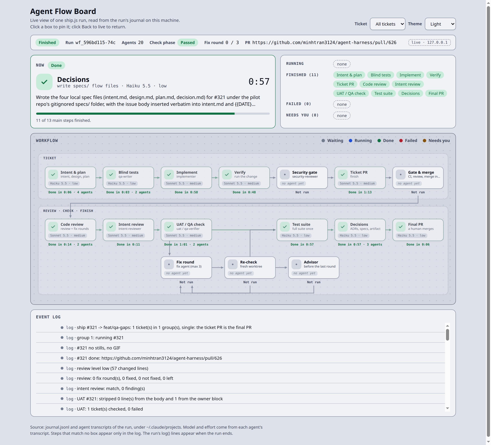

# Agent Flow Board

A live view of one `ship.js` (autopilot) run: which agent runs now, with which model and effort, what each
step returned, and where the run waits for you. One Node file, no dependencies, no build.



More shots of real runs (dark theme, a killed run) are in `docs/images/board/`.

```
node plugins/harness/board/board.js                    # newest run of the project in the current directory
node plugins/harness/board/board.js --project ~/code/app
node plugins/harness/board/board.js --run wf_596bd115-74c
```

Then open `http://127.0.0.1:4317`. Start the board before or during `/harness:autopilot`; it switches to a
newer run of the same project by itself (`--no-follow` keeps the first one). It works for any project
that runs `ship.js`, because it only needs the project path.

## Where the data comes from

Claude Code writes these files for every Workflow run. The board reads them and nothing else:

| File | What the board takes |
|---|---|
| `~/.claude/projects/<project>/<session>/subagents/workflows/<run id>/journal.jsonl` | one `started` and one `result` line per agent: label, phase, status, the agent's short summary, check rows |
| `.../<run id>/agent-<id>.jsonl` | first and last timestamp, `message.model`, `effort` |
| `~/.claude/projects/<project>/<session>/workflows/<run id>.json` | written once at the end: run status, final PR, the `log()` lines |

`<project>` is the project path with every character outside `A-Z a-z 0-9` replaced by `-`.

The server polls these files every 500 ms and pushes new events to the page with Server-Sent Events.
`flow.json` maps the stage part of each agent label (`#321 QA check fix r2 · title` → `QA check fix`) to a
box. A stage that matches no box still shows in the event log. Edit `flow.json` to change the diagram.

## Privacy

The server binds `127.0.0.1` only. It sends labels, phases, statuses, models, efforts, times, check row
counts and the agent's own summary (cut to 200 characters). It never sends prompts, tool calls or file
contents from the transcripts.

## Limits

- Verifies: each agent of the run appears when it starts and when it returns, within about one poll interval.
- Does not verify: `log()` lines and `phase()` calls, because Claude Code writes them only in the summary
  at the end of the run; runs of local mode, which skip the UAT phase.
- The file layout belongs to Claude Code and is not a public contract. If it changes, the board shows
  "No ship.js run found" or no model; `tests/board/board.test.js` pins the format the board expects.
- A check box shows its first result. When a fix round then passes, the Re-check box turns green and the
  summary's Check phase says Passed; the first check stays red, on purpose, so the failure stays visible.
- A box shows the latest agent of its stage; the caption counts all agents of the box (`2 agents`). The
  `fetch owner request` step before a check has no box, so the check box shows the checker's model.
- The Now card and the log show each agent's own summary as it wrote it. It can name a folder of your
  project: look at a screenshot before you post it somewhere public.
- After the run ends, a box that never ran says `Not run`, and a check stopped by the end of the run makes the Check phase `Stopped`.
- The setup agent (`check plugin and tools`) has no box; it shows only in the event log.
- A killed run has no PR link on the board: Claude Code writes `result: null` in its summary, so the PR
  number is not in any file the board reads.

## Started by autopilot

`/harness:autopilot` starts the board for you just before it launches the workflow, through
`plugins/harness/skills/autopilot/scripts/open_board.js`:

- It reuses a board that already runs for this project on port 4317. When another project's board holds
  that port, it starts one on a free port.
- It starts the board with `--idle-exit 30`: the board stops by itself 30 minutes after the run ends.
- It opens the page in your browser on macOS, Windows, and Linux with a desktop (`DISPLAY` or
  `WAYLAND_DISPLAY`). It opens nothing in CI or when `HARNESS_BOARD_NO_OPEN=1`. A headless `claude -p`
  run on a desktop machine also opens the browser.
- A board problem prints one line and never stops the run.
- `"board": false` in `<repo>/.claude/autopilot-profile.json` turns it off.

Tests: `bash tests/scripts/board.test.sh`.
