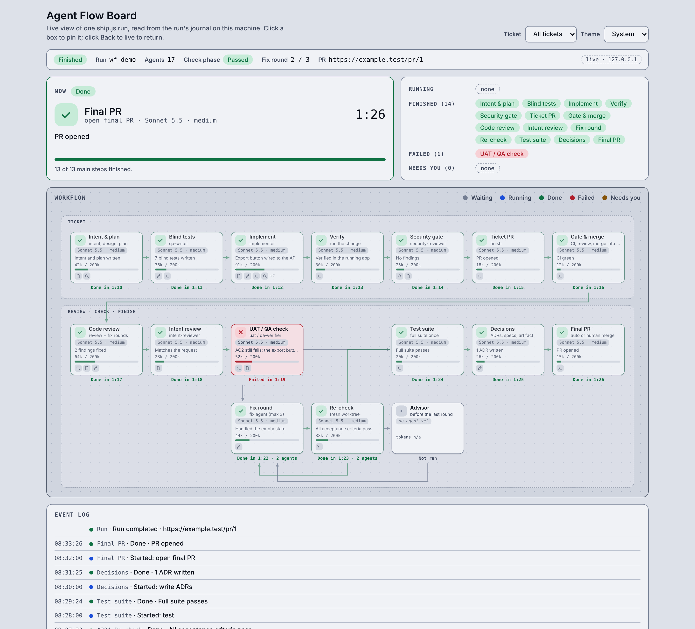

# Agent Flow Board

A live view of one `ship.js` (autopilot) run: which agent runs now, with which model and effort, what each
step returned, and where the run waits for you. One Node file, no dependencies, no build.



The two `board-completed` shots come from a fixture run (the token limit 200k is an example, not a shipped value). More shots of real runs (a killed run, one ticket) are in `docs/images/board/`; they show the old box look.

```
node plugins/harness/board/board.js                    # newest run of the project in the current directory
node plugins/harness/board/board.js --project ~/code/app
node plugins/harness/board/board.js --run wf_596bd115-74c
node plugins/harness/board/board.js --idle-exit 30          # stop by itself 30 min after the run ends
```

Then open `http://127.0.0.1:4317`. `/harness:pd-autopilot` starts the board for you, and opens it in a browser when a desktop is there (see below). Otherwise start the board before or during the run; it switches to a
newer run of the same project by itself (`--no-follow` keeps the first one). It works for any project
that runs `ship.js`, because it only needs the project path.

## Autopilot starts it

Unless you pass `--no-board`, `/harness:pd-autopilot` runs `plugins/harness/skills/pd-autopilot/scripts/board-start.sh` just
before it launches the workflow. The script:

- works for the directory where Claude Code was started (the board derives the project from it);
- starts `board.js` in the background and prints the URL. It reuses a board that already runs for this project. If port
  4317 is taken by a non-board server or by the board of another project, it uses a free port;
- opens the page in your browser only when a desktop is there: macOS, or Linux with a display and no SSH session. In an
  SSH session it prints an `ssh -L` line. Without a display it prints the URL;
- keeps a pid, url and log file per project under `${TMPDIR:-/tmp}` (`harness-board-<project>.*`);
- never blocks a run: with no `node` or a start error it prints one line and exits 0.

The board keeps running after the run ends. Stop it with `bash plugins/harness/skills/pd-autopilot/scripts/board-start.sh --stop`
from the same directory. It runs from the plugin's own copy, so after a plugin upgrade an old board keeps running
until you stop it. Verifies: a board for this project answers on the printed URL. Does not verify: that a browser opened,
that the board outlives the Claude Code session, or that the directory is the one Claude Code writes its runs under (if
the board shows "No ship.js run found" during a run, start it with `--project <path>` by hand).

## Health check

`GET /healthz` is a cheap check for a script: it does not load the page or the event stream. It answers 200 with
`content-type: application/json` and `{"ok":true,"run":<run id or null>,"running":<true|false>}`. `run` is the id
of the run the board shows (`null` when there is none); `running` is true while that run has not ended. A query
string is ignored.

```
curl -s http://127.0.0.1:4317/healthz
```

## Embed it in another page

- `?embed=1` hides the board's own header and footer note and makes the background transparent, so a host
  page (such as a local dashboard) can show the board in an `<iframe>`. `?theme=light|dark` follows the host's theme.
- In embed mode the page posts `{type: 'afb-height', height}` to its parent when its height changes, so the
  host can size the iframe without an inner scroll bar. It sends nothing else.
- The page loads `flow.json` and `events` with relative URLs. A reverse proxy can serve the board under a
  path such as `/board/<project>/` (note the final `/`); the board itself still binds `127.0.0.1` only.

## Where the data comes from

Claude Code writes these files for every Workflow run. The board reads them and nothing else:

| File | What the board takes |
|---|---|
| `~/.claude/projects/<project>/<session>/subagents/workflows/<run id>/journal.jsonl` | one `started` and one `result` line per agent: label, phase, status, the agent's short summary, check rows |
| `.../<run id>/agent-<id>.jsonl` | first and last timestamp, `message.model`, `effort`, `message.usage` (token count) and the names of `tool_use` blocks |
| `~/.claude/projects/<project>/<session>/workflows/<run id>.json` | written once at the end: run status, final PR, the `log()` lines |

`<project>` is the project path with every character outside `A-Z a-z 0-9` replaced by `-`.

The server polls these files every 500 ms and pushes new events to the page with Server-Sent Events.
`flow.json` maps the stage part of each agent label (`#321 QA check fix r2 · title` → `QA check fix`) to a
box. A stage that matches no box still shows in the event log. Edit `flow.json` to change the diagram.

## Privacy

The server binds `127.0.0.1` only. It sends labels, phases, statuses, models, efforts, times, check row
counts and the agent's own summary (cut to 200 characters). Since the crew cards (ADR 0034) it also sends,
per agent, `tokens` (a number), `tools` (tool names in first-use order, at most 40) and `tool` (the latest tool
name). It never sends prompts, assistant text, tool inputs, tool outputs or file contents from the transcripts.

## Crew cards

Each box of the Workflow panel is a card: status icon (a spinner while running), title and role from `flow.json`,
model chip, one activity line (`Using <tool>` while running, the agent's summary after), token text and bar,
up to 4 tool icons then `+N`, and a status badge under the card. A tooltip shows the handoff: the summary of the
previous agent of the same ticket.

- **Tokens used** = `input_tokens + cache_creation_input_tokens + cache_read_input_tokens + output_tokens` of the
  latest assistant message of the agent: the context size after its last turn, not a sum over all calls.
- **Token limit** comes from `flow.json` `models` (model id to tokens). The table is empty: the owner gives the
  values. A model with no entry shows `tokens n/a` and no bar.
- **Round cap:** a Re-check that fails in fix round 3 shows `Needs you`; after the run ends, boxes that never ran show `Not run`.
- Verifies: the cards, badges, arrows and fallbacks for the fixtures in `tests/board/board-ui.test.js`, in headless Chromium (`BOARD_PERF=1` adds a slow-CPU smoothness case).
- Does not verify: that real transcripts carry `usage` and `tool_use` blocks (only fixtures were checked); a phone or narrow layout (below a scale of 0.6 the diagram scrolls sideways inside its panel); several tickets in parallel.

## Limits

- Verifies: each agent of the run appears when it starts and when it returns, within about one poll interval.
- Does not verify: `log()` lines and `phase()` calls, because Claude Code writes them only in the summary
  at the end of the run; runs of local mode, which skip the UAT phase.
- The file layout belongs to Claude Code and is not a public contract. If it changes, the board shows
  "No ship.js run found" or no model; `tests/board/board.test.js` pins the format the board expects.
- A check box shows its first result. When a fix round then passes, the Re-check box turns green and the
  summary's Check phase says Passed; the first check stays red, on purpose, so the failure stays visible.
- A box shows the latest agent of its stage; the caption counts all agents of the box (`2 agents`). The
  `fetch owner request` step before a check has no box, so the check box shows the checker's model.
- The Now card and the log show each agent's own summary as it wrote it. It can name a folder of your
  project: look at a screenshot before you post it somewhere public.
- After the run ends, a box that never ran says `Not run`, and a check stopped by the end of the run makes the Check phase `Stopped`.
- The setup agent (`check plugin and tools`) has no box; it shows only in the event log.
- A killed run has no PR link on the board: Claude Code writes `result: null` in its summary, so the PR
  number is not in any file the board reads.

Tests: `bash tests/scripts/board.test.sh`.

## Fleet view (`/harness:pd-orchestrate` runs)

A fleet run has no ship.js run; its state is the ledger `specs/fleet/<run>/ledger.json` of the orchestrator's checkout (format: `skills/pd-orchestrate/references/protocol.md`, section "Ledger").

```
node plugins/harness/board/board.js --ledger <path to ledger.json>
node plugins/harness/board/board.js --project <dir>     # newest specs/fleet/*/ledger.json under <dir>
```

Without `--ledger`, the board picks the newest `specs/fleet/*/ledger.json` (by modification time) under `--project` (default: the current directory). The ledger is read again on every request, so a change shows without a restart.

- `GET /fleet`: HTML page, one row per ticket (id, state, worker, reviewer, pull request). `blocked` and `escalated` rows are marked and listed first; a pull request that is an http(s) URL is a link. The page refreshes itself every 3 seconds and fits a 390 px screen.
- `GET /fleet.json`: `{"run","base","tickets":[{"id","state","kind","depth","worker","reviewer","head","pr"}]}`, sorted by id (all-digit ids numerically, others as strings). `worker` and `reviewer` are the session names; missing fields are `null`; `pr` is passed through unchanged.
- No fleet run: `404 {"error":"no fleet run"}`. A ledger that does not parse: `503 {"error":"<reason>"}`; the board keeps running.

The existing routes and the ship.js view are unchanged.
