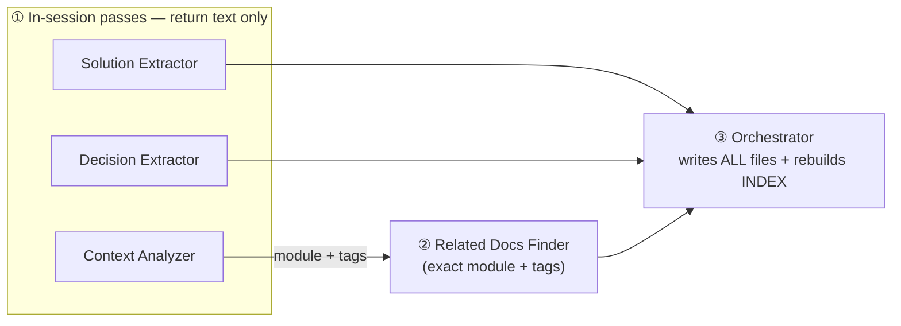

# Claude Skills — Reference & Workflow

Skills are reusable prompt programs invoked by name through the active runtime. Each skill has a defined scope, hard rules, and a handoff to the next skill.

This file is the single source of truth for overview, workflow, and cross-skill concerns — consult the `SKILL.md` of each skill for runtime behavior.

## Runtime entry syntax

Claude Code is the only runtime. The plugin is named `harness`, so a user types `/harness:<skill>`
(for example `/harness:intake`) and a subagent type is `harness:<role>`. Prose that tells a model to
invoke another skill uses the same namespaced name. That the Skill tool resolves a bare name inside a
plugin is not verified, so the namespaced form is used where a model must invoke a skill.

---

## Development Workflows

### Full Cycle (3+ layers, migration, or spans multiple services)

```
init-structure.sh --root <project>   (first-time setup; run from the harness repo)
  → scaffolds specs/, docs/solutions/ (create-if-missing)
      ↓
intake  (readiness gate — run first on every ticket)
  → judges READY | CONFIRM | GRILL | BLOCKED and depth S | M | L; returns a short verdict block
  → writes specs/<slug>/intent.md; every depth gets the five flow files (see specs/README.md)
  → GRILL hands off to the grilling skill · BLOCKED proposes a split or names the missing dependency
  → Input-type: bug fix → diagnosing-bugs before the plan (see Bug Fix Path)
      ↓
brainstorming  (depth L)
  → explores options, converges on a design; depth L writes specs/<slug>/design.md and the design ADR in docs/adr/; no review rounds
      ↓
xia2  (depth L; a short inline brief for M)
  → research before building; external docs only when the change has an external surface
  → output: research brief, local scratch (specs/<slug>/research-brief.md) or inline; no code
      ↓
writing-plans  (every depth; one or two steps for S)
  → steps carry Files, Effort, Done-when, Parallel group → specs/<slug>/plan.md (local scratch)
  → depth S and M: also a short specs/<slug>/design.md
      ↓
using-git-worktrees  (manual runs; a Workflow uses isolation: 'worktree')
      ↓
implement
  → one fresh implementer subagent per step in an isolated worktree; runs Done-when; fix loop capped at 3
  → hands back files touched + verify output; review is /code-review plus intent-review
      ↓
compound  (if non-obvious pattern found)
  → output: docs/solutions/<category>/<slug>.md
  → a high-overlap match is a second occurrence ("mistake twice"): update and promote that record
      ↓
finishing-a-development-branch
  → runs tests, pushes, opens a PR (Summary, Why, Changes, Decisions, Testing, Risk, How to revert, Notes)
  → writes specs/<slug>/summary.md (local scratch)
  → never merges — a human reviews & merges
```

### Minimum Viable Path (intent clear, in-place edit, <1 day)

```
intake → writing-plans (depth S, one or two steps) → implement → finishing-a-development-branch
intake → writing-plans → implement (depth M) · add brainstorming + xia2 first for depth L

Every change runs on its own branch. Skip brainstorming when the approach is clear.
Apply asd-ste100 to agent prose you edit under skills/, rules/, or agents/.
```

### Bug Fix Path

```
intake  (Input-type: bug fix — any fix of wrong behavior, harness bugs included)
      ↓
diagnosing-bugs  (every depth — six gated phases; intake Reads its SKILL.md, not the Skill tool)
  → isolation first: depth S → `git checkout -b fix/<slug>` from a shared branch · M / L → using-git-worktrees
  → Phases 1–4 write specs/<slug>/diagnosis.md (Loop, Repro, Hypotheses, Probes, Confirmed, Seam)
  → task-reviewer reviews it before any fix (spec_verdict: pass + quality_verdict: approved)
      ↓
Phase 5 fix
  S: red test at the Seam: committed before the fix → Phase 6 cleanup (loop green, no [DEBUG- tag)
  M / L: writing-plans and implement, diagnosis.md as input; Phase 6 runs before review
      ↓
compound  (when the root cause is a reusable learning — the bug track takes it from diagnosis.md Confirmed:)
```

---

## Skills Reference (in this repo)

### Intake & Routing

| Skill | Trigger | Output |
|---|---|---|
| `intake` | First, on every ticket — readiness gate: READY / CONFIRM / GRILL / BLOCKED and depth S / M / L, before research, planning, or edits | A short verdict block (verdict, slug, depth, deps, questions, reason) and `specs/<slug>/intent.md` |

### Setup

| Skill | Trigger | Output |
|---|---|---|
| `setup` | **User-invoked** (`/harness:setup`), once per project after installing the plugin | `specs/`, `docs/solutions/` and `techstacks/` scaffold files, `agents/PROJECT.md`, the merged `permissions.deny` rules, a `specs/` line in `.gitignore`, and an approved removal of an old copied install |

### Discovery & Design

| Skill | Trigger | Output |
|---|---|---|
| `grilling` | **Intake- or user-invoked**. A ticket has open decisions that the owner must settle before design or planning. It maps the decisions as a design tree and asks the whole frontier in one numbered round, each with a recommended answer. Facts it looks up itself. `Mode: auto` is for `--no-ask` runs only | A "Confirmed decisions" comment on the ticket, the same list in `intent.md` and `decision.md`, + a short decision list for the caller |
| `brainstorming` | The goal is clear but the approach is not. The user weighs two or more ways, does not know how to start, or asks for a design or a recommendation. Not for a settled approach that only needs codebase or library knowledge (that is `xia2`). Depth L routes here | `specs/<slug>/design.md` and a design ADR in `docs/adr/` (depth L) |
| `xia2` | Find out how something actually works here before building on it. Examples: a feature on unexplained code, a library or API that the repo does not use yet, or how an existing part works. Not for a choice between approaches (that is `brainstorming`). No depth classifier | `specs/<slug>/research-brief.md` (depth L) or a short inline brief |
| `diagnosing-bugs` | **User- or intake-invoked**. Run `/diagnosing-bugs`, or `intake` routes an `Input-type: bug fix` here. The skill blocks model invocation, so intake uses the Read tool on its `SKILL.md`. It proves the root cause in six gated phases before any fix. Every depth runs all six phases. No "cause known" shortcut exists. `task-reviewer` reviews the diagnosis before the fix | `specs/<slug>/diagnosis.md` → red test + fix (depth S) or the M / L route |

### Planning

| Skill | Trigger | Output |
|---|---|---|
| `writing-plans` | After intake, at every depth | `specs/<slug>/plan.md`: steps with Files, Effort, Done-when and parallel group; a short `design.md` at depth S and M |

### Execution

| Skill | Trigger | Output |
|---|---|---|
| `using-git-worktrees` | Manual runs that need an isolated worktree from the right base (a Workflow uses `isolation: 'worktree'`) | Isolated worktree + branch |
| `implement` | Carrying out an agreed plan — a fresh implementer subagent per step in an isolated worktree, Done-when run, fix loop capped at 3 | Commits, files touched and verify output per step |

### Review & Shipping

| Skill | Trigger | Output |
|---|---|---|
| `intent-review` | Checks the diff range against the owner's original request verbatim, blind to the plan; dispatches the `intent-reviewer` agent with only those two inputs. **Standalone** on any diff plus its request, or run by the ship workflow as its last pass | Findings classified `gap` / `excess` / `drift` → fix · ask the owner (auto mode: record a decision) · list in the PR |
| `autopilot` | **User-invoked** (`/autopilot <milestone \| #n \| free text> [base=<branch>] [--no-ask]`). Interactive first half of a hands-off run for one ticket or a milestone: triages each ticket (`intake`), groups them by dependency (`skills/autopilot/scripts/plan_groups.py`), asks the owner every open question once, runs `grilling` for GRILL tickets, then launches `workflows/ship.js` after one go/no-go | Summary table, "Confirmed decisions" comments on the tickets, one `Workflow` run |
| `decision-record` | **Stage- or user-invoked**. A model decided something on its own during an autonomous run. Stage agents return `decisions[]`. The final ADR stage runs `scripts/write_adrs.py`, commits `docs/adr/NNNN-*.md` and renders the PR `## Decisions` section | ADR files + a `## Decisions` PR section (and one private artifact when available) |
| `compound` | Only after a session that produced a reusable learning (non-obvious bug fix, pattern, decision, useful failure) | `docs/solutions/<category>/<slug>.md`, rebuilt `INDEX.md`, `critical-patterns.md` entries for critical or recurring learnings |
| `session-retro` | **User-invoked**, after a session with visible friction — traces struggles to missing environment levers (check > pointer > scoped rule) and proposes ranked fixes; never edits, waits for approval. Not `compound` (knowledge capture) or a bug hunt | Ranked candidate list → approved items become an `intake` task. Durable knowledge goes to `compound` |
| `asd-ste100` | Use it when an agent or a tool must read English text with no human to help. Use it for instructions, tool descriptions, error messages, and status reports. Do not use it for creative or marketing copy. Vendored from upstream. See `skills/asd-ste100/UPSTREAM.md`. Implementers apply it to prose under `skills/`, `rules/`, and `agents/`. `compound` applies it to new records. | Text rewritten in ASD-STE100 style (Strict or STE-flavored mode). `skills/asd-ste100/scripts/ste-lint.py` checks the structural rules. |
| `verify` | Use it when a ticket has a `Verify:` row and its code is ready, or run `/harness:verify`. Picks the checks by ticket type (BE, FE, FE+BE, docs). Browser steps use the Claude Code Playwright plugin tools only, and pass or fail comes from assertions. The agent infers the start recipe and writes `verify.config.json` (names of the login variables, never values). Never a project-level skill named `verify` | A pass or fail table, stills in `.playwright-mcp/<ticket>/` (gitignored), and a committed `verify.config.json`. A fixture app in `tests/fixtures/verify-app/` lets you try it by hand |
| `uat` | Use it after a ticket is built, for FE, BE and FE+BE tickets, or run `/harness:uat N`. Reads only the issue body and the Confirmed decisions comment (never the plan, the diff or the `Verify:` row), numbers the acceptance bullets AC1..ACn, and checks the running app through `verify/references/run-app.md`. `ship.js` runs it as the UAT phase between intent review and testing | A table of scenarios (each naming an AC id, negative, extra or not-browser-checkable) with PASS or FAIL, assertion and still path. Never fixes code |
| `finishing-a-development-branch` | Implementation complete, tests pass | Runs tests, pushes, opens a PR with a structured body (never merges), writes `specs/<slug>/summary.md` |

---

## External Skills (referenced but live elsewhere)

The global `superpowers` plugin or the active runtime's user-level skill directory supplies these skills, not this repo. No skill, agent, or rule in this repo names them, so no workflow step depends on them:

| Skill | Role |
|---|---|
| `test-driven-development` | Tests-first protocol (the implementer prompt carries its own red-test rule) |
| `requesting-code-review` | Structured review template |
| `session-tracker` | Session resumption across conversations |
| `skill-creator` | Authoring new skills |

If one of these isn't available in your environment, the workflows degrade gracefully — treat them as optional.

---

## Skill Handoff Map

```
intake             ──► READY → depth S and M: writing-plans · L: brainstorming → xia2 → writing-plans
                                GRILL: grilling skill · BLOCKED: split or wait
                                Input-type: bug fix → diagnosing-bugs (before the plan)
grilling                   ──► "Confirmed decisions" comment + decision list → caller (terminal)
brainstorming              ──► xia2 → writing-plans
xia2                       ──► research brief → writing-plans
writing-plans              ──► implement
implement                  ──► /code-review → intent-review → finishing-a-development-branch
intent-review              ──► (standalone — same pipeline; needs the verbatim request and a BASE..HEAD range)
autopilot                  ──► intake (per ticket) → grilling → workflows/ship.js (launch, terminal)
decision-record            ──► docs/adr/NNNN-*.md + PR `## Decisions` section (terminal)
diagnosing-bugs            ──► diagnosis.md → task-reviewer → S: red test → fix → cleanup
                                M / L: writing-plans → implement (Phase 6) → compound
session-retro              ──► user approval → intake task · compound
asd-ste100                 ──► nothing (terminal — returns the rewritten text to its caller)
compound                   ──► nothing (terminal — crystallization is end state)
finishing-a-development-branch ──► nothing (terminal — shipped)
```

---

## Knowledge Base Integration

Skills read from and write to `docs/solutions/`:

```
writes ──► compound
           docs/solutions/<category>/<slug>.md, critical-patterns.md,
           INDEX.md (rebuilt by scripts/rebuild_solution_index.py)
           front-matter: problem_type (bug | knowledge | decision | failure),
                         module, tags, severity, applicable_when,
                         affects, supersedes, confidence, confirmed_at

reads  ◄── brainstorming  (applicable decisions — avoid re-proposing rejected approaches)
       ◄── xia2           (INDEX.md + critical-patterns.md, then at most three relevant records)
       ◄── compound       (related-docs pass — overlap by module + tags; high overlap is a recurrence)
```

Schema reference: `docs/solutions/README.md` (scaffolded by `/harness:setup`).

---

---

## Hooks

`hooks/session-rules.sh` delivers `rules/behavior.md` at session start.
`hooks/secrets-scan.sh` runs before every `git commit`: it blocks a staged secret pattern or a staged `.env` file.
`hooks/pr-opened.sh` reminds the main session to review a PR after `gh pr create`, and `hooks/clean-worktrees.sh`
removes merged worktrees and branches after a merge. The old commit gate is gone; its lane and escalation checks are judgment calls now. `docs/hooks.md` has the detail.

This is one of several wired hooks — see the full table in the root `CLAUDE.md`.


<!-- harness-only:begin -->
---

> **Maintainer notes.** Everything below explains how the harness is built and how to fork it.
> `skills/compound/README.md` and the harness repo's `agents/README.md` hold the same kind of content in full.

## Per-skill Design Rationales

Notes preserved from the former per-skill READMEs. For full runtime behavior read each skill's `SKILL.md`.
The diagrams below render natively in the GitHub README — no clone needed.

### `compound`

> **One-liner:** the orchestrator runs four read-only passes over the session it holds, then writes every knowledge doc itself.



- **Orchestrator + 4 in-session passes.** `SKILL.md` runs each pass in the main session (a fresh subagent cannot see the transcript); `subagents/*.md` define the output schemas, and passes return **text only** — the orchestrator writes all files.
- **Order:** the 3 extractors first; then Related Docs Finder with the Context Analyzer's exact `module`+`tags`. Dispatch a subagent only for a solutions tree too large to screen from `INDEX.md`, pasting in its inputs.
- **`applicable_when` is the primary discovery field.** Knowledge: "Use this pattern when…". Decision: "Make this decision when…". Bug: inherited from `CONTEXT_ANALYSIS`. Appears as an INDEX.md column so future agents scan one sentence per doc.
- **Four track types: `bug`, `knowledge`, `decision`, `failure`.** The `failure` track records a tried-and-abandoned approach to prevent recurrence: sections are Symptom → Wrong Approach → Why It Failed → Correct Approach → Guardrail (the check/hook/rule that now prevents a repeat). Emitted only when all four required sections (Symptom, Wrong_Approach, Why_It_Failed, Correct_Approach) are non-empty.
- **Every `bug` doc requires `## Regression Test`.** Names the pinned test that catches a recurrence, or `[none] — <reason>` if none exists. This field is not optional.
- **Multi-decision consolidation.** ≥2 decisions in one session → single `[slug]-decisions.md` with `## Decision 1` / `## Decision 2` sections. Rationale: decisions from the same session are causally related; reading one without the other loses the constraints that drove it.
- **INDEX full rebuild (not append-only).** `scripts/rebuild_solution_index.py` runs after every run, even a run that wrote nothing. Prevents orphaned rows when files are renamed/moved/deleted. `docs/solutions/` grows to tens of files, not thousands — full scan is negligible.
- **Mistake twice.** A learning that matches an existing record at `high` overlap is a second occurrence. The run updates that record, adds a `**Recurred:** <date>` line, and updates or adds its `critical-patterns.md` entry instead of a new append. A path-specific learning also gets a proposed path-scoped rule in the report, never a written one: adding `paths:` to `rules/` changes what loads, so a human decides. `moderate` overlap is not a recurrence.
- **Bug root cause from the diagnosis.** When `specs/<slug>/diagnosis.md` exists, the bug track takes its root cause from the `Confirmed:` hypothesis.
- **STE-flavored records.** Each new record gets `skills/asd-ste100/SKILL.md` in STE-flavored mode. Fenced code and literal strings that a test or hook matches stay unchanged.
- **Never auto-write to `CLAUDE.md`.** At end of run, if `CLAUDE.md` does not reference `docs/solutions/`, propose an addition — wait for developer approval.

**Severity triage** — `critical` requires **all three**; anything else is `standard`:

| Tier | Conditions | Effect |
|---|---|---|
| `critical` | (1) affects multiple features/layers **and** (2) ≥30 min wasted if unknown **and** (3) generalizable beyond this PR | Summary promoted to `critical-patterns.md` |
| `standard` | anything missing one of the above | Normal doc only |

**Collision handling** — how a new finding merges with existing docs:

| Overlap | Detected when | Action |
|---|---|---|
| **High** | same module **+** ≥2 matching tags | Update the existing file |
| **Moderate** | partial match | Write `[slug]-2.md` |
| **Low** | no real match | Write `[slug].md` |

### `xia2`

> **One-liner:** research before building. No depth classifier: look locally first, and outside the repo only when the change has an external surface.

- **Portable by design.** Copy `skills/xia2/`; there is no per-project config.
- **Fork to another project:** copy the folder, then run `/harness:setup` in the new repo. Keep `skills/xia2/tests/behavioural/pressure-scenarios.md`: most scenarios are universal.

<!-- harness-only:end -->
