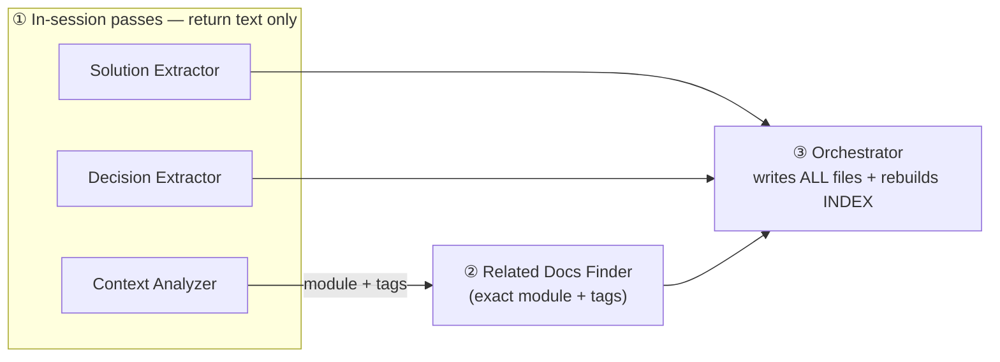
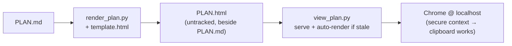
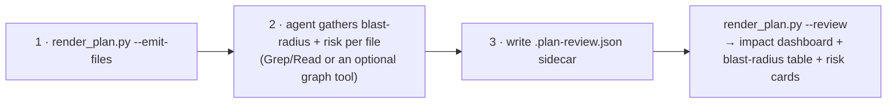

# Claude Skills — Reference & Workflow

Skills are reusable prompt programs invoked by name through the active runtime. Each skill has a defined scope, hard gates, and a handoff to the next skill.

This file is the single source of truth for overview, workflow, and cross-skill concerns — consult the `SKILL.md` of each skill for runtime behavior.

## Runtime entry syntax

Skill names in this repository are semantic and runtime-neutral. At an entry boundary, the checked
binding renders `/skill-name` for Claude Code. Shared skills must not hard-code the form.

---

## Development Workflows

### Full Cycle (3+ layers, migration, or spans multiple services)

```
init-structure.sh --root <project>   (first-time setup; run from the harness repo)
  → scaffolds specs/, docs/solutions/ (create-if-missing)
      ↓
feature-intake  (readiness gate — run first on every ticket)
  → judges READY | CONFIRM | GRILL | BLOCKED and depth S | M | L; returns a short verdict block
  → GRILL hands off to the grilling skill · BLOCKED proposes a split or names the missing dependency
  → Input-type: bug fix → diagnosing-bugs before the plan (see Bug Fix Path)
      ↓
brainstorming  (depth L)
  → explores options, converges on a design; depth L records the design as an ADR in docs/adr/; no review rounds
      ↓
xia2  (depth L; a short inline brief for M)
  → research before building; external docs only when the change has an external surface
  → output: research brief, local scratch (specs/<slug>/research-brief.md) or inline; no code
      ↓
writing-plans  (depth M and L)
  → steps carry Files, Effort, Done-when, Parallel group → specs/<slug>/PLAN.md (local scratch)
      ↓
using-git-worktrees  (manual runs; a Workflow uses isolation: 'worktree')
      ↓
implement
  → one fresh coding subagent per step in an isolated worktree; runs Done-when; fix loop capped at 3
  → hands back files touched + verify output; review is /code-review plus intent-review
      ↓
compound  (if non-obvious pattern found)
  → output: docs/solutions/<category>/<slug>.md
  → a high-overlap match is a second occurrence ("mistake twice"): update and promote that record
      ↓
finishing-a-development-branch
  → runs tests, pushes, opens a PR (Summary, Why, Changes, Decisions, Testing, Risk, How to revert, Notes)
  → never merges — a human reviews & merges
```

### Minimum Viable Path (intent clear, in-place edit, <1 day)

```
feature-intake → implement (depth S, plan in the prompt) → finishing-a-development-branch
feature-intake → writing-plans → implement (depth M) · add brainstorming + xia2 first for depth L

Every change runs on its own branch. Skip brainstorming when the approach is clear.
Apply asd-ste100 to agent prose you edit under skills/, rules/, or agents/.
```

### Bug Fix Path

```
feature-intake  (Input-type: bug fix — any fix of wrong behavior, harness bugs included)
      ↓
diagnosing-bugs  (every depth — six gated phases; intake Reads its SKILL.md, not the Skill tool)
  → isolation first: tiny → `git checkout -b fix/<slug>` from a shared branch · normal / high-risk → using-git-worktrees
  → Phases 1–4 write specs/<slug>/diagnosis.md (Loop, Repro, Hypotheses, Probes, Confirmed, Seam)
  → task-reviewer reviews it before any fix (spec_verdict: pass + quality_verdict: approved)
      ↓
Phase 5 fix
  tiny: red test at the Seam: committed before the fix → Phase 6 cleanup (loop green, no [DEBUG- tag)
  M / L: writing-plans and implement, diagnosis.md as input; Phase 6 runs before review
      ↓
compound  (when the root cause is a reusable learning — the bug track takes it from diagnosis.md Confirmed:)
```

---

## Skills Reference (in this repo)

### Intake & Routing

| Skill | Trigger | Output |
|---|---|---|
| `feature-intake` | First, on every ticket — readiness gate: READY / CONFIRM / GRILL / BLOCKED and depth S / M / L, before research, planning, or edits | A short verdict block (verdict, depth, deps, questions, reason) and an intent line quoting the request |

### Setup

No skill covers first-time setup — it is a harness-repo script (never deployed into a project):
from the harness checkout run `bash scripts/init-structure.sh --root <project>`, which scaffolds
`specs/` and `docs/solutions/` (create-if-missing). Run it once per repo.

| Skill | Trigger | Output |
|---|---|---|
| `harness-models` | **User-invoked**. Run it to show, check, or apply the model and effort settings in `harness-models.json`. It runs `scripts/apply_model_config.py` with `--show`, `--check`, or `--apply`. The default mode is `show` | The applier output, verbatim |

### Discovery & Design

| Skill | Trigger | Output |
|---|---|---|
| `grilling` | **Intake- or user-invoked**. A ticket has open decisions that the owner must settle before design or planning. It maps the decisions as a design tree and asks the whole frontier in one numbered round, each with a recommended answer. Facts it looks up itself. `Mode: auto` is for `--no-ask` runs only | A "Confirmed decisions" comment on the ticket + a short decision list for the caller |
| `brainstorming` | The goal is clear but the approach is not. The user weighs two or more ways, does not know how to start, or asks for a design or a recommendation. Not for a settled approach that only needs codebase or library knowledge (that is `xia2`). Depth L routes here | a design ADR in `docs/adr/` (depth L) |
| `xia2` | Find out how something actually works here before building on it. Examples: a feature on unexplained code, a library or API that the repo does not use yet, or how an existing part works. Not for a choice between approaches (that is `brainstorming`). No depth classifier | `specs/<slug>/research-brief.md` (depth L) or a short inline brief |
| `diagnosing-bugs` | **User- or intake-invoked**. Run `/diagnosing-bugs`, or `feature-intake` routes an `Input-type: bug fix` here. The skill blocks model invocation, so intake uses the Read tool on its `SKILL.md`. It proves the root cause in six gated phases before any fix. Every lane runs all six phases. No "cause known" shortcut exists. `task-reviewer` reviews the diagnosis before the fix | `specs/<slug>/diagnosis.md` → red test + fix (tiny) or the lane route |

### Planning

| Skill | Trigger | Output |
|---|---|---|
| `writing-plans` | After intake picks depth M or L | `specs/<slug>/PLAN.md`: steps with Files, Effort, Done-when and parallel group |
| `visual-planner` | Standalone render of a `PLAN.md` — mainly for `--review` mode (blast-radius/risk overlay). Plain renders come from `render_plan.py --summarize` (run by writing-plans, at each wave boundary, and by finishing-a-development-branch before the shipped commit) | `specs/<slug>/PLAN.html` (untracked, local-only). `--review` writes `PLAN.review.html` |

### Execution

| Skill | Trigger | Output |
|---|---|---|
| `using-git-worktrees` | Manual runs that need an isolated worktree from the right base (a Workflow uses `isolation: 'worktree'`) | Isolated worktree + branch |
| `implement` | Carrying out an agreed plan — a fresh coding subagent per step in an isolated worktree, Done-when run, fix loop capped at 3 | Commits, files touched and verify output per step |

### Review & Shipping

| Skill | Trigger | Output |
|---|---|---|
| `correctness-review` | After implementation, or when the user asks whether a change is correct, wants a review before a PR, or says something feels wrong but the tests pass — adversarial runtime-bug search over a diff, run as **6 parallel angles**, each named for its method (`enclosing-function` · `removed-behavior` · `call-site-impact` · `stack-defects` · `guard-completeness` · `prior-art`). **Standalone** (any diff, no workflow gate) or called by `subagent-driven-development` as its final pass. Context-propagation defects (a load-bearing instruction never delivered to an isolated context) are **not** its province — they belong to `context-propagation-audit`, not this bug hunt | Candidates deduped by location → scored (0–100, threshold 75) → classified (Severity + Rule class) → fixes, escalations, or advisory |
| `context-propagation-audit` | **change-triggered** — Change-triggered consumer audit for workflow-as-code changes: enumerates every consumer + execution context (main / implementer / reviewer / scorer / new session) and proves how each receives the authoritative instruction; assumed/unconfirmed delivery on a load-bearing instruction FAILS. Runs only when the diff touches the workflow-engine inventory. Not a bug hunt (`correctness-review`) or intent check (`intent-review`) | PASS/FAIL per consumer → assumed delivery on a load-bearing instruction FAILS → fix (prove delivery) or escalate |
| `intent-review` | Checks the diff range against the owner's original request verbatim, blind to the plan; dispatches the `intent-reviewer` agent with only those two inputs. **Standalone** on any diff plus its request, or called by `subagent-driven-development` as its last pass | Findings classified `gap` / `excess` / `drift` → fix · ask the owner (auto mode: record a decision) · list in the PR |
| `decision-record` | **Stage- or user-invoked**. A model decided something on its own during an autonomous run. Stage agents return `decisions[]`. The final ADR stage runs `scripts/write_adrs.py`, commits `docs/adr/NNNN-*.md` and renders the PR `## Decisions` section | ADR files + a `## Decisions` PR section (and one private artifact when available) |
| `compound` | Only after a session that produced a reusable learning (non-obvious bug fix, pattern, decision, useful failure) or a proposed harness ratchet | `docs/solutions/<category>/<slug>.md`, rebuilt `INDEX.md`, `critical-patterns.md` entries for critical or recurring learnings, `improvement-backlog.md` rows for proposed guardrails |
| `session-retro` | **User-invoked**, after a session with visible friction — traces struggles to missing environment levers (check > pointer > scoped rule) and proposes ranked fixes; never edits, waits for approval. Not `compound` (knowledge capture) or a bug hunt | Ranked candidate list → approved items go to `improvement-backlog.md` rows or a `feature-intake` task. Durable knowledge goes to `compound` |
| `asd-ste100` | Use it when an agent or a tool must read English text with no human to help. Use it for instructions, tool descriptions, error messages, and status reports. Do not use it for creative or marketing copy. Vendored from upstream. See `skills/asd-ste100/UPSTREAM.md`. Tiny-lane intake edits and implementers apply it to prose under `skills/`, `rules/`, and `agents/`. `compound` applies it to new records. | Text rewritten in ASD-STE100 style (Strict or STE-flavored mode). `skills/asd-ste100/scripts/ste-lint.py` checks the structural rules. |
| `finishing-a-development-branch` | Implementation complete, tests pass | Runs tests, pins review receipts, marks the plan shipped, pushes, opens a PR, records `ready_to_merge` (never merges) |

---

## External Skills (referenced but live elsewhere)

The global `superpowers` plugin or the active runtime's user-level skill directory supplies these skills, not this repo. No skill, agent, or rule in this repo names them, so no workflow step depends on them:

| Skill | Role |
|---|---|
| `test-driven-development` | Tests-first protocol (the implementer prompt carries its own red-test rule) |
| `requesting-code-review` | Structured review template |
| `session-tracker` | Session resumption across conversations |
| `skill-creator` | Authoring new skills |

If one of these isn't available in your environment, the workflows degrade gracefully — treat them as optional.

---

## Skill Handoff Map

```
feature-intake             ──► READY → depth S: implement · M: writing-plans · L: brainstorming → xia2 → writing-plans
                                GRILL: grilling skill · BLOCKED: split or wait
                                Input-type: bug fix → diagnosing-bugs (before the plan)
grilling                   ──► "Confirmed decisions" comment + decision list → caller (terminal)
brainstorming              ──► xia2 → writing-plans
xia2                       ──► research brief → writing-plans
writing-plans              ──► implement
visual-planner             ──► PLAN.html (terminal — visual artifact; back to writing-plans handoff)
implement                  ──► /code-review → intent-review → finishing-a-development-branch
correctness-review         ──► (standalone — runs the same pipeline ad-hoc on any diff; no gate)
context-propagation-audit ──► (conditional workflow-engine delivery gate, then correctness-review)
intent-review              ──► (standalone — same pipeline; needs the verbatim request and a BASE..HEAD range)
decision-record            ──► docs/adr/NNNN-*.md + PR `## Decisions` section (terminal)
diagnosing-bugs            ──► diagnosis.md → task-reviewer → tiny: red test → fix → cleanup
                                M / L: writing-plans → implement (Phase 6) → compound
session-retro              ──► user approval → improvement-backlog.md row · feature-intake task · compound
asd-ste100                 ──► nothing (terminal — returns the rewritten text to its caller)
compound                   ──► nothing (terminal — crystallization is end state)
finishing-a-development-branch ──► nothing (terminal — shipped)
```

---

## Knowledge Base Integration

Skills read from and write to `docs/solutions/`:

```
writes ──► compound
           docs/solutions/<category>/<slug>.md, critical-patterns.md,
           INDEX.md (rebuilt by scripts/rebuild_solution_index.py)
           front-matter: problem_type (bug | knowledge | decision | failure),
                         module, tags, severity, applicable_when,
                         affects, supersedes, confidence, confirmed_at

reads  ◄── brainstorming  (applicable decisions — avoid re-proposing rejected approaches)
       ◄── xia2           (INDEX.md + critical-patterns.md, then at most three relevant records)
       ◄── compound       (related-docs pass — overlap by module + tags; high overlap is a recurrence)
```

Schema reference: `docs/solutions/README.md` (scaffolded by the harness repo's `scripts/init-structure.sh`).

---

---

## Commit Hook

`hooks/commit-gate.sh` gates every commit (default `standard` profile; `minimal` runs only the
secrets scan, `strict` adds the untracked-`.py` deny — which runs before everything else — and the app gates):
1. Secrets scan (+ staged `.env` check)
1.5. Pending-escalation gate — denies a commit touching `specs/<slug>/` while that slug's
   `ESCALATIONS.md` has `decision: pending` (deny-on-no-response)
1.6. Lane-evidence gate — for each staged `specs/<slug>/SUMMARY.md`, runs
   `scripts/verify_summary.py --lane` and blocks when the evidence the declared `Lane:` requires
   is missing (tiny → filled header; normal → + a real `### Verify` row; high-risk → + a
   non-empty `### Rollback`). The **staged** copy is checked, so a commit that adds the evidence
   self-unblocks. Fail-open when `python3` is unavailable
1.7. Run-state gate — an untracked `RUN.json`/`events.jsonl` beside a staged `specs/<slug>/`
   file blocks (`REQUIRE_RUN_STATE_STAGED=0` downgrades it to a warning)
1.8. Risk corroboration — the declared `Lane:` against the staged diff; a block-mode hard-gate
   signal with a lane below `high-risk` blocks (modes from the manifest in the git index, never a `.claude/` copy)
1.9. Plan scope — staged paths outside the active `PLAN.md` Files set warn
   (`BLAST_RADIUS_STRICT=1` blocks)

   Checks 2–3 below are app gates, skipped unless the `strict` profile or `REQUIRE_APP_GATES=1`.
2. Debug artifact check (`breakpoint()`, bare `print()`)
2.5. Evidence gate (opt-in via `REQUIRE_VERIFY=1`) — for `app/` changes, requires a
   `### Verify` **heading** in the SUMMARY, then re-runs each *real* row and blocks when a
   claimed Exit does not match the fresh run. It does **not** require a real row: a table of
   only template placeholders (`<command>`) passes with a `no checks ran` warning, and the
   re-run degrades to presence-only if `python3` is unavailable
3. Targeted pytest for changed `app/` files

Under `REQUIRE_APP_GATES=1`, once at least one staged file maps to a test and the targeted pytest run passes, a commit with ≥5 staged `app/**/*.py` files prints `★ Large session detected (N app/ files).` and suggests the compound skill.

> **Two different evidence gates — do not conflate them.** Check **1.6** is the row-presence
> gate: `scripts/verify_summary.py --lane`, always on, asserts the SUMMARY carries what its `Lane:`
> requires. Check **2.5** is the row-*accuracy* gate: opt-in via `REQUIRE_VERIFY=1`, it re-runs
> real rows and blocks on a claimed-vs-actual exit mismatch — but a table of only placeholders
> passes it with a `no checks ran` warning. Evidence *exists* because of 1.6; evidence is
> *honest* because of 2.5. You can still run the former by hand:
> `python3 scripts/verify_summary.py --lane <slug>`.

This is one of several wired hooks — see the full table in the root `CLAUDE.md`.


<!-- harness-only:begin -->
---

> **Maintainer notes.** Everything below explains how the harness is built and how to fork it.
> A deployed `.claude/` copy drops this region (deploy-harness.sh → strip_maintenance_docs),
> along with `skills/compound/README.md`, and `agents/README.md`,
> which hold the same kind of content in full.

## Per-skill Design Rationales

Notes preserved from the former per-skill READMEs. For full runtime behavior read each skill's `SKILL.md`.
The diagrams below render natively in the GitHub README — no clone needed.

### `compound`

> **One-liner:** the orchestrator runs four read-only passes over the session it holds, then writes every knowledge doc itself.



- **Orchestrator + 4 in-session passes.** `SKILL.md` runs each pass in the main session (a fresh subagent cannot see the transcript); `subagents/*.md` define the output schemas, and passes return **text only** — the orchestrator writes all files.
- **Order:** the 3 extractors first; then Related Docs Finder with the Context Analyzer's exact `module`+`tags`. Dispatch a subagent only for a solutions tree too large to screen from `INDEX.md`, pasting in its inputs.
- **`applicable_when` is the primary discovery field.** Knowledge: "Use this pattern when…". Decision: "Make this decision when…". Bug: inherited from `CONTEXT_ANALYSIS`. Appears as an INDEX.md column so future agents scan one sentence per doc.
- **Four track types: `bug`, `knowledge`, `decision`, `failure`.** The `failure` track records a tried-and-abandoned approach to prevent recurrence: sections are Symptom → Wrong Approach → Why It Failed → Correct Approach → Guardrail (the check/hook/rule that now prevents a repeat). Emitted only when all four required sections (Symptom, Wrong_Approach, Why_It_Failed, Correct_Approach) are non-empty. `Harness-Delta: backlog` friction signals from subagent summaries are also mined into failure records.
- **Every `bug` doc requires `## Regression Test`.** Names the pinned test that catches a recurrence, or `[none] — <reason>` if none exists. This field is not optional.
- **Multi-decision consolidation.** ≥2 decisions in one session → single `[slug]-decisions.md` with `## Decision 1` / `## Decision 2` sections. Rationale: decisions from the same session are causally related; reading one without the other loses the constraints that drove it.
- **INDEX full rebuild (not append-only).** `scripts/rebuild_solution_index.py` runs after every run, even a run that wrote nothing. Prevents orphaned rows when files are renamed/moved/deleted. `docs/solutions/` grows to tens of files, not thousands — full scan is negligible.
- **Mistake twice.** A learning that matches an existing record at `high` overlap is a second occurrence. The run updates that record, adds a `**Recurred:** <date>` line, and updates or adds its `critical-patterns.md` entry instead of a new append. A path-specific learning also gets a proposed path-scoped rule in the report, never a written one: adding `paths:` to `rules/` changes what loads, so a human decides. `moderate` overlap is not a recurrence.
- **Bug root cause from the diagnosis.** When `specs/<slug>/diagnosis.md` exists, the bug track takes its root cause from the `Confirmed:` hypothesis.
- **STE-flavored records.** Each new record gets `skills/asd-ste100/SKILL.md` in STE-flavored mode. Fenced code and literal strings that a test or hook matches stay unchanged.
- **Never auto-write to `CLAUDE.md`.** At end of run, if `CLAUDE.md` does not reference `docs/solutions/`, propose an addition — wait for developer approval.

**Severity triage** — `critical` requires **all three**; anything else is `standard`:

| Tier | Conditions | Effect |
|---|---|---|
| `critical` | (1) affects multiple features/layers **and** (2) ≥30 min wasted if unknown **and** (3) generalizable beyond this PR | Summary promoted to `critical-patterns.md` |
| `standard` | anything missing one of the above | Normal doc only |

**Collision handling** — how a new finding merges with existing docs:

| Overlap | Detected when | Action |
|---|---|---|
| **High** | same module **+** ≥2 matching tags | Update the existing file |
| **Moderate** | partial match | Write `[slug]-2.md` |
| **Low** | no real match | Write `[slug].md` |

### `visual-planner`

> **One-liner:** a deterministic script (not the LLM) renders `PLAN.md` → a self-contained, untracked `PLAN.html`; a second script serves and opens it.



| Script | Role |
|---|---|
| `render_plan.py` | **Builds** `PLAN.html` by filling `{{PLACEHOLDER}}` slots in `template.html` — byte-for-byte reproducible. |
| `view_plan.py` | **Shows** it — serves on localhost + opens Chrome, auto-rendering first if `PLAN.html` is missing/stale. |

- **Deterministic script, not LLM transcription.** The skill only runs the script and relays its report — never emits HTML token-by-token. Transcribing a ~340-line template every run is expensive and the least reproducible part of the pipeline; a script makes the fill free and stable.
- **Local-only output.** `PLAN.html` is untracked — it lives beside `PLAN.md` in `specs/`, which is local scratch and gitignored.
- **Rendered by a script run, not a hook or sub-agent.** `writing-plans` runs `render_plan.py --summarize` after saving `PLAN.md`, `rules/wave-parallelism.md` runs it at each wave boundary, and `finishing-a-development-branch` runs it before the shipped commit, so `PLAN.html` and the in-file "At a glance" block stay current without any skill dispatch. Nothing auto-opens it; `view_plan.py` opens it on request. Run `visual-planner <slug>` standalone when you want `--review` mode.
- **Why serve instead of `file://`?** Localhost is a browser *secure context*, so per-task "copy `<verify>`" buttons use `navigator.clipboard`; `--file` (`file://`) is faster but falls back to `execCommand`. Auto-view is environment-dependent (no display on headless/remote), so it stays an explicit step.
- **Self-check before claiming success.** The script asserts non-empty output, no surviving `{{PLACEHOLDER}}`, the `slug` present, and one `<section data-wave>` per distinct wave. On non-zero exit, surface the `SELF-CHECK FAILED:` lines verbatim — do not claim success.

**`--review` mode is a 3-step dance** (the offline renderer never queries any tool itself):



### `xia2`

> **One-liner:** research before building. No depth classifier: look locally first, and outside the repo only when the change has an external surface.

- **Portable by design.** Copy `skills/xia2/`; there is no per-project config.
- **Fork to another project:** copy the folder, then run `bash scripts/init-structure.sh --root <new repo>`. Keep `tests/behavioural/pressure-scenarios.md`: most scenarios are universal.

<!-- harness-only:end -->
