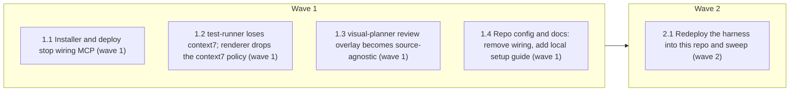

# Make MCP servers optional, external add-ons

<!-- AT-A-GLANCE:BEGIN (generated — do not edit; refreshed by render_plan.py --summarize) -->
## At a glance

**5 tasks · 2 waves · 19 files · 0/5 done**

| Wave | Task | Title | Files | Done (acceptance) |
|---|---|---|---|---|
| 1 | 1.1 | Installer and deploy stop wiring MCP (wave 1) | scripts/install-harness.sh, scripts/deploy-harness.sh, tests/scripts/install-harness.test.sh | The suite exits 0; `grep -c -e mcp -e uvx scripts/install-harness.sh scripts/dep… |
| 1 | 1.2 | test-runner loses context7; renderer drops the context7 policy (wave 1) | agents/runtime-bindings.json, agents/agent-contracts.json, scripts/render_agent_definitions.py, scripts/test_render_agent_definitions.py, scripts/test_render_codex_adapter.py | Tests pass; `grep -c context7 agents/runtime-bindings.json agents/agent-contract… |
| 1 | 1.3 | visual-planner review overlay becomes source-agnostic (wave 1) | skills/visual-planner/SKILL.md, skills/visual-planner/references/review-sidecar.md, skills/visual-planner/render_plan.py, skills/README.md | Tests pass; `grep -c -e code-review-graph -e "in the graph" skills/visual-planne… |
| 1 | 1.4 | Repo config and docs: remove wiring, add local setup guide (wave 1) | .mcp.json, .gitignore, CLAUDE.md, README.md, docs/solutions/critical-patterns.md, docs/solutions/harness-bootstrap/meta-repo-signal-remapping.md | Verify exits 0; `test ! -e .mcp.json` exits 0; `grep -c -e code-review-graph -e … |
| 2 | 2.1 | Redeploy the harness into this repo and sweep (wave 2) | .claude/agents/test-runner.md | Verify exits 1 with output `0`; SC-4 and SC-10 greps exit 1. |

### Progress
- [ ] 1.1 — Installer and deploy stop wiring MCP (wave 1)
- [ ] 1.2 — test-runner loses context7; renderer drops the context7 policy (wave 1)
- [ ] 1.3 — visual-planner review overlay becomes source-agnostic (wave 1)
- [ ] 1.4 — Repo config and docs: remove wiring, add local setup guide (wave 1)
- [ ] 2.1 — Redeploy the harness into this repo and sweep (wave 2)
<!-- AT-A-GLANCE:END -->

## 1. Motivation

The harness hard-wires two MCP servers: `code-review-graph` (root `.mcp.json`, installer
create/merge, deploy warning, `visual-planner` allowed-tools, `CLAUDE.md` instructions) and
`context7` (`test-runner` tools and the Codex `context7-read-only` policy). Users without them get
confusing instructions or failed connections (`code-review-graph (ENOENT): Executable not found in
$PATH: uvx`). This plan removes every coupling so the harness requires no MCP server or plugin, and
documents how a user adds both back for local use only. Design: `specs/decouple-mcp-dependencies/design.md`
(D1–D5); research: `research-brief.md`.

## 2. Non-goals

- Editing, deleting or backing up any consumer's `.mcp.json`, user-level context7 config, or plugins.
- Rewriting historical records: shipped `specs/*`, `docs/research/`, `docs/harness-gap-closure-plan.md`, `evals/**/results/`, `docs/solutions/harness-bootstrap/meta-repo-signal-remapping-decisions.md`, `docs/harness-experimental/trust-metrics.md`. `scripts/lint-doc-truth.sh:19` (an example token in a comment) and `tests/scripts/deploy-profile.test.sh:108` (asserts no `.mcp.json`, still true) stay unchanged.
- Adding an installer flag or prompt to opt back into MCP wiring.
- Open PR #279 (`feat/install-uv-autoinstall`, base `main`): left open by user decision; this plan touches only what is on `sdlc`.

## Global Constraints

- Branch `refactor/decouple-mcp-dependencies`, cut from `sdlc`; PR base is `sdlc`.
- The installer must never read, write, back up or mention `.mcp.json` after this change (D1).
- `skills/visual-planner/render_plan.py`: change only the comment at the `--review` section header, the warning string "not found in the graph", and the `emit_files_json` docstring. No logic, signature or output-structure change (D2, high-blast file).
- Reworded text in `skills/`, `agents/`, `rules/`, `hooks/`, `scripts/`, `templates/` and `CLAUDE.md` must not contain the strings `code-review-graph` or `context7`; a graph tool may be named only generically, as one optional evidence source among Grep/Read (SC-4).
- Test files under `scripts/test_*` must build the former policy name from parts (e.g. `"context" + "7-read-only"`) rather than writing it literally. Fixtures under `tests/` may keep literal server names.
- Python tests on this machine run with the harness venv: `/tmp/harness-tests-venv/bin/python` (created by `bash -c 'source tests/lib.sh; ensure_pyenv'`); system `python3` has no pytest.
- `bash scripts/run-tests.sh` (full suite, includes the doc-truth lint) runs at `finishing-a-development-branch`, not in a task Verify.

## 3. Success Criteria

| ID | Behavior (observable) | Check (re-runnable) | Expected |
|------|-------------------------|-----------------------|------------|
| SC-1 | A fresh install into an empty directory leaves no `.mcp.json`, and neither dry-run nor real-run output mentions `.mcp.json` or `uvx` | `bash tests/scripts/install-harness.test.sh` | exit 0 |
| SC-2 | An existing consumer `.mcp.json` (with a `code-review-graph` entry, with only other servers, or invalid JSON) is byte-identical after install and no `.harness-backup-*/.mcp.json` is written | `bash tests/scripts/install-harness.test.sh` | exit 0 |
| SC-3 | Rendered Claude and Codex `test-runner` definitions carry no MCP server or `mcp__` tool, and the former context7 policy is rejected as unmapped | `/tmp/harness-tests-venv/bin/python -m pytest scripts/test_render_agent_definitions.py scripts/test_render_codex_adapter.py -q` | exit 0 |
| SC-4 | No live harness file names either server | `grep -rIn -e code-review-graph -e context7 skills agents rules hooks scripts templates CLAUDE.md` | exit 1 — no matches |
| SC-5 | README has the Optional MCP servers (local setup) section with the local-scope code-review-graph command and CLAUDE.local.md guidance (context7 wording is left to intent-review) | `grep -q "Optional MCP servers (local setup)" README.md && grep -q "claude mcp add --scope local code-review-graph" README.md && grep -q "CLAUDE.local.md" README.md` | exit 0 — heading, local-scope command and CLAUDE.local.md all present |
| SC-6 | `visual-planner` renderer behavior is unchanged after the rewording | `/tmp/harness-tests-venv/bin/python -m pytest skills/visual-planner/test_render_plan.py -q` | exit 0 |
| SC-7 | Docs still agree with the code (paths exist, hook table matches `settings.json`) | `bash scripts/lint-doc-truth.sh` | exit 0 |
| SC-8 | This repo no longer ships a root `.mcp.json` | `test ! -e .mcp.json` | exit 0 |
| SC-9 | This repo's deployed `test-runner` agent has no MCP tools | `grep -c mcp__ .claude/agents/test-runner.md` | exit 1 — zero matches |
| SC-10 | No hook reads `.mcp.json` or an MCP tool name, so no gate depends on the removed config | `grep -rIn -e "\.mcp\.json" -e mcp__ hooks` | exit 1 — no matches |

## 4. Tasks

### Task 1.1 — Installer and deploy stop wiring MCP (wave 1)

- **Files:** scripts/install-harness.sh, scripts/deploy-harness.sh, tests/scripts/install-harness.test.sh
- **Action:** Test-first: invert the installer tests before changing the scripts.
  In `tests/scripts/install-harness.test.sh`: the dry-run case asserts the output has no
  `.mcp.json` line (drop the "would create  .mcp.json" requirement, keep the writes-nothing
  checks); the fresh-install case asserts `[ ! -e "$tgt/.mcp.json" ]` and no `.mcp.json` line in
  `$OUT`; the merge case becomes "existing `.mcp.json` with other servers is left byte-identical"
  (copy the file before install, `cmp` after, assert no `.harness-backup-*/.mcp.json`); add a case
  with a pre-existing `{"mcpServers":{"code-review-graph":{...}}}` file, also byte-identical; the
  idempotent re-install case asserts exit 0 and the file unchanged instead of "already wires
  code-review-graph"; the invalid-JSON case asserts the content is unchanged and the output has no
  "not valid JSON" warning; the missing-uvx case asserts exit 0 and the output does not contain
  "uvx". Update the header comment (it describes the MCP-wiring suite).
  Then in `scripts/install-harness.sh` delete the uvx prerequisite block (`UVX_MISSING` set and
  warning), the closing `UVX_MISSING` reminder, and the whole "wire MCP config" block including
  `MCP_SRV`, `MCP_DST`, `BACKUP_DIR`; reword the header comment ("merges one server entry into
  .mcp.json") and the validation comment (".mcp.json is written before deploy runs") so neither
  contains the strings `mcp` or `uvx` (Done greps for them).
  In `scripts/deploy-harness.sh` delete the "No .mcp.json at project root" warning line.
- **Verify:** `bash tests/scripts/install-harness.test.sh`
- **Done:** The suite exits 0; `grep -c -e mcp -e uvx scripts/install-harness.sh scripts/deploy-harness.sh` reports 0 for both files.
- **Criteria:** SC-1, SC-2
- **Interfaces:** Consumes the current installer and its test helpers (run_install and target in the test file, assert_rc_contains in tests/lib.sh). Produces `scripts/install-harness.sh` and `scripts/deploy-harness.sh` with no MCP logic, and `tests/scripts/install-harness.test.sh` asserting non-touch behavior.

### Task 1.2 — test-runner loses context7; renderer drops the context7 policy (wave 1)

- **Files:** agents/runtime-bindings.json, agents/agent-contracts.json, scripts/render_agent_definitions.py, scripts/test_render_agent_definitions.py, scripts/test_render_codex_adapter.py
- **Action:** Test-first: in both test files change the `test_runner` assertions to
  `test_runner["mcp_servers"] == {}`; remove the two `mcp__context7__*` tool names from the
  expected Claude tool list in `test_render_agent_definitions.py`; add, in `scripts/test_render_codex_adapter.py`, a test that sets
  `payload["roles"]["test-runner"]["mcp"]` to the former policy name built from parts and asserts
  render raises with "unmapped mcp policy" (model it on `test_unmapped_mcp_policy_blocks_render`).
  Then: in `agents/runtime-bindings.json` remove the two context7 tools from the Claude
  `test-runner` `tools`, set its `capabilities.mcp` to `"no MCP tools allowed"`, and set the Codex
  `test-runner` `capabilities.mcp` to `"disabled"`; in `agents/agent-contracts.json` set
  `test-runner.mcp` to `"none"`; in `scripts/render_agent_definitions.py` remove the context7
  policy from `CODEX_MCP_POLICIES` and delete its emission branch.
- **Verify:** `/tmp/harness-tests-venv/bin/python -m pytest scripts/test_render_agent_definitions.py scripts/test_render_codex_adapter.py -q`
- **Done:** Tests pass; `grep -c context7 agents/runtime-bindings.json agents/agent-contracts.json scripts/render_agent_definitions.py scripts/test_render_agent_definitions.py scripts/test_render_codex_adapter.py` reports 0 for every file.
- **Criteria:** SC-3, SC-4
- **Interfaces:** Consumes the existing none MCP policy path (empty mcp_servers table) used by reviewer roles. Produces `agents/runtime-bindings.json`, `agents/agent-contracts.json` and `scripts/render_agent_definitions.py` with no context7 policy.

### Task 1.3 — visual-planner review overlay becomes source-agnostic (wave 1)

- **Files:** skills/visual-planner/SKILL.md, skills/visual-planner/references/review-sidecar.md, skills/visual-planner/render_plan.py, skills/README.md
- **Action:** In `SKILL.md` remove the four `mcp__code-review-graph__*` entries from
  `allowed-tools` (keep `Bash, Read, Glob, Write`); change the description's "optional
  graph-derived risk" to "optional review-derived risk"; reword "For graph-backed plan review,
  first emit plan files, gather graph evidence" to evidence-backed wording that names Grep/Read
  and, optionally, any code-graph tool the user has installed; reword "New/missing graph nodes"
  to "New/missing files". In `references/review-sidecar.md` reword the last sentence so evidence
  may come from Grep/Read or an optional code-graph tool and unknown coverage remains unknown.
  In `render_plan.py` reword only the `--review` section comment ("graph-derived sidecar", "never
  calls the … MCP itself"), the warning string "not found in the graph" to "not found by the
  review evidence", and the `emit_files_json` docstring. In `skills/README.md` reword the
  `--review` paragraph ("the offline renderer can't call MCP itself") and mermaid step 2 to
  "agent gathers blast-radius + risk per file (Grep/Read or an optional graph tool)".
- **Verify:** `/tmp/harness-tests-venv/bin/python -m pytest skills/visual-planner/test_render_plan.py -q`
- **Done:** Tests pass; `grep -c -e code-review-graph -e "in the graph" skills/visual-planner/SKILL.md skills/visual-planner/references/review-sidecar.md skills/visual-planner/render_plan.py skills/README.md` reports 0 for every file.
- **Criteria:** SC-4, SC-6
- **Interfaces:** Consumes the existing emit-files and review CLI modes. Produces `skills/visual-planner/SKILL.md`, `skills/visual-planner/references/review-sidecar.md`, `skills/visual-planner/render_plan.py` and `skills/README.md` with source-agnostic wording.

### Task 1.4 — Repo config and docs: remove wiring, add local setup guide (wave 1)

- **Files:** .mcp.json, .gitignore, CLAUDE.md, README.md, docs/solutions/critical-patterns.md, docs/solutions/harness-bootstrap/meta-repo-signal-remapping.md
- **Action:** `git rm .mcp.json`; delete the `# Added by code-review-graph` and
  `.code-review-graph/` lines from `.gitignore`.
  `CLAUDE.md`: delete the `.mcp.json` Gotchas bullet and the whole "MCP Tools: code-review-graph"
  section (its HTML comment marker, intro and tool table); keep "Boundary of trust" as its own
  `##` section, reworded to apply to any MCP server the user adds, naming no server.
  `README.md`: line 87 says the installer touches only the workflow's structural dirs at the root
  (no `.mcp.json`); line 89 drops the `uv` recommendation; replace the "MCP servers" section with
  "Optional MCP servers (local setup)" stating the harness needs none, then: code-review-graph —
  install `uv`, run `claude mcp add --scope local code-review-graph -- uvx code-review-graph serve`
  from the project root (local scope is stored in `~/.claude.json` under this project, not in the
  repo), add `.code-review-graph/` to `.git/info/exclude`, and use `--scope user` if `/mcp` does
  not show it in a session started inside a worktree; context7 — configure it at user scope or as
  a plugin in your own Claude Code config; personal instructions — an untracked `CLAUDE.local.md`
  (excluded via `.git/info/exclude`) for the main checkout, noting it exists only in the worktree
  where it was created, so for notes that must follow into worktrees use an
  `@~/.claude/<file>.md` import or the user-level `~/.claude/CLAUDE.md`; confirm with `/memory`.
  `docs/solutions/critical-patterns.md:17` and
  `docs/solutions/harness-bootstrap/meta-repo-signal-remapping.md:29`: remove `.mcp.json` from
  the current-state lists (the repo has no dependency-like file now). Leave
  `critical-patterns.md:28` unchanged: it records a dated decision (adding `.mcp.json` is a Deep
  trigger), which stays true.
- **Verify:** `grep -q "Optional MCP servers (local setup)" README.md && grep -q "claude mcp add --scope local code-review-graph" README.md && grep -q "CLAUDE.local.md" README.md`
- **Done:** Verify exits 0; `test ! -e .mcp.json` exits 0; `grep -c -e code-review-graph -e context7 CLAUDE.md` reports 0; `bash scripts/lint-doc-truth.sh` exits 0.
- **Criteria:** SC-4, SC-5, SC-7, SC-8
- **Interfaces:** Consumes the research brief's Docs findings (MCP scopes, `CLAUDE.local.md` worktree caveat). Produces `README.md` "Optional MCP servers (local setup)", `CLAUDE.md` without MCP instructions, `.gitignore`, and updated `docs/solutions/critical-patterns.md` and `docs/solutions/harness-bootstrap/meta-repo-signal-remapping.md`.

### Task 2.1 — Redeploy the harness into this repo and sweep (wave 2)

- **Files:** .claude/agents/test-runner.md
- **Action:** Run `bash scripts/deploy-harness.sh` (it rewrites the whole gitignored `.claude/`;
  nothing there is committed) so this repo's gitignored `.claude/` copy picks
  up the wave-1 changes (agents, skills, rules). Then run the SC-4 sweep and fix any remaining
  live reference in the wave-1 files by reporting it to the controller (do not edit wave-1 files
  in this task).
- **Verify:** `grep -c mcp__ .claude/agents/test-runner.md`
- **Done:** Verify exits 1 with output `0`; SC-4 and SC-10 greps exit 1.
- **Criteria:** SC-9, SC-4, SC-10
- **Interfaces:** Consumes all wave-1 outputs and `scripts/deploy-harness.sh`. Produces the redeployed `.claude/agents/test-runner.md` (gitignored, not committed).

## 5. Risks

- Open PR #279 edits the same installer region and `tests/scripts/install-harness.test.sh`; it conflicts when both reach `main`. Left open by user decision.
- `render_plan.py` is a high-blast file and `scripts/` diffs trigger the `ci-strict-gate.sh` warn tier: SUMMARY needs re-runnable high-risk `### Verify` rows.
- A session launched inside a linked worktree may not load a local-scope MCP server (undocumented); README tells users to fall back to `--scope user`.
- The pytest Verify commands depend on the harness venv path on this machine; CI uses `scripts/run-tests.sh`, which builds it.

### Assumption coverage

- A1 → SC-10
- A2 → SC-6
- A3 → SC-5
- A4 → accepted risk: `CLAUDE.local.md` support confirmed in official docs (research brief), not exercised locally; README tells the user to confirm with `/memory`
- A5 → SC-3

## 6. Status Log

- 2026-10-14 — proposed (writing-plans)
