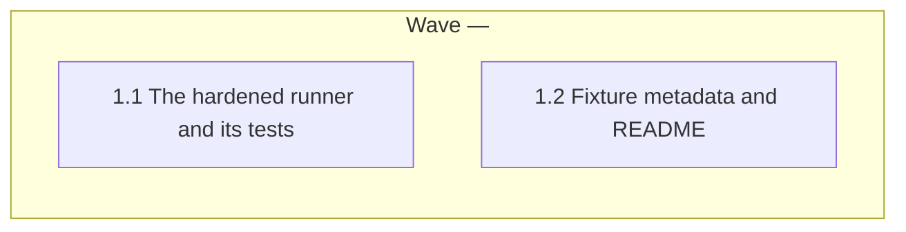

# Eval-runner hardening for intake-classifier

<!-- AT-A-GLANCE:BEGIN (generated — do not edit; refreshed by render_plan.py --summarize) -->
## At a glance

**2 tasks · 1 waves · 10 files · 2/2 done**

| Wave | Task | Title | Files | Done (acceptance) |
|---|---|---|---|---|
| — | 1.1 | The hardened runner and its tests | scripts/run_intake_eval.py, scripts/test_run_intake_eval.py | SC-1 to SC-5 exit 0. |
| — | 1.2 | Fixture metadata and README | evals/workflow/intake-classifier/fixtures/add-validation/eval.json, evals/workflow/intake-classifier/fixtures/ambiguous/eval.json, evals/workflow/intake-classifier/fixtures/auth-change/eval.json, evals/workflow/intake-classifier/fixtures/db-migration/eval.json, evals/workflow/intake-classifier/fixtures/edit-hook/eval.json, evals/workflow/intake-classifier/fixtures/multi-domain/eval.json, evals/workflow/intake-classifier/fixtures/typo-fix/eval.json, evals/workflow/intake-classifier/README.md | SC-6 and SC-7 exit 0. |

### Progress
- [x] 1.1 — The hardened runner and its tests
- [x] 1.2 — Fixture metadata and README
<!-- AT-A-GLANCE:END -->

## 1. Motivation

The intake-classifier eval has a scorer (`scripts/score_intake_eval.py`) but no runner: runs are
started by hand with blind subagents in the live checkout. This plan adds M5 from
`docs/research/2026-10-10-ai-native-sdlc-playbook-adoption.md` §6 (playbook Play 8), as approved in
`specs/eval-runner-hardening/intent.md`: a runner that pins each fixture's `from` commit and
`may_change` list, runs the agent in a scratch worktree with `evals/` removed, scores with a scorer
copy made before any run, fails a run that changes a file outside `may_change`, and never passes
`--bare`. It is the prerequisite for H1.

## 2. Non-goals

- Hardening the other four eval runners.
- Any CI or merge gate on eval results (H1).
- Changing `skills/feature-intake/`, `scripts/score_intake_eval.py`, or any fixture's
  `request.md` / `truth.md`.
- Running the real eval (it calls the API and costs money); that is a later, manual step.

## 3. Success Criteria

| ID | Behavior (observable) | Check (re-runnable) | Expected |
|---|---|---|---|
| SC-1 | The scratch worktree starts at the pinned `from` commit and has no `evals/` directory | `python3 -m pytest -q scripts/test_run_intake_eval.py -k scratch` | exit 0 |
| SC-2 | A run that changes a file outside `may_change` is marked failed; changes inside it are not | `python3 -m pytest -q scripts/test_run_intake_eval.py -k stray` | exit 0 |
| SC-3 | Scoring uses the scorer and answer keys copied before the run; an edit to the in-tree scorer during the run does not change the scorecard | `python3 -m pytest -q scripts/test_run_intake_eval.py -k scorer_copy` | exit 0 |
| SC-4 | The client command never contains `--bare` and loads project settings | `python3 -m pytest -q scripts/test_run_intake_eval.py -k bare` | exit 0 |
| SC-5 | An end-to-end run with a stub client writes one result per clean fixture and exits 1 when one fixture strays | `python3 -m pytest -q scripts/test_run_intake_eval.py -k end_to_end` | exit 0 |
| SC-6 | Every intake-classifier fixture has a valid `eval.json` whose `from` resolves to a commit | `python3 scripts/run_intake_eval.py --check-fixtures` | exit 0 |
| SC-7 | The eval README documents the hardened runner command | `grep -q run_intake_eval.py evals/workflow/intake-classifier/README.md` | exit 0 |

## Global Constraints

- Edit the source tree only. Never edit `.claude/`, `hooks/`, `settings.json`, `VERSION` or
  `CHANGELOG.md`. Touch only the files your task names.
- Read `specs/eval-runner-hardening/intent.md` first. It is the spec; its `(assumed)` defaults are
  approved.
- Follow the shape of `scripts/run_test_runner_eval.py` (argparse `main()`, `shutil.which` for the
  client, `subprocess.run` with `timeout`, sha256 snapshot and integrity diff).
- Python uses the standard library only and runs on Linux and macOS (no `timeout` binary, no
  GNU-only flags). Tests never call the real `claude` CLI or the network: they use a stub client
  script written into `tmp_path`.
- Run shell commands as plain, separate commands from the worktree root. The session guard refuses
  compound commands, heredocs and inline scripts that mention git.
- Run pytest with `/tmp/harness-tests-venv/bin` first on `PATH` (the system `python3` has no
  pytest). A task `Verify:` may carry that `env PATH=...` prefix; an SC row or a SUMMARY
  `### Verify` row never does (CI re-runs those on its own `python3`).
- Tests build throwaway repos with `git -c user.name=t -c user.email=t@t` (CI may have no git
  identity) and change directory only with `monkeypatch.chdir` (the suite runs under xdist).
- Do not use the words `correctly`, `properly`, `as expected`, `works`, `is correct`,
  `looks right`, `appropriate` or `reasonable` in a `Verify:` or `Done:` line
  (`rules/terminology.md` §3).

## 4. Tasks

### Task 1.1 — The hardened runner and its tests

- **Files:** scripts/run_intake_eval.py, scripts/test_run_intake_eval.py
- **Action:** Write the tests first, then the runner. Interface:
  `python3 scripts/run_intake_eval.py --model M --output-dir DIR [--fixtures DIR] [--claude PATH] [--deploy-script PATH] [--timeout S] [--only NAME] [--strict]`,
  and `python3 scripts/run_intake_eval.py --check-fixtures [--fixtures DIR]`.
  The repo root is `git rev-parse --show-toplevel` run in the current directory, never the
  script's own location; every relative default resolves against it. Default fixtures dir:
  `evals/workflow/intake-classifier/fixtures`. Default deploy script:
  `scripts/deploy-harness.sh`. Behavior, one small function per step so tests can call each:
  - **Fixture metadata.** `load_meta(fixture_dir)` reads `eval.json`:
    `{"from": "<40-hex sha>", "may_change": ["<glob>", ...]}`. Reject (raise `ValueError` with
    the fixture name) a missing file, a `from` that is not 40 lowercase hex characters or does not
    resolve with `git rev-parse --verify <sha>^{commit}`, or a `may_change` that is not a list of
    strings. `--check-fixtures` loads every fixture that has a `request.md`, prints one line per
    fixture, and exits 1 on the first invalid one, else 0.
  - **Scorer copy.** Before any fixture runs, copy `scripts/score_intake_eval.py` and the whole
    fixtures directory into a private `tempfile.mkdtemp()` directory outside the repo. Scoring at
    the end runs `<python> <copy>/score_intake_eval.py --run <output-dir> --fixtures <copy>/fixtures`
    (plus `--strict` when given), and writes its stdout to `<output-dir>/scorecard.txt`.
  - **Scratch worktree.** Per fixture: `git worktree add --detach <tmp>/wt <from>` with `<tmp>`
    from `tempfile.mkdtemp()` (outside the repo, `wt` not yet created); `shutil.rmtree(<tmp>/wt/evals)`;
    then run `bash <deploy-script> --target <tmp>/wt` from the repo root so the agent loads the
    config of the branch under test. Take a sha256 snapshot of every file under `<tmp>/wt` except
    the `.git` path and the `IGNORED_PARTS` of `run_test_runner_eval.py` (`__pycache__`,
    `.pytest_cache`). Also record `git for-each-ref --format=%(refname) %(objectname)` of the repo
    before and after the run: a linked worktree shares refs, so a new, deleted or moved ref is a
    stray too, reported as `ref:<refname>`. In a `finally` block, run `git worktree remove --force <tmp>/wt`, remove
    `<tmp>` if it still exists, then run `git worktree prune`.
  - **Client command.** `build_cmd(args, prompt)` returns
    `[claude, "-p", prompt, "--model", M, "--setting-sources", "project", "--permission-mode", "dontAsk", "--allowedTools", "Bash,Read,Glob,Grep,Write,Edit,Skill", "--no-session-persistence", "--output-format", "json"]`.
    It never contains `--bare`; assert that in `build_cmd` itself (raise on a `--bare` element), so
    no later edit can add it silently. Confirm each flag with `claude --help` before relying on it.
    The prompt is a module constant: classify the request below with the feature-intake skill, do
    not implement it, and end the reply with the intake header lines `Lane:`, `Confidence:`,
    `Reason:`, `Flags:`, `Escalate:`; then the `request.md` text.
  - **Run and stray check.** Run the command with `cwd=<tmp>/wt` and the timeout. Take the snapshot
    again. A stray path is any changed, added or removed path that matches no `may_change` glob
    (`fnmatch.fnmatchcase`). For a clean fixture write the reply's `result` text to
    `<output-dir>/<fixture>.md`. For a stray, timed-out or non-zero client run, do not write
    `<fixture>.md` (the scorer then counts it as not run); write the raw output to
    `<output-dir>/<fixture>.raw.txt`.
  - **Record.** Write `<output-dir>/run.json`: schema_version 1, model, client version, the
    measured repo HEAD, and per fixture `from`, `may_change`, `rc`, `elapsed`, `stray` (sorted
    list) and `status` (`ok`, `stray`, `timeout` or `client-error`). Refuse to start when
    `<output-dir>` already exists. Exit 1 when any fixture status is not `ok` or the strict scorer
    exits non-zero, else 0.
  Tests, each on a throwaway git repo built in `tmp_path` with two commits: the older one pinned as
  `from`, the newer one adding a file `only-in-head.txt`. The repo holds an `evals/` directory, a
  copy of the real scorer at `scripts/score_intake_eval.py`, two fixtures, a stub deploy script
  that writes `.claude/marker`, and a stub client (a Python script) that writes
  `specs/x/SUMMARY.md` and prints a JSON reply with a `Lane:` header; a second stub mode also
  writes `README.md`. Each test that calls `main()` first runs `monkeypatch.chdir` into the
  throwaway repo. Name them so `-k` selects them:
  `scratch` — while the client runs, the worktree HEAD equals `from` (not the throwaway repo's
  HEAD), `only-in-head.txt` is absent and `evals/` is absent (the stub records all three);
  `stray` — the README write gives status `stray` with `README.md` listed, the SUMMARY write alone
  gives `ok`, and a stub that creates a branch gives a `ref:` stray; `scorer_copy` — the stub
  overwrites the throwaway repo's in-tree `scripts/score_intake_eval.py` with a script that prints
  `TAMPERED`; after the run that in-tree file contains `TAMPERED` and `scorecard.txt` does not;
  `bare` — `build_cmd` output has no `--bare`, has `--setting-sources project`, and `build_cmd`
  raises when its list is patched to include `--bare`; `end_to_end` — `main()` with one clean and
  one straying fixture exits 1, writes exactly one `<fixture>.md`, and leaves
  `git worktree list` in the throwaway repo with one line; plus `load_meta` rejection cases (bad
  sha, unknown sha, bad `may_change`).
- **Verify:** `env PATH=/tmp/harness-tests-venv/bin:/usr/bin:/bin python3 -m pytest -q scripts/test_run_intake_eval.py`
- **Done:** SC-1 to SC-5 exit 0.
- **Criteria:** SC-1, SC-2, SC-3, SC-4, SC-5
- **Interfaces:** Consumes: the existing intake scorer script (unchanged), the deploy script's --target option, the claude CLI flags listed above. Produces: `scripts/run_intake_eval.py`, `scripts/test_run_intake_eval.py`.

### Task 1.2 — Fixture metadata and README

- **Files:** evals/workflow/intake-classifier/fixtures/add-validation/eval.json, evals/workflow/intake-classifier/fixtures/ambiguous/eval.json, evals/workflow/intake-classifier/fixtures/auth-change/eval.json, evals/workflow/intake-classifier/fixtures/db-migration/eval.json, evals/workflow/intake-classifier/fixtures/edit-hook/eval.json, evals/workflow/intake-classifier/fixtures/multi-domain/eval.json, evals/workflow/intake-classifier/fixtures/typo-fix/eval.json, evals/workflow/intake-classifier/README.md
- **Action:** Add an `eval.json` to each of the 7 fixtures:
  `{"from": "732d484941b80b835de39bca1eb88c129d910dac", "may_change": ["specs/*/SUMMARY.md", "specs/*/intent.md", "specs/*/RUN.json", "specs/*/events.jsonl"]}`
  (the `sdlc` merge of PR #301, the state the fixtures were last measured against). In the README,
  replace the "Running (manual, blind)" steps with the runner: the command, what each hardening
  step guards against (pinned `from`, `evals/` removed, scorer copied first, stray-file failure,
  no `--bare`), the `eval.json` keys (note that `fnmatch` `*` also matches `/`), the `run.json` /
  `scorecard.txt` outputs, the prerequisites (`claude` CLI, `jq` for the deploy script), and the
  residual risk that the agent can still read the main checkout or git history by absolute path. Keep the
  claim-discipline, honesty-rules and fixture-revisions sections unchanged.
- **Verify:** `python3 scripts/run_intake_eval.py --check-fixtures`
- **Done:** SC-6 and SC-7 exit 0.
- **Criteria:** SC-6, SC-7
- **Interfaces:** Consumes: `scripts/run_intake_eval.py` from Task 1.1 (its --check-fixtures mode). Produces: `evals/workflow/intake-classifier/README.md` and the seven fixture `eval.json` files.

## 5. Risks

- Isolation is partial: removing `evals/` from the scratch worktree does not stop an agent that
  reads the main checkout by absolute path or runs `git show <sha>:evals/...`. Recorded in the
  README and SUMMARY `### Not auto-verified`; a sandbox is out of scope.
- The real `claude -p` flags are confirmed by `--help`, not by a paid run; the first real run may
  surface a flag or permission problem.
- `may_change` globs are a guess at what intake writes; a real run may add a legitimate path
  (for example a `.harness-state/` file) that must be added to the list, not ignored.
- The ref check covers the whole shared repo, so a ref another session changes during a real run
  shows up as a false `ref:` stray. Run real evals while no other session works in the repo.

## 6. Status Log

- 2026-10-16 — plan written (normal lane, two sequential tasks)
- 2026-10-16 — task 1.1 complete; commits da54b2b, 6923f2d
- 2026-10-16 — task 1.2 complete; commits f055a55, e4a708d
- 2026-10-16 — shipped: review chain passed at 40358a1 (correctness: 1 fixed, 11 advisory; intent: no unmet outcome); PR to sdlc
