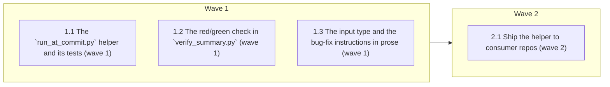

# Failing-test-first protocol for bug fixes

<!-- AT-A-GLANCE:BEGIN (generated — do not edit; refreshed by render_plan.py --summarize) -->
## At a glance

**4 tasks · 2 waves · 10 files · 4/4 done**

| Wave | Task | Title | Files | Done (acceptance) |
|---|---|---|---|---|
| 1 | 1.1 | The `run_at_commit.py` helper and its tests (wave 1) | scripts/run_at_commit.py, scripts/test_run_at_commit.py | SC-1, SC-2 and SC-3 exit 0; `git worktree list` in this repo shows no leftover e… |
| 1 | 1.2 | The red/green check in `verify_summary.py` (wave 1) | scripts/verify_summary.py, scripts/test_verify_summary.py | SC-4 and SC-5 exit 0; the test count is the 72 before this task plus the new `re… |
| 1 | 1.3 | The input type and the bug-fix instructions in prose (wave 1) | templates/SUMMARY.template.md, skills/feature-intake/SKILL.md, skills/subagent-driven-development/implementer-prompt.md, rules/auto-correct-scope.md | SC-6, SC-7, SC-8 and SC-9 exit 0. |
| 2 | 2.1 | Ship the helper to consumer repos (wave 2) | scripts/deploy-harness.sh, tests/scripts/consumer-subset.test.sh | SC-10 exits 0; removing the new `CONSUMER_SCRIPTS` entry makes the same test exi… |

### Progress
- [x] 1.1 — The `run_at_commit.py` helper and its tests (wave 1)
- [x] 1.2 — The red/green check in `verify_summary.py` (wave 1)
- [x] 1.3 — The input type and the bug-fix instructions in prose (wave 1)
- [x] 2.1 — Ship the helper to consumer repos (wave 2)
<!-- AT-A-GLANCE:END -->

## 1. Motivation

A bug fix can claim "done" with a test that was never shown to fail before the fix. This plan adds
E5 from `docs/research/2026-10-10-ai-native-sdlc-playbook-adoption.md` §6, as designed in
`specs/failing-test-first/design.md` (approved 2026-10-15, D1–D8): a `bug fix` input type, a helper
that runs a test at the pre-fix commit, and an advisory red/green check in `verify_summary.py`.

## 2. Non-goals

- A hook that blocks test edits during a fix (M2).
- Making the check blocking by default.
- Any change to `hooks/`.

## 3. Success Criteria

| ID | Behavior (observable) | Check (re-runnable) | Expected |
|---|---|---|---|
| SC-1 | The helper's own tests pass | `env PATH=/tmp/harness-tests-venv/bin:/usr/bin:/bin python3 -m pytest -q scripts/test_run_at_commit.py` | exit 0 |
| SC-2 | The helper exits 125 for a sha that does not exist | `python3 scripts/run_at_commit.py 0000000 -- python3 -c pass` | exit 125 |
| SC-3 | The helper returns the test command's own exit code | `python3 scripts/run_at_commit.py HEAD -- python3 -c "raise SystemExit(3)"` | exit 3 |
| SC-4 | The red/green check cases pass | `env PATH=/tmp/harness-tests-venv/bin:/usr/bin:/bin python3 -m pytest -q scripts/test_verify_summary.py -k red_green` | exit 0 |
| SC-5 | Every `verify_summary.py` test passes, old and new | `env PATH=/tmp/harness-tests-venv/bin:/usr/bin:/bin python3 -m pytest -q scripts/test_verify_summary.py` | exit 0 |
| SC-6 | The SUMMARY template lists `bug fix` as an input type | `grep -q 'bug fix' templates/SUMMARY.template.md` | exit 0 |
| SC-7 | Intake lists `bug fix` as an input type | `grep -q 'bug fix' skills/feature-intake/SKILL.md` | exit 0 |
| SC-8 | The implementer prompt tells a bug-fix task to use the helper | `grep -q run_at_commit.py skills/subagent-driven-development/implementer-prompt.md` | exit 0 |
| SC-9 | The lane-evidence rule names the opt-in variable | `grep -q REQUIRE_RED_TEST rules/auto-correct-scope.md` | exit 0 |
| SC-10 | A deployed consumer tree contains the helper | `bash tests/scripts/consumer-subset.test.sh` | exit 0 |

## Global Constraints

- Edit the source tree only. Never edit `.claude/`, `hooks/`, `VERSION` or `CHANGELOG.md`. Touch
  only the files your task names.
- Read `specs/failing-test-first/design.md` (Architecture, Error behavior, Decisions D1–D8) and
  `specs/failing-test-first/research-brief.md` (Risks R1–R3) before you edit. They are the spec.
- Run shell commands as plain, separate commands from the worktree root. The session guard refuses
  compound commands, heredocs and inline scripts that mention git. Put helper scripts in a file.
- Run pytest with `/tmp/harness-tests-venv/bin` first on `PATH`; the system `python3` has no pytest.
- Python scripts use the standard library only, and must run on Linux and macOS (no `timeout`
  binary, no GNU-only flags).
- Exit codes are fixed by the design: the helper's own failures exit 125; a test it stops after
  its internal 50 s (budget) timeout exits 124; a test killed by signal `n` returns 128+n; a red
  row must claim an exit from 1 to 123 (budget).
- Apply `skills/asd-ste100/SKILL.md` to prose you edit in `skills/`, `rules/` and `templates/`:
  Strict mode inside the fenced dispatch prompt of `implementer-prompt.md`, STE-flavored mode
  elsewhere. Do not change fenced code, or a literal string that a test or hook matches.
- Do not use the words `correctly`, `properly`, `as expected`, `works`, `is correct`,
  `looks right`, `appropriate` or `reasonable` in a `Verify:` or `Done:` line
  (`rules/terminology.md` §3).

## 4. Tasks

### Task 1.1 — The `run_at_commit.py` helper and its tests (wave 1)

- **Files:** scripts/run_at_commit.py, scripts/test_run_at_commit.py
- **Action:** Write the tests first, then the helper. Interface:
  `python3 scripts/run_at_commit.py <rev> -- <arg>...`. Behavior:
  - Resolve the repo with `git rev-parse --show-toplevel` from the current directory, never from
    the script's own location (research R3).
  - Resolve `<rev>` with `git rev-parse --verify <rev>^{commit}`; a failure exits 125.
  - Run `git worktree prune`, then `git worktree add --detach <tmp> <commit>` with `<tmp>` from
    `tempfile.mkdtemp()` (outside the repo).
  - Run the arguments after `--` as an argument list without a shell, with `cwd=<tmp>`, under an
    internal timeout of 50 s (budget), held in a module constant. Start the test with
    `start_new_session=True`; on timeout, kill its whole process group (`os.killpg`) and exit 124
    (research R1).
  - A negative `returncode` `-n` becomes `128+n`. An `OSError` when the command starts exits 125.
    A missing `--` or an empty command exits 125. Every 125 prints one line to stderr prefixed
    `run_at_commit:`.
  - In a `finally` block, run `git worktree remove --force <tmp>`, and remove `<tmp>` if it still
    exists.
  Tests, each on a throwaway git repo built in `tmp_path` (name them so `-k` can select them):
  the test command's exit code comes through (3); an unknown sha gives 125; a missing `--` gives
  125; an unknown binary gives 125; a command killed by SIGKILL gives 137; a command that sleeps
  past a short internal timeout gives 124 (`main(argv)` returns the exit code; the test runs it
  in-process after `monkeypatch.chdir` into the throwaway repo, with the timeout constant
  monkeypatched; add no environment override); after each run, `git worktree list` has one
  line and the temporary directory is gone; the helper works when invoked by absolute path from
  the throwaway repo's root (it does not use its own file location).
- **Verify:** `env PATH=/tmp/harness-tests-venv/bin:/usr/bin:/bin python3 -m pytest -q scripts/test_run_at_commit.py`
- **Done:** SC-1, SC-2 and SC-3 exit 0; `git worktree list` in this repo shows no leftover entry
  after the tests.
- **Criteria:** SC-1, SC-2, SC-3
- **Interfaces:** Consumes: git 2.17+ worktree commands. Produces: `scripts/run_at_commit.py`, `scripts/test_run_at_commit.py`.

### Task 1.2 — The red/green check in `verify_summary.py` (wave 1)

- **Files:** scripts/verify_summary.py, scripts/test_verify_summary.py
- **Action:** Write the tests first, then the check, following design Architecture §2 and D3–D8.
  - Add `_RED_TEST_ENV = "REQUIRE_RED_TEST"` and a blocking test helper parsed like
    `_not_auto_verified_is_blocking` (set and not `0`/`false`).
  - Add `_red_green_issue(text) -> str | None`. It returns None unless `Input-type`, trimmed and
    lower-cased, is exactly `bug fix`. Otherwise it accepts a `Red test exempt: <reason>` line
    with a non-empty reason in the `### Verify` section, or a `red` + `green` row pair:
    - red: `Check` (trimmed, lower-cased) is `red`; the command is `python3` (optional) then a
      path ending in `scripts/run_at_commit.py`, then a 7–40 (budget) character hex sha, then
      `--`, then a non-empty test command; the claimed Exit is an integer from 1 to 123.
    - green: `Check` is `green`; its command equals the red row's test command after whitespace
      is normalized; its claimed Exit is `0`.
    Give the function `Verifies:` / `Does not verify:` docstring lines (traceability tier).
  - `check_lane_warnings` returns warnings that carry their own enforcing variable, and returns
    the red/green issue whatever `REQUIRE_NOT_AUTO_VERIFIED` is set to, unless `REQUIRE_RED_TEST`
    is blocking. Change `_check_lane_targets` to print each warning with its own
    `(warn-only; set <VAR>=1 to enforce)` suffix; keep the leading `    ! `. Keep the existing
    Not-auto-verified output byte-identical.
  - `check_lane_evidence` appends the issue as an error when `REQUIRE_RED_TEST` is blocking.
  - Keep `check_lane_warnings`' existing callers and tests working; update an existing test only
    where its assertion depends on the return shape, and say so in the report.
  Tests, each name containing `red_green`: valid pair → no warning; no red row → one warning whose
  printed line starts with `!` and names `REQUIRE_RED_TEST`; the same under `REQUIRE_RED_TEST=1`
  → `--lane` exit 1 and the warning not printed; warning still present with
  `REQUIRE_NOT_AUTO_VERIFIED=1`; exemption with reason → accepted, empty reason → rejected;
  green command differs → rejected; red claims of 0, 124, 125, 126, 127, 128 and 139 → rejected,
  1 → accepted; `Input-type: Bug Fix` → the check applies; another input type → no message; every
  `specs/*/SUMMARY.md` whose `Input-type` is not `bug fix` → no red/green message from either
  function.
- **Verify:** `env PATH=/tmp/harness-tests-venv/bin:/usr/bin:/bin python3 -m pytest -q scripts/test_verify_summary.py`
- **Done:** SC-4 and SC-5 exit 0; the test count is the 72 before this task plus the new
  `red_green` cases.
- **Criteria:** SC-4, SC-5
- **Interfaces:** Consumes: the existing lane-warning and lane-evidence functions of verify_summary. Produces: `scripts/verify_summary.py`, `scripts/test_verify_summary.py`.

### Task 1.3 — The input type and the bug-fix instructions in prose (wave 1)

- **Files:** templates/SUMMARY.template.md, skills/feature-intake/SKILL.md, skills/subagent-driven-development/implementer-prompt.md, rules/auto-correct-scope.md
- **Action:**
  - `templates/SUMMARY.template.md`: add `bug fix` to the `Input-type:` option list.
  - `skills/feature-intake/SKILL.md` step 2: add `bug fix` to the input types, with a short note
    that it covers any fix of wrong behavior, harness bugs included.
  - `skills/subagent-driven-development/implementer-prompt.md`, under "Your Job" next to "Write
    tests": for a bug-fix run (`Input-type: bug fix` in SUMMARY), commit the failing test before
    the fix; record a `red` row
    (`python3 scripts/run_at_commit.py <red sha> -- <test command>`, its non-zero exit) and a
    `green` row (the same test command, exit 0) in `### Verify`, or a
    `Red test exempt: <reason>` line when the bug has no testable surface. The test command is a
    plain argument list: no `&&`, pipes, globs or env prefixes; use an absolute interpreter path
    when the test needs untracked setup.
  - `rules/auto-correct-scope.md`, lane-evidence box: one bullet saying a SUMMARY with
    `Input-type: bug fix` also needs the red/green pair or an exemption line, advisory unless
    `REQUIRE_RED_TEST=1`.
  Write `scripts/run_at_commit.py` (the source path); deploy rewrites it for consumers.
- **Verify:** `grep -q 'bug fix' templates/SUMMARY.template.md && grep -q 'bug fix' skills/feature-intake/SKILL.md && grep -q run_at_commit.py skills/subagent-driven-development/implementer-prompt.md && grep -q REQUIRE_RED_TEST rules/auto-correct-scope.md`
- **Done:** SC-6, SC-7, SC-8 and SC-9 exit 0.
- **Criteria:** SC-6, SC-7, SC-8, SC-9
- **Interfaces:** Consumes: the row format in design Architecture §2. Produces: `templates/SUMMARY.template.md`, `skills/feature-intake/SKILL.md`, `skills/subagent-driven-development/implementer-prompt.md`, `rules/auto-correct-scope.md`.

### Task 2.1 — Ship the helper to consumer repos (wave 2)

- **Files:** scripts/deploy-harness.sh, tests/scripts/consumer-subset.test.sh
- **Action:** Add `"run_at_commit.py"` to `CONSUMER_SCRIPTS` in `scripts/deploy-harness.sh`. Add
  `run_at_commit.py` to the helper list in the first `consumer-subset.test.sh` case, so the test
  fails when the deployed tree lacks `.claude/scripts/run_at_commit.py`.
- **Verify:** `bash tests/scripts/consumer-subset.test.sh`
- **Done:** SC-10 exits 0; removing the new `CONSUMER_SCRIPTS` entry makes the same test exit
  non-zero (check once, then restore).
- **Criteria:** SC-10
- **Interfaces:** Consumes: `scripts/run_at_commit.py` from Task 1.1. Produces: `scripts/deploy-harness.sh`, `tests/scripts/consumer-subset.test.sh`.

## 5. Risks

- The red row's worktree may not fit the 60 s (budget) row limit in a large consumer repo
  (design A2); the exemption line is the fallback. This repo measured 0.098 s (measured
  2026-10-15 local run).
- `scripts/deploy-harness.sh` is a deploy script; a mistake there reaches every consumer. SC-10
  and `bash scripts/run-tests.sh` at finish cover it.

### Assumption coverage

- A1 → accepted risk: a legacy SUMMARY mislabelled `bug fix` would only warn; SC-5 covers every other SUMMARY
- A2 → accepted risk: a throwaway-repo test cannot show large-repo timing; the exemption line is the fallback
- A3 → accepted risk: the implementer instruction (Task 1.3) says to use an absolute interpreter path for untracked setup
- A4 → SC-4
- A5 → accepted risk: consumer repos may squash; the exemption line is the documented fallback

## 6. Status Log

- 2026-10-15 — plan written from design.md (approved) and research-brief.md.
- 2026-10-15 — tasks 1.1, 1.2, 1.3 complete; commits 04392a6, 214c2d9, 58f6cda
- 2026-10-15 — task 2.1 complete; commit 087f331
- 2026-10-15 — review chain complete (audit repair 9ec0e59, word-ceiling fix 32c5978); full suite 1003 passed; plan shipped
