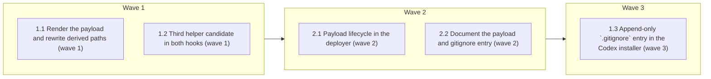

# Ship the full harness payload with the Codex install

<!-- AT-A-GLANCE:BEGIN (generated — do not edit; refreshed by render_plan.py --summarize) -->
## At a glance

**5 tasks · 3 waves · 12 files · 0/5 done**

| Wave | Task | Title | Files | Done (acceptance) |
|---|---|---|---|---|
| 1 | 1.1 | Render the payload and rewrite derived paths (wave 1) | scripts/render_codex_adapter.py, adapters/codex/schema.json, scripts/test_render_codex_adapter.py | All `test_render_codex_adapter.py` tests pass, including the four new groups; th… |
| 1 | 1.2 | Third helper candidate in both hooks (wave 1) | hooks/commit-gate.sh, hooks/session-knowledge.sh, tests/hooks/commit-gate-evidence.test.sh, tests/hooks/session-knowledge.test.sh | Both hook suites exit 0, including the new Codex-path cases. A one-time mutation… |
| 2 | 2.1 | Payload lifecycle in the deployer (wave 2) | scripts/deploy-codex-adapter.sh, tests/scripts/codex-install.test.sh | The suite exits 0. It asserts that after an unedited `--remove` the path `.codex… |
| 2 | 2.2 | Document the payload and gitignore entry (wave 2) | docs/codex-alpha-install.md | The lint exits 0; `grep -c "agent-harness/payload" docs/codex-alpha-install.md` … |
| 3 | 1.3 | Append-only `.gitignore` entry in the Codex installer (wave 3) | scripts/install-codex-harness.sh, tests/scripts/codex-install-gitignore.test.sh | The new suite exits 0 and `bash -n scripts/install-codex-harness.sh` exits 0. |

### Progress
- [ ] 1.1 — Render the payload and rewrite derived paths (wave 1)
- [ ] 1.2 — Third helper candidate in both hooks (wave 1)
- [ ] 2.1 — Payload lifecycle in the deployer (wave 2)
- [ ] 2.2 — Document the payload and gitignore entry (wave 2)
- [ ] 1.3 — Append-only `.gitignore` entry in the Codex installer (wave 3)
<!-- AT-A-GLANCE:END -->

## 1. Motivation

Issue #253 (tracking #257). A Codex-only install leaves 17 unique `rules|runtime|scripts|templates`
paths and the skill-local helpers unresolved, and `commit-gate.sh` drops lane evidence with one
warning line. Design: `specs/gh-253-codex-full-payload/design.md` (payload under
`.codex/.agent-harness/payload/`, derived-Markdown path rewrite, third hook candidate, append-only
`.gitignore` entry). Research: `specs/gh-253-codex-full-payload/research-brief.md`.

## 2. Non-goals

- Loading always-on rules into Codex session context (#254).
- Hook trust, doctor reasons, installer next-step text, running `init-structure.sh` (#255).
- Any change to Claude deploy output, including its latent unrewritten `runtime/…`/`rules/…`
  paths (Harness-Delta backlog).
- Preserving file modes in the deployer.

## Global Constraints

- Run `bash scripts/run-tests.sh` before the first `hooks/` or `scripts/` edit and once after all
  tasks; record the result in SUMMARY prose, never as a Verify row.
- Claude install and deploy output must stay byte-identical: no edit to `scripts/deploy-harness.sh`
  or `scripts/install-harness.sh`. The renderer only reads `deploy-harness.sh`.
- Source skills, rules, and templates must stay unchanged. Path rewriting happens only in rendered
  output.
- Hooks must keep resolving the project root from the runtime, never from `SCRIPT_DIR`, and must
  never read `harness-manifest.json` from the payload.
- Bash must stay compatible with macOS 3.2. Use Python 3 stdlib only.
- Tests must not need Codex authentication or network access, and must not touch the real
  `~/.codex`. Use the existing fake-Codex harness.
- Verify commands must be pipe-free, run as a single command, and finish in under 60 s.

## 3. Success Criteria

| ID | Behavior (observable) | Check (re-runnable) | Expected |
| --- | --- | --- | --- |
| SC-1 | A rendered Codex adapter holds the payload, and every payload-backed helper reference in rendered Markdown points at an existing payload file, with zero bare references left | `python3 -m pytest scripts/test_render_codex_adapter.py -q -k closure` | exit 0 |
| SC-2 | The payload script set equals `CONSUMER_SCRIPTS` + `CONSUMER_DATA` from `deploy-harness.sh`; an unparseable or bogus entry fails the render | `python3 -m pytest scripts/test_render_codex_adapter.py -q -k consumer_subset` | exit 0 |
| SC-3 | The rewrite is idempotent and leaves `.claude/…`, already-prefixed, and non-payload paths unchanged | `python3 -m pytest scripts/test_render_codex_adapter.py -q -k rewrite` | exit 0 |
| SC-4 | `render-manifest.json` carries a required `payload` inventory that the schema validator accepts | `python3 -m pytest scripts/test_render_codex_adapter.py -q -k payload_inventory` | exit 0 |
| SC-5 | In a repo whose only `verify_summary.py` is at `.codex/.agent-harness/payload/scripts/`, `commit-gate.sh` runs lane evidence (prints `Lane evidence... FAILED` for a placeholder-only normal lane) instead of skipping | `bash tests/hooks/commit-gate-evidence.test.sh` | exit 0 |
| SC-6 | `session-knowledge.sh` renders the runtime-mode section from `.codex/.agent-harness/payload/runtime/runtime_mode.py` | `bash tests/hooks/session-knowledge.test.sh` | exit 0 |
| SC-7 | Install writes the payload and lists it in the deployment manifest; an edited payload file gets a `.harness-incoming` sidecar; a retired payload file and its empty directory are pruned on reinstall; `--remove` deletes unchanged payload files and empty directories and keeps edited ones | `bash tests/scripts/codex-install.test.sh` | exit 0 |
| SC-8 | The installer appends `.codex/.agent-harness/` to `.gitignore` exactly once, leaves an existing scoping line alone, and writes nothing under `--dry-run` | `bash tests/scripts/codex-install-gitignore.test.sh` | exit 0 |
| SC-9 | Claude rendering is unchanged by a Codex render | `python3 -m pytest scripts/test_render_codex_adapter.py -q -k claude_rendering_is_unchanged` | exit 0 |
| SC-10 | Docs list the payload and the `.gitignore` entry, and the doc-truth lint passes | `bash scripts/lint-doc-truth.sh` | exit 0 |

## 4. Tasks

### Task 1.1 — Render the payload and rewrite derived paths (wave 1)

- **Files:** scripts/render_codex_adapter.py, adapters/codex/schema.json, scripts/test_render_codex_adapter.py
- **Action:** Write the failing tests first: a closure test (`closure`), a consumer-subset parity
  test plus removal, bogus-entry, and unparseable cases (`consumer_subset`; removing a name from the
  array removes that file from the payload), rewrite-safety tests (`rewrite`, including a frontmatter `allowed-tools` assertion), and a
  payload-inventory schema test (`payload_inventory`). Extend `clone_render_root` to copy `rules/`,
  `runtime/`, `templates/`, `scripts/deploy-harness.sh`, the consumer scripts, and
  `harness-manifest.json`. Then implement as `design.md` §Components 1 describes:
  - parse `CONSUMER_SCRIPTS`/`CONSUMER_DATA`;
  - copy `rules/`, non-test `runtime/`, `templates/`, the subset, and each shipped skill's
    non-Markdown, non-test helpers into `project/.codex/.agent-harness/payload/`;
  - apply the existence-gated, token-anchored rewrite to plugin `skills/**/*.md` and payload
    `rules/**/*.md` and `templates/**/*.md`;
  - add the required `payload` inventory to the render manifest, the schema, and the
    `_validate_schema` expected set.
- **Verify:** `python3 -m pytest scripts/test_render_codex_adapter.py -q`
- **Done:** All `test_render_codex_adapter.py` tests pass, including the four new groups; the existing byte-stability and Claude-unchanged tests still pass.
- **Criteria:** SC-1, SC-2, SC-3, SC-4, SC-9
- **Interfaces:** Consumes the deploy-harness.sh consumer arrays and the source trees; produces `project/.codex/.agent-harness/payload/**` and the `payload` key in `render-manifest.json`.

### Task 1.2 — Third helper candidate in both hooks (wave 1)

- **Files:** hooks/commit-gate.sh, hooks/session-knowledge.sh, tests/hooks/commit-gate-evidence.test.sh, tests/hooks/session-knowledge.test.sh
- **Action:** Add failing tests first:
  - a `codex_lane_repo` that places `verify_summary.py` only at
    `.codex/.agent-harness/payload/scripts/` and asserts `Lane evidence... FAILED` for a
    placeholder-only normal lane;
  - a session-knowledge case that places `runtime_mode.py` only at
    `.codex/.agent-harness/payload/runtime/`.

  Then append `.codex/.agent-harness/payload/scripts/verify_summary.py` as the last candidate in
  the `commit-gate.sh` probe loop and update both "unavailable" messages to list it. Append
  `$RUN_STATE_ROOT/.codex/.agent-harness/payload/runtime/runtime_mode.py` as the last fallback in
  `session-knowledge.sh`. Leave the existing candidate order unchanged.
- **Verify:** `bash tests/hooks/commit-gate-evidence.test.sh && bash tests/hooks/session-knowledge.test.sh`
- **Done:** Both hook suites exit 0, including the new Codex-path cases. A one-time mutation check (third candidate removed, so the new cases fail) is recorded in SUMMARY prose.
- **Criteria:** SC-5, SC-6
- **Interfaces:** Consumes the payload path contract from `design.md`; produces probe candidates in `hooks/commit-gate.sh` and `hooks/session-knowledge.sh`.

### Task 1.3 — Append-only `.gitignore` entry in the Codex installer (wave 3)

- **Files:** scripts/install-codex-harness.sh, tests/scripts/codex-install-gitignore.test.sh
- **Action:** Write the new test suite first: a fresh repo gains `.codex/.agent-harness/` once and
  keeps it once across two installs; an existing `.codex/` or `.codex/.agent-harness/` line is left
  as is; `--dry-run` leaves `.gitignore` absent; an already-tracked `.codex/.agent-harness/` gets a
  warning and no edit. Then add the step after a successful deploy, mirroring
  `install-harness.sh:249-297` (append-only, guarded writes, never fatal). A `.codex`, `.codex/`, or
  `/.codex/` line counts as already scoped. Use a fake Codex binary
  as `codex-install.test.sh` does.
- **Verify:** `bash tests/scripts/codex-install-gitignore.test.sh`
- **Done:** The new suite exits 0 and `bash -n scripts/install-codex-harness.sh` exits 0.
- **Criteria:** SC-8
- **Interfaces:** Consumes the target directory from installer args; produces the `.gitignore` line `.codex/.agent-harness/` in the consumer and `tests/scripts/codex-install-gitignore.test.sh`.

### Task 2.1 — Payload lifecycle in the deployer (wave 2)

- **Files:** scripts/deploy-codex-adapter.sh, tests/scripts/codex-install.test.sh
- **Action:** Add failing lifecycle cases to `codex-install.test.sh`:
  - after install, `payload/scripts/verify_summary.py` exists and is in the manifest's
    `project_files`;
  - editing a payload file and reinstalling yields `<file>.harness-incoming`;
  - a retired payload file (simulated by a source without it) is pruned along with its empty
    directory;
  - `--remove` deletes unchanged payload files and empty directories and keeps an edited one.

  Then add a deepest-first empty-directory sweep under `.codex/.agent-harness/payload/` to
  `sync_project`, run before the existing three fixed rmdirs, in both install and remove modes.
  Update the existing exact-inventory assertion ("deployment manifest lists exact project
  ownership") so it requires the five current paths plus a `.codex/.agent-harness/payload/` entry
  for every file in the rendered payload inventory.
- **Verify:** `bash tests/scripts/codex-install.test.sh && python3 -m pytest scripts/test_codex_harness_doctor.py -q`
- **Done:** The suite exits 0. It asserts that after an unedited `--remove` the path `.codex/.agent-harness` is absent and no empty directory remains under `.codex/`.
- **Criteria:** SC-7
- **Interfaces:** Consumes `project/.codex/.agent-harness/payload/**` from Task 1.1; produces payload entries in `.codex/.agent-harness/deployment-manifest.json`.

### Task 2.2 — Document the payload and gitignore entry (wave 2)

- **Files:** docs/codex-alpha-install.md
- **Action:** Add the payload directory and the `.gitignore` line to the "adapter owns" list.
  State that the payload is a derived copy that is refreshed on reinstall and covered by the same
  conflict and remove rules. State that `--remove` leaves the `.gitignore` line in place. Do not
  claim hook trust or enforcement.
- **Verify:** `bash scripts/lint-doc-truth.sh`
- **Done:** The lint exits 0; `grep -c "agent-harness/payload" docs/codex-alpha-install.md` and `grep -c "gitignore" docs/codex-alpha-install.md` each print at least 1.
- **Criteria:** SC-10
- **Interfaces:** Consumes the shipped behaviour from Tasks 1.1–2.1; produces the updated `docs/codex-alpha-install.md`.

## 5. Risks

- An over-broad rewrite corrupts skill prose. Mitigation: rewrite only targets that exist in the
  payload, use the token-anchored lookbehind, and test idempotency and non-targets.
- The `CONSUMER_*` regex parse breaks on a future reformat of `deploy-harness.sh`. Mitigation: fail
  closed, and the parity test makes the break visible in CI.
- The payload adds many `project_files` entries, and `scripts/codex_harness_doctor.py:273-276`
  hashes each of them. `python3 -m pytest scripts/test_codex_harness_doctor.py -q` must still exit
  0 after Task 2.1. It runs in the post-task full suite.
- Task 1.3's test runs the full installer, which goes through the renderer and the deployer. That
  is why it runs alone in wave 3, after Tasks 1.1 and 2.1.
- Payload size grows the install. Measure the payload byte count after Task 1.1 and record it in
  SUMMARY.
- Live Codex execution of rewritten skills is unobserved; deterministic evidence only. Record this
  in SUMMARY `### Not auto-verified`.

## 6. Status Log

- 2026-10-08 — The user chose the payload location (`.codex/.agent-harness/payload/`). `design.md` passed the spec review on iteration 2, and the plan was written and reviewed. Implementation waits for the user to approve `design.md` and this plan. Baseline `bash scripts/run-tests.sh` passed before any `hooks/` or `scripts/` edit: all green, 799 pytest passed.
