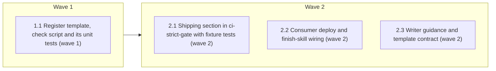

# Open-questions register and warn-first ship check

<!-- AT-A-GLANCE:BEGIN (generated — do not edit; refreshed by render_plan.py --summarize) -->
## At a glance

**4 tasks · 2 waves · 12 files · 1/4 done**

| Wave | Task | Title | Files | Done (acceptance) |
|---|---|---|---|---|
| 1 | 1.1 | Register template, check script and its unit tests (wave 1) | templates/QUESTIONS.template.md, scripts/check_open_questions.py, scripts/test_check_open_questions.py | SC-1 returns exit 0; the template contains the header sentence and all six field… |
| 2 | 2.1 | Shipping section in ci-strict-gate with fixture tests (wave 2) | scripts/ci-strict-gate.sh, tests/scripts/ci-strict-gate.test.sh | SC-2 returns exit 0, and every pre-existing case in that file still passes. |
| 2 | 2.2 | Consumer deploy and finish-skill wiring (wave 2) | scripts/deploy-harness.sh, skills/finishing-a-development-branch/SKILL.md, tests/scripts/consumer-subset.test.sh, tests/scripts/finishing-branch-contract.test.sh | SC-3, SC-4 and SC-6 return exit 0; SC-7 returns exit 0 for the finish skill. |
| 2 | 2.3 | Writer guidance and template contract (wave 2) | skills/brainstorming/SKILL.md, templates/structure/specs-README.md, tests/scripts/brainstorming-contract.test.sh | SC-5 returns exit 0; SC-7 returns exit 0 for the brainstorming skill; SC-6 retur… |

### Progress
- [x] 1.1 — Register template, check script and its unit tests (wave 1)
- [ ] 2.1 — Shipping section in ci-strict-gate with fixture tests (wave 2)
- [ ] 2.2 — Consumer deploy and finish-skill wiring (wave 2)
- [ ] 2.3 — Writer guidance and template contract (wave 2)
<!-- AT-A-GLANCE:END -->

## 1. Motivation

Issue #258 item 3, as designed in `specs/gh-258-open-questions-register/design.md` (approved
2026-10-09, D1–D7). A multi-phase spec gets an optional `QUESTIONS.md` of non-blocking unknowns,
each naming the phase slug that must close it. `scripts/check_open_questions.py` warns when that
phase ships with the question still open. It runs at finishing step 3 and in
`scripts/ci-strict-gate.sh`, warn by default and blocking under `REQUIRE_QUESTIONS_CLOSED=1`.
Research: `research-brief.md` (Deep, local-only).

## 2. Non-goals

- Items 5, 6 and 7 of #258.
- Any change to `hooks/`, `settings.json`, `skills/visual-planner/render_plan.py`, `rules/*.md` or
  `templates/ESCALATIONS.template.md`.
- Blocking by default, automatic closing of questions, or moving design `DC<n>` entries into the
  register.
- Creating a `QUESTIONS.md` for any existing spec.

## Global Constraints

- Edit the source tree only. Never edit `.claude/`; `scripts/deploy-harness.sh` derives it.
- Do not edit `VERSION` or `CHANGELOG.md`; post-merge bookkeeping owns them.
- `scripts/check_open_questions.py` uses the Python standard library only. Its module docstring
  carries `Verifies:` and `Does not verify:` lines (design §2) and the exit-code contract.
- Exact strings, copied character for character, each kept on one line so fixed-string greps match:
  - template header sentence: `A question that blocks work does not belong here: write it in ESCALATIONS.md.`
  - block heading form `## OQ-<n>`; field keys `raised-by`, `closes-at`, `decided-by`,
    `default-until-closed`, `status`, `closed-by`; `decided-by` values `measurement` and `owner`;
    `status` values `open` and `closed`
  - environment flag `REQUIRE_QUESTIONS_CLOSED`
  - finish-skill command `python3 scripts/check_open_questions.py --slug <slug>` and PR-body
    heading `Open questions closing here`
  - brainstorming sentence: `In a multi-phase spec, record non-blocking unknowns in specs/<slug>/QUESTIONS.md from templates/QUESTIONS.template.md.`
- CLI contract: `--slug` is required (missing → exit 2); `--root` defaults to `Path.cwd()`, never
  to a path derived from `__file__` (design D7). Findings go to stderr. Exit 0 with no findings;
  with findings, exit 0 unless `REQUIRE_QUESTIONS_CLOSED=1`, then exit 1.
- `closes-at: <X>` matches slug `X` when the value equals `X` or starts with `X#`; `X-other` does
  not match `X`.
- The `ci-strict-gate.sh` section sits after `[ -z "$DIFF" ] && exit 0` and before the tier
  selection that ends in `exit 0  # no gated paths touched`. It never exits 0 itself. It exits 1
  only when a check run exits 1. When a shipping slug exists but `scripts/check_open_questions.py`
  is absent, it prints `open-question check skipped: scripts/check_open_questions.py not found`
  to stderr and continues; under `REQUIRE_QUESTIONS_CLOSED=1` it exits 1 instead.
- Shipping detection: `specs/<slug>/PLAN.md` is in `$DIFF`, its frontmatter (the lines between the
  first two `---` lines) reads `status: shipped` at `HEAD`, and at `git merge-base "$BASE" HEAD`
  it does not (read with `git show <mb>:specs/<slug>/PLAN.md`; a missing file counts as not
  shipped). Tolerate trailing spaces and `\r`.
- Keep `skills/finishing-a-development-branch/SKILL.md` and `skills/brainstorming/SKILL.md` at or
  under 600 words (`scripts/audit_skill_prompts.py`). Keep every anchor the existing contract
  tests pin in those two skills and in `scripts/deploy-harness.sh`.
- pytest rows use `python3 -m pytest …` (CI installs pytest on `python3`). Locally, run them with
  the shared venv first on `PATH`: `PATH=/tmp/harness-tests-venv/bin:$PATH`.

## 3. Success Criteria

| ID | Behavior (observable) | Check (re-runnable) | Expected |
|---|---|---|---|
| SC-1 | The check's output and exit code match the design's error-behavior table, including `X#task` matching, `X-other` not matching, duplicate IDs and an undecodable register reported without a traceback | `python3 -m pytest scripts/test_check_open_questions.py -q` | exit 0 |
| SC-2 | In CI, a specs-only branch that ships a phase with an open question prints the finding and exits 0, exits 1 under `REQUIRE_QUESTIONS_CLOSED=1`, an edit to an already-shipped plan runs no check, and a branch touching `hooks/` that also ships a phase still fails without high-risk proof | `bash tests/scripts/ci-strict-gate.test.sh` | exit 0 |
| SC-3 | The deployed consumer copy is shipped and, run from a consumer root, reports an open question from that root's `specs/` | `bash tests/scripts/consumer-subset.test.sh` | exit 0 |
| SC-4 | The finish skill runs the check before marking a plan shipped and names the PR-body list | `bash tests/scripts/finishing-branch-contract.test.sh` | exit 0 |
| SC-5 | The template carries its fields and blocking-question sentence; brainstorming points multi-phase specs at it; the specs README lists `QUESTIONS.md` | `bash tests/scripts/brainstorming-contract.test.sh` | exit 0 |
| SC-6 | Every `scripts/*` path named in source and derived consumer docs exists | `bash scripts/lint-doc-truth.sh` | exit 0 |
| SC-7 | Both edited skills stay within the 600-word ceiling | `python3 scripts/audit_skill_prompts.py` | exit 0 |

## 4. Tasks

### Task 1.1 — Register template, check script and its unit tests (wave 1)

- **Files:** templates/QUESTIONS.template.md, scripts/check_open_questions.py, scripts/test_check_open_questions.py
- **Action:** Write the pytest file first: one test per row of the design's error-behavior table,
  plus `X#3.2` matching `X`, `X-other` not matching `X`, a duplicate `OQ-<n>` in one file, a
  progress-note bullet ignored, and a `QUESTIONS.md` containing byte `0xff` reported with its path
  and no `Traceback` in stderr. Each test builds a temp root with `specs/<slug>/QUESTIONS.md` and
  runs the script as a subprocess with `--root`. Run it and confirm the tests fail. Then write
  `scripts/check_open_questions.py` to the CLI contract in Global Constraints, and
  `templates/QUESTIONS.template.md` in the bullet style of `templates/ESCALATIONS.template.md`,
  with the header sentence and one example `## OQ-1` block holding every field.
- **Verify:** `python3 -m pytest scripts/test_check_open_questions.py -q`
- **Done:** SC-1 returns exit 0; the template contains the header sentence and all six field keys.
- **Criteria:** SC-1
- **Interfaces:** Consumes design §1–§2 and the error-behavior table. Produces `scripts/check_open_questions.py` (CLI `--slug`, `--root`, exit 0/1/2) and `templates/QUESTIONS.template.md`.

### Task 2.1 — Shipping section in ci-strict-gate with fixture tests (wave 2)

- **Files:** scripts/ci-strict-gate.sh, tests/scripts/ci-strict-gate.test.sh
- **Action:** Add these cases to `tests/scripts/ci-strict-gate.test.sh` first, and make `mkrepo`
  also copy `scripts/check_open_questions.py` into the fixture. Fixtures put the register in a
  parent spec (`specs/p/QUESTIONS.md`, open `OQ-1` with `closes-at: p-phase-1`):
  (a) the branch creates `specs/p-phase-1/PLAN.md` with `status: shipped` (absent at the merge
  base): stderr contains `OQ-1`, exit 0;
  (b) case (a) with `REQUIRE_QUESTIONS_CLOSED=1`: exit 1;
  (c) the base already has that plan `shipped` and the branch only appends a Status Log line:
  stderr does not contain `OQ-1`, exit 0;
  (d) the branch touches `hooks/` and ships a phase with no open question and no SUMMARY: exit 1;
  (e) case (a) with the script removed from the fixture: stderr contains
  `open-question check skipped`, exit 0, and exit 1 under `REQUIRE_QUESTIONS_CLOSED=1`.
  Confirm the new cases fail. Then add the section to `scripts/ci-strict-gate.sh` per Global Constraints
  (placement, shipping detection, exit handling, missing-script message). Leave the existing tier
  logic unchanged.
- **Verify:** `bash tests/scripts/ci-strict-gate.test.sh`
- **Done:** SC-2 returns exit 0, and every pre-existing case in that file still passes.
- **Criteria:** SC-2
- **Interfaces:** Consumes `scripts/check_open_questions.py` from Task 1.1. Produces the shipping section in `scripts/ci-strict-gate.sh`.

### Task 2.2 — Consumer deploy and finish-skill wiring (wave 2)

- **Files:** scripts/deploy-harness.sh, skills/finishing-a-development-branch/SKILL.md, tests/scripts/consumer-subset.test.sh, tests/scripts/finishing-branch-contract.test.sh
- **Action:** Add contract cases first. In `consumer-subset.test.sh`: `check_open_questions.py` is
  in the deployed `.claude/scripts/`, and running the deployed copy with `cwd` set to the deploy
  target, after writing a `specs/p/QUESTIONS.md` there with an open question closing at `p`,
  prints `OQ-1` and exits 0. In `finishing-branch-contract.test.sh`: the skill contains
  `python3 scripts/check_open_questions.py --slug <slug>` and `Open questions closing here`. Then
  add `"check_open_questions.py"` to `CONSUMER_SCRIPTS`, and add to finishing step 3, before the
  `status: shipped` instruction, one or two sentences that run the check and relay findings to the
  user and the PR body. Keep the skill within 600 words.
- **Verify:** `bash tests/scripts/consumer-subset.test.sh`
- **Done:** SC-3, SC-4 and SC-6 return exit 0; SC-7 returns exit 0 for the finish skill.
- **Criteria:** SC-3, SC-4, SC-6, SC-7
- **Interfaces:** Consumes `scripts/check_open_questions.py` from Task 1.1. Produces the `CONSUMER_SCRIPTS` row in `scripts/deploy-harness.sh` and the step-3 wiring in `skills/finishing-a-development-branch/SKILL.md`.

### Task 2.3 — Writer guidance and template contract (wave 2)

- **Files:** skills/brainstorming/SKILL.md, templates/structure/specs-README.md, tests/scripts/brainstorming-contract.test.sh
- **Action:** Add contract cases first to `brainstorming-contract.test.sh`, each a fixed-string
  grep: the brainstorming sentence from Global Constraints in `skills/brainstorming/SKILL.md`; the
  template header sentence and the six field keys in `templates/QUESTIONS.template.md`; a
  `QUESTIONS.md` row in `templates/structure/specs-README.md`. Then add the sentence to brainstorming
  Flow step 5, after the sentence that writes `design.md` (the spec directory and the settled
  unknowns exist only from there), and a `QUESTIONS.md` row after the `ESCALATIONS.md` row in the specs README's "Files
  Per Spec" table (produced by brainstorming for multi-phase specs; non-blocking unknowns; checked
  at ship by `scripts/check_open_questions.py`). Keep the skill within 600 words.
- **Verify:** `bash tests/scripts/brainstorming-contract.test.sh`
- **Done:** SC-5 returns exit 0; SC-7 returns exit 0 for the brainstorming skill; SC-6 returns
  exit 0 once Task 2.2 has also landed (checked at the wave boundary).
- **Criteria:** SC-5, SC-6, SC-7
- **Interfaces:** Consumes `templates/QUESTIONS.template.md` from Task 1.1. Produces the guidance sentence in `skills/brainstorming/SKILL.md` and the row in `templates/structure/specs-README.md`.

## 5. Risks

- Doc-truth ordering: two deployed docs name `scripts/check_open_questions.py`, the finish skill
  (Task 2.2) and the specs README (Task 2.3), and the path resolves in the derived tree only once
  Task 2.2 adds the `CONSUMER_SCRIPTS` row. Both are in wave 2, so SC-6 is checked at the wave
  boundary, after both land.
- This PR adds `templates/QUESTIONS.template.md`, so ci-strict-gate runs it in the block tier: the
  SUMMARY needs Verify rows that re-run clean, including under CI's `python3`.
- The CI section's frontmatter read is new shell logic; Task 2.1 cases (a) (plan absent at the
  merge base) and (c) (plan already shipped at the base) pin its two edge cases, and case (e) pins
  the missing-script path.
- The full suite (`bash scripts/run-tests.sh`) is not an SC row; it runs at
  `finishing-a-development-branch` and in the CI `tests` job.
- Running ci-strict-gate locally needs pytest on `python3` (shared venv on `PATH`), because SC-1's
  row uses `python3 -m pytest`.

### Assumption coverage

- A1 → SC-2
- A2 → accepted risk: a phase without its own spec slug is targeted as `<parent-slug>#<task>`; the convention is not enforced
- A3 → SC-2
- A4 → SC-3

## 6. Status Log

- 2026-10-09 — plan written from the approved design and the Deep research brief.
- 2026-10-09 — task 1.1 complete; commit 1dd461d (spec pass, quality approved, 3 Minor recorded in SUMMARY).
