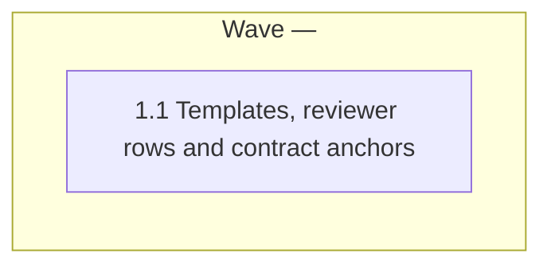

# Provenance header, reading path and worked trace in the spec templates

<!-- AT-A-GLANCE:BEGIN (generated — do not edit; refreshed by render_plan.py --summarize) -->
## At a glance

**1 tasks · 1 waves · 4 files · 0/1 done**

| Wave | Task | Title | Files | Done (acceptance) |
|---|---|---|---|---|
| — | 1.1 | Templates, reviewer rows and contract anchors | skills/brainstorming/references/design-template.md, skills/xia2/references/research-brief-template.md, skills/brainstorming/spec-document-reviewer-prompt.md, tests/scripts/brainstorming-contract.test.sh | SC-1, SC-2 and SC-3 return exit 0, and `bash tests/scripts/context-propagation-r… |

### Progress
- [ ] 1.1 — Templates, reviewer rows and contract anchors
<!-- AT-A-GLANCE:END -->

## 1. Motivation

This plan implements issue #258 items 6 and 7, as designed in
`specs/gh-258-provenance-reading-path/design.md` (approved 2026-10-09, D1–D4).

- **Item 6:** the design and research-brief templates each show a document skeleton. Its header
  line `Written <YYYY-MM-DD>. Pins: <…>`, with appended `Revised` lines, says when the document
  was written and what it was checked against.
- **Item 7:** the design template gains two optional free-form sections, `## Reading path` and
  `## Worked trace`.
- **Reviewer:** the isolated design reviewer checks the header, and checks the optional sections
  only for placeholder content.

Research: `research-brief.md` (Deep, local-only).

## 2. Non-goals

- A staleness check or any change to `scripts/` or `hooks/`.
- Rewriting existing specs.
- A reviewer for research briefs.
- Other #258 items.

## Global Constraints

- Edit the source tree only. Never edit `.claude/`, `VERSION` or `CHANGELOG.md`.
- **Exact anchor strings.** Copy each character for character and keep each on one line:
  - `Written <YYYY-MM-DD>. Pins:`
  - `Revised <YYYY-MM-DD>. Pins:`
  - `## Reading path`
  - `## Worked trace`
  - `Provenance header`
  - `Optional sections`
  - `+ uncommitted`
  - skeleton titles `# <slug> — Design` (design template) and `# <slug> — Research Brief` (research-brief template).
- **Skeleton (design D1).** Each template gains a fenced skeleton block placed before its first
  section: before `## Goal` in the design template, before `## Bottom Line` in the research-brief
  template.
  - One line before the fence says the block is the start of the output document.
  - Inside the fence, the first non-blank line after the skeleton title is the `Written` line.
- **Pins rules (design §1).**
  - At least the repository short sha.
  - `HEAD` plus `+ uncommitted` for uncommitted work.
  - Tool or dependency versions only when a claim depends on them.
  - In the research brief, `Pins` names what the claims rest on and does not replace the
    `Repo Snapshot` table.
  - A revision appends `Revised <YYYY-MM-DD>. Pins: <…>` after the last header line (oldest
    first) and never edits earlier lines.
  - Show the two examples `Written 2026-10-09. Pins: repo 8af66dd; Codex CLI 0.147.0` and
    `Revised 2026-10-12. Pins: repo 3c4d5e6 + uncommitted`.
- **Optional sections (design D3), design template only.**
  - `## Reading path` goes directly after `## Goal`. It is only for specs with more than two
    documents (budget, from #258).
  - `## Worked trace` goes directly after `## Architecture`.
  - The opening paragraph names both as optional and left out when unused. Keep its existing
    free-form/required split wording.
- **Reviewer rows (design §3).** Add two rows to the check table in
  `skills/brainstorming/spec-document-reviewer-prompt.md`, with categories `Provenance header` and
  `Optional sections`, wording as in the design's §3 table.
  - The header row also flags `Revised` dates that are not in ascending order.
  - It accepts `+ uncommitted`.
  - Keep every existing row and the `[TEMPLATE_FILE_PATH]` Read instruction.
- **Section content (design §1–§2).**
  - `Written` is the date the document was first written.
  - `## Reading path` lists the documents in reading order, each with one line on why it comes
    there and what the reader can skip.
  - `## Worked trace` follows one concrete request through the components the design names, from
    start to end, showing the hand-offs between layers.
- **Anchors per file**, for the contract test:
  - Design template: `# <slug> — Design`, `Written <YYYY-MM-DD>. Pins:`,
    `Revised <YYYY-MM-DD>. Pins:`, `+ uncommitted`, `## Reading path`, `## Worked trace`.
  - Research-brief template: `# <slug> — Research Brief`, `Written <YYYY-MM-DD>. Pins:`,
    `Revised <YYYY-MM-DD>. Pins:`, `+ uncommitted`.
  - Reviewer prompt: `Provenance header`, `Optional sections`, `+ uncommitted`.
- **Research-brief template.** Add text only. Do not rename or reword any existing heading or
  the external-surface wording that `tests/scripts/research-depth-drift.test.sh` pins. Each of
  that test's keyword phrases must still appear exactly once, so do not repeat any of them in the
  new header text: `external surface`, `upgrades a dependency`, `integrates an external system`,
  `version-specific API`, `local-only`.
- Keep every anchor that `tests/scripts/brainstorming-contract.test.sh` and
  `tests/scripts/context-propagation-regression.test.sh` already pin.

## 3. Success Criteria

| ID | Behavior (observable) | Check (re-runnable) | Expected |
|---|---|---|---|
| SC-1 | Both templates carry the skeleton and header anchors. The `Written` line is the first non-blank line after each skeleton title, checked by line position. The design template carries both optional sections, and the reviewer carries both new rows. | `bash tests/scripts/brainstorming-contract.test.sh` | exit 0 |
| SC-2 | The research-brief template's research-depth drift anchors are intact | `bash tests/scripts/research-depth-drift.test.sh` | exit 0 |
| SC-3 | The isolated-prompt delivery contracts, including the design reviewer's template Read, still hold | `python3 scripts/render_skill_prompt.py --check-all` | exit 0 |

## 4. Tasks

### Task 1.1 — Templates, reviewer rows and contract anchors

- **Files:** skills/brainstorming/references/design-template.md, skills/xia2/references/research-brief-template.md, skills/brainstorming/spec-document-reviewer-prompt.md, tests/scripts/brainstorming-contract.test.sh
- **Action:**
  1. Add the contract cases to `tests/scripts/brainstorming-contract.test.sh` first:
     - `has_all` anchors for the strings in Global Constraints, in the right file;
     - one line-position case per template. Find the skeleton title line inside the fenced
       block, then assert that the first non-blank line after it starts with
       `Written <YYYY-MM-DD>. Pins:`. This must fail if the header text appears only outside
       the skeleton.
  2. Run the test and confirm the new cases fail.
  3. Edit the two templates and the reviewer prompt per Global Constraints.
- **Verify:** `bash tests/scripts/brainstorming-contract.test.sh`
- **Done:** SC-1, SC-2 and SC-3 return exit 0, and `bash tests/scripts/context-propagation-regression.test.sh` returns exit 0.
- **Criteria:** SC-1, SC-2, SC-3
- **Interfaces:** Consumes design §1–§3. Produces the skeleton and sections in `skills/brainstorming/references/design-template.md` and `skills/xia2/references/research-brief-template.md`, and the two rows in `skills/brainstorming/spec-document-reviewer-prompt.md`, plus the anchor and line-position cases in `tests/scripts/brainstorming-contract.test.sh`.

## 5. Risks

- An agent could copy the template's own `# … Template` title. The fenced skeleton and its introducing line address this, and SC-1's line-position case pins it.
- Editing near the research-brief template's pinned wording could break the drift test. SC-2 guards it.
- The full suite (`bash scripts/run-tests.sh`) is not an SC row. It runs at `finishing-a-development-branch` and in CI.

### Assumption coverage

- A1 → SC-3
- A2 → SC-2

## 6. Status Log

- 2026-10-09 — plan written from the approved design and the Deep research brief.
