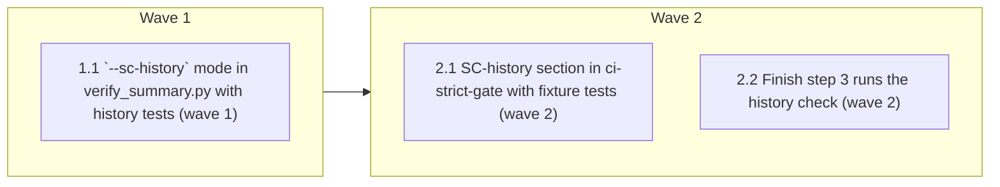

# SC goalpost guard: warn when a failed Success Criterion is changed

<!-- AT-A-GLANCE:BEGIN (generated — do not edit; refreshed by render_plan.py --summarize) -->
## At a glance

**3 tasks · 2 waves · 6 files · 0/3 done**

| Wave | Task | Title | Files | Done (acceptance) |
|---|---|---|---|---|
| 1 | 1.1 | `--sc-history` mode in verify_summary.py with history tests (wave 1) | scripts/verify_summary.py, scripts/test_verify_summary_sc_history.py | SC-1 and SC-4 both return exit 0. |
| 2 | 2.1 | SC-history section in ci-strict-gate with fixture tests (wave 2) | scripts/ci-strict-gate.sh, tests/scripts/ci-strict-gate.test.sh | SC-2 returns exit 0, and all 35 existing cases still pass. |
| 2 | 2.2 | Finish step 3 runs the history check (wave 2) | skills/finishing-a-development-branch/SKILL.md, tests/scripts/finishing-branch-contract.test.sh | SC-3 and SC-5 both return exit 0. |

### Progress
- [ ] 1.1 — `--sc-history` mode in verify_summary.py with history tests (wave 1)
- [ ] 2.1 — SC-history section in ci-strict-gate with fixture tests (wave 2)
- [ ] 2.2 — Finish step 3 runs the history check (wave 2)
<!-- AT-A-GLANCE:END -->

## 1. Motivation

This is issue #258 item 5, as designed in `specs/gh-258-sc-goalpost-guard/design.md` (approved
2026-10-09, decisions D1–D7). A new mode, `verify_summary.py --sc-history <slug> --base <ref>`,
walks the branch history. It finds every `SC-n` that a committed `### Verify` row recorded as
failing, then warns if that SC's `Check` or `Expected` was later changed, or the SC was removed,
without a `### Deviations` entry naming it. Two places call it: `ci-strict-gate.sh`, through a
section next to the item-3 one, and finishing step 3. It is warn-first; `REQUIRE_SC_STABLE=1`
makes it block. Research: `research-brief.md` (Deep, local-only).

## 2. Non-goals

- Items 6 and 7 of #258.
- Any change to `hooks/`, `harness-manifest.json`, `settings.json`, `templates/`, or
  `skills/visual-planner/render_plan.py`.
- Any behavior change to the existing `verify_summary.py` modes (`<slug>`, `--check`, `--lane`).
- A failure ledger file, blocking by default, or detecting weakening inside a command's own test
  content.

## Global Constraints

- Edit the source tree only. Never edit `.claude/`. Do not edit `VERSION` or `CHANGELOG.md`.
- `scripts/verify_summary.py` stays standard library only. Run git through
  `subprocess.run([...])` or `subprocess.check_output([...])` with a list argument and no shell,
  following the `git(root, *args)` helper in `scripts/resolve_finish_context.py`.
- **Repository root (design D7):** the new mode resolves its root with
  `git rev-parse --show-toplevel` run in the current directory, and passes it into a history
  function that takes the root as a parameter. It never uses `_REPO_ROOT`.
- **CLI contract:**
  - `--sc-history <slug> --base <ref>`.
  - Exit 2 with a usage message in these cases: `--base` is missing; it is combined with
    `--check`, `--lane`, `--plan-dir`, `--timeout`, or a positional target; the ref does not resolve; there is no merge
    base; the current directory is not in a git repository; or git cannot run.
  - Findings go to stdout. Exit 0 by default. Exit 1 only when there is at least one finding
    and `REQUIRE_SC_STABLE=1`.
- **Exact strings.** Copy each character for character and keep each on one line so a
  fixed-string grep matches it:
  - finding line: `SC-GOALPOST [SC-n] changed after it failed at <short-sha>; name SC-n in ### Deviations to acknowledge`
    (or `removed` instead of `changed`);
  - environment flag: `REQUIRE_SC_STABLE`;
  - CI error line: `sc-history check errored for <slug> (exit <rc>)`;
  - CI BLOCKED lines:
    `[ci-strict-gate] BLOCKED — a failed Success Criterion was changed (REQUIRE_SC_STABLE=1)` and
    `[ci-strict-gate] BLOCKED — the sc-history check errored (REQUIRE_SC_STABLE=1)`;
  - finish-skill command: `python3 scripts/verify_summary.py --sc-history <slug> --base <base>`.
- **Semantics** (design §1 and the error-behavior table):
  - A failure record is the first commit in `git rev-list --reverse <mb>..HEAD -- 
 <plan>`
    where a Verify row's `Criterion` is `SC-n` and its integer `Exit` differs from SC-n's
    expected exit in that commit's PLAN. Non-integer `Exit` cells and SC rows that return
    `ERROR:` are ignored.
  - Compare `Expected` by its `exit <n>` token. Compare `Check` after collapsing whitespace.
  - When PLAN.md is missing at HEAD, or the SC row is gone, the finding is `removed`.
  - When both files are missing at HEAD, skip the slug.
  - A finding is suppressed only when the HEAD SUMMARY `### Deviations` section contains `SC-n`
    as a whole token.
- `parse_sc_table` keeps its return shape. Add a new helper for the `Check` cell.
- **CI section (design D5):**
  - Place it next to the existing item-3 section, after `DIFF` is computed and before
    `exit 0  # no gated paths touched`.
  - Select slugs whose `specs/<slug>/PLAN.md` or `specs/<slug>/SUMMARY.md` is in
    `git -c core.quotePath=false diff --name-only "$BASE"...HEAD`.
  - Map exit codes the way the item-3 section does: rc 1 with REQUIRE is a finding; rc 1
    without REQUIRE, or any other non-zero rc, is an error that blocks only under REQUIRE.
  - The section never exits 0 itself. Do not change the item-3 section or the tier logic.
  - A slug whose spec directory is gone at HEAD is skipped by the mode itself (exit 0, skip
    note), so the section needs no extra check for it.
- `skills/finishing-a-development-branch/SKILL.md` stays at or under its 600-word ceiling
  (budget, `scripts/audit_skill_prompts.py`). Keep every anchor that the existing finish
  contract tests pin.
- pytest rows use `python3 -m pytest …`. Locally, put the shared venv first on `PATH`:
  `PATH=/tmp/harness-tests-venv/bin:$PATH`.
- History tests build temporary git repositories in the system temp area through a
  `_git(repo, *args)` helper, as in `scripts/test_check_review_receipt.py`. They never run git
  against this worktree.

## 3. Success Criteria

| ID | Behavior (observable) | Check (re-runnable) | Expected |
|---|---|---|---|
| SC-1 | Output and exit code match every row of the design's error-behavior table. Covered rows include a changed or removed failed SC, Deviations suppression, an SC that was changed but never failed, prose-only `Expected` edits, malformed rows, non-integer and `124` exits, a missing SUMMARY, Deviations section or PLAN at HEAD, a removed spec directory, the usage errors, and `SC-1` not matching inside `SC-12`. | `python3 -m pytest scripts/test_verify_summary_sc_history.py -q` | exit 0 |
| SC-2 | In CI, a specs-only branch that changes a failed SC's `Expected` prints the finding and exits 0, and exits 1 under `REQUIRE_SC_STABLE=1`. A branch with no failure record prints no finding. An errored check exits 0 in warn mode and 1 under REQUIRE. Every existing case still passes. | `bash tests/scripts/ci-strict-gate.test.sh` | exit 0 |
| SC-3 | The finish skill runs the history check at step 3. | `bash tests/scripts/finishing-branch-contract.test.sh` | exit 0 |
| SC-4 | The existing `verify_summary.py` modes behave exactly as before. | `python3 -m pytest scripts/test_verify_summary.py -q` | exit 0 |
| SC-5 | The finish skill stays within the 600-word ceiling. | `python3 scripts/audit_skill_prompts.py` | exit 0 |

## 4. Tasks

### Task 1.1 — `--sc-history` mode in verify_summary.py with history tests (wave 1)

- **Files:** scripts/verify_summary.py, scripts/test_verify_summary_sc_history.py
- **Action:**
  1. Write `scripts/test_verify_summary_sc_history.py` first:
     - Use a `_git` helper that builds a temp repo with a base commit, then branch commits that
       write `specs/<slug>/PLAN.md` (an SC table) and `specs/<slug>/SUMMARY.md` (a Verify table
       with a `Criterion` column, an optional `### Deviations` section).
     - Drive the CLI as a subprocess with `cwd` set to the temp repo:
       `[sys.executable, <abs path to scripts/verify_summary.py>, "--sc-history", slug, "--base", base]`.
     - Write one test per row of the design's error-behavior table. Where the default and
       `REQUIRE_SC_STABLE=1` exit columns differ, assert both. The rows to name are:
       - `Check` changed; `Expected` changed; removed; Deviations suppression;
       - SUMMARY or Deviations missing at HEAD; PLAN missing at HEAD; spec directory gone;
       - changed but never failed; prose-only `Expected` edit; failed and unchanged;
       - malformed SC row; non-integer `Exit`; `Exit` 124; no files in any commit;
       - each usage error.
     - Add a `SC-1`/`SC-12` token case.
     - Put these tests in a new file, not the existing `scripts/test_verify_summary.py`, so the
       git-fixture tests stay apart from the existing unit tests. `run-tests.sh` discovers it.
  2. Run the tests and confirm they fail.
  3. Implement the mode per Global Constraints:
     - argparse wiring and argument validation;
     - root resolution;
     - a pure history function taking `(repo_root, slug, base)`;
     - a new `Check`-cell helper.
- **Verify:** `python3 -m pytest scripts/test_verify_summary_sc_history.py -q`
- **Done:** SC-1 and SC-4 both return exit 0.
- **Criteria:** SC-1, SC-4
- **Interfaces:** Consumes design §1 and the error-behavior table. Produces the `--sc-history` mode in `scripts/verify_summary.py` (stdout findings; exit 0, 1 only with REQUIRE_SC_STABLE=1, 2 on usage) and `scripts/test_verify_summary_sc_history.py`.

### Task 2.1 — SC-history section in ci-strict-gate with fixture tests (wave 2)

- **Files:** scripts/ci-strict-gate.sh, tests/scripts/ci-strict-gate.test.sh
- **Action:**
  1. Add fixture cases to `tests/scripts/ci-strict-gate.test.sh` first. Each fixture commits, on
     the base, a `specs/s/PLAN.md` whose SC-1 expects `exit 0`. Then, on the branch:
     - (j) commit a SUMMARY Verify row with `Criterion` SC-1 and `Exit` 1, then a PLAN commit
       changing SC-1's `Expected` to `exit 1`: the output contains `SC-GOALPOST [SC-1]` and the
       gate exits 0;
     - (k) case (j) under `REQUIRE_SC_STABLE=1`: exit 1, and the output contains
       `a failed Success Criterion was changed`;
     - (l) change SC-1's `Expected` with no failing row: the output does not contain
       `SC-GOALPOST`, exit 0;
     - (m) replace the fixture's `scripts/verify_summary.py` with a stub that exits 2 **before
       the base commit**, as the existing (g) case does, so `scripts/` is not in the branch diff;
       then make the slug change. The output contains `sc-history check errored` and the gate
       exits 0 in warn mode. Under REQUIRE it exits 1 and the output contains
       `BLOCKED — the sc-history check errored`.

     Confirm the new cases fail.
  2. Add the section per Global Constraints. Give it a comment block in the file's style with
     `Verifies:` and `Does not verify:` lines.
- **Verify:** `bash tests/scripts/ci-strict-gate.test.sh`
- **Done:** SC-2 returns exit 0, and all 35 existing cases still pass.
- **Criteria:** SC-2
- **Interfaces:** Consumes the `--sc-history` mode from Task 1.1. Produces the SC-history section in `scripts/ci-strict-gate.sh`.

### Task 2.2 — Finish step 3 runs the history check (wave 2)

- **Files:** skills/finishing-a-development-branch/SKILL.md, tests/scripts/finishing-branch-contract.test.sh
- **Action:**
  1. Add a case to `finishing-branch-contract.test.sh` first. It does a `grep -qF` for
     `python3 scripts/verify_summary.py --sc-history <slug> --base <base>`. Confirm it fails.
  2. Add one clause to step 3, next to the open-questions check. The clause runs that command
     with the base reported by `resolve_finish_context.py` and relays any finding to the user
     and the PR body. In warn mode the flow continues; under `REQUIRE_SC_STABLE=1` an exit 1
     stops the flow.
  3. Keep the skill within 600 words.
- **Verify:** `bash tests/scripts/finishing-branch-contract.test.sh`
- **Done:** SC-3 and SC-5 both return exit 0.
- **Criteria:** SC-3, SC-5
- **Interfaces:** Consumes the `--sc-history` CLI from Task 1.1. Produces the step-3 clause in `skills/finishing-a-development-branch/SKILL.md`.

## 5. Risks

- `verify_summary.py` is the evidence authority for the commit-gate lane check, ci-strict-gate
  and finishing. SC-4 re-runs every existing pytest case so that the new mode changes none of
  them.
- Because history tests run git, a test that resolves the root wrongly would read this worktree.
  Global Constraints require temp repositories and cwd-based root resolution.
- The new CI section prints a summary line for every slug whose PLAN or SUMMARY changed, which
  adds noise to fixture output. No existing case asserts silence for those diffs.
- This PR changes `scripts/` (warn tier) and a skill (workflow-engine), so the SUMMARY needs
  Verify rows that re-run clean with pytest on `python3`.
- The full suite (`bash scripts/run-tests.sh`) is not an SC row. It runs at
  `finishing-a-development-branch` and in the CI `tests` job.

### Assumption coverage

- A1 → accepted risk: an agent that never commits a failing Verify row leaves no failure record; stated in design "What we do not claim"
- A2 → SC-1
- A3 → SC-2

## 6. Status Log

- 2026-10-09 — plan written from the approved design and the Deep research brief.
