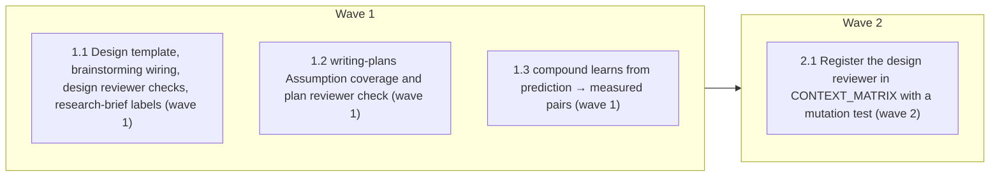

# Spec evidence rules: assumptions, negative claims, decision changes, number labels

<!-- AT-A-GLANCE:BEGIN (generated — do not edit; refreshed by render_plan.py --summarize) -->
## At a glance

**4 tasks · 2 waves · 13 files · 3/4 done**

| Wave | Task | Title | Files | Done (acceptance) |
|---|---|---|---|---|
| 1 | 1.1 | Design template, brainstorming wiring, design reviewer checks, research-brief labels (wave 1) | skills/brainstorming/references/design-template.md, skills/brainstorming/SKILL.md, skills/brainstorming/references/spec-review-loop.md, skills/brainstorming/spec-document-reviewer-prompt.md, skills/xia2/references/research-brief-template.md, tests/scripts/brainstorming-contract.test.sh | SC-1 and SC-4 return exit 0, and `skills/brainstorming/references/design-templat… |
| 1 | 1.2 | writing-plans Assumption coverage and plan reviewer check (wave 1) | skills/writing-plans/SKILL.md, skills/writing-plans/plan-document-reviewer-prompt.md, tests/scripts/writing-plans-contract.test.sh | SC-2 returns exit 0. |
| 1 | 1.3 | compound learns from prediction → measured pairs (wave 1) | skills/compound/SKILL.md, tests/scripts/compound-contract.test.sh | SC-3 returns exit 0. |
| 2 | 2.1 | Register the design reviewer in CONTEXT_MATRIX with a mutation test (wave 2) | scripts/render_skill_prompt.py, tests/scripts/context-propagation-regression.test.sh | SC-5 and SC-6 return exit 0. |

### Progress
- [x] 1.1 — Design template, brainstorming wiring, design reviewer checks, research-brief labels (wave 1)
- [x] 1.2 — writing-plans Assumption coverage and plan reviewer check (wave 1)
- [x] 1.3 — compound learns from prediction → measured pairs (wave 1)
- [ ] 2.1 — Register the design reviewer in CONTEXT_MATRIX with a mutation test (wave 2)
<!-- AT-A-GLANCE:END -->

## 1. Motivation

Issue #258 items 1, 2 and 4, as designed in `specs/gh-258-spec-evidence-rules/design.md` (approved
2026-10-08, with DC1 → D12). A `design.md` gains `What must be true`, `What we do not claim`, a
`Decisions` table with a change rule, and labels on load-bearing numbers. The design reviewer and
plan reviewer enforce them through their existing loops. `CONTEXT_MATRIX` mechanically checks that
the isolated design reviewer receives the template. Research: `research-brief.md`.

## 2. Non-goals

- Items 3, 5, 6 and 7 of #258.
- Any change to `hooks/`, `settings.json`, `templates/`, `skills/visual-planner/render_plan.py`, or
  `rules/*.md` (including `rules/plan-format.md`).
- Rewriting existing `specs/*/design.md` files to the new template.
- A script that lints design sections or number labels.

## Global Constraints

- Edit the source tree only (`skills/`, `tests/`, `scripts/render_skill_prompt.py`). Never edit
  `.claude/`; it is derived by `scripts/deploy-harness.sh`.
- Do not edit `VERSION` or `CHANGELOG.md`; post-merge bookkeeping owns them
  (`docs/solutions/harness/manual-version-bump-collides-with-event-sourced-bookkeeping.md`).
- Copy anchor strings from design §7 exactly, character for character, including the arrow in
  `prediction → measured`. Contract tests grep them as fixed strings, so each anchor must sit on
  one line: never wrap `` `measured <YYYY-MM-DD> <source>` ``, `To reopen a settled decision after
  approval`, `after the risk bullets`, `Assumption coverage` or `prediction → measured` across a
  line break, even where the surrounding prose wraps at about 100 columns.
- The three number labels are exactly `` `prediction` ``, `` `budget` `` and
  `` `measured <YYYY-MM-DD> <source>` ``. The evidence tiers are exactly `traceability`,
  `provenance`, `truth` and `none yet`. Decision statuses are exactly `settled` and
  `superseded by DC<n>`.
- In `skills/xia2/references/research-brief-template.md`: do not rename `## Docs Findings`, and do
  not add any of the phrases `external surface`, `upgrades a dependency`,
  `integrates an external system`, `version-specific API`, `local-only`
  (`tests/scripts/research-depth-drift.test.sh` pins them).
- Keep every anchor the existing contract tests pin: in `skills/compound/SKILL.md` the
  `| bug |`/`| knowledge |`/`| decision |`/`| failure |` rows, `scripts/rebuild_solution_index.py`,
  `Do not manually scan/sort/render`, `critical-patterns.md`, `proposed:`. In
  `skills/writing-plans/SKILL.md`: ``Read `rules/plan-format.md` ``, `design.md`,
  `research-brief.md`, `using-git-worktrees`, `subagent-driven-development`. In
  `skills/brainstorming/SKILL.md`: `<HARD-GATE>`, `Do not write code`, ``Invoke only `xia2` ``,
  `` `writing-plans` ``, `references/spec-review-loop.md`.
- Keep skill prose short and in the files' existing style. `SKILL.md` files are 45–54 lines today.
  Put the template content in `references/design-template.md`, not in `SKILL.md`.
- Tests follow the existing `tests/lib.sh` idiom (`t`, `pass`, `fail`, `finish`, `$ROOT`) and use
  `grep -qF` for fixed strings.

## 3. Success Criteria

| ID | Behavior (observable) | Check (re-runnable) | Expected |
|------|-------------------------|-----------------------|------------|
| SC-1 | The design template exists with its four sections, reopen pointer and three labels; brainstorming reads it; the design reviewer prompt carries the §6.1 checks and the template placeholder; the review loop passes the template path; the research-brief template carries the label rule | `bash tests/scripts/brainstorming-contract.test.sh` | exit 0 |
| SC-2 | writing-plans and the plan reviewer prompt both name `Assumption coverage`, and writing-plans states the after-the-risk-bullets position | `bash tests/scripts/writing-plans-contract.test.sh` | exit 0 |
| SC-3 | compound names the `prediction → measured` source and keeps its five pinned anchors | `bash tests/scripts/compound-contract.test.sh` | exit 0 |
| SC-4 | The research-depth external-surface drift guard still holds after the template edit | `bash tests/scripts/research-depth-drift.test.sh` | exit 0 |
| SC-5 | `CONTEXT_MATRIX` registers the design reviewer and the live prompt satisfies it | `python3 scripts/render_skill_prompt.py --check-all` | exit 0 |
| SC-6 | Deleting the design reviewer's template Read is detected by the matrix (mutation case), alongside the existing propagation cases | `bash tests/scripts/context-propagation-regression.test.sh` | exit 0 |

## 4. Tasks

### Task 1.1 — Design template, brainstorming wiring, design reviewer checks, research-brief labels (wave 1)

- **Files:** skills/brainstorming/references/design-template.md, skills/brainstorming/SKILL.md, skills/brainstorming/references/spec-review-loop.md, skills/brainstorming/spec-document-reviewer-prompt.md, skills/xia2/references/research-brief-template.md, tests/scripts/brainstorming-contract.test.sh
- **Action:** Test first: add to `tests/scripts/brainstorming-contract.test.sh` the design §7 checks
  1, 2, 3 and 5 as separate `t` cases using `grep -qF`, with the exact anchors listed in design §7.
  Run it and confirm the new cases fail. Then:
  (a) Create `skills/brainstorming/references/design-template.md`, modelled on
  `skills/xia2/references/research-brief-template.md`: a one-line purpose header; the existing
  free-form sections (Goal, Current state, Approaches considered, Architecture, Error behavior,
  Tests, Success criteria, Non-goals) as short headed stubs; then, after Non-goals and in this order,
  `## What must be true`, `## What we do not claim`, `## Decisions` (with the reopen pointer line of
  design §5.3 as a `>` quote above the table) and `## Decision changes`. State every rule of design
  §5.1–§5.4: the A-row columns and tier+source vocabulary, `none yet`,
  `accepted risk: <reason>`, `retired by DC<n>`, renumbering before approval only, `- none — <reason>`
  in each section, when a decision becomes `settled`, the revision-pass rule, the post-approval
  Rule 4 flow with the `### Deviations` pointer (stated as a deliberate extension of Rule 1–3
  reporting), the definition of load-bearing, the three labels, and keeping a replaced prediction.
  Do not include design §5.5 (plan-side).
  (b) In `skills/brainstorming/SKILL.md` step 5, before "Write the approved result", add an explicit
  instruction to Read `references/design-template.md` and write `design.md` to that template.
  (c) In `skills/brainstorming/references/spec-review-loop.md` step 1, pass the absolute path of
  `references/design-template.md` with the design path and text.
  (d) In `skills/brainstorming/spec-document-reviewer-prompt.md`, inside the fenced prompt, add
  `**Template:** [TEMPLATE_FILE_PATH]`, a line ``**Read `design-template.md`** at
  `[TEMPLATE_FILE_PATH]` before checking; it defines every rule below.`` (one line, so the
  `CONTEXT_MATRIX` Read regex matches it in Task 2.1; keep every other mention of
  `design-template.md` in that file off lines containing the word "Read"), and `What to Check` rows
  for the nine design §6.1 checks: a required section missing or placeholder (`- none — <reason>`
  valid); an `A<n>` with empty *Proven by* or *If false*, or *Evidence now* outside the tier+source
  vocabulary; non-sequential or reused `A`/`D`/`DC` IDs; an unlabelled load-bearing number; a
  status other than `settled` / `superseded by DC<n>`; a superseded row with no matching `DC<n>`; a
  `DC<n>` citing no evidence; a `DC<n>` whose new decision is not a settled row or whose reopened
  row is not marked superseded; a `## Decisions` table without the reopen pointer line. Use the words `What must be true`, `Proven by`, `load-bearing`, `superseded by`,
  `Decision changes` and `To reopen a settled decision`. State that the decision-change checks fire
  only in a revision pass.
  (e) In `skills/xia2/references/research-brief-template.md`, directly under the `## Evidence Ledger`
  intro line, add the number-label rule of design §5.4 (load-bearing definition, the three labels,
  keep a replaced prediction), noting that it complements the source labels.
- **Verify:** `bash tests/scripts/brainstorming-contract.test.sh && bash tests/scripts/research-depth-drift.test.sh`
- **Done:** SC-1 and SC-4 return exit 0, and `skills/brainstorming/references/design-template.md` exists.
- **Criteria:** SC-1, SC-4
- **Interfaces:** Consumes `specs/gh-258-spec-evidence-rules/design.md` (§5.1–§5.4, §6.1, §7). Produces `skills/brainstorming/references/design-template.md`, the edited `skills/brainstorming/spec-document-reviewer-prompt.md` with its one-line template Read, and the edited `skills/xia2/references/research-brief-template.md`.

### Task 1.2 — writing-plans Assumption coverage and plan reviewer check (wave 1)

- **Files:** skills/writing-plans/SKILL.md, skills/writing-plans/plan-document-reviewer-prompt.md, tests/scripts/writing-plans-contract.test.sh
- **Action:** Test first: add design §7 check 4 to `tests/scripts/writing-plans-contract.test.sh`
  (`Assumption coverage` in both files, `after the risk bullets` in `SKILL.md`, with `grep -qF`) and
  confirm it fails. Then:
  (a) In `skills/writing-plans/SKILL.md` step 5, as the first action before `check_plan_contract.py`,
  instruct the author to write `### Assumption coverage` in `## 5. Risks` per design §5.5: one line
  per design `A<n>` (`A<n> → SC-n`, `→ Task x.y`, or `→ accepted risk: <reason>`); placed after the
  risk bullets with a blank line (start Risks with `- none` when there are no risks), because
  `render_plan.py` cards only the first bullet list; `- none (design has no assumptions)` when the
  design's section is `- none — <reason>`; no subsection when the design has no
  `## What must be true` section or there is no `design.md`; and self-check that every named
  `SC-n`/task exists in the plan. Keep the step short. Two or three sentences plus the line format.
  (b) In `skills/writing-plans/plan-document-reviewer-prompt.md`, add one `What to Check` row named
  `Assumption coverage`: only for the chunk holding `## 5. Risks`, and only when the spec has
  `## What must be true`; report an `A<n>` missing or listed twice, a subsection before the risk
  bullets or with no blank line after them, or a missing subsection (one issue naming every
  `A<n>`); accept `- none (design has no assumptions)` when the design's section is `- none`.
- **Verify:** `bash tests/scripts/writing-plans-contract.test.sh`
- **Done:** SC-2 returns exit 0.
- **Criteria:** SC-2
- **Interfaces:** Consumes `specs/gh-258-spec-evidence-rules/design.md` (§5.5, §6.2). Produces the edited `skills/writing-plans/SKILL.md` and `skills/writing-plans/plan-document-reviewer-prompt.md`.

### Task 1.3 — compound learns from prediction → measured pairs (wave 1)

- **Files:** skills/compound/SKILL.md, tests/scripts/compound-contract.test.sh
- **Action:** Test first: add design §7 check 6 (`grep -qF 'prediction → measured'`) to
  `tests/scripts/compound-contract.test.sh` and confirm it fails. Then add one sentence to
  `## Extract and select` in `skills/compound/SKILL.md`: a spec number labelled
  `prediction → measured` (design-template number labels) is a learning source, since the gap
  between the two is evidence about how the team estimates. Leave the five pinned anchors unchanged.
- **Verify:** `bash tests/scripts/compound-contract.test.sh`
- **Done:** SC-3 returns exit 0.
- **Criteria:** SC-3
- **Interfaces:** Consumes `specs/gh-258-spec-evidence-rules/design.md` (§4 Compound row). Produces the edited `skills/compound/SKILL.md`.

### Task 2.1 — Register the design reviewer in CONTEXT_MATRIX with a mutation test (wave 2)

- **Files:** scripts/render_skill_prompt.py, tests/scripts/context-propagation-regression.test.sh
- **Action:** Test first: in `tests/scripts/context-propagation-regression.test.sh`, define
  `DESIGN_REVIEWER="skills/brainstorming/spec-document-reviewer-prompt.md"` and add a case
  "mutation: canonical matrix detects a missing design-reviewer template Read". It copies `skills/`
  to a temp dir, deletes the line with `` sed -i.bak '/Read `design-template\.md`/d' `` on the copy of
  `$DESIGN_REVIEWER` (then removes the `.bak`), and asserts `python3 "$ROOT/$COMPOSER" --root <tmp> --check-all` exits non-zero.
  Follow the existing plan-reviewer mutation case's shape (mktemp, `_CLEANUP_DIRS`). Confirm the new
  case fails before the matrix entry exists. Then add to `CONTEXT_MATRIX` in
  `scripts/render_skill_prompt.py` the entry `"spec-document-reviewer": {"path":
  "skills/brainstorming/spec-document-reviewer-prompt.md", "required": ["design-template.md"],
  "required_reads": ["design-template.md"]}`, placed beside `plan-document-reviewer`.
- **Verify:** `python3 scripts/render_skill_prompt.py --check-all && bash tests/scripts/context-propagation-regression.test.sh`
- **Done:** SC-5 and SC-6 return exit 0.
- **Criteria:** SC-5, SC-6
- **Interfaces:** Consumes `skills/brainstorming/spec-document-reviewer-prompt.md` (its one-line template Read from Task 1.1). Produces the edited `scripts/render_skill_prompt.py` and `tests/scripts/context-propagation-regression.test.sh`.

## 5. Risks

- **Template drift between two copies** — the number-label rule lives in `design-template.md` and `research-brief-template.md`. Mitigation: SC-1 greps the same label string in both files (design §7 checks 2 and 5).
- **Pinned anchors broken by an edit** — compound, writing-plans and brainstorming contract tests pin existing strings, and `research-depth-drift` pins five phrases in the brief template. Mitigation: Global Constraints list every anchor; SC-1 to SC-4 re-run them.
- **Reviewer judgment** — the reviewers' application of "load-bearing" and the §6.1 checks is judgment-tier. Mitigation: one post-implementation dry run (design §8 criterion 4), recorded in `SUMMARY.md` `### Not auto-verified`.
- **CI warn tier** — Task 2.1 edits `scripts/`, so `ci-strict-gate.sh` reports a warning that needs a high-risk `SUMMARY.md` with Verify rows that re-run clean. Mitigation: the lane is already high-risk, and the SUMMARY Verify rows cite SC-1 to SC-6.
- The full suite (`bash scripts/run-tests.sh`) is not an SC row; it runs at `finishing-a-development-branch` (design §8 criterion 2).

### Assumption coverage

- A1 → accepted risk: the contract test and SC-5 show only that the loop reference, prompt text and template Read exist; nothing re-runs the dispatch.
- A2 → accepted risk: judgment-tier until the post-implementation dry run of design §8 criterion 4.
- A3 → SC-2
- A4 → accepted risk: no targeted test parses design sections; the full suite runs in prose at finishing.
- A5 → SC-2

## 6. Status Log

- 2026-10-08 — plan written.
- 2026-10-08 — tasks 1.1, 1.2, 1.3 complete; commits 50d1343, 8fe2736, 908f750; task reviews spec pass / quality approved (Minor findings recorded in SUMMARY); controller re-ran each Verify, exit 0.
