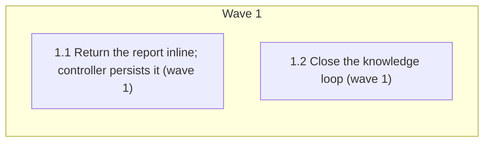

# SDD report handoff: implementer returns inline, controller persists the file

<!-- AT-A-GLANCE:BEGIN (generated — do not edit; refreshed by render_plan.py --summarize) -->
## At a glance

**2 tasks · 1 waves · 7 files · 2/2 done**

| Wave | Task | Title | Files | Done (acceptance) |
|---|---|---|---|---|
| 1 | 1.1 | Return the report inline; controller persists it (wave 1) | skills/subagent-driven-development/implementer-prompt.md, skills/subagent-driven-development/SKILL.md, rules/orchestration.md, tests/scripts/sdd-artifact-handoffs.test.sh | SC-1, SC-2 and SC-3 return exit 0. |
| 1 | 1.2 | Close the knowledge loop (wave 1) | docs/harness-experimental/improvement-backlog.md, docs/solutions/harness/sdd-report-file-handoff-refused-for-subagents.md, docs/solutions/INDEX.md | SC-4 and SC-5 return exit 0. |

### Progress
- [x] 1.1 — Return the report inline; controller persists it (wave 1)
- [x] 1.2 — Close the knowledge loop (wave 1)
<!-- AT-A-GLANCE:END -->

## 1. Motivation

Issue #261. The SDD implementer prompt tells each implementer to write its report file, but the
runtime refuses subagent report-file writes. This was observed on 2/2 implementers in
`opus-5-5-review-bindings` and 4/4 in gh-258. Each implementer improvises, and the controller
transcribes by hand without any instruction to. Approach A (user choice): the implementer returns
the full report inline, and the controller persists it. Design:
`specs/gh-261-sdd-report-handoff/design.md`.

## 2. Non-goals

- Changing `task-reviewer-prompt.md`, `IMPLEMENTER_REPORT_PATH`, or `scripts/check_task_review_contract.py`.
- Reducing the controller's context, or verifying that transcription is verbatim.
- #262 and the other open issues.

## Global Constraints

- Edit the source tree only; never `.claude/`.
- Do not edit `VERSION` or `CHANGELOG.md`.
- Exact phrases, each kept on a single line because tests grep them as fixed strings:
  `do not write a report file` (implementer prompt), `the controller writes it verbatim to`
  (SDD SKILL.md), `report-<task>.md` (SDD SKILL.md). The checks are case-sensitive: keep each phrase
  lowercase, mid-sentence (not "Do not write…" at a sentence start).
- `rules/orchestration.md` must no longer contain `the full contract goes in the report file`.
- Keep every existing anchor that tests pin. In `implementer-prompt.md`, keep the
  `FIRST: Read` … `auto-correct-scope.md` line and the report fields. In SDD `SKILL.md`, keep
  `task_brief.py`, `review_package.py`, `task-reviewer-prompt.md`, and the text
  "Never paste history or report contents".
- `sdd-artifact-handoffs.test.sh` keeps its own style: `set -euo pipefail`, bare `grep -q`/`grep -qF`
  assertions, and the final `echo 'sdd-artifact-handoffs: passed'`.

## 3. Success Criteria

| ID | Behavior (observable) | Check (re-runnable) | Expected |
|------|-------------------------|-----------------------|------------|
| SC-1 | The implementer prompt says to return the report inline and not write a file. SDD SKILL.md names the controller as the writer of `report-<task>.md`. orchestration.md no longer puts the contract in an implementer-written file. | `bash tests/scripts/sdd-artifact-handoffs.test.sh` | exit 0 |
| SC-2 | The task-reviewer contract is unchanged and still complete | `python3 scripts/check_task_review_contract.py` | exit 0 |
| SC-3 | Every isolated-prompt delivery still holds | `python3 scripts/render_skill_prompt.py --check-all` | exit 0 |
| SC-4 | The backlog row is closed, and the solution entry's guardrail is in force and lists orchestration.md | `python3 -c "import sys;b=open('docs/harness-experimental/improvement-backlog.md').read();s=open('docs/solutions/harness/sdd-report-file-handoff-refused-for-subagents.md').read();sys.exit(0 if 'done (2026-10-09, gh-261)' in b and 'existing:' in s and 'proposed:' not in s and 'rules/orchestration.md' in s else 1)"` | exit 0 |
| SC-5 | The solution INDEX entries and order match a fresh rebuild (the date-only `Last updated` line is ignored) | `python3 -c "import subprocess,sys;n=subprocess.run([sys.executable,'scripts/rebuild_solution_index.py','--dry-run'],capture_output=True,text=True).stdout;f=open('docs/solutions/INDEX.md').read();k=lambda t:[l for l in t.splitlines() if not l.startswith('> Last updated')];sys.exit(0 if k(n)==k(f) else 1)"` | exit 0 |

## 4. Tasks

### Task 1.1 — Return the report inline; controller persists it (wave 1)

- **Files:** skills/subagent-driven-development/implementer-prompt.md, skills/subagent-driven-development/SKILL.md, rules/orchestration.md, tests/scripts/sdd-artifact-handoffs.test.sh
- **Action:** Test first. Before the final `echo` in `tests/scripts/sdd-artifact-handoffs.test.sh`,
  add fixed-string `grep -qF` assertions:
  - `implementer-prompt.md` contains `do not write a report file`;
  - `implementer-prompt.md` does not contain `[IMPLEMENTER_REPORT_PATH]`;
  - SDD `SKILL.md` contains `the controller writes it verbatim to` and `report-<task>.md`;
  - `rules/orchestration.md` does not contain `the full contract goes in the report file`.

  Write each absence check as `if grep -qF '<phrase>' "$root/<file>"; then exit 1; fi`, never as
  `! grep …`: under `set -e` a `!`-negated command never aborts, so the check would be a no-op.
  Run the test and confirm it fails. Each of the four checks must fail against the current text. Then apply design §4.1–§4.3:
  1. In `implementer-prompt.md` Report Format, replace the "Write the detailed structured contract
     below to `[IMPLEMENTER_REPORT_PATH]`, then return only …" sentence. The new text says to
     return the full structured report below in the final message, and to not write a report
     file, because the controller persists it. Keep every report field.
  2. In SDD `SKILL.md` Execute waves, first bullet, keep `task_brief.py` and `[LANE]`. State the
     following:
     - The implementer returns the full structured report inline.
     - On `DONE` or `DONE_WITH_CONCERNS`, before building the review package, the controller
       writes it verbatim to `.harness-state/sdd/report-<task>.md` under a one-line
       "transcribed by controller" header, and passes that path to the task reviewer.
     - After a fix dispatch, the controller overwrites the file with the latest report.
     - `BLOCKED` and `NEEDS_CONTEXT` returns write no file.
     - Record non-`none` deltas in SUMMARY.
     - Never paste history or report contents.
  3. In `rules/orchestration.md` Subagent contract, reword the file-handoff sentence. Under
     `subagent-driven-development`, the implementer returns the full contract inline, because the
     runtime refuses subagent report-file writes. The controller persists it to
     `.harness-state/sdd/` for the task reviewer. That full report is what the main thread needs,
     so it does not contradict the "no raw file dumps" line. Do not restate the old phrase in any
     form (no "previously…" aside), or the absence check rejects the edit.
- **Verify:** `bash tests/scripts/sdd-artifact-handoffs.test.sh`
- **Done:** SC-1, SC-2 and SC-3 return exit 0.
- **Criteria:** SC-1, SC-2, SC-3
- **Interfaces:** Consumes `specs/gh-261-sdd-report-handoff/design.md` (§4.1–§4.4). Produces the edited `skills/subagent-driven-development/implementer-prompt.md`, `skills/subagent-driven-development/SKILL.md`, `rules/orchestration.md`, and `tests/scripts/sdd-artifact-handoffs.test.sh`.

### Task 1.2 — Close the knowledge loop (wave 1)

- **Files:** docs/harness-experimental/improvement-backlog.md, docs/solutions/harness/sdd-report-file-handoff-refused-for-subagents.md, docs/solutions/INDEX.md
- **Action:**
  1. In `docs/harness-experimental/improvement-backlog.md`, set the Status cell of the
     `sdd-report-file-handoff-refused-for-subagents` row to `done (2026-10-09, gh-261)`.
  2. In `docs/solutions/harness/sdd-report-file-handoff-refused-for-subagents.md`:
     - change the Guardrail paragraph from `proposed:` to `existing:`. Name the changed files
       (`implementer-prompt.md` Report Format, the SDD `SKILL.md` Execute-waves bullet,
       `rules/orchestration.md` Subagent contract) and the presence checks in
       `tests/scripts/sdd-artifact-handoffs.test.sh`. Note that the guard lives in the handoff's
       own suite rather than the context-propagation regression test;
     - add `rules/orchestration.md` to `affects:`;
     - set `confirmed_at: 2026-10-09`.
  3. Run `python3 scripts/rebuild_solution_index.py`.
- **Verify:** `python3 -c "import subprocess,sys;n=subprocess.run([sys.executable,'scripts/rebuild_solution_index.py','--dry-run'],capture_output=True,text=True).stdout;f=open('docs/solutions/INDEX.md').read();k=lambda t:[l for l in t.splitlines() if not l.startswith('> Last updated')];sys.exit(0 if k(n)==k(f) else 1)"`
- **Done:** SC-4 and SC-5 return exit 0.
- **Criteria:** SC-4, SC-5
- **Interfaces:** Consumes `specs/gh-261-sdd-report-handoff/design.md` (§4.5). Produces the edited `docs/harness-experimental/improvement-backlog.md`, `docs/solutions/harness/sdd-report-file-handoff-refused-for-subagents.md`, and the rebuilt `docs/solutions/INDEX.md`.

## 5. Risks

- **Fixed-string drift.** The test greps exact phrases, so a reword can break it. Mitigation: Global Constraints pin each phrase on a single line.
- **Stale INDEX.** No CI step runs the rebuild. Mitigation: SC-5 checks it. `rebuild_solution_index.py --check` also compares the `Last updated` date, so it fails on any day after the last rebuild (true on `main` today). SC-5 therefore compares everything except that line.
- **Transcription accuracy.** Whether the controller copies the report verbatim is judgment-tier. The header only marks the file's origin. This goes in `### Not auto-verified`.
- The full suite (`bash scripts/run-tests.sh`) is not an SC row. It runs at `finishing-a-development-branch`.

## 6. Status Log

- 2026-10-09 — plan written.
- 2026-10-09 — tasks 1.1, 1.2 complete; commits 7523f0c, 6a36b3c, fix rounds 974e686, cf0567d; task reviews spec pass / quality approved (Minor findings in SUMMARY); controller re-ran SC-1..SC-5 and the full suite, green.
