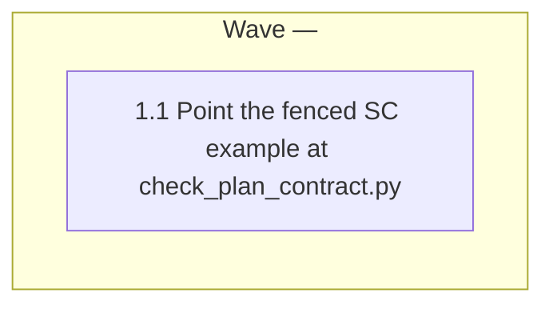

# plan-format SC example: use a command that exists

<!-- AT-A-GLANCE:BEGIN (generated — do not edit; refreshed by render_plan.py --summarize) -->
## At a glance

**1 tasks · 1 waves · 1 files · 1/1 done**

| Wave | Task | Title | Files | Done (acceptance) |
|---|---|---|---|---|
| — | 1.1 | Point the fenced SC example at check_plan_contract.py | rules/plan-format.md | SC-1 exits 1, SC-2 exits 0, SC-3 exits 0. |



### Progress
- [x] 1.1 — Point the fenced SC example at check_plan_contract.py
<!-- AT-A-GLANCE:END -->

## 1. Motivation

Issue #263. The fenced Success Criteria example in `rules/plan-format.md` calls
`verify_summary.py --lint`, a flag that never existed; it exits 2 instead of the `exit 1` /
`exit 0` the example promises. Design: `specs/gh-263-plan-format-lint-example/design.md`.

## 2. Non-goals

- A lint or test that checks fenced command examples against `--help`.
- Any other edit to `rules/plan-format.md`, or any other file outside `specs/`.

## Global Constraints

- Edit only `rules/plan-format.md` lines 99–100, the two rows of the fenced example. Never edit `.claude/`.
- Use the design §4 replacement rows verbatim, including the `—` dash in "exit 1 — no SC rows".
- Keep the rows inside the existing ```` ```markdown ```` fence.
- Do not edit `VERSION` or `CHANGELOG.md`.

## 3. Success Criteria

| ID | Behavior (observable) | Check (re-runnable) | Expected |
|------|-------------------------|-----------------------|------------|
| SC-1 | `rules/plan-format.md` no longer calls the nonexistent `--lint` flag | `grep -qF 'verify_summary.py --lint' rules/plan-format.md` | exit 1 — no match |
| SC-2 | Both example rows call `check_plan_contract.py specs/<slug>/PLAN.md` and carry the design §4 Behavior and Expected text | `python3 -c "import sys;t=open('rules/plan-format.md').read();sys.exit(0 if t.count('python3 scripts/check_plan_contract.py specs/<slug>/PLAN.md')==2 and all(x in t for x in ['without SC rows is rejected','A well-formed SC table passes the contract check','exit 1 — no SC rows']) else 1)"` | exit 0 |
| SC-3 | The example's command exits 1 on a contract plan without SC rows (stating that cause) and 0 on a well-formed one | `python3 -c "import subprocess,sys,tempfile,os;B=chr(124);T=chr(96);R=lambda c:B+B.join(c)+B;g='## Global Constraints\n\n- Safe\n\n';s='## 3. Success Criteria\n\n'+R([' ID ',' B ',' C ',' E '])+'\n'+R([' --- ']*4)+'\n'+R([' SC-1 ',' w ',' true ',' exit 0 '])+'\n\n';t='## 4. Tasks\n\n### Task 1.1 - x\n\n- **Files:** x\n- **Action:** x\n- **Verify:** true\n- **Done:** x\n- **Criteria:** SC-1\n- **Interfaces:** Consumes: input. Produces: '+T+'o.py'+T+'.\n';d=tempfile.mkdtemp();p=lambda n,x:(open(os.path.join(d,n),'w').write(x),os.path.join(d,n))[1];r=lambda f:subprocess.run([sys.executable,'scripts/check_plan_contract.py',f],capture_output=True,text=True);a=r(p('bad.md',g+t));b=r(p('ok.md',g+s+t));sys.exit(0 if a.returncode==1 and 'Success Criteria table has no SC rows' in a.stderr and b.returncode==0 else 1)"` | exit 0 |

## 4. Tasks

### Task 1.1 — Point the fenced SC example at check_plan_contract.py

- **Files:** rules/plan-format.md
- **Action:** Run SC-1 first and confirm it exits 0 (the bad flag is present). Then replace the
  two fenced example rows at `rules/plan-format.md:99-100` with the design §4 rows:
  SC-1 "A contract plan (declares `## Global Constraints`) without SC rows is rejected" with
  `python3 scripts/check_plan_contract.py specs/<slug>/PLAN.md` and Expected
  `exit 1 — no SC rows`; SC-2 "A well-formed SC table passes the contract check" with the same
  command and Expected `exit 0`. Leave the fence and every other line unchanged.
- **Verify:** `python3 -c "import sys;t=open('rules/plan-format.md').read();sys.exit(0 if t.count('python3 scripts/check_plan_contract.py specs/<slug>/PLAN.md')==2 and 'verify_summary.py --lint' not in t else 1)"`
- **Done:** SC-1 exits 1, SC-2 exits 0, SC-3 exits 0.
- **Criteria:** SC-1, SC-2, SC-3
- **Interfaces:** Consumes `specs/gh-263-plan-format-lint-example/design.md` (§4 rows). Produces the edited `rules/plan-format.md`.

## 5. Risks

- **Example over-reads the exit-1 cause** — `check_plan_contract.py` also exits 1 for other contract defects; "exit 1 — no SC rows" names only the illustrated one. Mitigation: SC-3 asserts the stated cause appears in the checker's output; the illustration stays fenced.
- **SC-3 does not observe the edit** — it proves the example's claim (the checker's exit codes) is true, before and after the fix; SC-1 and SC-2 are what observe the edited file.
- The full suite (`bash scripts/run-tests.sh`) is not an SC row; it runs at `finishing-a-development-branch` (it includes the doc-truth lint over `rules/*.md`).

## 6. Status Log

- 2026-10-09 — plan written.
- 2026-10-09 — task 1.1 complete; commit 1c29222; task review spec pass / quality approved (Minor: reviewer could not run checks; controller re-ran SC-1..SC-3 and the full suite, green).
