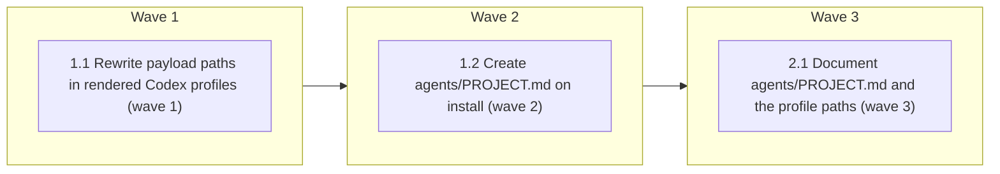

# Codex agent profiles cite paths a Codex install has

<!-- AT-A-GLANCE:BEGIN (generated — do not edit; refreshed by render_plan.py --summarize) -->
## At a glance

**3 tasks · 3 waves · 5 files · 0/3 done**

| Wave | Task | Title | Files | Done (acceptance) |
|---|---|---|---|---|
| 1 | 1.1 | Rewrite payload paths in rendered Codex profiles (wave 1) | scripts/render_codex_adapter.py, scripts/test_render_codex_adapter.py | The file's tests pass, including the new `agent_profile` group. |
| 2 | 1.2 | Create agents/PROJECT.md on install (wave 2) | scripts/install-codex-harness.sh, tests/scripts/codex-install-next-step.test.sh | The suite exits 0; `bash -n scripts/install-codex-harness.sh` exits 0; `bash tes… |
| 3 | 2.1 | Document agents/PROJECT.md and the profile paths (wave 3) | docs/codex-alpha-install.md | That check exits 0 and `bash scripts/lint-doc-truth.sh` exits 0. |

### Progress
- [ ] 1.1 — Rewrite payload paths in rendered Codex profiles (wave 1)
- [ ] 1.2 — Create agents/PROJECT.md on install (wave 2)
- [ ] 2.1 — Document agents/PROJECT.md and the profile paths (wave 3)
<!-- AT-A-GLANCE:END -->

## 1. Motivation

Issue #268 (tracking #257), stacked on #255 / PR #271. Rendered `.codex/agents/*.toml` profiles
cite `rules/orchestration.md`, `rules/auto-correct-scope.md`, and `rules/behavior.md` by bare
source paths, and `agents/PROJECT.md`, none of which resolve in a Codex-only install. Design:
`specs/gh-268-codex-agent-profile-paths/design.md` (rewrite the decoded `developer_instructions`
with #253's `rewrite_payload_paths`; the Codex installer creates `agents/PROJECT.md`, seeded from
`.claude/agents/PROJECT.md` when present, else from the template). Research:
`specs/gh-268-codex-agent-profile-paths/research-brief.md`.

## 2. Non-goals

- Changing source `agents/*.md` or Claude render output.
- Rewriting the copied `agents/PROJECT.md`, or keeping it in sync with `.claude/agents/PROJECT.md`.
- Live evidence of Codex child-context loading (#269).

## Global Constraints

- Run `bash scripts/run-tests.sh` before the first `scripts/` edit and once after all tasks;
  record the result in SUMMARY prose, never as a Verify row.
- Source `agents/*.md`, `scripts/render_agent_definitions.py`, and Claude deploy/install output
  stay unchanged.
- Rewrite only the decoded `developer_instructions` string (never the encoded TOML text), re-encode
  with `json.dumps(…, ensure_ascii=False)`, and re-validate with `parse_codex_profile`; output stays
  byte-deterministic.
- Installer additions run only inside the existing `GI_RUN` tail, never fail the install, and
  never edit trust.
- Bash stays macOS 3.2 compatible; Python 3 stdlib only; tests use the fake Codex.
- Verify commands are pipe-free, a single command, and finish in under 60 s.

## 3. Success Criteria

| ID | Behavior (observable) | Check (re-runnable) | Expected |
| --- | --- | --- | --- |
| SC-1 | Rendered `coding.toml` and `reviewer.toml` cite `.codex/.agent-harness/payload/rules/…` and no bare payload-eligible path remains in any profile's decoded instructions; `agents/PROJECT.md` and `agents/runtime-bindings.json` stay bare; every profile parses and two renders are byte-identical | `python3 -m pytest scripts/test_render_codex_adapter.py -q -k agent_profile` | exit 0 |
| SC-2 | Existing renderer behaviour holds, including Claude rendering unchanged and the payload closure | `python3 -m pytest scripts/test_render_codex_adapter.py -q` | exit 0 |
| SC-3 | Install creates `agents/PROJECT.md` from the template (its line printed), seeds it from `.claude/agents/PROJECT.md` when that exists (its line printed), leaves an existing one byte-identical (its line printed), prints the skip line for a source without the template, creates none under `--dry-run`, and `--remove` leaves it | `bash tests/scripts/codex-install-next-step.test.sh` | exit 0 |
| SC-4 | Existing Codex install suite still passes (the `.gitignore` suite is checked in Task 1.2's Done) | `bash tests/scripts/codex-install.test.sh` | exit 0 |
| SC-5 | Docs list `agents/PROJECT.md` among the files written outside `.codex/` and quote its installer lines | `python3 -c "import pathlib,sys; t=pathlib.Path('docs/codex-alpha-install.md').read_text(encoding='utf-8'); sys.exit(0 if all(k in t for k in ('agents/PROJECT.md', 'four things', 'created agents/PROJECT.md from the template', 'created agents/PROJECT.md from .claude/agents/PROJECT.md', 'agents/PROJECT.md exists; left as is', 'four more steps', 'skipping agents/PROJECT.md')) else 1)"` | exit 0 |

## 4. Tasks

### Task 1.1 — Rewrite payload paths in rendered Codex profiles (wave 1)

- **Files:** scripts/render_codex_adapter.py, scripts/test_render_codex_adapter.py
- **Action:** Write failing tests first, named `test_agent_profile_*` so `-k agent_profile`
  selects them: `coding.toml` decoded instructions contain
  `.codex/.agent-harness/payload/rules/auto-correct-scope.md` and
  `.codex/.agent-harness/payload/rules/orchestration.md`; `reviewer.toml` contains
  `.codex/.agent-harness/payload/rules/behavior.md`; no profile's decoded instructions has a bare
  payload-eligible path (reuse the closure test's eligible-set helper), and every
  `PREFIXED_TOKEN` match in decoded instructions is a file under the payload (mirroring
  `test_payload_closure_every_helper_reference_resolves`); `agents/PROJECT.md` and
  `agents/runtime-bindings.json` stay bare; every profile passes `parse_codex_profile`; two renders
  are byte-identical. Then implement per `design.md` §Components 1: in `render()`, once the
  payload targets are known, for each `agents_dir/*.toml` find the single
  `developer_instructions = ` line, `json.loads` its value, apply `rewrite_payload_paths`,
  replace the line with `json.dumps(…, ensure_ascii=False)`, write the file, and validate it with
  `render_agent_definitions.parse_codex_profile` (a `ContractError` propagates as today).
- **Verify:** `python3 -m pytest scripts/test_render_codex_adapter.py -q`
- **Done:** The file's tests pass, including the new `agent_profile` group.
- **Criteria:** SC-1, SC-2
- **Interfaces:** Consumes the rendered agent profiles and the payload targets; produces rewritten `.codex/agents/*.toml` from `scripts/render_codex_adapter.py`.

### Task 1.2 — Create agents/PROJECT.md on install (wave 2)

- **Files:** scripts/install-codex-harness.sh, tests/scripts/codex-install-next-step.test.sh
- **Action:** Write the failing cases first in the existing suite: fresh install (`--source
  "$ROOT"`) creates `agents/PROJECT.md` byte-equal to `$ROOT/agents/PROJECT.template.md` and prints
  `codex-install: created agents/PROJECT.md from the template; fill in its Test execution section.`;
  a target with `.claude/agents/PROJECT.md` (any content) gets a root copy byte-equal to it and
  prints `codex-install: created agents/PROJECT.md from .claude/agents/PROJECT.md; Codex agents read the root copy, so keep the two in step.`;
  a target with an existing `agents/PROJECT.md` keeps it byte-identical and prints
  `codex-install: agents/PROJECT.md exists; left as is.`; the existing stub `--source` (no
  template) prints `codex-install: agents/PROJECT.template.md not in this source checkout; skipping agents/PROJECT.md.`
  and creates no `agents/` directory; `--dry-run` creates no `agents/PROJECT.md` (assert it before the install that follows on the
  same target); `--remove` leaves it. Tighten the existing init-structure skip assertion to its full line
  (`codex-install: init-structure.sh not in this source checkout; skipping the workflow structure.`).
  Then implement per `design.md` §Components 2 inside the `GI_RUN` tail, after the
  `init-structure.sh` call and before the doctor: `[ -e ]` test on the target file;
  `mkdir -p "$TARGET_DIR/agents"` only in the two copy branches; every command guarded.
- **Verify:** `bash tests/scripts/codex-install-next-step.test.sh`
- **Done:** The suite exits 0; `bash -n scripts/install-codex-harness.sh` exits 0;
  `bash tests/scripts/codex-install.test.sh` and `bash tests/scripts/codex-install-gitignore.test.sh`
  exit 0.
- **Criteria:** SC-3, SC-4
- **Interfaces:** Consumes the source template and an existing Claude copy; produces the `agents/PROJECT.md` step in `scripts/install-codex-harness.sh`.

### Task 2.1 — Document agents/PROJECT.md and the profile paths (wave 3)

- **Files:** docs/codex-alpha-install.md
- **Action:** Change "After a successful install, the installer runs three more steps" to four
  and insert the new step as step 2 (after workflow structure, before the doctor), renumbering
  the rest. Change "Outside `.codex/`, it writes three things" to four, adding
  `agents/PROJECT.md` (created only when missing; seeded from `.claude/agents/PROJECT.md` when
  present, else from the template; user-owned, meant to be committed, left by `--remove`). In the
  installer-output section, quote the four `agents/PROJECT.md` lines exactly as implemented in
  `scripts/install-codex-harness.sh`, say what to fill in (the *Test execution* section the coding
  and test-runner agents read), and note that after the first seed the root copy and
  `.claude/agents/PROJECT.md` are separate files. Add one sentence that the rendered
  `.codex/agents/*.toml` profiles point at the payload copies of the rules they cite.
- **Verify:** `python3 -c "import pathlib,sys; t=pathlib.Path('docs/codex-alpha-install.md').read_text(encoding='utf-8'); sys.exit(0 if all(k in t for k in ('agents/PROJECT.md', 'four things', 'created agents/PROJECT.md from the template', 'created agents/PROJECT.md from .claude/agents/PROJECT.md', 'agents/PROJECT.md exists; left as is', 'four more steps', 'skipping agents/PROJECT.md')) else 1)"`
- **Done:** That check exits 0 and `bash scripts/lint-doc-truth.sh` exits 0.
- **Criteria:** SC-5
- **Interfaces:** Consumes the installer lines from Task 1.2; produces the updated `docs/codex-alpha-install.md`.

## 5. Risks

- Task 1.2's suite runs the renderer Task 1.1 edits, so 1.2 runs in wave 2.
- A future agent body citing a non-payload path stays bare; the extended closure test covers
  payload-eligible paths only.

## 6. Status Log

- 2026-10-09 — plan written from the approved design and research brief.
- 2026-10-09 — revised after plan review (doc step count, payload-existence half of the closure test, SC-5 tokens); plan review approved.
