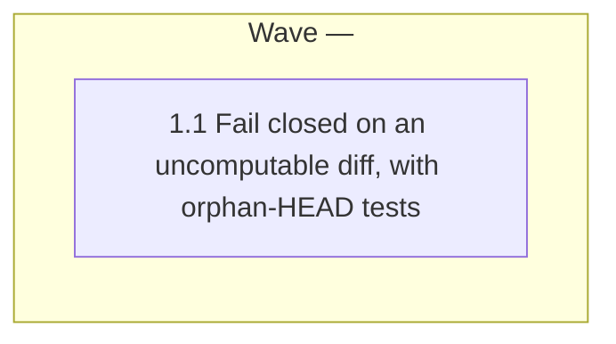

# ci-strict-gate fails closed when BASE and HEAD share no merge base

<!-- AT-A-GLANCE:BEGIN (generated — do not edit; refreshed by render_plan.py --summarize) -->
## At a glance

**1 tasks · 1 waves · 2 files · 1/1 done**

| Wave | Task | Title | Files | Done (acceptance) |
|---|---|---|---|---|
| — | 1.1 | Fail closed on an uncomputable diff, with orphan-HEAD tests | scripts/ci-strict-gate.sh, tests/scripts/ci-strict-gate.test.sh | The test file prints `ci-strict-gate.test.sh: 49 passed` (47 existing + 2 new), … |

### Progress
- [x] 1.1 — Fail closed on an uncomputable diff, with orphan-HEAD tests
<!-- AT-A-GLANCE:END -->

## 1. Motivation

`scripts/ci-strict-gate.sh:82-83` computes the PR diff with
`git diff --name-only "$BASE"...HEAD 2>/dev/null || true` and exits 0 when the result is empty.
When `$BASE` and `HEAD` share no merge base, git exits 128 (`fatal: ...: no merge base`, git
2.43.0), the error is discarded, `DIFF` is empty, and the strict gate reports success having
inspected nothing — in default mode and under every `REQUIRE_*` flag (issue #277). A diff the gate
cannot compute must be an error, not an empty diff.

## 2. Non-goals

- Choosing or validating the right base ref — `scripts/resolve-base-ref.sh` and the explicit-base
  check at `scripts/ci-strict-gate.sh:42-48` own that.
- Changing any tier, shipping-section, or SC-history logic beyond the diff computation.
- The "fail only when a `REQUIRE_*` flag is set" reading of the issue — rejected at intake
  (`SUMMARY.md` → Alternatives considered).

## 3. Success Criteria

| ID | Behavior (observable) | Check (re-runnable) | Expected |
|------|-------------------------|-----------------------|------------|
| SC-1 | An orphan HEAD with no history in common with the base makes the gate exit 1 with a stderr message containing `no merge base between`, in default mode and under `REQUIRE_SC_STABLE=1`; a normal empty-gated diff still exits 0 (all existing cases keep passing) | `bash tests/scripts/ci-strict-gate.test.sh` | exit 0 — every case passes, including the two new orphan-HEAD cases |
| SC-2 | The diff line no longer discards git's exit status with an or-true fallback | `grep -n -e 'DIFF=.*true' scripts/ci-strict-gate.sh` | exit 1 — no matching line |

## Global Constraints

- Change only `scripts/ci-strict-gate.sh` and `tests/scripts/ci-strict-gate.test.sh`.
- Keep `set -uo pipefail` semantics; do not add `set -e`.
- An empty diff from a `git diff` that exits 0 still exits 0 silently, as today.
- Any non-zero `git diff` exit fails closed with exit 1; the stderr message starts with
  `ci-strict-gate:` like the script's other errors, and names the missing merge base when
  `git merge-base "$BASE" HEAD` also fails.
- Portable to bash 3.2 (macOS) and GNU userland (ubuntu CI): no `timeout`, no GNU-only flags.

## 4. Tasks

### Task 1.1 — Fail closed on an uncomputable diff, with orphan-HEAD tests

- **Files:** scripts/ci-strict-gate.sh, tests/scripts/ci-strict-gate.test.sh
- **Action:** Test-first. In `tests/scripts/ci-strict-gate.test.sh`, after the
  "unresolvable explicit base" cases, add a helper that builds an orphan branch in a `mkrepo`
  fixture (`git checkout -q --orphan`, `git rm -rqf .`, commit a `hooks/foo.sh` so the diff would
  be gated if computed) and runs the gate with the original base commit sha. Add two cases:
  default mode → `assert_rc_contains 1 "no merge base between"`; `REQUIRE_SC_STABLE=1` → the same
  assertion. Assert on that script-owned phrase, not bare `merge base`: git's own fatal
  (`...HEAD: no merge base`) already contains `merge base` and would let a fix that only drops
  `|| true` pass without the required message.
  Run the file and confirm both new cases fail against the current script (exit 0). Then in
  `scripts/ci-strict-gate.sh` replace lines 82-83 so the `git diff` exit status is captured
  instead of discarded with `|| true`: on a non-zero status, print a `ci-strict-gate:` error to
  stderr — naming "no merge base between '$BASE' and HEAD" when `git merge-base "$BASE" HEAD`
  also fails, else git's own failure — and exit 1; on status 0 keep the existing empty-diff
  `exit 0`. Update the comment at lines 33-35, which describes the old `|| true` swallowing, so
  it no longer describes code that no longer exists. Leave the `MERGE_BASE=` line
  (`scripts/ci-strict-gate.sh:110`) unchanged: a `"$BASE"...HEAD` diff succeeds only when a
  merge base exists, so that line cannot reach its fallback after the fix; record this in
  `SUMMARY.md` Rationale.
- **Verify:** `bash tests/scripts/ci-strict-gate.test.sh`
- **Done:** The test file prints `ci-strict-gate.test.sh: 49 passed` (47 existing + 2 new), no
  `FAILED`, and exits 0; before the script change the 2 new cases fail; `grep -n -e 'DIFF=.*true' scripts/ci-strict-gate.sh`
  exits 1.
- **Criteria:** SC-1, SC-2
- **Interfaces:** Consumes: the existing mkrepo and assert_rc_contains test helpers. Produces: `scripts/ci-strict-gate.sh`, `tests/scripts/ci-strict-gate.test.sh`.

## 5. Risks

- A PR whose base was force-pushed so history diverged now fails CI instead of passing — that is
  the intended behavior, and the stderr message names the cause.
- `scripts/` is the WARN tier of this same gate, so this PR's own CI run reports missing
  high-risk proof as a warning only (not blocking without `REQUIRE_SCRIPTS_PROOF=1`).

## 6. Status Log

- 2026-10-09 — plan written (normal lane, one task).
- 2026-10-09 — task 1.1 complete; commit fa6162f (task review: spec pass, quality approved, 1 Minor).
