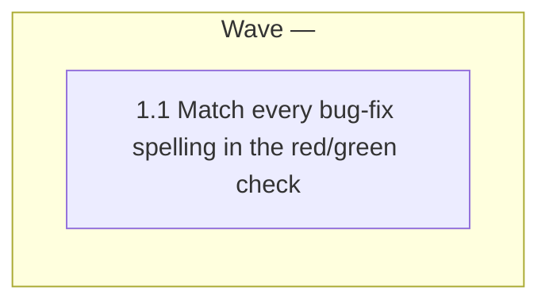

# Red/green check applies to every bug-fix Input-type spelling

<!-- AT-A-GLANCE:BEGIN (generated — do not edit; refreshed by render_plan.py --summarize) -->
## At a glance

**1 tasks · 1 waves · 2 files · 1/1 done**

| Wave | Task | Title | Files | Done (acceptance) |
|---|---|---|---|---|
| — | 1.1 | Match every bug-fix spelling in the red/green check | scripts/verify_summary.py, scripts/test_verify_summary.py | SC-1 and SC-2 exit 0; the commit that adds the tests exits 1 on the SC-1 command… |

### Progress
- [x] 1.1 — Match every bug-fix spelling in the red/green check
<!-- AT-A-GLANCE:END -->

## 1. Motivation

`scripts/verify_summary.py` `_red_green_issue` applies the red/green check only when
`Input-type`, trimmed and lower-cased, equals exactly `bug fix`. A SUMMARY that writes `bug-fix`,
`bugfix` or `bug fix (harness)` skips the check silently, even under `REQUIRE_RED_TEST=1`
(issue #302, `specs/gh-302-red-green-input-type/intent.md`). The fix matches a leading
`bug[ -]?fix` token, the way `_resolve_lane` matches the lane (intent Q1, assumed default).

## 2. Non-goals

- Normalising any other `Input-type` value.
- The other advisory findings from PR #301.
- Any prose edit (`rules/auto-correct-scope.md` stays as it is).
- Making the check blocking by default.

## 3. Success Criteria

| ID | Behavior (observable) | Check (re-runnable) | Expected |
|---|---|---|---|
| SC-1 | `bug-fix`, `bugfix` and `bug fix (harness)` get the red/green warning, and exit 1 under `REQUIRE_RED_TEST=1`; `harness fix` and `bug fixes` get no red/green message | `env PATH=/tmp/harness-tests-venv/bin:/usr/bin:/bin python3 -m pytest -q scripts/test_verify_summary.py -k input_type` | exit 0 |
| SC-2 | Every `verify_summary.py` test passes, old and new, including the scan of existing `specs/*/SUMMARY.md` | `env PATH=/tmp/harness-tests-venv/bin:/usr/bin:/bin python3 -m pytest -q scripts/test_verify_summary.py` | exit 0 |

## Global Constraints

- Edit the source tree only. Never edit `.claude/`, `hooks/`, `VERSION` or `CHANGELOG.md`. Touch
  only `scripts/verify_summary.py` and `scripts/test_verify_summary.py`.
- Run shell commands as plain, separate commands from the worktree root. The session guard refuses
  compound commands, heredocs and inline scripts that mention git.
- Run pytest with `/tmp/harness-tests-venv/bin` first on `PATH`; the system `python3` has no pytest.
- Standard library only. No new public callable in `verify_summary.py`; a private module-level
  regex or helper is allowed.
- The check stays advisory by default. A SUMMARY whose `Input-type` is not a bug fix keeps the same
  `verify_summary.py` result.
- Do not use the words `correctly`, `properly`, `as expected`, `works`, `is correct`,
  `looks right`, `appropriate` or `reasonable` in a `Verify:` or `Done:` line
  (`rules/terminology.md` §3).

## 4. Tasks

### Task 1.1 — Match every bug-fix spelling in the red/green check

- **Files:** scripts/verify_summary.py, scripts/test_verify_summary.py
- **Action:** This is a bug fix. Commit the failing tests first, then the fix.
  1. Tests first, in `class TestRedGreen` of `scripts/test_verify_summary.py`. Put `input_type`
     in each new test name so `-k input_type` selects them:
     - for each of `bug-fix`, `bugfix`, `bug fix (harness)` and `Bug-Fix`, a SUMMARY built with
       `_bug_fix_summary(f"{REAL_LANE_VERIFY}\n{_GREEN_ROW}", input_type=...)` gets a non-None
       `_red_green_issue`, one red/green warning from `check_lane_warnings` when
       `REQUIRE_RED_TEST` is unset, and `vs.main(["--lane", ...])` returns 1 when
       `REQUIRE_RED_TEST=1`;
     - extend `test_red_green_other_input_type_has_no_message` (keep its name or rename it to
       include `input_type`) so `bug fixes`, `bugfixes`, `bug-fixes`, `bug fix-up`, `bugs fix`,
       `harness fix` and `maintenance` give no red/green message under `REQUIRE_RED_TEST=1`.
     Commit these tests alone. They must fail at that commit.
  2. Fix in `scripts/verify_summary.py` `_red_green_issue`: replace the exact `!= "bug fix"`
     comparison with a match of a leading token on the trimmed, lower-cased value:
     `re.match(r"bug[ -]?fix(?![\w-])", value)`. Keep it in a private module-level compiled
     regex next to `_RED_COMMAND_RE`. Update the docstring's `Verifies:` line to name the
     accepted spellings.
  3. In `test_red_green_no_message_for_existing_non_bug_fix_summaries`, replace the exact
     `input_type == "bug fix"` skip with the same predicate the checker uses, so a future
     `bug-fix` SUMMARY under `specs/` is skipped, not failed.
  Record the `red` and `green` rows in `specs/gh-302-red-green-input-type/SUMMARY.md`
  `### Verify`, per the implementer prompt's bug-fix steps. The test command is
  `/tmp/harness-tests-venv/bin/python -m pytest -q scripts/test_verify_summary.py -k input_type`.
- **Verify:** `env PATH=/tmp/harness-tests-venv/bin:/usr/bin:/bin python3 -m pytest -q scripts/test_verify_summary.py`
- **Done:** SC-1 and SC-2 exit 0; the commit that adds the tests exits 1 on the SC-1 command;
  `git log` shows the test commit before the fix commit.
- **Criteria:** SC-1, SC-2
- **Interfaces:** Consumes: the Input-type header of a SUMMARY. Produces: `scripts/verify_summary.py`, `scripts/test_verify_summary.py`.

## 5. Risks

- A looser match could catch a value that is not a bug fix. The `(?![\w-])` lookahead rejects
  `bug fixes`, `bugfixes` and `bug fix-up`; the negative tests pin this.
- The scan test over existing `specs/*/SUMMARY.md` uses its own skip predicate. Step 3 keeps it
  aligned with the checker.

## 6. Status Log

- 2026-10-16 — plan written at intake handoff (normal lane, confidence medium).
- 2026-10-16 — task 1.1 complete; commits ee6da93, 36d809f (task review: spec pass, quality approved, 2 Minor).
