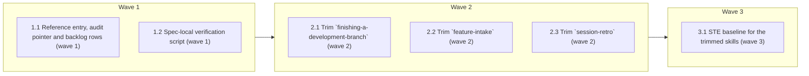

# Deletion-test procedure for the 600-word skill ceiling

<!-- AT-A-GLANCE:BEGIN (generated — do not edit; refreshed by render_plan.py --summarize) -->
## At a glance

**6 tasks · 3 waves · 16 files · 5/6 done**

| Wave | Task | Title | Files | Done (acceptance) |
|---|---|---|---|---|
| 1 | 1.1 | Reference entry, audit pointer and backlog rows (wave 1) | docs/solutions/harness/deletion-test-for-word-ceiling.md, docs/solutions/INDEX.md, scripts/audit_skill_prompts.py, scripts/test_audit_skill_prompts.py, docs/harness-experimental/improvement-backlog.md | SC-1, SC-2 and SC-3 exit 0; the new assertion failed before the audit edit (stat… |
| 1 | 1.2 | Spec-local verification script (wave 1) | specs/gh-308-deletion-test-ceiling/check_gh308.py | `ratchet` and `qualifiers` exit 0 and `budget` exits 1 on the task's tree, each … |
| 2 | 2.1 | Trim `finishing-a-development-branch` (wave 2) | skills/finishing-a-development-branch/SKILL.md, skills/finishing-a-development-branch/references/run-state-handoff.md, specs/gh-308-deletion-test-ceiling/qualifiers-finishing-a-development-branch.md | that budget command exits 0, SC-9 and SC-11 exit 0, and every listed word for th… |
| 2 | 2.2 | Trim `feature-intake` (wave 2) | skills/feature-intake/SKILL.md, skills/feature-intake/references/route-notes.md, specs/gh-308-deletion-test-ceiling/qualifiers-feature-intake.md | that budget command exits 0, SC-10 and SC-12 exit 0, and every listed word for t… |
| 2 | 2.3 | Trim `session-retro` (wave 2) | skills/session-retro/SKILL.md, skills/session-retro/references/report-details.md, specs/gh-308-deletion-test-ceiling/qualifiers-session-retro.md | that budget command exits 0, SC-13 exits 0, and every listed word for this skill… |
| 3 | 3.1 | STE baseline for the trimmed skills (wave 3) | scripts/ste-baseline.json | SC-7 exits 0, and `python3 scripts/check_ste_baseline.py` prints no NOTE or WARN… |

### Progress
- [x] 1.1 — Reference entry, audit pointer and backlog rows (wave 1)
- [x] 1.2 — Spec-local verification script (wave 1)
- [x] 2.1 — Trim `finishing-a-development-branch` (wave 2)
- [x] 2.2 — Trim `feature-intake` (wave 2)
- [x] 2.3 — Trim `session-retro` (wave 2)
- [ ] 3.1 — STE baseline for the trimmed skills (wave 3)
<!-- AT-A-GLANCE:END -->

## 1. Motivation

The 600-word ceiling in `scripts/audit_skill_prompts.py` reports a count and nothing else, and two
recorded trims to meet it lost conditions with every test green
(`docs/solutions/harness/ste-rewrite-drops-scope-qualifiers.md`). This plan implements
`specs/gh-308-deletion-test-ceiling/design.md` (approved 2026-10-16, D1–D4): a harness-owned
deletion-test procedure, a pointer to it in the audit message, a trim of the three skills at or
near the ceiling to ≤540 words (budget) each, and the two stale backlog rows marked done. Research:
`specs/gh-308-deletion-test-ceiling/research-brief.md` (Deep, local-only).

## 2. Non-goals

- Any edit to `skills/asd-ste100/` or its `UPSTREAM.md` (vendored).
- Changing the 600-word ceiling or the vendored exemption.
- Any change to `hooks/`, `.claude/`, `VERSION` or `CHANGELOG.md`.
- Adding the sentences that #310, #312, #313 and #318 need.
- A new repo-wide checker; `check_gh308.py` is spec-local verification only.

## 3. Success Criteria

| ID | Behavior (observable) | Check (re-runnable) | Expected |
|---|---|---|---|
| SC-1 | The over-ceiling audit message names the reference path, and the audit tests pass | `env PATH=/tmp/harness-tests-venv/bin:/usr/bin:/bin python3 -m pytest -q scripts/test_audit_skill_prompts.py` | exit 0 |
| SC-2 | The reference entry is listed in the solutions index | `grep -q deletion-test-for-word-ceiling docs/solutions/INDEX.md` | exit 0 |
| SC-3 | The solutions index matches a fresh rebuild | `python3 scripts/rebuild_solution_index.py --check` | exit 0 |
| SC-4 | `session-retro`, `feature-intake` and `finishing-a-development-branch` are each at most 540 words (budget), or a skill above 540 is below its `cc366fd` count and lists its kept sentences under `## Kept long on purpose` in its qualifiers file | `python3 specs/gh-308-deletion-test-ceiling/check_gh308.py budget` | exit 0 |
| SC-5 | Every condition word the qualifier check lists for the three skills since `cc366fd` has a "kept" resolution that cites a line present at HEAD | `python3 specs/gh-308-deletion-test-ceiling/check_gh308.py qualifiers` | exit 0 |
| SC-6 | Both `ste-rewrite-drops-scope-qualifiers` backlog rows end in `done` | `python3 specs/gh-308-deletion-test-ceiling/check_gh308.py backlog` | exit 0 |
| SC-7 | For each skill, the summed STE hard count of `SKILL.md` plus `references/*.md` at HEAD is at most its sum at `cc366fd`, and `scripts/ste-baseline.json` changed only entries under the three skills | `python3 specs/gh-308-deletion-test-ceiling/check_gh308.py ratchet` | exit 0 |
| SC-8 | The qualifier canaries (both recorded drops) and the review-package tests pass | `env PATH=/tmp/harness-tests-venv/bin:/usr/bin:/bin python3 -m pytest -q scripts/test_check_scope_qualifiers.py skills/subagent-driven-development/scripts/test_review_package.py` | exit 0 |
| SC-9 | The finishing-branch contract pins still hold | `bash tests/scripts/finishing-branch-contract.test.sh` | exit 0 |
| SC-10 | The feature-intake tiny-route propagation check still holds | `bash tests/scripts/context-propagation-regression.test.sh` | exit 0 |
| SC-11 | A deployed consumer tree still rewrites the render_plan path in the finishing skill | `bash tests/scripts/consumer-subset.test.sh` | exit 0 |
| SC-12 | A deployed consumer tree still rewrites the verify_summary path in feature-intake | `bash tests/scripts/deploy-worktree-isolation.test.sh` | exit 0 |
| SC-13 | The prompt audit reports no problem for any skill | `python3 scripts/audit_skill_prompts.py` | exit 0 |

Plan SC ids differ from the design's: design SC-1 → SC-1, SC-2 → SC-2/SC-3, SC-3 → SC-4, SC-4 → SC-5, SC-5 → SC-1 and SC-8 to SC-12, SC-6 → SC-6, SC-7 → SC-7. SC-13 is new.

## Global Constraints

- Work in the task worktree root. Edit only the files your task names. Never edit `.claude/`,
  `hooks/`, `skills/asd-ste100/`, `VERSION` or `CHANGELOG.md`.
- Read `specs/gh-308-deletion-test-ceiling/design.md` (Architecture, Error behavior, Decisions
  D1–D4) and `specs/gh-308-deletion-test-ceiling/research-brief.md` (Evidence Ledger pin rows,
  Risks 1–6) before you edit. They are the spec.
- Run pytest with `env PATH=/tmp/harness-tests-venv/bin:/usr/bin:/bin`; the system `python3` has
  no pytest. If `/tmp/harness-tests-venv` is missing, build it with
  `bash -c 'source tests/lib.sh; ensure_pyenv'`.
- Run shell commands as plain, separate commands. Put any helper logic in a file, not in an inline
  script that mentions git.
- The branch base for every comparison is `cc366fd` (the `sdlc` tip this branch was cut from).
- Trim rule (design Architecture §2): delete a whole sentence only when the model already does it
  by default or it restates a file the skill already points to; move a whole block that only some
  branches reach into the skill's `references/` with a one-line pointer. Never shorten a sentence
  that holds `if`, `unless`, `only`, `when`, `never`, `except`, `for a new` or `without`. When a
  moved or deleted sentence sits under a leading condition, keep that condition in scope for every
  sentence that still depends on it.
- Never delete or reword a pinned string listed in the research brief's Evidence Ledger pin rows.
  Grep each line you plan to remove against `tests/scripts/finishing-branch-contract.test.sh`,
  `tests/scripts/context-propagation-regression.test.sh`, `tests/scripts/consumer-subset.test.sh`
  and `tests/scripts/deploy-worktree-isolation.test.sh` first.
- New file names must not contain `prompt` (the audit counts `skills/**/*prompt*.md` as companion
  prompts and a test pins that count at 11).
- Apply `skills/asd-ste100/SKILL.md` STE-flavored mode to prose you write under `skills/`. Do not
  change fenced code or a literal string a test or hook matches.
- Do not use the words `correctly`, `properly`, `as expected`, `works`, `is correct`,
  `looks right`, `appropriate` or `reasonable` in a `Verify:` or `Done:` line
  (`rules/terminology.md` §3).

## 4. Tasks

### Task 1.1 — Reference entry, audit pointer and backlog rows (wave 1)

- **Files:** docs/solutions/harness/deletion-test-for-word-ceiling.md, docs/solutions/INDEX.md, scripts/audit_skill_prompts.py, scripts/test_audit_skill_prompts.py, docs/harness-experimental/improvement-backlog.md
- **Action:** Test first, then code.
  - In `scripts/test_audit_skill_prompts.py`, extend
    `test_description_and_skill_surface_ceilings_fail_with_named_diagnostics` (or add a sibling
    test) to assert that the over-ceiling stderr contains
    `docs/solutions/harness/deletion-test-for-word-ceiling.md`. Run it and see it fail.
  - In `scripts/audit_skill_prompts.py`, append to the existing over-ceiling problem string a
    two-line hint: delete whole sentences that the model already follows or that restate a
    pointed-to file; move branch-only blocks to `references/`; never shorten a sentence with a
    condition word; see `docs/solutions/harness/deletion-test-for-word-ceiling.md`. Keep the
    substring `progressive-disclosure ceiling`, the count, the ceiling value and the vendored
    exemption unchanged.
  - Write `docs/solutions/harness/deletion-test-for-word-ceiling.md` with front-matter per
    `docs/solutions/README.md` (`problem_type: knowledge`, `module`, `tags`, `affects`,
    `confidence: high`, `confirmed_at: 2026-10-16`, plus the `severity` and `applicable_when`
    fields that `scripts/rebuild_solution_index.py` reads) and body sections Pattern and
    How_to_Use. Content per design Architecture §1–§2: the five-step procedure, the condition-word
    list (the same list as `scripts/check_scope_qualifiers.py` WORDS), the disclosure fallback, the
    split-scope warning, the "kept long on purpose" exit for the word budget only, the upstream
    source (Pocock `writing-for-agents/SKILL.md` @49dd158), and a link to
    `docs/solutions/harness/ste-rewrite-drops-scope-qualifiers.md`.
  - Run `python3 scripts/rebuild_solution_index.py` to regenerate `docs/solutions/INDEX.md`. Do not
    hand-edit it.
  - In `docs/harness-experimental/improvement-backlog.md`, change the Status cell of the two
    2026-10-15 `ste-rewrite-drops-scope-qualifiers` rows (lines 24–25 at `03e3555`) from `open` to
    `done`, and append `(shipped in 23438c1)` to each row's guardrail cell.
- **Verify:** `env PATH=/tmp/harness-tests-venv/bin:/usr/bin:/bin python3 -m pytest -q scripts/test_audit_skill_prompts.py`
- **Done:** SC-1, SC-2 and SC-3 exit 0; the new assertion failed before the audit edit (state the
  failing run in the report).
- **Criteria:** SC-1, SC-2, SC-3
- **Interfaces:** Consumes: the design procedure and the qualifier word list. Produces: `docs/solutions/harness/deletion-test-for-word-ceiling.md`, `docs/solutions/INDEX.md`, `scripts/audit_skill_prompts.py`, `scripts/test_audit_skill_prompts.py`, `docs/harness-experimental/improvement-backlog.md`.

### Task 1.2 — Spec-local verification script (wave 1)

- **Files:** specs/gh-308-deletion-test-ceiling/check_gh308.py
- **Action:** Write a standard-library Python script with four subcommands. Each prints one line
  per failure and exits 1 on any failure, 0 otherwise. Resolve the repo root with
  `git rev-parse --show-toplevel`. `BASE = "cc366fd"`. `SKILLS = ("session-retro",
  "feature-intake", "finishing-a-development-branch")`. Give the module a `Verifies:` /
  `Does not verify:` docstring pair.
  - `budget [<skill>]`: for each skill (or only the named one), the whitespace word count
    (`len(text.split())`) of `skills/<s>/SKILL.md` is at most 540 (budget). A skill above 540
    passes only when its count is below its count at `cc366fd` and
    `specs/gh-308-deletion-test-ceiling/qualifiers-<s>.md` has a `## Kept long on purpose` heading
    followed by at least one `- ` bullet (design D4 shortfall exit).
  - `qualifiers`: run `scripts/check_scope_qualifiers.py --base cc366fd --head HEAD`; keep lines
    whose path is under `skills/<s>/` for the three skills; for each kept line
    (`- <file>:<line>: dropped "<word>": <text>`), require a line in
    `specs/gh-308-deletion-test-ceiling/qualifiers-<s>.md` of the form
    ``- <file>:<line> "<word>" kept: `<cited text>` `` whose cited text (the text between the
    first and the last backtick after `kept:`, since skill lines often hold inline code) occurs verbatim in
    `skills/<s>/SKILL.md` or a file under `skills/<s>/references/` at HEAD. Read only lines of the
    `- <file>:<line> "<word>" kept:` form and skip every other line, including the `## Kept long on
    purpose` bullets. Output `- none` or no output passes. A `scope-qualifiers: unavailable` line fails.
  - `backlog`: the two lines of `docs/harness-experimental/improvement-backlog.md` that contain
    `ste-rewrite-drops-scope-qualifiers` both end in `| done |`.
  - `ratchet`: for each skill, sum the STE hard count over `SKILL.md` and `references/*.md` at
    `cc366fd` (read with `git show cc366fd:<path>`, files that exist there) and in the working
    tree, each counted by `skills/asd-ste100/scripts/ste-lint.py --json --disable
    synonym-rotation` on stdin. Read the JSON field `hard_count`; the linter exits 1 whenever the
    hard count is above 0, so its exit code is not a failure signal (session-retro is already 2 at
    the base). Require working-tree sum ≤ base sum. Then load `scripts/ste-baseline.json` from
    `git show cc366fd:scripts/ste-baseline.json` and from the working tree, and require every key whose value differs, or that exists on only
    one side, to start with `skills/<s>/` for one of the three skills.
  Run each subcommand once on your task's tree and quote the result. `budget` must exit 1, because
  no wave-1 task trims a skill; this proves the check can fail. `ratchet` and `qualifiers` exit 0.
  `backlog` exits 1 or 0 depending on whether Task 1.1 has committed; report which.
- **Verify:** `python3 specs/gh-308-deletion-test-ceiling/check_gh308.py ratchet`
- **Done:** `ratchet` and `qualifiers` exit 0 and `budget` exits 1 on the task's tree, each result
  quoted in the report.
- **Criteria:** SC-4, SC-5, SC-6, SC-7
- **Interfaces:** Consumes: the existing scope-qualifier script, the vendored STE linter and the STE baseline file (all present at cc366fd). Produces: `specs/gh-308-deletion-test-ceiling/check_gh308.py`.

### Task 2.1 — Trim `finishing-a-development-branch` (wave 2)

- **Files:** skills/finishing-a-development-branch/SKILL.md, skills/finishing-a-development-branch/references/run-state-handoff.md, specs/gh-308-deletion-test-ceiling/qualifiers-finishing-a-development-branch.md
- **Action:** Apply the Global Constraints trim rule to reach ≤540 words (budget). Start from the
  research brief candidate: the run-state rationale in Step 3 (why `RUN.json`/`events.jsonl` are
  tracked) and in "Push and PR" (why `ready_to_merge` matters and why the extra commit is needed)
  moves whole to `references/run-state-handoff.md`; the instructions themselves stay. Add the new
  file to the skill's `## References` list. Keep every finishing pin from the research brief,
  including `skills/visual-planner/render_plan.py`. Then run
  `python3 scripts/check_scope_qualifiers.py --base cc366fd --head HEAD` (after committing) and
  write one ``- <file>:<line> "<word>" kept: `<cited text>` `` line per listed word for this
  skill into the qualifiers file, or `- none`. If the skill cannot reach 540 without shortening a
  condition sentence, stop at the lowest safe count, add a `## Kept long on purpose` section to the
  qualifiers file listing each kept sentence, and return `DONE_WITH_CONCERNS` (the controller
  copies the list into SUMMARY).
- **Verify:** `python3 specs/gh-308-deletion-test-ceiling/check_gh308.py budget finishing-a-development-branch`
- **Done:** that budget command exits 0, SC-9 and SC-11 exit 0, and every listed word for this
  skill has a "kept" line.
- **Criteria:** SC-4, SC-5, SC-8, SC-9, SC-11, SC-13
- **Interfaces:** Consumes: `docs/solutions/harness/deletion-test-for-word-ceiling.md` from Task 1.1. Produces: `skills/finishing-a-development-branch/SKILL.md`, `skills/finishing-a-development-branch/references/run-state-handoff.md`, `specs/gh-308-deletion-test-ceiling/qualifiers-finishing-a-development-branch.md`.

### Task 2.2 — Trim `feature-intake` (wave 2)

- **Files:** skills/feature-intake/SKILL.md, skills/feature-intake/references/route-notes.md, specs/gh-308-deletion-test-ceiling/qualifiers-feature-intake.md
- **Action:** Apply the Global Constraints trim rule to reach ≤540 words (budget). Do not edit
  Procedure Steps 1, 3 or 6, or the `- tiny:` route line (it carries the `asd-ste100` pin). Start
  from the research brief candidates: the "Artifacts scale by signal" list restates
  `rules/orchestration.md` (which Step 1 reads) and becomes a one-line pointer; the xia2
  lane-to-depth sentence is for xia2, not intake. Create `references/route-notes.md` only if a
  branch-only block must move; otherwise leave it out of the diff. Keep the
  source line `python3 scripts/verify_summary.py --lane <slug>` (Step 7; deploy rewrites it to
  the `.claude/scripts/` form that `deploy-worktree-isolation.test.sh` checks) and every other
  feature-intake pin. Write the qualifiers file, and handle a shortfall, as in Task 2.1.
- **Verify:** `python3 specs/gh-308-deletion-test-ceiling/check_gh308.py budget feature-intake`
- **Done:** that budget command exits 0, SC-10 and SC-12 exit 0, and every listed word for this
  skill has a "kept" line.
- **Criteria:** SC-4, SC-5, SC-8, SC-10, SC-12, SC-13
- **Interfaces:** Consumes: `docs/solutions/harness/deletion-test-for-word-ceiling.md` from Task 1.1. Produces: `skills/feature-intake/SKILL.md`, `specs/gh-308-deletion-test-ceiling/qualifiers-feature-intake.md`, and `skills/feature-intake/references/route-notes.md` only if a block moves.

### Task 2.3 — Trim `session-retro` (wave 2)

- **Files:** skills/session-retro/SKILL.md, skills/session-retro/references/report-details.md, specs/gh-308-deletion-test-ceiling/qualifiers-session-retro.md
- **Action:** Apply the Global Constraints trim rule to reach ≤540 words (budget). Start from the
  research brief candidates: the opening framing that repeats "Then stop", and the Report
  section's parenthetical limits. Keep the sentences behind the three eval-corpus behaviors in
  `scripts/generate_skill_eval_corpus.py` ("trace each struggle to an environment lever",
  "report a clean session without inventing rules", "route approved candidates to the backlog or
  compound"), the lever table, and the final `Verifies:` / `Does not verify:` pair. If a block
  moves, create `references/report-details.md` and point to it; the skill already has `Read`. Write
  the qualifiers file, and handle a shortfall, as in Task 2.1.
- **Verify:** `python3 specs/gh-308-deletion-test-ceiling/check_gh308.py budget session-retro`
- **Done:** that budget command exits 0, SC-13 exits 0, and every listed word for this skill has a
  "kept" line.
- **Criteria:** SC-4, SC-5, SC-8, SC-13
- **Interfaces:** Consumes: `docs/solutions/harness/deletion-test-for-word-ceiling.md` from Task 1.1. Produces: `skills/session-retro/SKILL.md`, `specs/gh-308-deletion-test-ceiling/qualifiers-session-retro.md`, and `skills/session-retro/references/report-details.md` only if a block moves.

### Task 3.1 — STE baseline for the trimmed skills (wave 3)

- **Files:** scripts/ste-baseline.json
- **Action:** Run `python3 scripts/check_ste_baseline.py` and read its NOTE/WARN lines for files
  under the three skills. Edit only those entries in `scripts/ste-baseline.json`: lower an entry
  to its new hard count, add an entry for each new `references/` file, and leave every other entry
  byte-identical. Do not run `--update` on the whole file unless you then restore every other
  entry. Then run the ratchet check.
- **Verify:** `python3 specs/gh-308-deletion-test-ceiling/check_gh308.py ratchet`
- **Done:** SC-7 exits 0, and `python3 scripts/check_ste_baseline.py` prints no NOTE or WARN line
  for a file under the three skills.
- **Criteria:** SC-7
- **Interfaces:** Consumes: the trimmed skills from Tasks 2.1–2.3. Produces: `scripts/ste-baseline.json`.

## 5. Risks

- Scope split on move (research Risk 1): a moved block strands a sentence that depended on a
  leading condition; `check_scope_qualifiers.py` does not list this. Backstop: the trim rule in
  Global Constraints, the task reviewer's meaning check, and the context-propagation-audit that
  SDD runs on this workflow-engine diff.
- A skill cannot reach 540 words (budget) without touching a condition sentence (design A1). Per
  design D4 and Error behavior, the task stops at its lowest safe count, lists the kept sentences
  under `## Kept long on purpose`, and returns `DONE_WITH_CONCERNS`; SC-4 still passes when the
  count dropped, and the controller copies the list into SUMMARY. The shortfall leaves less room
  for #310, #312, #313 and #318.
- Self-reference: `feature-intake` routes every later change. Task 2.2 leaves Steps 1, 3 and 6 and
  the tiny route untouched; SC-10 and SC-12 guard the pinned parts.

### Assumption coverage

- A1 → SC-4
- A2 → SC-5, SC-8
- A3 → accepted risk: behavior of moved blocks is checked by the context-propagation-audit that SDD runs before correctness review on this workflow-engine diff, not by a plan SC
- A4 → SC-9, SC-10, SC-11, SC-12

## 6. Status Log

- 2026-10-16 — plan written from the approved design and research brief.
- 2026-10-16 — tasks 1.1, 1.2 complete; commits 77a27ef, 0cb0a06; both task reviews spec pass and quality approved, 3 Minor findings recorded in SUMMARY.
- 2026-10-16 — tasks 2.1, 2.2, 2.3 complete; commits aad04a6, 970a276, c043969, 63f1ef1, cf36783, 44d7061; word counts 524, 539, 525; all three task reviews spec pass and quality approved (2.2 after one focused retry), 5 Minor findings recorded in SUMMARY.
