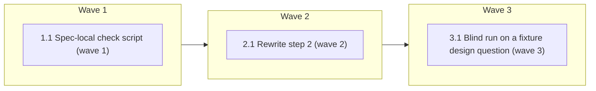

# Grill the design frontier in rounds inside brainstorming

<!-- AT-A-GLANCE:BEGIN (generated — do not edit; refreshed by render_plan.py --summarize) -->
## At a glance

**3 tasks · 3 waves · 5 files · 0/3 done**

| Wave | Task | Title | Files | Done (acceptance) |
|---|---|---|---|---|
| 1 | 1.1 | Spec-local check script (wave 1) | specs/gh-309-grilling-rounds/check_gh309.py | `--selftest` exits 0; `scope` exits 0 at the task's HEAD; `anchors` exits 1 at t… |
| 2 | 2.1 | Rewrite step 2 (wave 2) | skills/brainstorming/SKILL.md, specs/gh-309-grilling-rounds/qualifiers-brainstorming.md | after the task's commits, SC-1, SC-2, SC-3, SC-4 and SC-6 exit 0; `wc -w skills/… |
| 3 | 3.1 | Blind run on a fixture design question (wave 3) | specs/gh-309-grilling-rounds/blind-run.md, skills/brainstorming/SKILL.md, specs/gh-309-grilling-rounds/qualifiers-brainstorming.md, specs/gh-309-grilling-rounds/ESCALATIONS.md | SC-5 exits 0; every run section holds its full transcript and its answer key; th… |

### Progress
- [ ] 1.1 — Spec-local check script (wave 1)
- [ ] 2.1 — Rewrite step 2 (wave 2)
- [ ] 3.1 — Blind run on a fixture design question (wave 3)
<!-- AT-A-GLANCE:END -->

## 1. Motivation

`skills/brainstorming/SKILL.md` step 2 asks one clarifying question per message. A design with
many open decisions takes many round trips, and the agent may assume an answer it never asked
for, or ask the user for a fact it could find. Issue #309 adopts Pocock's `grilling` procedure:
map the decisions as a design tree, ask the whole frontier in one numbered round with a
recommended answer per question, find facts yourself, give decisions to the user, and act only
after the user confirms a shared understanding. Spec: `specs/gh-309-grilling-rounds/design.md`
(D1–D11) and `specs/gh-309-grilling-rounds/research-brief.md`.

## 2. Non-goals

- A question cap or a fixed number of rounds.
- A fixed question template or emoji.
- A design-tree field in `design.md`.
- A repo test under `tests/` that greps the step-2 wording. The spec-local script in this plan
  checks anchors for this branch only and is not deployed.
- Changes to `feature-intake`, `xia2`, `writing-plans`, the normal lane's notify-and-proceed
  flow, any hook, or any file under `skills/brainstorming/` other than `SKILL.md`.
- A separate `grilling` skill.
- Brainstorming for #318. The blind run borrows its body as a fixture and binds nothing.

## 3. Success Criteria

| ID | Behavior (observable) | Check (re-runnable) | Expected |
|---|---|---|---|
| SC-1 | Step 2 of `skills/brainstorming/SKILL.md` holds the seven anchor phrases `design tree`, `frontier`, `numbered round`, `recommended answer`, `never ask the user for a fact`, `record the recommended answer as an assumption`, `shared understanding`, the sentence holding `evasive` names `decision`, the visual-artifact sentence is unchanged, and step 2 has no semicolon | `python3 specs/gh-309-grilling-rounds/check_gh309.py anchors` | exit 0 |
| SC-2 | Every skill, including `brainstorming`, is under the 600-word ceiling | `python3 scripts/audit_skill_prompts.py` | exit 0 |
| SC-3 | The STE hard count of every prose file is at or below the baseline committed at `996f50d` | `python3 scripts/check_ste_baseline.py --strict --against 996f50d` | exit 0 |
| SC-4 | `qualifiers-brainstorming.md` exists with its `Source:` header, holds `replaced:` lines for `any` and `still` whose cited text occurs in `SKILL.md` at HEAD, and every condition word the qualifier check lists for `skills/brainstorming/` since `996f50d` has a `kept:` or `replaced:` line whose cited text occurs at HEAD | `python3 specs/gh-309-grilling-rounds/check_gh309.py qualifiers` | exit 0 |
| SC-5 | The last `## Run <n>` section of `blind-run.md` records an answer key of 10–13 decisions, a round count of at most 3, a transcript of at least two rounds, and a `pass` for each of the four criteria (a)–(d); every earlier run section has a `Result:` line | `python3 specs/gh-309-grilling-rounds/check_gh309.py blindrun` | exit 0 |
| SC-6 | Since `996f50d`, the only changed file under `skills/` is `skills/brainstorming/SKILL.md` | `python3 specs/gh-309-grilling-rounds/check_gh309.py scope` | exit 0 |

Plan SC ids match the design's SC-1…SC-6 one to one. Design SC-1 (seven behaviors) is split: the
anchor check is the machine half; the task reviewer's spec verdict against the design's
seven-sentence map is the meaning half.

## Global Constraints

- Work in the task worktree root. Edit only the files your task names. Never edit `.claude/`,
  `hooks/`, `scripts/`, `skills/asd-ste100/`, `scripts/ste-baseline.json`, `VERSION` or
  `CHANGELOG.md`. If SC-3 cannot pass without a baseline change, stop and report; do not edit the
  baseline.
- Read `specs/gh-309-grilling-rounds/design.md` (Architecture, Error behavior, Decisions
  D1–D11) and `specs/gh-309-grilling-rounds/research-brief.md` (Evidence Ledger, Local Findings,
  Risks) before you edit. They are the spec.
- The branch base for every comparison is `996f50d`. Before the first task, run
  `git merge-base HEAD sdlc` and confirm it prints `996f50d…`. If it does not, stop and report.
- Run shell commands as plain, separate commands. Put helper logic in a file, not in an inline
  script that mentions git. Commit only your own files with `git commit -- <files>`; never use
  `git add -A`, `git reset` or `git stash`. Stage `specs/gh-309-grilling-rounds/RUN.json` and
  `specs/gh-309-grilling-rounds/events.jsonl` together with any `specs/gh-309-grilling-rounds/`
  file you commit when they are modified.
- Prose under `skills/` follows `skills/asd-ste100/SKILL.md`: one instruction per sentence, at
  most 20 words in an instruction and 25 in a description, no semicolon, active voice. Check with
  `python3 skills/asd-ste100/scripts/ste-lint.py skills/brainstorming/SKILL.md` before SC-3. That
  plain lint already exits 1 on the base file (line 3 long-sentence, line 32 synonym-rotation);
  read its list, do not read its exit code. SC-3 (`check_ste_baseline.py`) disables
  synonym-rotation and counts 1 hard violation at base, which is the baseline value.
- `scripts/check_scope_qualifiers.py`, the `scope` check and `git diff 996f50d..HEAD` read commits,
  not the working tree. Commit a task's files first, then run its Verify.
- The design's 169-word draft in `design.md` Architecture is the content of step 2, not the final
  wording. The research brief shows it has three semicolons and one 28-word sentence. Re-shape
  those sentences. Keep every behavior and the order. The visual-artifact sentence stays verbatim.
- Delete the old step 2 whole. For each condition word the qualifier check lists (`if`, `unless`,
  `only`, `when`, `never`, `except`, `for a new`, `without`), write one line in
  `qualifiers-brainstorming.md`: `kept:` with the HEAD text that still carries it, or `replaced:`
  with the HEAD text of the sentence that now carries the condition.
- The answer key for the blind run is written in the scratchpad and shown to the user agent only.
  The grilling agent never receives it, and the file is copied into `blind-run.md` only after the
  run ends. A grilling agent that is given the key makes the run meaningless.
- Do not use the words `correctly`, `properly`, `as expected`, `works`, `is correct`,
  `looks right`, `appropriate` or `reasonable` in a `Verify:` or `Done:` line
  (`rules/terminology.md` §3).

## 4. Tasks

### Task 1.1 — Spec-local check script (wave 1)

- **Files:** specs/gh-309-grilling-rounds/check_gh309.py
- **Action:** Write `check_gh309.py` after the shape of
  `specs/gh-308-deletion-test-ceiling/check_gh308.py`: stdlib only, `BASE = "996f50d"`, one
  subcommand per SC, one line per failure, exit 1 on any failure, 0 otherwise, a docstring with
  `Verifies:` and `Does not verify:` lines. Subcommands:
  - `anchors`: read `skills/brainstorming/SKILL.md`; take step 2 as the text from the line that
    starts with `2. ` to the line before the one that starts with `3. ` inside `## Flow`; join
    the lines and collapse whitespace to single spaces before matching; fail when any of the
    seven anchor phrases in SC-1 is absent (case-insensitive), when the sentence holding
    `evasive` lacks the word `decision`, when the sentence `Use a visual artifact only when
    seeing the answer is materially clearer than reading it.` is absent, or when step 2 holds
    a `;`.
  - `qualifiers`: fail when `specs/gh-309-grilling-rounds/qualifiers-brainstorming.md` is
    missing or lacks a line that starts with `Source: python3 scripts/check_scope_qualifiers.py`.
    Require one line each for `"any"` and `"still"` of the form
    `- skills/brainstorming/SKILL.md:<n> "<word>" replaced: <text>` whose `<text>` occurs verbatim
    in `skills/brainstorming/SKILL.md` at HEAD (whitespace collapsed); these two words are not on
    the script's list, so the design's D4 citation needs this explicit check. Write the matcher
    as a function that takes the skill text and the qualifiers text as parameters; the caller
    reads the skill text with `git show HEAD:skills/brainstorming/SKILL.md`, and the self-test
    passes fixture strings. Then run
    `scripts/check_scope_qualifiers.py --base 996f50d --head HEAD`; for each listed line under
    `skills/brainstorming/`, require a `kept:` or `replaced:` line of the same form whose text
    occurs at HEAD. Fail on a missing line, on text not found, and on the
    `scope-qualifiers: unavailable` line. `- none` or no output from the script adds no
    requirement.
  - `blindrun`: parse `specs/gh-309-grilling-rounds/blind-run.md`; require at least one
    `## Run <n>` section; every section but the last must hold a line `Result: pass` or
    `Result: fail`; the last section must hold the headings `### Design question`,
    `### Answer key`, `### Transcript`, `### Scoring`, a line `Decisions: <n>` with 10 ≤ n ≤ 13,
    a line `Rounds: <n>` with n ≤ 3, at least two lines that start with `#### Round ` under
    `### Transcript`, a line `Result: pass`, and a `### Scoring` table with rows `(a)`, `(b)`,
    `(c)`, `(d)` whose result cell is `pass`.
  - `scope`: run `git diff --name-only 996f50d..HEAD -- skills/`; fail when any path other than
    `skills/brainstorming/SKILL.md` is listed.
  Add a `--selftest` flag that builds temporary fixtures, one passing and one failing, for
  `anchors`, `blindrun` and the `any`/`still` half of `qualifiers`, and exits 1 when any returns
  the wrong result. `scope` and the script half of `qualifiers` need a git history and are not
  self-tested; say so in the docstring.
- **Verify:** `python3 specs/gh-309-grilling-rounds/check_gh309.py --selftest`
- **Done:** `--selftest` exits 0; `scope` exits 0 at the task's HEAD; `anchors` exits 1 at the
  task's HEAD (old step 2 lacks the anchors); `qualifiers` exits 1 (no file yet); `blindrun`
  exits 1 (no file yet).
- **Criteria:** SC-1, SC-4, SC-5, SC-6
- **Interfaces:** Consumes: the existing scope-qualifier script output, the skill file, the blind-run record and git (all present at 996f50d or produced later). Produces: `specs/gh-309-grilling-rounds/check_gh309.py`.

### Task 2.1 — Rewrite step 2 (wave 2)

- **Files:** skills/brainstorming/SKILL.md, specs/gh-309-grilling-rounds/qualifiers-brainstorming.md
- **Action:** Replace step 2 of `skills/brainstorming/SKILL.md` (lines 22–26 at `996f50d`) with
  the content of `design.md` Architecture, re-shaped so that no sentence holds a semicolon and no
  instruction exceeds 20 words. Keep the seven behaviors in the design's order and the design's
  wording where it already fits: tree and tier boundary; frontier; one numbered round with a
  recommended answer worded so "yes" accepts it, then wait; facts found yourself or by a subagent
  when the search is larger than a few reads, with the exact phrase `never ask the user for a
  fact`; decisions put to the user;
  the evasive rule for decisions, with the exact phrase `record the recommended answer as an
  assumption`; repeat with
  the new frontier; step 2 ends when the frontier is empty and the user confirms, the "yes" to the
  last round counts, act only after that. End with the visual-artifact sentence verbatim. Change
  nothing outside step 2. Run `python3 skills/asd-ste100/scripts/ste-lint.py skills/brainstorming/SKILL.md`
  and make sure the only hard findings are the two pre-existing ones (line 3 long-sentence,
  line 32 synonym-rotation); SC-3 ignores synonym-rotation and must stay at the baseline count
  of 1. Commit `skills/brainstorming/SKILL.md`. Then write `qualifiers-brainstorming.md` with the
  header line `Source: python3 scripts/check_scope_qualifiers.py --base 996f50d --head <sha>`,
  one `replaced:` line each for `"any"` and `"still"` (the old over-probe sentence, cited to the
  tier-boundary and stop-condition sentences at HEAD), and one `kept:`/`replaced:` line per word
  the script lists; the `only when` visual-artifact sentence is `kept:` verbatim. Commit that
  file. Run Verify after both commits.
- **Verify:** `python3 specs/gh-309-grilling-rounds/check_gh309.py anchors && python3 scripts/check_ste_baseline.py --strict --against 996f50d && python3 scripts/audit_skill_prompts.py && python3 specs/gh-309-grilling-rounds/check_gh309.py qualifiers`
- **Done:** after the task's commits, SC-1, SC-2, SC-3, SC-4 and SC-6 exit 0;
  `wc -w skills/brainstorming/SKILL.md` prints a number below 600;
  `git diff --stat 996f50d..HEAD -- skills/` lists one file.
- **Criteria:** SC-1, SC-2, SC-3, SC-4, SC-6
- **Interfaces:** Consumes: the design's Architecture text and `specs/gh-309-grilling-rounds/check_gh309.py` from Task 1.1. Produces: `skills/brainstorming/SKILL.md`, `specs/gh-309-grilling-rounds/qualifiers-brainstorming.md`.

### Task 3.1 — Blind run on a fixture design question (wave 3)

- **Files:** specs/gh-309-grilling-rounds/blind-run.md, skills/brainstorming/SKILL.md, specs/gh-309-grilling-rounds/qualifiers-brainstorming.md, specs/gh-309-grilling-rounds/ESCALATIONS.md
- **Action:** The orchestrator runs this task in the main session, not through an implementer
  subagent, because it dispatches two agents and relays between them. Steps:
  1. Write the answer key in the scratchpad: 10–13 decisions on issue #318 (`gh issue view 318`),
     each with the user's answer; mark one decision `evade twice`. If fewer than 10 decisions can
     be drawn from #318, use #313 and note it.
  2. Dispatch the grilling agent as an `Explore` agent (no Agent, Edit or Write tools). Its
     prompt holds: the HARD-GATE block of `skills/brainstorming/SKILL.md`, the new step 2
     verbatim, the body of issue #318 as the design question, and the instruction to run step 2
     with the user played by a relay, to end each turn after a numbered round, to stop when step
     2 ends, and to print "STEP 2 ENDED" then. Never include the answer key.
  3. Dispatch the user agent (any read-only type) with the answer key and the instruction to
     answer only what is asked, add nothing, answer the marked decision evasively twice, and
     answer any fact with "I do not know; find it yourself".
  4. Relay with `SendMessage`: each round from the grilling agent to the user agent, each answer
     set back to the grilling agent. If an agent gives no reply, start a fresh agent of the same
     role with the full transcript replayed, and note the restart.
  5. Write `blind-run.md` with one `## Run <n>` section per run. Each section holds
     `### Design question`, `### Answer key` (copied from the scratchpad after the run),
     `### Transcript` (one `#### Round <n>` per round, questions and answers verbatim),
     `### Scoring` (a table with rows (a)–(d), columns Criterion, Evidence, Result), the lines
     `Decisions: <n>`, `Rounds: <n>` and `Result: pass` or `Result: fail`, and the label
     "(assumed)". A step-2 question that asks a fact or an implementation-level choice sets (b)
     to `fail`. An agent restart is noted in the transcript. The first run stays in the file
     unchanged; the last section is the one `blindrun` scores.
  6. On a `fail`, edit step 2 in `skills/brainstorming/SKILL.md` and, if a cited sentence
     changed, `qualifiers-brainstorming.md`; commit; re-run Task 2.1's Verify; then rerun the
     blind run as a new `## Run <n>` section with a fresh agent pair. At most two reruns; after
     that, record an `ESCALATIONS.md` entry and stop. The three extra Files are for this path
     only; a passing first run edits `blind-run.md` alone.
- **Verify:** `python3 specs/gh-309-grilling-rounds/check_gh309.py blindrun`
- **Done:** SC-5 exits 0; every run section holds its full transcript and its answer key; the
  first run's section is present and unchanged when a rerun followed it.
- **Criteria:** SC-5
- **Interfaces:** Consumes: `skills/brainstorming/SKILL.md` from Task 2.1, issue #318's body, and `specs/gh-309-grilling-rounds/check_gh309.py` from Task 1.1. Produces: `specs/gh-309-grilling-rounds/blind-run.md`.

## 5. Risks

- The re-shaped step 2 drifts from the design's content while removing semicolons. Mitigation:
  the task reviewer's spec verdict compares the text against the design's seven-sentence map.
- One blind run passes or fails by chance (`docs/solutions/harness/skill-eval-blind-run-scoring.md`
  §5). The design budgets one run and two reruns; the first scored run stays in the record.
- The grilling agent ignores a step 2 handed to it without the surrounding skill (design A3).
  Fallback: give it the whole skill and say step 1 is done.
- `sdlc` moves before the PR opens, so `996f50d` is no longer the merge-base and SC-3, SC-4 and
  SC-6 compare against a stale base. Mitigation: the first Global Constraint re-checks the
  merge-base.
- An implementer edits `scripts/ste-baseline.json` to make SC-3 pass. Mitigation: the Global
  Constraint forbids it and says to stop and report.
- An `Explore` agent may not continue after `SendMessage`. The restart fallback in Task 3.1 step 4
  covers it; the restart is noted in the transcript.

The full suite `bash scripts/run-tests.sh` is not a Verify row (plan-format Guardrail 4). It runs
at `finishing-a-development-branch` and in CI, and it is the check behind design A1 beside SC-6.

### Assumption coverage

- A1 → SC-6
- A2 → Task 3.1
- A3 → Task 3.1
- A4 → accepted risk: the live round count after merge is listed in `SUMMARY.md` `### Not auto-verified`; no plan task can produce it

## 6. Status Log

- 2026-10-16 — plan written
