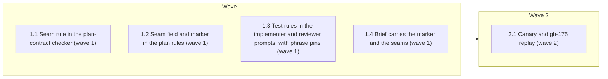

# Agreed test seams from plan to implementer to reviewer

<!-- AT-A-GLANCE:BEGIN (generated — do not edit; refreshed by render_plan.py --summarize) -->
## At a glance

**5 tasks · 2 waves · 11 files · 5/5 done**

| Wave | Task | Title | Files | Done (acceptance) |
|---|---|---|---|---|
| 1 | 1.1 | Seam rule in the plan-contract checker (wave 1) | scripts/check_plan_contract.py, scripts/test_check_plan_contract.py | SC-1 and SC-2 exit 0; `python3 scripts/check_plan_contract.py --self-test` exits… |
| 1 | 1.2 | Seam field and marker in the plan rules (wave 1) | rules/plan-format.md, skills/writing-plans/SKILL.md | SC-7 exits 0; `python3 scripts/audit_skill_prompts.py` exits 0; `git diff --stat… |
| 1 | 1.3 | Test rules in the implementer and reviewer prompts, with phrase pins (wave 1) | skills/subagent-driven-development/implementer-prompt.md, skills/subagent-driven-development/task-reviewer-prompt.md, scripts/check_task_review_contract.py, scripts/test_check_task_review_contract.py | SC-3, SC-7, SC-10, SC-11 and SC-12 exit 0; `python3 scripts/audit_skill_prompts.… |
| 1 | 1.4 | Brief carries the marker and the seams (wave 1) | skills/subagent-driven-development/scripts/test_task_brief.py | SC-4 exits 0. |
| 2 | 2.1 | Canary and gh-175 replay (wave 2) | specs/gh-312-test-seams/canary.md, specs/gh-312-test-seams/canary/, skills/subagent-driven-development/task-reviewer-prompt.md, scripts/check_task_review_contract.py | SC-5 and SC-6 exit 0; `canary.md` holds two fenced reviewer-output blocks, each … |

### Progress
- [x] 1.1 — Seam rule in the plan-contract checker (wave 1)
- [x] 1.2 — Seam field and marker in the plan rules (wave 1)
- [x] 1.3 — Test rules in the implementer and reviewer prompts, with phrase pins (wave 1)
- [x] 1.4 — Brief carries the marker and the seams (wave 1)
- [x] 2.1 — Canary and gh-175 replay (wave 2)
<!-- AT-A-GLANCE:END -->

## 1. Motivation

On gh-175 every per-task review passed and 145 tests were green, but the plan-blind correctness
review found about 11 real bugs. The tests sat at the right seam and used literal expected
values, but every test used one synthetic fixture (`_ACTIVE_MD_PLAN`). Issue #312, as amended by
the user's decisions, makes each plan task declare its test seams, makes the implementer test
only there with independent expected values and real inputs, makes the task reviewer check
this, and makes `check_plan_contract.py` block a marked plan without seams. Spec:
`specs/gh-312-test-seams/design.md` (D1–D16, A1–A6) and
`specs/gh-312-test-seams/research-brief.md`.

## 2. Non-goals

- Changes to `skills/visual-planner/render_plan.py`, `runtime/resume_decision.py`,
  `skills/subagent-driven-development/scripts/task_brief.py`, `correctness-review`, or
  `skills/subagent-driven-development/SKILL.md`.
- Adding seams to existing plans, or rewriting existing tests.
- A seam-quality row in `skills/writing-plans/plan-document-reviewer-prompt.md` (follow-up).
- #313 (prove the red) and #318 (diagnosing-bugs).

## 3. Success Criteria

| ID | Behavior (observable) | Check (re-runnable) | Expected |
|---|---|---|---|
| SC-1 | Each row of the design's error table, plus the field-order rule, has a unit test that passes | `python3 -m pytest scripts/test_check_plan_contract.py -q` | exit 0 |
| SC-2 | The checker accepts every committed `specs/*/PLAN.md`, this plan included | `python3 -m pytest scripts/test_check_plan_contract.py -q -k corpus` | exit 0 |
| SC-3 | The phrase pins pass on both prompts, and the tests that remove a pinned phrase from each prompt see exit 1 | `python3 -m pytest scripts/test_check_task_review_contract.py -q` | exit 0 |
| SC-4 | The brief that `task_brief.py` writes for a task of this plan holds the `- Plan-contract: 2` line and that task's `Seams:` line | `python3 -m pytest skills/subagent-driven-development/scripts/test_task_brief.py -q` | exit 0 |
| SC-5 | The canary record says the task reviewer returned an Important finding for both bad tests | `grep -q "^Canary result: pass$" specs/gh-312-test-seams/canary.md` | exit 0 |
| SC-6 | The canary record holds the gh-175 replay result as observed | `grep -q "^Replay result: " specs/gh-312-test-seams/canary.md` | exit 0 |
| SC-7 | The STE hard count of every prose file is at or below the baseline at `430192d` | `python3 scripts/check_ste_baseline.py --strict --against 430192d` | exit 0 |
| SC-8 | The renderer writes `PLAN.html` for this plan, which carries `Seams:` fields | `python3 skills/visual-planner/render_plan.py specs/gh-312-test-seams/PLAN.md specs/gh-312-test-seams/PLAN.html` | exit 0 |
| SC-9 | The written `PLAN.html` holds the text of a `Seams:` line | `grep -q "catches: a wrong accept or reject" specs/gh-312-test-seams/PLAN.html` | exit 0 |
| SC-10 | The existing prompt anchors still hold: the red-row template and the `[INPUT_TYPE]` line | `python3 -m pytest scripts/test_verify_summary.py -q -k "red_green_prose or input_type_reaches"` | exit 0 |
| SC-11 | The existing context-propagation anchors in both prompts still hold | `bash tests/scripts/context-propagation-regression.test.sh` | exit 0 |
| SC-12 | The existing SDD handoff anchors in both prompts still hold | `bash tests/scripts/sdd-artifact-handoffs.test.sh` | exit 0 |

Design SC-1 to SC-6 and SC-8 map to plan SC-1 to SC-6 and SC-8/SC-9. Design SC-7
(`run-tests.sh` exits 0) is a whole-suite check, so it is not an SC row here
(`rules/plan-format.md` guardrail 4); it runs at `finishing-a-development-branch`. Plan SC-7,
SC-10, SC-11 and SC-12 are the targeted checks for the files this plan edits. The word audit
`python3 scripts/audit_skill_prompts.py` runs in each prose task's Verify.

## Global Constraints

- Plan-contract: 2
- Work in the task worktree root. Edit only the files your task names. Never edit `.claude/`,
  `hooks/`, `settings.json`, `skills/visual-planner/render_plan.py`,
  `runtime/resume_decision.py`, `skills/subagent-driven-development/scripts/task_brief.py`,
  `skills/subagent-driven-development/SKILL.md`, `scripts/ste-baseline.json`, `VERSION` or
  `CHANGELOG.md`. If a check cannot pass without one of these files, stop and report.
- Read `specs/gh-312-test-seams/design.md` (Architecture, Error behavior, Decisions D1–D16) and
  `specs/gh-312-test-seams/research-brief.md` (Evidence Ledger, Risks) before you edit. They are
  the spec. The research brief adds one checker row that implements D1: a marked plan whose
  `Seams:` bullet is not the next field bullet after `Interfaces` is rejected.
- The branch base for every comparison is `430192d`. Before the first task, run
  `git merge-base --is-ancestor 430192d HEAD` and confirm it exits 0. If it does not, stop and
  report. (The local `sdlc` branch can be stale; the remote is `github`, not `origin`.)
- The system `python3` may have no pytest. Where an SC or Verify command says
  `python3 -m pytest`, run it as `${TMPDIR:-/tmp}/harness-tests-venv/bin/python -m pytest` with the same
  arguments when `python3 -m pytest` reports `No module named pytest`. That venv is the one
  `scripts/run-tests.sh` uses (`PYBIN`, line 185). Record the command you ran.
- Run shell commands as plain, separate commands. Put helper logic in a file, not in an inline
  script that mentions git. Commit only your own files: run `git add -- <files>`, then
  `git commit -- <files>` in a separate call (a new file is untracked until `git add`). Never use
  `git add -A`, `git reset` or `git stash`.
- Prose under `skills/` and `rules/` follows `skills/asd-ste100/SKILL.md`: one instruction per
  sentence, at most 20 words in an instruction and 25 in a description, no semicolon in a new
  sentence, active voice. Run `python3 skills/asd-ste100/scripts/ste-lint.py <file>` on each
  prose file you edit, then SC-7. Do not change `scripts/ste-baseline.json`.
- When you replace or delete a prose line, keep every condition it held (`if`, `when`, `only`,
  `unless`, `never`, `except`). The existing sentence "Follow TDD if the task says to." keeps its
  condition. The bug-fix red/green block in `implementer-prompt.md` stays word for word, including
  `python3 scripts/run_at_commit.py <red sha> -- <test command>`.
- Keep these existing phrases, which tests pin: `FIRST: Read` (implementer), `do not write a
  report file`, `Input type: [INPUT_TYPE]`, `Spec verdict also covers scope`, `**Files:**`,
  `Ignore bookkeeping paths`, `Fix round`, `model_stage: task_reviewer`, and the six strings in
  `scripts/check_task_review_contract.py` `REQUIRED`.
- This plan carries the `- Plan-contract: 2` marker and a `Seams:` field on every task. After
  Task 1.1 lands, `python3 scripts/check_plan_contract.py specs/gh-312-test-seams/PLAN.md` must
  exit 0. If it does not, fix the plan text, not the checker rule.
- Do not use the words `correctly`, `properly`, `as expected`, `works`, `is correct`,
  `looks right`, `appropriate` or `reasonable` in a `Verify:` or `Done:` line
  (`rules/terminology.md` §3).

## 4. Tasks

### Task 1.1 — Seam rule in the plan-contract checker (wave 1)

- **Files:** scripts/check_plan_contract.py, scripts/test_check_plan_contract.py
- **Action:** Write the tests first in `scripts/test_check_plan_contract.py`, then extend
  `errors()` in `scripts/check_plan_contract.py`. Keep the existing message form
  `<name>: Task <id> ...` and exit codes. Rules, all inside the existing contract branch:
  - The marker is a line `- Plan-contract: <value>` inside the fence-masked
    `## Global Constraints` section. A bare `Plan-contract: 2` line, a marker in another section
    and a marker in a code fence are not markers. A marker whose value is not `2` is an error
    (`unknown Plan-contract version`).
  - Without the marker, the seam rules do not run, and the result is the same as today.
  - With the marker, each task needs exactly one `- **Seams:**` (or `* **Seams:**`) bullet.
    No bullet and two or more bullets are errors.
  - The `Seams:` bullet is the next field bullet (a line that starts with `- **` or `* **`) after
    the `Interfaces` bullet. Otherwise it is an error.
  - Read the first line of the bullet only. A value whose first word is `none` (whole word, so
    `nonempty list` is a seam name, not this form) must match `none` + `—` or `-` + non-empty
    reason; otherwise error. Any other value splits on ` | `
    into seams. Each seam needs `catches:` and `misses:`, each followed by non-space text before
    the next `;`, ` | ` or the end of the line. A missing or empty clause is an error.
  - Extend `--self-test` with one marker plan that passes.
  Tests: one test per error-table row in `design.md`, the field-order row, a marker plan with two
  seams that passes, a fenced-marker plan, a bare-line-marker plan and a plan with the marker in
  another section that keep today's result, a seam named `nonempty list — catches: x; misses: y`
  that passes,
  and a corpus test named `test_corpus_every_committed_plan_passes` that runs `errors()` on every
  `specs/*/PLAN.md` under the repo root and asserts an empty list for each. Take expected values
  from the design's error table, not from the checker's output.
- **Verify:** `python3 -m pytest scripts/test_check_plan_contract.py -q`
- **Done:** SC-1 and SC-2 exit 0; `python3 scripts/check_plan_contract.py --self-test` exits 0;
  `python3 scripts/check_plan_contract.py specs/superpowers-6-review-pipeline-adoption/PLAN.md`
  exits 0.
- **Criteria:** SC-1, SC-2
- **Interfaces:** Consumes: the design's error table and the committed `specs/*/PLAN.md` files. Produces: `scripts/check_plan_contract.py`, `scripts/test_check_plan_contract.py`.
- **Seams:** `errors()` return list for a PLAN text — catches: a wrong accept or reject per error row; misses: argument parsing in `main()` | corpus of committed `specs/*/PLAN.md` — catches: a rule that rejects a real plan; misses: plans that consumer repos hold

### Task 1.2 — Seam field and marker in the plan rules (wave 1)

- **Files:** rules/plan-format.md, skills/writing-plans/SKILL.md
- **Action:** In `rules/plan-format.md` "Context contract for new plans", add the
  `- Plan-contract: 2` marker (a bullet inside `## Global Constraints`; a bare line is not a
  marker) and the `- **Seams:**` field: the next field bullet after `Interfaces`; one line; the
  point where the test observes behavior; prefer an existing seam and the highest seam possible;
  one seam is the ideal number; each seam states `catches:` and `misses:`, separated by `;`;
  several seams are separated by ` | `; `none — <reason>` when the task has no behavior to test;
  a bug-fix task never writes `none`. Add one fenced example with a seam, and one with `none`.
  State that the checker applies the seam rule only to a plan with the marker. In
  `skills/writing-plans/SKILL.md` step 3, add: write the marker in `## Global Constraints`, and
  give every task a `Seams:` line after `Interfaces`. Keep the skill under 600 words.
- **Verify:** `python3 scripts/check_ste_baseline.py --strict --against 430192d`
- **Done:** SC-7 exits 0; `python3 scripts/audit_skill_prompts.py` exits 0;
  `git diff --stat 430192d..HEAD -- rules/ skills/writing-plans/` lists only the two files.
- **Criteria:** SC-7
- **Interfaces:** Consumes: the design's Field format section and D13/D16. Produces: `rules/plan-format.md`, `skills/writing-plans/SKILL.md`.
- **Seams:** none — prose-only change, checked by STE lint and the word audit

### Task 1.3 — Test rules in the implementer and reviewer prompts, with phrase pins (wave 1)

- **Files:** skills/subagent-driven-development/implementer-prompt.md, skills/subagent-driven-development/task-reviewer-prompt.md, scripts/check_task_review_contract.py, scripts/test_check_task_review_contract.py
- **Action:** In `implementer-prompt.md` step 2, replace "Write tests. Follow TDD if the task
  says to." with the seven implementer rules in `design.md` Architecture, in STE, then
  "Follow TDD if the task says to." Add to the bug-fix block one sentence: the red test sits at
  a declared seam; with `Seams: none`, return `NEEDS_CONTEXT` before any edit. Leave the rest of
  that block unchanged. In `task-reviewer-prompt.md`, add the seam check to the quality verdict
  after the STE-lint paragraph: the three steps in `design.md` Architecture, each failure an
  Important quality finding; skip step 1 without the marker; the search allowance of D15, with
  each search in `search_surface`; the ban on broad crawling stays. In
  `scripts/check_task_review_contract.py`, add an implementer tuple of pinned phrases and read
  `implementer-prompt.md`; add `skills/subagent-driven-development/implementer-prompt.md` to
  `COPIED` in `scripts/test_check_task_review_contract.py`, because the existing
  `test_contract_checker_fails_without_checked_against` copies `COPIED` to `tmp_path` and
  `main()` now reads that file; add reviewer pins for the seam check. Pick phrases that carry the
  rule: the declared-seam rule, the independent-source rule, the real-input rule, the
  `NEEDS_CONTEXT` seam rule (implementer); the seam-check heading phrase, the copied-value check,
  the fixture-only check, the extra-search allowance (reviewer). In
  `scripts/test_check_task_review_contract.py`, add one test per prompt that removes a pinned
  phrase in a `tmp_path` copy and asserts `main() == 1`, after the existing test's pattern.
- **Verify:** `python3 -m pytest scripts/test_check_task_review_contract.py -q`
- **Done:** SC-3, SC-7, SC-10, SC-11 and SC-12 exit 0; `python3 scripts/audit_skill_prompts.py`
  exits 0.
- **Criteria:** SC-3, SC-7, SC-10, SC-11, SC-12
- **Interfaces:** Consumes: the design's implementer rules, reviewer seam check and D8–D15. Produces: `skills/subagent-driven-development/implementer-prompt.md`, `skills/subagent-driven-development/task-reviewer-prompt.md`, `scripts/check_task_review_contract.py`, `scripts/test_check_task_review_contract.py`.
- **Seams:** `check_task_review_contract.main()` exit code over the real prompts and over a copy with one phrase removed — catches: a pinned rule deleted from either prompt; misses: whether the remaining words still state the rule

### Task 1.4 — Brief carries the marker and the seams (wave 1)

- **Files:** skills/subagent-driven-development/scripts/test_task_brief.py
- **Action:** Add a test that runs `task_brief.py` as a subprocess with
  `--plan specs/gh-312-test-seams/PLAN.md --task 1.1 --output <tmp_path>/brief.md` and asserts
  that the brief holds the line `- Plan-contract: 2` and the line of Task 1.1 that starts with
  `- **Seams:**`, read from the plan file itself. Use the committed plan as the real input; do not
  build a synthetic plan for this test. Add a comment that the test reads this spec's live
  plan, so an edit to Task 1.1's `Seams:` line or a move of the spec must update the test. Do not
  change `task_brief.py`.
- **Verify:** `python3 -m pytest skills/subagent-driven-development/scripts/test_task_brief.py -q`
- **Done:** SC-4 exits 0.
- **Criteria:** SC-4
- **Interfaces:** Consumes: `specs/gh-312-test-seams/PLAN.md` and the unchanged task_brief.py script. Produces: `skills/subagent-driven-development/scripts/test_task_brief.py`.
- **Seams:** `task_brief.py` CLI output file for a task of this plan — catches: the marker or the seam line missing from the brief; misses: how a subagent reads the brief

### Task 2.1 — Canary and gh-175 replay (wave 2)

- **Files:** specs/gh-312-test-seams/canary.md, specs/gh-312-test-seams/canary/, skills/subagent-driven-development/task-reviewer-prompt.md, scripts/check_task_review_contract.py
- **Action:** The orchestrator runs this task in the main session, not through an implementer
  subagent, because it dispatches the task reviewer itself.
  1. Canary. In `specs/gh-312-test-seams/canary/`, write a small marker plan with one task whose
     `Seams:` names one function, a commit pair (base, head) on a scratch branch or a fixture
     diff that adds the function, one test at a different seam, and one test whose expected value
     is the function's own output. Build the brief with `task_brief.py`, a review package with
     `review_package.py`, and an implementer report. Dispatch the `task-reviewer` agent with the
     prompt from `task-reviewer-prompt.md`. Do not tell it which tests are bad. Record the full
     reviewer output in `canary.md`. Write `Canary result: pass` when both bad tests get an
     Important finding, else `Canary result: fail`. On fail, fix the reviewer prompt (Task 1.3
     files) and run again; after two failed runs, stop and escalate.
  2. Replay. Write seams after the fact for the gh-175 resume-decision task, build a brief and a
     review package for `ba964a3..e76b0fe`, dispatch the task reviewer, and record its output.
     Write `Replay result: <what the reviewer flagged, or nothing>`. This result is evidence, not
     a gate.
- **Verify:** `grep -q "^Canary result: pass$" specs/gh-312-test-seams/canary.md`
- **Done:** SC-5 and SC-6 exit 0; `canary.md` holds two fenced reviewer-output blocks, each
  with a `quality_verdict:` line; if a Task 1.3 file changed, SC-3, SC-7, SC-11 and SC-12 exit 0.
- **Criteria:** SC-5, SC-6
- **Interfaces:** Consumes: `skills/subagent-driven-development/task-reviewer-prompt.md` from Task 1.3, the existing task_brief.py and review_package.py scripts, and the gh-175 commits. Produces: `specs/gh-312-test-seams/canary.md`.
- **Seams:** none — a recorded reviewer run, not code; SC-5 and SC-6 read the record

## 5. Risks

- The canary is one model-judgement sample; it can pass by chance. Budget: two failed runs
  before escalation.
- The gh-175 replay package spans several original tasks; the reviewer may see more than one
  task's diff. The record states the range used.
- The corpus test reads every `specs/*/PLAN.md`; a legacy plan that contains the text
  `## Global Constraints` only inside prose can enter the contract branch. If one fails, stop and
  report; do not edit that plan.
- New prose must keep 0 hard STE findings in four files (SC-7).

### Assumption coverage

- A1 → SC-4
- A2 → SC-8
- A3 → accepted risk: the existing corpus parity test in `runtime/test_resume_decision.py` covers this plan once it is committed, and runs in `run-tests.sh` at finish
- A4 → SC-5
- A5 → SC-2
- A6 → accepted risk: the gh-175 replay is evidence, not a gate (SC-6)

## 6. Status Log
- 2026-10-16 — tasks 1.1, 1.2, 1.3, 1.4 complete; commits d60491e, 21799ef, f8019a6, bb99661, fixes a4cf8fa, 113a374
- 2026-10-16 — task 2.1 complete; canary pass, gh-175 replay recorded in canary.md
- 2026-10-16 — shipped: review chain complete (audit PASS, correctness 0 blocking, intent clean after E001-A); PR opened against sdlc
