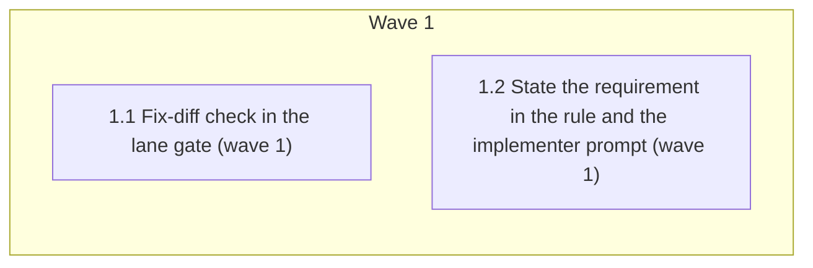

# Prove the red test is real (bug-fix lane)

<!-- AT-A-GLANCE:BEGIN (generated — do not edit; refreshed by render_plan.py --summarize) -->
## At a glance

**2 tasks · 1 waves · 4 files · 2/2 done**

| Wave | Task | Title | Files | Done (acceptance) |
|---|---|---|---|---|
| 1 | 1.1 | Fix-diff check in the lane gate (wave 1) | scripts/verify_summary.py, scripts/test_verify_summary.py | SC-1 to SC-6 exit 0; `python3 -m pytest -q scripts/test_verify_summary.py` exits… |
| 1 | 1.2 | State the requirement in the rule and the implementer prompt (wave 1) | rules/auto-correct-scope.md, skills/subagent-driven-development/implementer-prompt.md | SC-7, SC-8, SC-9 and SC-10 exit 0; `python3 scripts/audit_skill_prompts.py` exit… |

### Progress
- [x] 1.1 — Fix-diff check in the lane gate (wave 1)
- [x] 1.2 — State the requirement in the rule and the implementer prompt (wave 1)
<!-- AT-A-GLANCE:END -->

## 1. Motivation

For a bug-fix SUMMARY, `scripts/verify_summary.py --lane` accepts a `red`/`green` row pair from
the text alone. A "fix" that changes no code after the red commit still passes. Issue #313 step 1
adds a check: after the red commit, a change must exist outside `specs/` and the red test files.
Design: `specs/gh-313-prove-the-red/design.md` (D1–D9). Research:
`specs/gh-313-prove-the-red/research-brief.md`.

## 2. Non-goals

- Issue #313 step 2 (route bug fixes to `diagnosing-bugs`); it waits for #318.
- Re-running the red or green test; proving that the change fixes the bug.
- Changes to `hooks/commit-gate.sh`, `scripts/run_at_commit.py`, or the SUMMARY format.
- Edits to old bug-fix SUMMARYs.

## 3. Success Criteria

| ID | Behavior (observable) | Check (re-runnable) | Expected |
|------|-------------------------|-----------------------|------------|
| SC-1 | Canary: a bug-fix SUMMARY whose fix changes nothing after the red commit exits 1 under `REQUIRE_RED_TEST=1` and prints a `!` advisory without it | `python3 -m pytest -q scripts/test_verify_summary.py -k fix_diff_noop` | exit 0 |
| SC-2 | A real code change after the red commit exits 0 with no fix-diff message | `python3 -m pytest -q scripts/test_verify_summary.py -k fix_diff_real_fix` | exit 0 |
| SC-3 | Test-only, specs-only, directory-token, staged-fix, unknown-sha, not-a-repo, exempt and non-bug-fix cases give the design's results | `python3 -m pytest -q scripts/test_verify_summary.py -k fix_diff` | exit 0 |
| SC-4 | A SUMMARY copy outside the repo, with the cwd in the repo, is checked against the cwd's repo (commit-gate shape) | `python3 -m pytest -q scripts/test_verify_summary.py -k fix_diff_commit_gate_shape` | exit 0 |
| SC-5 | The committed gh-302 bug-fix SUMMARY passes `--lane` under `REQUIRE_RED_TEST=1` | `python3 -m pytest -q scripts/test_verify_summary.py -k fix_diff_gh302` | exit 0 |
| SC-6 | The existing red/green tests pass | `python3 -m pytest -q scripts/test_verify_summary.py -k RedGreen` | exit 0 |
| SC-7 | The bug-fix rule in `rules/auto-correct-scope.md` states the new requirement | `grep -q "and the red test files" rules/auto-correct-scope.md` | exit 0 |
| SC-8 | The implementer prompt states the new requirement | `grep -q "and the red test files" skills/subagent-driven-development/implementer-prompt.md` | exit 0 |
| SC-9 | Changed prose adds no hard STE finding | `python3 scripts/check_ste_baseline.py --strict --against ece206d` | exit 0 |
| SC-10 | The task-review phrase pins still pass | `python3 scripts/check_task_review_contract.py` | exit 0 |
| SC-11 | This plan passes the plan contract with seams | `python3 scripts/check_plan_contract.py specs/gh-313-prove-the-red/PLAN.md` | exit 0 |

## Global Constraints

- Plan-contract: 2
- Work in the task worktree root. Edit only the files your task names. Never edit `.claude/`,
  `hooks/`, `settings.json`, `scripts/run_at_commit.py`, `skills/visual-planner/render_plan.py`,
  `scripts/ste-baseline.json`, `VERSION` or `CHANGELOG.md`. If a check cannot pass without one of
  these files, stop and report.
- Read `specs/gh-313-prove-the-red/design.md` (Architecture, Worked trace, Error behavior, Tests,
  Decisions D1–D9) and `specs/gh-313-prove-the-red/research-brief.md` (Evidence Ledger,
  Recommendation, Risks) before you edit. They are the spec.
- The branch base for every comparison is `ece206d`. Before the first task, run
  `git merge-base --is-ancestor ece206d HEAD` and confirm it exits 0. If it does not, stop and
  report. The remote is `github`, not `origin`.
- The system `python3` may have no pytest. Where an SC or Verify command says
  `python3 -m pytest`, run it as `${TMPDIR:-/tmp}/harness-tests-venv/bin/python -m pytest` with
  the same arguments when `python3 -m pytest` reports `No module named pytest`. Record the command
  you ran.
- Run shell commands as plain, separate commands. Commit only your own files: run
  `git add -- <files>`, then `git commit -- <files>` in a separate call. Never use `git add -A`,
  `git reset` or `git stash`.
- Prose under `skills/` and `rules/` follows `skills/asd-ste100/SKILL.md`: one instruction per
  sentence, at most 20 words in an instruction and 25 in a description, no semicolon in a new
  sentence, active voice. `ste-lint` does not read prose inside a code fence, so check fenced
  prompt sentences by hand against the same limits.
- Do not use the words `correctly`, `properly`, `as expected`, `works`, `is correct`,
  `looks right`, `appropriate` or `reasonable` in a `Verify:` or `Done:` line
  (`rules/terminology.md` §3).

## 4. Tasks

### Task 1.1 — Fix-diff check in the lane gate (wave 1)

- **Files:** scripts/verify_summary.py, scripts/test_verify_summary.py
- **Action:** Write the tests first in `scripts/test_verify_summary.py`, then change
  `scripts/verify_summary.py`.
  - Code. Extract `_red_pairs(text)` from the red-row loop in `_red_green_issue`: it returns the
    `(red_sha, test_command)` of each red row with a matching green row, and `[]` for a
    non-bug-fix SUMMARY or when a `Red test exempt:` line has a non-empty reason.
    `_red_green_issue` keeps its signature and its messages. Add `_red_fix_diff_issue(text)`.
    Run every git command through the existing `_git(root, ...)` helper. For each pair it runs, in
    the process cwd: `git rev-parse --show-toplevel`; then in that root
    `git rev-parse --verify --quiet <sha>^{commit}`; then
    `git diff --cached --name-only -z --no-renames <commit> --`. Split that output on `\0` and drop
    empty entries. Split the test command on
    whitespace. Strip a `::…` suffix and a leading `./` from each token. Drop each diff path under
    `specs/` and each path equal to a token. If no path remains, return
    `bug fix: no code change after red commit <sha> outside specs/ and the red test files`.
    Map failures to `bug fix: cannot check the fix diff for red commit <sha> -- <cause>`, with
    cause `git is not available` (`OSError`), `the current directory is not in a git repository`
    (toplevel fails), or `the commit does not resolve here` (verify fails). Return the first
    message found, else `None`. Wire it into `check_lane_warnings` (advisory, with
    `_RED_TEST_ENV`) and `check_lane_evidence` (error under `_red_test_is_blocking()`) beside
    `_red_green_issue`. Docstring: `Verifies:` (provenance) a path outside `specs/` and the red
    test files differs between the red commit and the index. `Does not verify:` that the change
    fixes the bug, or that the red exit was real.
  - Tests. Add a fixture that builds a real git repo in `tmp_path` (copy the pattern of
    `scripts/test_run_at_commit.py`), commits a source file and a test file as the red commit,
    and sets the cwd with `monkeypatch.chdir`. Name every new test `test_fix_diff_<case>`.
    Cases: `noop` (no change after red: `main(["--lane", path])` returns 1 with
    `REQUIRE_RED_TEST=1` and prints a line that starts with `!` and holds `no code change` without
    it); `real_fix` (source change committed: returns 0, no fix-diff text in output);
    `test_only`; `specs_only`; `directory_token` (`pytest scripts/` does not drop
    `scripts/x.py`); `staged_fix` (staged, not committed: no message); `unknown_sha`
    (`the commit does not resolve here`); `not_a_repo` (cwd outside any repo:
    `not in a git repository`); `exempt_and_non_bug_fix` (no git call: patch
    `subprocess.check_output` to fail the test if called); `commit_gate_shape` (SUMMARY file in a
    second `tmp_path` dir outside the repo, cwd in the repo with a real fix: returns 0);
    `gh302` (run `main(["--lane", <repo root>/specs/gh-302-red-green-input-type/SUMMARY.md])` with
    `REQUIRE_RED_TEST=1` and cwd at the repo root; skip with `pytest.skip` when
    `git rev-parse --verify --quiet ee6da93^{commit}` fails). Take each expected message from the
    design's Error behavior section, not from the code's output. In `TestRedGreen`, move each
    case that expects a pass under `REQUIRE_RED_TEST=1`, or asserts no warning without the
    switch, to the temp-repo fixture with a real fix. This includes
    `test_red_green_valid_pair_has_no_warning`. Widen the `_red_green_messages` helper so it also
    collects messages that start with `bug fix:`. Do not loosen an assertion.
- **Verify:** `python3 -m pytest -q scripts/test_verify_summary.py`
- **Done:** SC-1 to SC-6 exit 0; `python3 -m pytest -q scripts/test_verify_summary.py` exits 0;
  `python3 -m pytest -q -rs scripts/test_verify_summary.py -k fix_diff_gh302` reports `1 passed`
  and no skip.
- **Criteria:** SC-1, SC-2, SC-3, SC-4, SC-5, SC-6
- **Interfaces:** Consumes: design D1–D9, Error behavior, and the research brief's git command sequence. Produces: `scripts/verify_summary.py`, `scripts/test_verify_summary.py`.
- **Seams:** `verify_summary.main(["--lane", path])` exit code and output in a real temp git repo — catches: a no-op fix passing, a real fix rejected, a wrong exclusion or cause; misses: git versions other than the local one | the committed gh-302 SUMMARY in this repo — catches: a rule that rejects a real bug-fix record; misses: bug-fix records in consumer repos

### Task 1.2 — State the requirement in the rule and the implementer prompt (wave 1)

- **Files:** rules/auto-correct-scope.md, skills/subagent-driven-development/implementer-prompt.md
- **Action:** In `rules/auto-correct-scope.md`, in the bullet that starts `**any lane, `Input-type: bug fix`**`,
  after the `green` row sentence, add one sentence: after the red commit, a change must exist
  outside `specs/` and the red test files. Keep every other word of the bullet. In
  `implementer-prompt.md`, in the bug-fix block, after the `green` row step, add one step: after
  the red commit, change code outside `specs/` and the red test files. Both new sentences must
  hold the exact text `and the red test files`. Keep the existing pinned phrases
  (`Write the red test at a declared seam` and the strings in
  `scripts/check_task_review_contract.py`). Keep `python3 scripts/run_at_commit.py <red sha> --
  <test command>` word for word.
- **Verify:** `python3 scripts/check_task_review_contract.py`
- **Done:** SC-7, SC-8, SC-9 and SC-10 exit 0; `python3 scripts/audit_skill_prompts.py` exits 0;
  `git diff --stat ece206d..HEAD -- rules/ skills/` lists only the two files.
- **Criteria:** SC-7, SC-8, SC-9, SC-10
- **Interfaces:** Consumes: design D7. Produces: `rules/auto-correct-scope.md`, `skills/subagent-driven-development/implementer-prompt.md`.
- **Seams:** none — prose-only change, checked by grep, STE baseline and the phrase pins

## 5. Risks

- `git commit -- <paths>` commits worktree copies, not the index, so the checked tree can differ
  from the committed tree. Every index-reading check in `commit-gate.sh` shares this limit.
- Git behavior on the macOS CI runner was not measured. The options used are long-standing.
- A renamed test file counts as a fix, because only exact token paths are dropped (design "What we
  do not claim").

### Assumption coverage

- A1 → SC-4
- A2 → SC-3
- A3 → SC-5

Not an SC row (Guardrail 4): `bash scripts/run-tests.sh` must exit 0 at branch finish. The
controller writes a dedicated SUMMARY `### Verify` row for the SC-1 canary run (intent: record the
canary run).

## 6. Status Log

- 2026-10-17 — plan written from design e0836a9 and the research brief
- 2026-10-17 — tasks 1.1, 1.2 complete; commits 6572584, 579eb28
