# diagnosing-bugs skill with six gated phases

<!-- AT-A-GLANCE:BEGIN (generated — do not edit; refreshed by render_plan.py --summarize) -->
## At a glance

**14 tasks · 8 waves · 30 files · 14/14 done**

| Wave | Task | Title | Files | Done (acceptance) |
|---|---|---|---|---|
| 1 | 1.1 | The diagnosing-bugs skill folder and its registration (wave 1) | skills/diagnosing-bugs/SKILL.md, skills/diagnosing-bugs/references/phases.md, skills/diagnosing-bugs/references/diagnosis-template.md, skills/diagnosing-bugs/references/diagnosis-review-prompt.md, skills/diagnosing-bugs/scripts/hitl-loop.template.sh, skills/diagnosing-bugs/tests/routing-cases.md, harness-manifest.json, scripts/test_audit_skill_prompts.py | SC-1 to SC-7, SC-9, SC-10 and SC-11 exit 0; `python3 scripts/check_ste_baseline.… |
| 1 | 1.2 | Seam rule accepts a diagnosed no-seam bug fix (wave 1) | rules/plan-format.md, skills/subagent-driven-development/implementer-prompt.md, skills/subagent-driven-development/task-reviewer-prompt.md | SC-15, SC-16, SC-17 and SC-18 exit 0; `python3 scripts/check_ste_baseline.py --s… |
| 1 | 1.3 | SDD controller: diagnosis context, seam check, Phase 6 (wave 1) | skills/subagent-driven-development/SKILL.md, skills/subagent-driven-development/references/bug-fix.md, skills/subagent-driven-development/references/review-chain.md | SC-19, SC-20, SC-21 exit 0; SC-2, SC-8, SC-18 and SC-32 exit 0; `bash tests/scri… |
| 2 | 2.1 | Intake routing, writing-plans seam copy, compound input (wave 2) | skills/feature-intake/SKILL.md, skills/writing-plans/SKILL.md, skills/compound/SKILL.md | SC-12, SC-22, SC-23 exit 0; SC-2, SC-8 and SC-32 exit 0; `bash tests/scripts/wri… |
| 2 | 2.2 | README bug-fix path, skills reference and handoff map (wave 2) | skills/README.md, skills/xia2/README.md | SC-8 and SC-14 exit 0; SC-13 exits 1. |
| 3 | 3.1 | Routing proof runs through a deployed harness (wave 3) | specs/gh-318-diagnosing-bugs/proof/extract_tool_calls.py, specs/gh-318-diagnosing-bugs/proof/quick-question.md, specs/gh-318-diagnosing-bugs/proof/bug-fix-routing.md | SC-26 and SC-28 exit 0; SC-27 and SC-29 exit 1. |
| 3 | 3.2 | Replay proof on a recorded bug (wave 3) | specs/gh-318-diagnosing-bugs/proof/transcript.py, specs/gh-318-diagnosing-bugs/proof/check_replay.py, specs/gh-318-diagnosing-bugs/proof/replay.md, specs/gh-318-diagnosing-bugs/proof/replay-diff.patch | SC-30 exits 0 and SC-31 exits 1; `grep -q "scripts/deploy-harness.sh" specs/gh-3… |
| 4 | 4.1 | Deploy rewrites the diagnosing-bugs skill path (wave 4) | scripts/deploy-harness.sh, tests/scripts/consumer-subset.test.sh | SC-33 exits 0; `bash tests/scripts/deploy-prune.test.sh` and `bash tests/scripts… |
| 4 | 4.2 | Skill states list-before-probe and names the review prompt (wave 4) | skills/diagnosing-bugs/SKILL.md, specs/gh-318-diagnosing-bugs/proof/transcript.py | SC-34 exits 0; SC-2, SC-11 and SC-24 exit 0; `python3 specs/gh-318-diagnosing-bu… |
| 5 | 5.1 | Replay re-run on the tightened skill (wave 5) | specs/gh-318-diagnosing-bugs/proof/replay.md, specs/gh-318-diagnosing-bugs/proof/replay-diff.patch | SC-30 exits 0 and SC-31 exits 1; `grep -q "scripts/deploy-harness.sh" specs/gh-3… |
| 6 | 6.1 | Skill commits the hypotheses before any probe (wave 6) | skills/diagnosing-bugs/SKILL.md, skills/diagnosing-bugs/references/diagnosis-template.md | SC-34, SC-35 and SC-36 exit 0; SC-2, SC-11, SC-24 and SC-33 exit 0. |
| 6 | 6.2 | HYPOTHESIS marker counts a Bash heredoc (wave 6) | specs/gh-318-diagnosing-bugs/proof/transcript.py | the two scratch checks give the stated marks; `transcript.py --help` exits 0. |
| 7 | 7.1 | Replay run on the committed-hypotheses skill (wave 7) | specs/gh-318-diagnosing-bugs/proof/replay.md, specs/gh-318-diagnosing-bugs/proof/replay-diff.patch | SC-30 exits 0 and SC-31 exits 1; `grep -q "scripts/deploy-harness.sh" specs/gh-3… |
| 8 | 8.1 | Clean replay without fix history or test hints (wave 8) | specs/gh-318-diagnosing-bugs/proof/replay-clean.md, specs/gh-318-diagnosing-bugs/proof/replay-clean-diff.patch | SC-37 exits 0; SC-38 and SC-39 exit 1. |

```mermaid
flowchart LR
  subgraph W0[Wave 1]
    T1_1["1.1 The diagnosing-bugs skill folder and its registration (wave 1)"]
    T1_2["1.2 Seam rule accepts a diagnosed no-seam bug fix (wave 1)"]
    T1_3["1.3 SDD controller: diagnosis context, seam check, Phase 6 (wave 1)"]
  end
  subgraph W1[Wave 2]
    T2_1["2.1 Intake routing, writing-plans seam copy, compound input (wave 2)"]
    T2_2["2.2 README bug-fix path, skills reference and handoff map (wave 2)"]
  end
  subgraph W2[Wave 3]
    T3_1["3.1 Routing proof runs through a deployed harness (wave 3)"]
    T3_2["3.2 Replay proof on a recorded bug (wave 3)"]
  end
  subgraph W3[Wave 4]
    T4_1["4.1 Deploy rewrites the diagnosing-bugs skill path (wave 4)"]
    T4_2["4.2 Skill states list-before-probe and names the review prompt (wave 4)"]
  end
  subgraph W4[Wave 5]
    T5_1["5.1 Replay re-run on the tightened skill (wave 5)"]
  end
  subgraph W5[Wave 6]
    T6_1["6.1 Skill commits the hypotheses before any probe (wave 6)"]
    T6_2["6.2 HYPOTHESIS marker counts a Bash heredoc (wave 6)"]
  end
  subgraph W6[Wave 7]
    T7_1["7.1 Replay run on the committed-hypotheses skill (wave 7)"]
  end
  subgraph W7[Wave 8]
    T8_1["8.1 Clean replay without fix history or test hints (wave 8)"]
  end
  W0 --> W1
  W1 --> W2
  W2 --> W3
  W3 --> W4
  W4 --> W5
  W5 --> W6
  W6 --> W7
```

### Progress
- [x] 1.1 — The diagnosing-bugs skill folder and its registration (wave 1)
- [x] 1.2 — Seam rule accepts a diagnosed no-seam bug fix (wave 1)
- [x] 1.3 — SDD controller: diagnosis context, seam check, Phase 6 (wave 1)
- [x] 2.1 — Intake routing, writing-plans seam copy, compound input (wave 2)
- [x] 2.2 — README bug-fix path, skills reference and handoff map (wave 2)
- [x] 3.1 — Routing proof runs through a deployed harness (wave 3)
- [x] 3.2 — Replay proof on a recorded bug (wave 3)
- [x] 4.1 — Deploy rewrites the diagnosing-bugs skill path (wave 4)
- [x] 4.2 — Skill states list-before-probe and names the review prompt (wave 4)
- [x] 5.1 — Replay re-run on the tightened skill (wave 5)
- [x] 6.1 — Skill commits the hypotheses before any probe (wave 6)
- [x] 6.2 — HYPOTHESIS marker counts a Bash heredoc (wave 6)
- [x] 7.1 — Replay run on the committed-hypotheses skill (wave 7)
- [x] 8.1 — Clean replay without fix history or test hints (wave 8)
<!-- AT-A-GLANCE:END -->

## 1. Motivation

`feature-intake` classifies `Input-type: bug fix` but routes it to no diagnosis step. The bug-fix
path in `skills/README.md` names an external, optional `systematic-debugging` skill. When it is
absent, the agent reads code and guesses. Issue #318 adds an in-repo `diagnosing-bugs` skill with
six gated phases, wired into intake, the bug-fix lane, `subagent-driven-development`,
`writing-plans`, and `compound`. Design: `specs/gh-318-diagnosing-bugs/design.md` (D1–D13).
Research: `specs/gh-318-diagnosing-bugs/research-brief.md`, including the four follow-up
questions that the user confirmed on 2026-10-17 ("yes for all").

## 2. Non-goals

- No change to `scripts/verify_summary.py`, `hooks/commit-gate.sh`, `settings.json`, or any hook.
- `REQUIRE_RED_TEST=1` stays opt-in.
- No file under `templates/`. No new script under `scripts/`.
- No copy of Pocock's text. `hitl-loop.template.sh` is written new.
- No task edits this repo's `.claude/`. It is gitignored and derived. The design's "deployed
  `.claude/` copies" step runs at branch finish as `bash scripts/deploy-harness.sh`, and Task 3.1
  proves a deployed copy through a scratch install.

## 3. Success Criteria

| ID | Behavior (observable) | Check (re-runnable) | Expected |
|------|-------------------------|-----------------------|------------|
| SC-1 | The skill file exists and sets `disable-model-invocation: true` | `grep -qx "disable-model-invocation: true" skills/diagnosing-bugs/SKILL.md` | exit 0 |
| SC-2 | Every audited skill, the new one and `subagent-driven-development` and `feature-intake` included, is at or under the 600-word ceiling | `python3 scripts/audit_skill_prompts.py` | exit 0 |
| SC-3 | The audit surface test counts 15 skills and 12 companion prompts | `python3 -m pytest -q scripts/test_audit_skill_prompts.py` | exit 0 |
| SC-4 | The manifest lists `diagnosing-bugs` and the manifest check passes | `python3 scripts/check_manifest.py` | exit 0 |
| SC-5 | Every backticked command in a skill and its references has a matching tool grant | `python3 scripts/check_skill_tool_conformance.py` | exit 0 |
| SC-6 | Every skill has a non-empty `allowed-tools:` line | `bash scripts/check-allowed-tools.sh` | exit 0 |
| SC-7 | No skill source names a deployed `.claude/` path or a model id | `python3 scripts/check_runtime_neutral_sources.py` | exit 0 |
| SC-8 | Every backticked repo path in the docs resolves | `bash scripts/lint-doc-truth.sh` | exit 0 |
| SC-9 | Fenced bash blocks in skills pass the syntax lint (shellcheck when installed) | `bash scripts/lint-skill-bash.sh` | exit 0 |
| SC-10 | The HITL loop template parses as bash | `bash -n skills/diagnosing-bugs/scripts/hitl-loop.template.sh` | exit 0 |
| SC-11 | The skill carries the redaction rule with the `<REDACTED>` token | `grep -q "<REDACTED>" skills/diagnosing-bugs/SKILL.md` | exit 0 |
| SC-12 | `feature-intake` routes a bug fix to the skill file by path | `grep -q "skills/diagnosing-bugs/SKILL.md" skills/feature-intake/SKILL.md` | exit 0 |
| SC-13 | No README names `systematic-debugging` | `grep -q systematic-debugging skills/README.md skills/xia2/README.md` | exit 1 — no match |
| SC-14 | The handoff map has a `diagnosing-bugs` row | `grep -qE "^diagnosing-bugs +──►" skills/README.md` | exit 0 |
| SC-15 | `rules/plan-format.md` allows `Seams: none — <reason>` for a bug-fix task whose `diagnosis.md` says `Seam: none` | `grep -q "Seam: none" rules/plan-format.md` | exit 0 |
| SC-16 | The implementer takes the `Red test exempt` path when `diagnosis.md` says `Seam: none` | `grep -q "Seam: none" skills/subagent-driven-development/implementer-prompt.md` | exit 0 |
| SC-17 | The task reviewer accepts that `Seams: none` case | `grep -q "Seam: none" skills/subagent-driven-development/task-reviewer-prompt.md` | exit 0 |
| SC-18 | The task-review and implementer phrase pins still pass | `python3 scripts/check_task_review_contract.py` | exit 0 |
| SC-19 | The SDD bug-fix reference states the seam check before dispatch | `grep -q "Seam:" skills/subagent-driven-development/references/bug-fix.md` | exit 0 |
| SC-20 | SDD SKILL.md points to the bug-fix reference | `grep -q "references/bug-fix.md" skills/subagent-driven-development/SKILL.md` | exit 0 |
| SC-21 | The final review chain runs Phase 6 cleanup for a diagnosed bug | `grep -qF "[DEBUG-" skills/subagent-driven-development/references/review-chain.md` | exit 0 |
| SC-22 | `writing-plans` copies `diagnosis.md` `Seam:` into the fix task | `grep -q "diagnosis.md" skills/writing-plans/SKILL.md` | exit 0 |
| SC-23 | `compound` takes the root cause from `diagnosis.md` | `grep -q "diagnosis.md" skills/compound/SKILL.md` | exit 0 |
| SC-24 | Changed and new prose adds no hard STE finding | `python3 scripts/check_ste_baseline.py --strict --against 09a7985` | exit 0 |
| SC-25 | This plan passes the plan contract with seams | `python3 scripts/check_plan_contract.py specs/gh-318-diagnosing-bugs/PLAN.md` | exit 0 |
| SC-26 | The quick-question run reached `feature-intake` (a Skill call or a Read of its SKILL.md) | `grep -qE "^[A-Z][A-Za-z]+ .*feature-intake" specs/gh-318-diagnosing-bugs/proof/quick-question.md` | exit 0 |
| SC-27 | The quick-question run did not read the diagnosing-bugs skill, by Read or by Bash (DC2) | `grep -qE "^[RB][a-z]+ .*diagnosing-bugs/SKILL\.md" specs/gh-318-diagnosing-bugs/proof/quick-question.md` | exit 1 — no match |
| SC-28 | The bug-fix run read the skill file, by the Read tool or by Bash (DC2) | `grep -qE "^[RB][a-z]+ .*diagnosing-bugs/SKILL\.md" specs/gh-318-diagnosing-bugs/proof/bug-fix-routing.md` | exit 0 |
| SC-29 | The bug-fix run made no Skill call for diagnosing-bugs | `grep -qx "Skill diagnosing-bugs" specs/gh-318-diagnosing-bugs/proof/bug-fix-routing.md` | exit 1 — no match |
| SC-30 | In the replay transcript, the red loop precedes the first hypothesis, which precedes the first probe, which precedes the diagnosis review | `python3 specs/gh-318-diagnosing-bugs/proof/check_replay.py specs/gh-318-diagnosing-bugs/proof/replay.md` | exit 0 |
| SC-31 | The replay fix diff has zero `[DEBUG-` tags | `grep -qF "[DEBUG-" specs/gh-318-diagnosing-bugs/proof/replay-diff.patch` | exit 1 — no match |
| SC-32 | The context-propagation pins on SDD and intake wording still pass | `bash tests/scripts/context-propagation-regression.test.sh` | exit 0 |
| SC-33 | A deployed consumer copy names the diagnosing-bugs skill at `.claude/skills/diagnosing-bugs/SKILL.md`, and the file exists there (DC1) | `bash tests/scripts/consumer-subset.test.sh` | exit 0 |
| SC-34 | The skill puts the ranked list before the first probe (DC3, DC4) | `grep -q "before the first probe" skills/diagnosing-bugs/SKILL.md` | exit 0 |
| SC-35 | Phase 1 runs the loop with no pipe, so its exit code shows the red (DC4) | `grep -q "with no pipe" skills/diagnosing-bugs/SKILL.md` | exit 0 |
| SC-36 | Phase 3 commits `diagnosis.md` with the hypotheses before the first probe (DC4) | `grep -q "Commit diagnosis.md before the first probe" skills/diagnosing-bugs/SKILL.md` | exit 0 |
| SC-37 | In the clean replay (no fix history, no hint), the red loop precedes the first hypothesis, which precedes the first probe, which precedes the review (DC5) | `python3 specs/gh-318-diagnosing-bugs/proof/check_replay.py specs/gh-318-diagnosing-bugs/proof/replay-clean.md` | exit 0 |
| SC-38 | The clean replay's fix diff has zero `[DEBUG-` tags (DC5) | `grep -qF "[DEBUG-" specs/gh-318-diagnosing-bugs/proof/replay-clean-diff.patch` | exit 1 — no match |
| SC-39 | The clean replay never names the real fix commit (DC5) | `grep -q "ac7f472" specs/gh-318-diagnosing-bugs/proof/replay-clean.md` | exit 1 — no match |

## Global Constraints

- Plan-contract: 2
- Work in the task worktree root. Edit only the files your task names. Never edit `.claude/`,
  `hooks/`, `settings.json`, `templates/`, `scripts/verify_summary.py`,
  `skills/visual-planner/render_plan.py`, `scripts/ste-baseline.json`, `VERSION` or
  `CHANGELOG.md`. If a check cannot pass without one of these files, stop and report.
- Read `specs/gh-318-diagnosing-bugs/design.md` (Architecture, the six phases, Worked trace,
  Error behavior, Tests, What we do not claim, Decisions D1–D13) and
  `specs/gh-318-diagnosing-bugs/research-brief.md` (Evidence Ledger, Risks, the four confirmed
  follow-up questions) before you edit. They are the spec. Do not read or copy upstream Pocock
  text.
- The branch base for every comparison is `09a7985`. Before the first task, run
  `git merge-base --is-ancestor 09a7985 HEAD` and confirm it exits 0. If it does not, stop and
  report. The remote is `origin`.
- The system `python3` may have no pytest. If `python3 -m pytest` reports
  `No module named pytest`, run `python3 -m pip install -q pytest` once and re-run. Record the
  command you ran.
- Run shell commands as plain, separate commands. Commit only your own files: run
  `git add -- <files>`, then `git commit -- <files>` in a separate call. Never use `git add -A`,
  `git reset` or `git stash`.
- The audit counts words on the whole file, frontmatter included (`scripts/audit_skill_prompts.py`).
  The ceiling is 600 words per `SKILL.md`. `subagent-driven-development/SKILL.md` is at 600 and
  `feature-intake/SKILL.md` is at 539 (measured at `09a7985`). Meet a ceiling by deleting a
  sentence whose removal changes no behavior (the #308 deletion test), not by squeezing words.
  Never delete a line that `tests/scripts/context-propagation-regression.test.sh` pins.
- Prose under `skills/`, `rules/` and `agents/` follows `skills/asd-ste100/SKILL.md`: one
  instruction per sentence, at most 20 words in an instruction and 25 in a description, no
  semicolon in a new sentence, active voice. A new prose file starts at STE baseline 0, so it must
  have zero hard findings. Check with
  `python3 skills/asd-ste100/scripts/ste-lint.py --json --disable synonym-rotation <file>`.
  `ste-lint` does not read prose inside a code fence. Check fenced prompt sentences by hand.
- Name the skill path as `skills/diagnosing-bugs/...` in every skill and rule. Never write a
  `.claude/` path (`scripts/check_runtime_neutral_sources.py`).
- Every `diagnosis.md` field name is fixed by the template in Task 1.1: `Loop:`, `Repro:`,
  `Hypotheses:`, `Probes:`, `Confirmed:`, `Seam:`. Hypotheses are numbered `H1` to `H5`. The seam
  point is the text before ` — catches:` (`rules/plan-format.md`). `Seam: none — <reason>` is
  the only no-seam form.
- Headless proof runs (Tasks 3.1, 3.2) use only these verified `claude` 2.1.302 flags:
  `-p`, `--output-format stream-json`, `--verbose`, `--permission-mode`, `--allowedTools`,
  `--max-budget-usd`. There is no `--max-turns`. Raw stream files stay in a scratch directory
  outside the repo. Only extracted logs go under `proof/`.
- Do not use the words `correctly`, `properly`, `as expected`, `works`, `is correct`,
  `looks right`, `appropriate` or `reasonable` in a `Verify:` or `Done:` line
  (`rules/terminology.md` §3).

## 4. Tasks

### Task 1.1 — The diagnosing-bugs skill folder and its registration (wave 1)

- **Files:** skills/diagnosing-bugs/SKILL.md, skills/diagnosing-bugs/references/phases.md, skills/diagnosing-bugs/references/diagnosis-template.md, skills/diagnosing-bugs/references/diagnosis-review-prompt.md, skills/diagnosing-bugs/scripts/hitl-loop.template.sh, skills/diagnosing-bugs/tests/routing-cases.md, harness-manifest.json, scripts/test_audit_skill_prompts.py
- **Action:** Write the skill folder per design Architecture and D1–D11.
  - `SKILL.md`: frontmatter `name: diagnosing-bugs`, a description that names a bug fix routed
    by intake or `/diagnosing-bugs`, `disable-model-invocation: true`, and a non-empty
    `allowed-tools:`. The grant must cover every backticked command in `SKILL.md` and in
    `references/*.md`, and must include `Agent` and `Task`, because the skill dispatches a
    `*prompt*.md` (`scripts/check_skill_tool_conformance.py`). The first body section is the
    redaction rule: replace each secret with `<REDACTED>` before you show or write a command or an
    output. Then state D4: every lane runs all six phases, with no "cause known" shortcut. Then
    the isolation step (D3: tiny runs `git checkout -b fix/<slug>`; normal and high-risk run
    `using-git-worktrees`). Then the six phases, each ending in one `Done when:` line taken from
    design "The six phases". Phase 1 with no loop writes an `ESCALATIONS.md` block with
    `decision: pending` and stops (D7). Phase 3 posts three to five ranked hypotheses `H1`–`H5`,
    each with a prediction, and continues without waiting (D6). Phase 4 tags each probe with a
    unique `[DEBUG-xxxx]` prefix, deletes every probe and throwaway harness before handoff, and
    commits `specs/<slug>/diagnosis.md` (D11). Between Phase 4 and Phase 5, dispatch
    `task-reviewer` with `references/diagnosis-review-prompt.md` and the `diagnosis.md` path (D5).
    Apply the Error behavior budgets: two reviews, two refutation rounds. Phase 5 on the tiny lane:
    write the red test at the `diagnosis.md` `Seam:`, commit it, then commit the fix; with
    `Seam: none — <reason>`, record a finding in `SUMMARY.md` and write
    `Red test exempt: <reason>`. Phase 5 on normal and high-risk: continue the lane route with
    `diagnosis.md` as an input. Phase 6 re-runs the loop, greps the tag in the fix diff and the
    working tree, deletes what is left, and names the confirmed hypothesis in the commit message
    and SUMMARY `Rationale`. Point to `references/phases.md` for long lists. Keep the whole file
    under 600 words.
  - `references/phases.md`: original text for loop-building techniques in preference order,
    minimisation tactics, and hypothesis and probe patterns. Do not copy upstream wording.
  - `references/diagnosis-template.md`: the shape of `specs/<slug>/diagnosis.md` with the six
    fields from Global Constraints, in that order, and one line of guidance under each.
  - `references/diagnosis-review-prompt.md`: the `task-reviewer` brief. Inputs: the
    `diagnosis.md` path and the SUMMARY path. It returns `spec_verdict` and `quality_verdict` in
    the YAML shape of `skills/subagent-driven-development/task-reviewer-prompt.md`. It fails the
    spec verdict when a field is missing, when `Loop:` has no red output, when fewer than three or
    more than five hypotheses exist, when a probe maps to no prediction, or when `Confirmed:`
    names no listed hypothesis. It states that the reviewer cannot re-run the loop.
  - `scripts/hitl-loop.template.sh`: an original bash script, mode 100644, run with `bash`. It
    defines `step "<instruction>"` (print, wait for Enter) and `capture VAR "<question>"` (read
    one answer). It ends by printing `--- Captured ---` and one `KEY=VALUE` line per capture.
  - `tests/routing-cases.md`: case table in the style of
    `skills/feature-intake/tests/lane-classification-cases.md`. Rows: a quick question does not
    fire the skill; a bug-fix input reads `skills/diagnosing-bugs/SKILL.md`; `/diagnosing-bugs`
    runs it; a tiny bug fix still runs all six phases (D4).
  - `harness-manifest.json`: add `"diagnosing-bugs"` to `skills[]` in alphabetical order.
  - `scripts/test_audit_skill_prompts.py`: change the pinned totals to 15 skills and 12
    companion prompts.
- **Verify:** `grep -qx "disable-model-invocation: true" skills/diagnosing-bugs/SKILL.md`
- **Done:** SC-1 to SC-7, SC-9, SC-10 and SC-11 exit 0; `python3 scripts/check_ste_baseline.py --strict --against 09a7985` prints no WARN line that names a `skills/diagnosing-bugs/` file.
- **Criteria:** SC-1, SC-2, SC-3, SC-4, SC-5, SC-6, SC-7, SC-9, SC-10, SC-11, SC-24
- **Interfaces:** Consumes: design D1–D11, Error behavior, the confirmed follow-up 3. Produces: `skills/diagnosing-bugs/SKILL.md`, `skills/diagnosing-bugs/references/diagnosis-template.md`, `skills/diagnosing-bugs/references/diagnosis-review-prompt.md`, `skills/diagnosing-bugs/scripts/hitl-loop.template.sh`, `harness-manifest.json`.
- **Seams:** `scripts/audit_skill_prompts.py --json` totals and per-skill words — catches: a ceiling breach, an unlisted skill, a wrong prompt count; misses: whether the prose drives a model to follow the phases | `bash -n` on the HITL template — catches: a syntax error; misses: interactive behavior

### Task 1.2 — Seam rule accepts a diagnosed no-seam bug fix (wave 1)

- **Files:** rules/plan-format.md, skills/subagent-driven-development/implementer-prompt.md, skills/subagent-driven-development/task-reviewer-prompt.md
- **Action:** Apply confirmed follow-up 1 (D13) and the design's red-test target. In
  `rules/plan-format.md`, change the bullet `A bug-fix task never writes none` so one exception
  holds: when `specs/<slug>/diagnosis.md` says `Seam: none — <reason>`, the fix task writes
  `Seams: none — <reason>` with the same reason. In `implementer-prompt.md`, in the bug-fix block:
  when Context names a `diagnosis.md`, the red test targets its `Confirmed:` hypothesis; replace
  the rule that returns `NEEDS_CONTEXT` on `Seams: none` so that, when `diagnosis.md` says
  `Seam: none — <reason>`, the implementer writes `Red test exempt: <reason>` in `### Verify` and
  skips the red and green rows, and otherwise keeps `NEEDS_CONTEXT`. In `task-reviewer-prompt.md`,
  step 4 of the seam check (`Seams:` is `none`) stays an Important finding, except for a bug-fix
  task whose `diagnosis.md` says `Seam: none — <reason>` with the same reason. Each of the three
  files must hold the literal `Seam: none`. Keep every string pinned in
  `scripts/check_task_review_contract.py` word for word, including
  `Write the red test at a declared seam` and
  `cannot observe the behavior, return \`NEEDS_CONTEXT\` before any edit`.
- **Verify:** `grep -q "Seam: none" skills/subagent-driven-development/implementer-prompt.md`
- **Done:** SC-15, SC-16, SC-17 and SC-18 exit 0; `python3 scripts/check_ste_baseline.py --strict --against 09a7985` prints no WARN line that names one of the three files.
- **Criteria:** SC-15, SC-16, SC-17, SC-18, SC-24
- **Interfaces:** Consumes: design D13, Architecture "the red test targets the confirmed hypothesis", confirmed follow-up 1. Produces: `rules/plan-format.md`, `skills/subagent-driven-development/implementer-prompt.md`, `skills/subagent-driven-development/task-reviewer-prompt.md`.
- **Seams:** `scripts/check_task_review_contract.py` exit and stderr — catches: a removed pinned phrase; misses: the meaning of the new exception, which the task reviewer reads

### Task 1.3 — SDD controller: diagnosis context, seam check, Phase 6 (wave 1)

- **Files:** skills/subagent-driven-development/SKILL.md, skills/subagent-driven-development/references/bug-fix.md, skills/subagent-driven-development/references/review-chain.md
- **Action:** Apply D12 and confirmed follow-up 2. Write the new
  `references/bug-fix.md` (original prose, STE). It applies when SUMMARY says
  `Input-type: bug fix` and `specs/<slug>/diagnosis.md` exists. It tells the controller to:
  name the `diagnosis.md` path in the fix task's Context; before dispatch, confirm the plan has
  the `- Plan-contract: 2` marker and the fix task has a `Seams:` line (a missing marker or line
  is a mismatch); compare the first seam point of `Seams:` (text before ` — catches:`) with
  `diagnosis.md` `Seam:` for an exact match; on a mismatch, not dispatch, then correct `Seams:`
  itself on the normal lane or return the task to `writing-plans` on high-risk; on a second
  mismatch, write an `ESCALATIONS.md` block with `decision: pending` and stop. In `SKILL.md`, add
  one sentence under "Execute waves" that reads `references/bug-fix.md` for a diagnosed bug fix.
  Pay for its words with a deletion elsewhere in `SKILL.md` that passes the #308 deletion test,
  so the file stays at or under 600 words. Keep `spec then quality` and
  `spec-reviewer-prompt.md` absent. In `references/review-chain.md`, add a first step for a
  diagnosed bug fix: before the audit, run `diagnosing-bugs` Phase 6 (re-run the loop, grep the
  `[DEBUG-` tag in the branch diff and the working tree, delete what is left, name the confirmed
  hypothesis in the commit message and SUMMARY `Rationale`).
- **Verify:** `grep -q "Seam:" skills/subagent-driven-development/references/bug-fix.md`
- **Done:** SC-19, SC-20, SC-21 exit 0; SC-2, SC-8, SC-18 and SC-32 exit 0; `bash tests/scripts/final-review-package-contract.test.sh` exits 0.
- **Criteria:** SC-2, SC-8, SC-18, SC-19, SC-20, SC-21, SC-24, SC-32
- **Interfaces:** Consumes: design D5, D12, Worked trace steps 4–5, confirmed follow-up 2. Produces: `skills/subagent-driven-development/references/bug-fix.md`, `skills/subagent-driven-development/SKILL.md`, `skills/subagent-driven-development/references/review-chain.md`.
- **Seams:** `scripts/audit_skill_prompts.py --json` word count for `subagent-driven-development` — catches: a ceiling breach from the pointer; misses: whether a controller follows the seam check

### Task 2.1 — Intake routing, writing-plans seam copy, compound input (wave 2)

- **Files:** skills/feature-intake/SKILL.md, skills/writing-plans/SKILL.md, skills/compound/SKILL.md
- **Action:** In `skills/feature-intake/SKILL.md` `## Routes`, add one short line (D1, D8,
  research-brief Inference row): for `Input-type: bug fix`, use the Read tool on
  `skills/diagnosing-bugs/SKILL.md` and follow it before the lane route; do not call the Skill
  tool for it. Keep the file at or under 600 words; pay with a #308 deletion if needed. In
  `skills/writing-plans/SKILL.md`, add one sentence: when `specs/<slug>/diagnosis.md` exists,
  copy its `Seam:` into the fix task's `Seams:` and keep the `- Plan-contract: 2` marker. In
  `skills/compound/SKILL.md`, add one sentence to the bug track: when
  `specs/<slug>/diagnosis.md` exists, take the root cause from its `Confirmed:` hypothesis.
- **Verify:** `grep -q "skills/diagnosing-bugs/SKILL.md" skills/feature-intake/SKILL.md`
- **Done:** SC-12, SC-22, SC-23 exit 0; SC-2, SC-8 and SC-32 exit 0; `bash tests/scripts/writing-plans-contract.test.sh` and `bash tests/scripts/compound-contract.test.sh` exit 0.
- **Criteria:** SC-2, SC-8, SC-12, SC-22, SC-23, SC-24, SC-32
- **Interfaces:** Consumes: `skills/diagnosing-bugs/SKILL.md` from Task 1.1; design D1, D8, D12. Produces: `skills/feature-intake/SKILL.md`, `skills/writing-plans/SKILL.md`, `skills/compound/SKILL.md`.
- **Seams:** `scripts/lint-doc-truth.sh` path resolution and `scripts/audit_skill_prompts.py` word counts — catches: a dead skill path, a ceiling breach; misses: whether a model routes a bug fix (Task 3.1 proves that)

### Task 2.2 — README bug-fix path, skills reference and handoff map (wave 2)

- **Files:** skills/README.md, skills/xia2/README.md
- **Action:** In `skills/README.md`, replace the Bug Fix Path block so it reads:
  `feature-intake` → `diagnosing-bugs` (six phases, `diagnosis.md`, review) → the lane route →
  `compound`. Add a Skills Reference row for `diagnosing-bugs` marked **User- or intake-invoked**.
  Delete the `systematic-debugging` row from "External Skills". In the handoff map, replace the
  `systematic-debugging` line with a line that starts `diagnosing-bugs`, then `──►` and the lane
  route, and add `Input-type: bug fix → diagnosing-bugs` to the `feature-intake` line. In
  `skills/xia2/README.md`, reword the last table row to `Bug fix (any lane)` with
  `No — intake routes it to diagnosing-bugs`, so no row implies a "cause known" shortcut (D4). No
  file may still contain `systematic-debugging`.
- **Verify:** `grep -qE "^diagnosing-bugs +──►" skills/README.md`
- **Done:** SC-8 and SC-14 exit 0; SC-13 exits 1.
- **Criteria:** SC-8, SC-13, SC-14
- **Interfaces:** Consumes: `skills/diagnosing-bugs/SKILL.md` from Task 1.1 and confirmed follow-up 3. Produces: `skills/README.md`, `skills/xia2/README.md`.
- **Seams:** none — documentation-only change, checked by grep and the doc-truth lint

### Task 3.1 — Routing proof runs through a deployed harness (wave 3)

- **Files:** specs/gh-318-diagnosing-bugs/proof/extract_tool_calls.py, specs/gh-318-diagnosing-bugs/proof/quick-question.md, specs/gh-318-diagnosing-bugs/proof/bug-fix-routing.md
- **Action:** Prove A1 and confirmed follow-up 4.
  - First capture one short stream and read its `tool_use` blocks, to observe the Skill tool's
    input key. Then write `proof/extract_tool_calls.py`: it reads a stream-json file path and
    prints one line per `tool_use` block, `<Tool> <first argument>`. For Read print the
    `file_path` relative to the run directory, for Skill the skill name, for Bash the first 80
    characters of `command`. It prints no tool results.
  - Install the harness from this worktree into a new scratch directory outside the repo with
    `bash scripts/install-harness.sh --source <worktree> -y -d <scratch>`, then run `git init` and
    one empty commit there on a branch named `work`.
  - In the scratch directory, run `claude -p` twice with `--output-format stream-json --verbose`,
    `--permission-mode acceptEdits`, and
    `--allowedTools "Read Write Edit Glob Grep Skill Agent Task Bash"`. Save each stream in
    scratch. Run 1 (budget `--max-budget-usd 2`) prompt:
    `Use the feature-intake skill: what does verify_summary.py --lane check for a normal lane?`.
    Run 2 (budget `--max-budget-usd 4`) prompt:
    `Use the feature-intake skill: scripts/x.sh exits 0 when its input file is missing; it should exit 1.`
  - Write each extractor output to `proof/quick-question.md` and `proof/bug-fix-routing.md`. Start
    each file with two header lines that begin `# ` (the prompt, and the output of
    `claude --version`), so the header cannot match SC-26 to SC-29.
  - If `claude -p` cannot authenticate, return BLOCKED with its error. If run 2 ends before a
    read of the diagnosis skill file (Read or Bash, DC2), raise the budget once to `--max-budget-usd 8`. If it still ends
    early, return BLOCKED with the last tool line.
- **Verify:** `grep -qE "^[RB][a-z]+ .*diagnosing-bugs/SKILL\.md" specs/gh-318-diagnosing-bugs/proof/bug-fix-routing.md`
- **Done:** SC-26 and SC-28 exit 0; SC-27 and SC-29 exit 1.
- **Criteria:** SC-26, SC-27, SC-28, SC-29
- **Interfaces:** Consumes: the deployed harness built from Tasks 1.1–2.2. Produces: `specs/gh-318-diagnosing-bugs/proof/extract_tool_calls.py`, `specs/gh-318-diagnosing-bugs/proof/quick-question.md`, `specs/gh-318-diagnosing-bugs/proof/bug-fix-routing.md`.
- **Seams:** the extracted tool-call log of a real `claude -p` stream — catches: the skill firing on a quick question, a Skill-tool call instead of a Read; misses: other runtimes (Codex) and other prompts

### Task 3.2 — Replay proof on a recorded bug (wave 3)

- **Files:** specs/gh-318-diagnosing-bugs/proof/transcript.py, specs/gh-318-diagnosing-bugs/proof/check_replay.py, specs/gh-318-diagnosing-bugs/proof/replay.md, specs/gh-318-diagnosing-bugs/proof/replay-diff.patch
- **Action:** Prove A2, A4 and the design's replay proof.
  - Write `proof/transcript.py`. It reads a stream-json file and the loop command, and prints one
    line per assistant text block and per tool call, in stream order. It reads tool results to
    set markers by these fixed rules. `LOOP-RED`: a Bash call whose command contains the loop
    command and whose result has `is_error` true or reports a non-zero exit. `HYPOTHESIS`: a text
    block or a Write input that holds a line whose first word, after whitespace, list markers and
    `*`, is `H1`. `PROBE`: a tool call whose input contains `[DEBUG-`. `REVIEW`: an Agent or Task
    call whose input names `diagnosis-review-prompt.md`. When one line matches more than one rule,
    the first match in the order REVIEW, PROBE, HYPOTHESIS, LOOP-RED wins. Any other line gets
    `-`.
  - Write `proof/check_replay.py`. It exits 0 only when the first `LOOP-RED` line comes before
    the first `HYPOTHESIS`, the first `HYPOTHESIS` before the first `PROBE`, and the first
    `PROBE` before the first `REVIEW`. It exits 1 and names the first failed pair otherwise.
  - Make a throwaway worktree outside the repo at 0048a16, on a new branch `replay`. Install the
    harness from this branch into it with
    `bash scripts/install-harness.sh --source <this worktree> -y -d <replay worktree>`. This gives
    it the diagnosing-bugs skill, the `task-reviewer` agent, and settings; 0048a16 ignores
    `.claude/`. Overlay `tests/scripts/resync-conflict.test.sh` from 8e72f7f and commit it.
  - Run `claude -p` there with `--output-format stream-json --verbose`,
    `--permission-mode acceptEdits`,
    `--allowedTools "Read Write Edit Glob Grep Agent Task Bash"`, and `--max-budget-usd 10`. Save
    the stream in scratch. Prompt with the symptom only:
    `A tty-less re-sync with no --yes prints the conflict menu and never prints the keeping-your-local-copy warning. Read the diagnosing-bugs SKILL.md under .claude/skills with the Read tool and follow it on the tiny lane.`
    Do not name the cause.
  - Run `proof/transcript.py` with the loop command from the run's `diagnosis.md` and write its
    output to `proof/replay.md`. Write
    `git diff 0048a16 -- . ':!specs' ':!.claude' ':!tests/scripts/resync-conflict.test.sh'`
    from the replay worktree to `proof/replay-diff.patch`. Apply `<REDACTED>` to any secret.
    Remove the worktree afterwards.
  - If the run stops before a fix, return BLOCKED with the last marker reached.
- **Verify:** `python3 specs/gh-318-diagnosing-bugs/proof/check_replay.py specs/gh-318-diagnosing-bugs/proof/replay.md`
- **Done:** SC-30 exits 0 and SC-31 exits 1; `grep -q "scripts/deploy-harness.sh" specs/gh-318-diagnosing-bugs/proof/replay-diff.patch` exits 0.
- **Criteria:** SC-30, SC-31
- **Interfaces:** Consumes: the harness from Tasks 1.1–2.2; the pre-fix commit 0048a16 and the test commit 8e72f7f. Produces: `specs/gh-318-diagnosing-bugs/proof/transcript.py`, `specs/gh-318-diagnosing-bugs/proof/check_replay.py`, `specs/gh-318-diagnosing-bugs/proof/replay.md`, `specs/gh-318-diagnosing-bugs/proof/replay-diff.patch`.
- **Seams:** `check_replay.py` exit on the marked transcript — catches: a hypothesis before a red loop, a probe before the ranked list, a first review before the first probe; misses: whether a marker rule matches the model's intent, which is traceability tier only

### Task 4.1 — Deploy rewrites the diagnosing-bugs skill path (wave 4)

- **Files:** scripts/deploy-harness.sh, tests/scripts/consumer-subset.test.sh
- **Action:** Apply DC1 and D14. Write the test first: in `tests/scripts/consumer-subset.test.sh`,
  after the `asd-ste100` ste-lint check, add a case that copies its shape. The derived
  `skills/feature-intake/SKILL.md` must not name a bare `skills/diagnosing-bugs/SKILL.md`, it must
  name `.claude/skills/diagnosing-bugs/SKILL.md`, and that file must exist under the target. Run
  the test and see the new case fail. Then, in `scripts/deploy-harness.sh` `rewrite_derived_paths`,
  add one pattern and its substitute in the same style as the `asd-ste100` pair:
  `(?<![\w./-])skills/diagnosing-bugs/SKILL\.md` → `.claude/skills/diagnosing-bugs/SKILL.md`. Extend
  the comment above the `asd-ste100` pattern by one line naming the new path. Keep the rewrite
  idempotent; the existing idempotency case in the same test must still pass.
- **Verify:** `bash tests/scripts/consumer-subset.test.sh`
- **Done:** SC-33 exits 0; `bash tests/scripts/deploy-prune.test.sh` and `bash tests/scripts/install-harness.test.sh` exit 0; SC-8 exits 0.
- **Criteria:** SC-8, SC-33
- **Interfaces:** Consumes: design D14, DC1. Produces: `scripts/deploy-harness.sh`, `tests/scripts/consumer-subset.test.sh`.
- **Seams:** `tests/scripts/consumer-subset.test.sh` derived-tree grep after a real deploy — catches: a bare skill path left in the consumer copy, a double `.claude/.claude/` prefix; misses: whether a model reads the rewritten path

### Task 4.2 — Skill states list-before-probe and names the review prompt (wave 4)

- **Files:** skills/diagnosing-bugs/SKILL.md, specs/gh-318-diagnosing-bugs/proof/transcript.py
- **Action:** Apply DC3 and D16. In `skills/diagnosing-bugs/SKILL.md`, Phase 3: post the ranked
  list `H1`–`H5` as reply text before the first probe, then continue without waiting. The phrase
  `before the first probe` must appear. Phase 4: start no probe before that list is posted. In the
  diagnosis review step, tell the agent to name `references/diagnosis-review-prompt.md` by path in
  the `task-reviewer` dispatch, not to paste its text. The file is at 594 of 600 words: pay for
  every added word with #308 deletions in the same file and stay at or under 600. In
  `proof/transcript.py`, widen only the REVIEW rule: an Agent or Task call whose input names
  `diagnosis-review-prompt.md`, or whose `subagent_type` is `task-reviewer`. Keep every other
  marker rule and the precedence order unchanged.
- **Verify:** `grep -q "before the first probe" skills/diagnosing-bugs/SKILL.md`
- **Done:** SC-34 exits 0; SC-2, SC-11 and SC-24 exit 0; `python3 specs/gh-318-diagnosing-bugs/proof/transcript.py --help` exits 0.
- **Criteria:** SC-2, SC-11, SC-24, SC-34
- **Interfaces:** Consumes: design D16, DC3; the Task 3.2 stream shapes. Produces: `skills/diagnosing-bugs/SKILL.md`, `specs/gh-318-diagnosing-bugs/proof/transcript.py`.
- **Seams:** `scripts/audit_skill_prompts.py --json` word count for diagnosing-bugs and the SC-34 grep — catches: a ceiling breach, a missing order rule; misses: whether a model obeys the order (Task 5.1 shows one run)

### Task 5.1 — Replay re-run on the tightened skill (wave 5)

- **Files:** specs/gh-318-diagnosing-bugs/proof/replay.md, specs/gh-318-diagnosing-bugs/proof/replay-diff.patch
- **Action:** Re-run Task 3.2's replay once, with the same setup, prompt and flags, against a
  harness installed from this branch after Tasks 4.1 and 4.2. Reuse the Task 3.2 drivers in the
  scratch root. Add `':!.gitignore'` to the diff pathspec, because the install changes
  `.gitignore`. Overwrite `proof/replay.md` and `proof/replay-diff.patch` with this run. Do not run
  more than once to look for a passing sample. The loop-command input to `proof/transcript.py` is
  fixed before the run: the basename of the last whitespace-separated token of the run's
  `diagnosis.md` `Loop:` value (for `bash $SCRATCH/loop.sh` that is `loop.sh`). Do not choose it
  after seeing the run. Report the single result as it comes: the marker
  lines, the confirmed hypothesis, and whether it matches the known cause. If SC-30 fails, return
  DONE_WITH_CONCERNS with the failed pair.
- **Verify:** `python3 specs/gh-318-diagnosing-bugs/proof/check_replay.py specs/gh-318-diagnosing-bugs/proof/replay.md`
- **Done:** SC-30 exits 0 and SC-31 exits 1; `grep -q "scripts/deploy-harness.sh" specs/gh-318-diagnosing-bugs/proof/replay-diff.patch` exits 0.
- **Criteria:** SC-30, SC-31
- **Interfaces:** Consumes: `skills/diagnosing-bugs/SKILL.md` and `specs/gh-318-diagnosing-bugs/proof/transcript.py` from Task 4.2; `scripts/deploy-harness.sh` from Task 4.1. Produces: `specs/gh-318-diagnosing-bugs/proof/replay.md`, `specs/gh-318-diagnosing-bugs/proof/replay-diff.patch`.
- **Seams:** `check_replay.py` exit on the marked transcript — catches: a hypothesis before a red loop, a probe before the ranked list, a first review before the first probe; misses: run-to-run variance (one sample)

### Task 6.1 — Skill commits the hypotheses before any probe (wave 6)

- **Files:** skills/diagnosing-bugs/SKILL.md, skills/diagnosing-bugs/references/diagnosis-template.md
- **Action:** Apply DC4 and D17. In `skills/diagnosing-bugs/SKILL.md`: Phase 1, add that the loop
  command runs as written, with no pipe, so its exit code shows the red (the phrase `with no pipe`
  must appear). Phase 2, add that it adds no probe or debug log. Phase 3, replace the reply-text
  sentence: write three to five ranked hypotheses, `H1` to `H5`, each with a prediction, into
  `Hypotheses:`; then a sentence that holds the exact text `Commit diagnosis.md before the first
  probe`; then post the list to the user and continue without waiting. Phase 4, replace its first
  sentence with "Start no probe before that commit." Keep the `before the first probe`, `<REDACTED>`
  and `skills/diagnosing-bugs/scripts/hitl-loop.template.sh` text, the red-then-fix sentence in
  Phase 5, every `Done when:` line and every Error-behavior budget. The file is at 599 of 600 words:
  pay for added words with #308 deletions in the same file and stay at or under 600. In
  `references/diagnosis-template.md`, add one guidance line under `Loop:` that the command runs with
  no pipe, and one under `Hypotheses:` that this field is committed before the first probe.
- **Verify:** `grep -q "Commit diagnosis.md before the first probe" skills/diagnosing-bugs/SKILL.md`
- **Done:** SC-34, SC-35 and SC-36 exit 0; SC-2, SC-11, SC-24 and SC-33 exit 0.
- **Criteria:** SC-2, SC-11, SC-24, SC-33, SC-34, SC-35, SC-36
- **Interfaces:** Consumes: design D17, DC4; `.harness-state/sdd/report-5.1.md`. Produces: `skills/diagnosing-bugs/SKILL.md`, `skills/diagnosing-bugs/references/diagnosis-template.md`.
- **Seams:** `scripts/audit_skill_prompts.py --json` word count and the SC-35/SC-36 greps — catches: a ceiling breach, a missing gate sentence; misses: whether a model obeys the order (Task 7.1 shows one run)

### Task 6.2 — HYPOTHESIS marker counts a Bash heredoc (wave 6)

- **Files:** specs/gh-318-diagnosing-bugs/proof/transcript.py
- **Action:** Apply DC4. Widen only the HYPOTHESIS rule: a text block, a Write input, or a Bash call
  input that holds a line whose first word, after whitespace, list markers and `*`, is `H1`. Keep the
  precedence REVIEW, PROBE, HYPOTHESIS, LOOP-RED and every other rule unchanged. Update the docstring.
  Check on two scratch streams built from the shape of
  `/tmp/claude-0/-home-user-agent-harness/e2aec56b-9fed-5e48-bc4a-4a3ce00b92d3/scratchpad/proof-3.2/stream-5.1.jsonl`:
  a Bash heredoc with an `H1` line is marked HYPOTHESIS; a Bash call with no `H1` line is not.
- **Verify:** `python3 specs/gh-318-diagnosing-bugs/proof/transcript.py --help`
- **Done:** the two scratch checks give the stated marks; `transcript.py --help` exits 0.
- **Criteria:** SC-30
- **Interfaces:** Consumes: design DC4; the Task 5.1 stream shape. Produces: `specs/gh-318-diagnosing-bugs/proof/transcript.py`.
- **Seams:** `transcript.py` output on a hand-made stream — catches: a Bash-written list left unmarked, an unrelated Bash call marked; misses: model behavior

### Task 7.1 — Replay run on the committed-hypotheses skill (wave 7)

- **Files:** specs/gh-318-diagnosing-bugs/proof/replay.md, specs/gh-318-diagnosing-bugs/proof/replay-diff.patch
- **Action:** Run the Task 5.1 replay once more, with the same setup, prompt, flags, loop-input rule
  and pathspec, against a harness installed from this branch after Tasks 6.1 and 6.2. Overwrite
  `proof/replay.md` and `proof/replay-diff.patch` with this run. Do not run more than once. Report
  the single result as it comes. If SC-30 fails, return DONE_WITH_CONCERNS with the failed pair.
- **Verify:** `python3 specs/gh-318-diagnosing-bugs/proof/check_replay.py specs/gh-318-diagnosing-bugs/proof/replay.md`
- **Done:** SC-30 exits 0 and SC-31 exits 1; `grep -q "scripts/deploy-harness.sh" specs/gh-318-diagnosing-bugs/proof/replay-diff.patch` exits 0.
- **Criteria:** SC-30, SC-31
- **Interfaces:** Consumes: `skills/diagnosing-bugs/SKILL.md` from Task 6.1; `specs/gh-318-diagnosing-bugs/proof/transcript.py` from Task 6.2. Produces: `specs/gh-318-diagnosing-bugs/proof/replay.md`, `specs/gh-318-diagnosing-bugs/proof/replay-diff.patch`.
- **Seams:** `check_replay.py` exit on the marked transcript — catches: a hypothesis before a red loop, a probe before the ranked list, a first review before the first probe; misses: run-to-run variance (one sample)

### Task 8.1 — Clean replay without fix history or test hints (wave 8)

- **Files:** specs/gh-318-diagnosing-bugs/proof/replay-clean.md, specs/gh-318-diagnosing-bugs/proof/replay-clean-diff.patch
- **Action:** Apply DC5. Run the Task 7.1 replay once more, with the same prompt, flags,
  loop-input rule and diff pathspec. Use the harness installed from this branch's HEAD. Change only
  the setup:
  - Make the replay checkout with `git clone --no-local --single-branch --no-tags` of this repo into
    scratch. Reset it to 0048a16 on a new branch `replay`, and delete every other ref there. Expire
    its reflog and run `git gc --prune=now`. Confirm `git cat-file -e ac7f472` fails there before the
    run.
  - Take `tests/scripts/resync-conflict.test.sh` from 8e72f7f. Delete only its comment lines, the
    lines whose first non-blank character is `#` (keep the shebang). Leave every command and
    assertion unchanged. Confirm that `grep -c have_tty` on the overlay prints 0, and that the overlay
    is red at 0048a16 (`20 passed, 1 FAILED`, case 4). Commit it.
  - Write the transcript to `proof/replay-clean.md` and the diff to `proof/replay-clean-diff.patch`.
    Leave `proof/replay.md` and `proof/replay-diff.patch` (Task 7.1) unchanged.
  Run exactly once. Report the single result as it comes: whether the confirmed hypothesis matches
  the known cause, and whether the fix fixes the test. If SC-37 fails, return DONE_WITH_CONCERNS.
- **Verify:** `python3 specs/gh-318-diagnosing-bugs/proof/check_replay.py specs/gh-318-diagnosing-bugs/proof/replay-clean.md`
- **Done:** SC-37 exits 0; SC-38 and SC-39 exit 1.
- **Criteria:** SC-37, SC-38, SC-39
- **Interfaces:** Consumes: the branch harness at HEAD; the pre-fix commit 0048a16 and the test commit 8e72f7f. Produces: `specs/gh-318-diagnosing-bugs/proof/replay-clean.md`, `specs/gh-318-diagnosing-bugs/proof/replay-clean-diff.patch`.
- **Seams:** `check_replay.py` exit on the clean marked transcript — catches: a hypothesis before a red loop, a probe before the ranked list, a first review before the first probe; misses: run-to-run variance (one sample), and leaks other than fix history and test comments

## 5. Risks

- A1: on CLI 2.1.302 the Skill-tool block message for a `disable-model-invocation` skill may make
  the model refuse the steps. Task 3.1 detects it; the fallback is a model-invocable skill with a
  narrow description (design A1), which reopens D1 and needs a `DC<n>` entry.
- `subagent-driven-development/SKILL.md` has zero word headroom. Task 1.3 can fail the audit if
  no sentence passes the deletion test; then stop and report rather than squeeze words.
- Proof runs cost model calls and are not deterministic. One run per case is traceability tier;
  the SUMMARY lists these claims under `### Not auto-verified`.
- The proof runs use `--permission-mode acceptEdits` with a scoped `--allowedTools` list in a
  scratch directory. A run that is denied a tool stops early, and the task reports BLOCKED.
- Codex handling of `disable-model-invocation` is unconfirmed (research Inference row).

### Assumption coverage

- A1 → SC-28
- A2 → SC-30
- A3 → SC-28
- A4 → SC-30
- A5 → SC-2

A1 has two halves: SC-27 shows the skill does not fire on a quick question, and SC-28 with SC-29
shows the Read-and-follow chain. A3 is covered by SC-28: the run in a scratch install reads the
deployed diagnosing-bugs SKILL.md, which exists only if the deploy copied the new skill.

Not an SC row (Guardrail 4): `bash scripts/run-tests.sh` must exit 0 at branch finish. The
`workflow-engine` signal fires, so the final review chain starts with `context-propagation-audit`.

## 6. Status Log

- 2026-10-17 — plan written from design ff90b54, the research brief, and the user's confirmation of follow-ups 1–4 (09a7985)
- 2026-10-17 — plan review round 1: 6 issues fixed (replay pathspec and reviewer, transcript markers, headless flags, deploy step, red-test target, fail-first Verify)
- 2026-10-17 — plan review round 2: approved; advisories applied (marker precedence, H1 rule, A3 → SC-28)
- 2026-10-17 — tasks 1.1, 1.2, 1.3 complete; commits 94473fd, 169ce1b, 28b9aa2, 0d02ee8, 52b3416; task reviews approved (1.2 and 1.3 after one fix round each)
- 2026-10-17 — tasks 2.1, 2.2 complete; commits f276a8e, 725fd33, 6344da3, 1aeaa02; task reviews approved after one fix round each
- 2026-10-17 — wave 3 first results: 3.1 SC-28 failed (Bash read, not Read); 3.2 SC-30 failed (probe before list; REVIEW marker missed). User approved DC1–DC3; tasks 4.1, 4.2, 5.1 added; SC-28 widened; SC-33, SC-34 added
- 2026-10-17 — tasks 3.1, 3.2, 4.1, 4.2 complete; commits 5cc4b92, c7f128b, d7c60d8, 1f43418, 1078f3a, b722203, 5af53e6, d4d7507; task reviews approved (3.1, 4.1, 4.2 after one fix round each; 3.2 SC-30 carried to the wave-5 replay re-run)
- 2026-10-17 — task 5.1 complete; commit 43b5b37; SC-30 failed again on the D16 skill (probe before the list; piped loop exited 0)
- 2026-10-17 — user approved DC4 (structural gate); added tasks 6.1, 6.2 and 7.1; added SC-35, SC-36
- 2026-10-17 — tasks 6.1, 6.2 complete; commits 1690a6d, 47d2397, 2059adb; task reviews approved (6.1 after one fix round)
- 2026-10-17 — task 7.1 complete; commit 61c1c53; SC-30 passed; task review approved with one Important plan-mandated finding (replay setup leaked the answer)
- 2026-10-17 — user approved DC5 (clean replay); added task 8.1; added SC-37, SC-38, SC-39
- 2026-10-17 — task 8.1 complete; commits c5e9d82, 017e017; SC-37 passed under the DC6 post-run loop rule (strict conversion kept, fails); task review approved with four Minors
