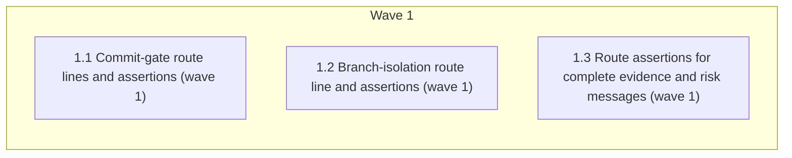

# Every hook deny message states its reason and a route

<!-- AT-A-GLANCE:BEGIN (generated — do not edit; refreshed by render_plan.py --summarize) -->
## At a glance

**3 tasks · 1 waves · 6 files · 3/3 done**

| Wave | Task | Title | Files | Done (acceptance) |
|---|---|---|---|---|
| 1 | 1.1 | Commit-gate route lines and assertions (wave 1) | hooks/commit-gate.sh, tests/hooks/commit-gate.test.sh | SC-1 exits 0; `git diff 94682f9 -- hooks/commit-gate.sh` has exactly two `-` lin… |
| 1 | 1.2 | Branch-isolation route line and assertions (wave 1) | hooks/branch-isolation-guard.sh, tests/hooks/branch-isolation-guard.test.sh | SC-2 exits 0; `git diff 94682f9 -- hooks/branch-isolation-guard.sh` has exactly … |
| 1 | 1.3 | Route assertions for complete evidence and risk messages (wave 1) | tests/hooks/commit-gate-evidence.test.sh, tests/hooks/commit-gate-risk.test.sh | SC-3 and SC-4 exit 0; each of the 5 messages has at least one route assertion. |

### Progress
- [x] 1.1 — Commit-gate route lines and assertions (wave 1)
- [x] 1.2 — Branch-isolation route line and assertions (wave 1)
- [x] 1.3 — Route assertions for complete evidence and risk messages (wave 1)
<!-- AT-A-GLANCE:END -->

## 1. Motivation

Eleven blocking paths in the harness hooks say why they blocked but not what clears them (one says
nothing at all), so an agent or person has to read hook source to move on. Playbook play 10
(research note §6, E2): a block message is "reason + route". Design: `design.md` (approach A,
D1, D3–D5, DC1); research: `research-brief.md`.

## 2. Non-goals

- Changing what any gate blocks, its exit code, deny decision, profile or mode.
- Any new override or break-glass variable.
- Warn-only messages, PASS/skip notices, `scripts/ci-strict-gate.sh`.
- A lint that forces future denies to carry a route (design D4).
- Editing the 9 complete messages other than the untracked-`.py` deny (design D5).

## 3. Success Criteria

| ID | Behavior (observable) | Check (re-runnable) | Expected |
|---|---|---|---|
| SC-1 | Every commit-gate blocking path tested in this file (G1–G10, untracked `.py`, `print()`, Verify missing, Verify mismatch) prints its route text, with its exit code unchanged | `bash tests/hooks/commit-gate.test.sh` | exit 0 — 0 FAIL lines |
| SC-2 | Both branch-isolation denies (G11 and the shared-branch deny) print their route text inside a `permissionDecision: deny` JSON at exit 0 | `bash tests/hooks/branch-isolation-guard.test.sh` | exit 0 — 0 FAIL lines |
| SC-3 | The escalation, lane-evidence and run-state blocks print their existing route text at exit 2 | `bash tests/hooks/commit-gate-evidence.test.sh` | exit 0 — 0 FAIL lines |
| SC-4 | The two risk-corroboration blocks print their existing route text at exit 2 | `bash tests/hooks/commit-gate-risk.test.sh` | exit 0 — 0 FAIL lines |

The full suite (`bash scripts/run-tests.sh`) runs at `finishing-a-development-branch`, not as a
task Verify.

## Global Constraints

- Edit the source tree only (`hooks/`, `tests/hooks/`). Never edit `.claude/`, `VERSION`, or
  `CHANGELOG.md`.
- **Text only.** Do not change any condition, exit code, deny decision, check order, profile
  membership, or variable. Add lines; do not edit an existing message line. Exactly three
  existing lines may change: the `cd "$REPO_DIR" || exit 2` line (G5, which has no message today),
  and the two jq `permissionDecisionReason` lines that gain an appended segment —
  `hooks/commit-gate.sh:117` (D5) and `hooks/branch-isolation-guard.sh:157` (G11) — because jq
  does not accept a `+ "…"` continuation after the closing paren. On those two lines the existing
  text stays byte-identical and the new segment goes before the closing `)`.
- **Format.** A stderr route is its own line, `echo "  Route: <text>" >&2`, placed directly before
  the block's `exit 2`. A JSON route is appended to the `permissionDecisionReason` string as
  `"\nRoute: <text>"`. Keep bash 3.2 compatibility.
- **Exact route text** (from design Architecture; `<…>` placeholders are printed literally unless
  a `$VAR` is named):
  - **R-REDEPLOY** (G1, G2, G3): `Route: redeploy the harness: bash <harness>/scripts/install-harness.sh --source <harness> -d <project> --yes, or re-run the installer one-liner from the harness README (in the harness repo itself: git restore hooks/lib/).`
    G1 adds one more line: `  Route: if the payload itself is malformed, re-issue the command.`
  - **R-ROOT** (G4, G5): `Route: run the commit from inside the project's git work tree, or set CLAUDE_PROJECT_DIR to the project root.`
  - **G5 reason** (replaces the bare `cd "$REPO_DIR" || exit 2`): on `cd` failure print
    `[COMMIT GATE] BLOCKED — cannot enter project root $REPO_DIR.` then R-ROOT, then `exit 2`.
  - **G6**: `Route: remove the value from the staged change (read it from an env var instead), then re-stage. There is no override — if you believe it is a false positive or a fake test value, stop and ask a human.` Do not name the scan's path exclusions, including `*.example` (design D3).
  - **G7**: `Route: unstage it (git restore --staged <file>), add it to .gitignore, and commit a .env.example instead. Untracking an already-tracked .env (git rm --cached) stages a deletion that this check also blocks — a human decides that commit.` (revised in correctness review; see SUMMARY Deviations)
  - **G8**: `Route: remove the breakpoint()/pdb lines, re-stage, and commit again.`
  - **G9**: `Route: reproduce with python -m pytest$TEST_FILES -x -q, fix the failure, re-stage.` (`$TEST_FILES` already starts with a space.)
  - **G10**: `Route: if the paths belong to this work, add them to the task's Files in the active PLAN.md and re-stage; otherwise unstage them. If the scope change needs a human, escalate in specs/<slug>/ESCALATIONS.md — the commit stays blocked until the plan is updated. This block is on because BLAST_RADIUS_STRICT=1.`
  - **G11** (JSON): `Route: cut a task branch (git checkout -b <type>/<slug>, or the using-git-worktrees skill) and re-apply the edit; if the normalizer is stale, redeploy with bash <harness>/scripts/install-harness.sh --source <harness> -d <project> --yes or the installer one-liner from the harness README (in the harness repo itself: git restore hooks/lib/); break glass with BRANCH_ISOLATION_REASON=<why>.`
  - **D5 untracked `.py`** (JSON, `commit-gate.sh` check_untracked_py): append `"\n\nStage and commit in separate Bash calls: this check reads the whole command, so git add <files> && git commit in one call is denied again."` after the existing reason text; the existing text stays byte-identical.
- **Tests.** In the existing test case for each path, add one `assert_rc_contains <same rc> '<substring>'`
  right after the existing assertion, reusing the same `OUT`. Gap substrings (each appears only in
  that path's route): G1, G2, G3 → `--source <harness>` (G1 also `if the payload itself is
  malformed`); G4, G5 → `Route: run the commit from inside`; G6 → `There is no override`;
  G7 → `this check also blocks`; G8 → `remove the breakpoint()/pdb lines`; G9 → `Route: reproduce with
  python -m pytest`; G10 → `active PLAN.md and re-stage`; G11 → `--source <harness>`. For the 10 complete messages, assert a fragment of their existing route:
  untracked `.py` → `git add <files>` and `separate Bash calls`; escalation → `records the decision`;
  lane evidence → `See rules/auto-correct-scope.md`; run-state → `Stage them by name`; risk below
  high-risk → `Re-classify with the feature-intake skill`; strict no-Lane → `Declare a Lane`;
  `print()` → `Use logger instead`; Verify missing → `Record the command(s) run`; Verify
  mismatch → `Fix the commands/exit codes`; shared-branch → `git checkout -b <type>/<slug>`.
- A same-wave Verify that fails because of a sibling's file is attributed to the task that owns
  that file.

## 4. Tasks

### Task 1.1 — Commit-gate route lines and assertions (wave 1)

- **Files:** hooks/commit-gate.sh, tests/hooks/commit-gate.test.sh
- **Action:** Test first: in `tests/hooks/commit-gate.test.sh` add the route assertions for G1
  (`:80`), G2 (`:109`, `:115`), G3 (`:121`), G4 (`:350`), G6 (`:59`), G7 (`:189`), G8 (`:241`),
  G9 (`:320`, inside the existing `ensure_pyenv` branch), G10 (`:406–411`), untracked `.py`
  (`:130–134`, the strict `git commit` case),
  `print()` (`:247`), Verify missing (`:253`) and Verify mismatch (`:282`), per Global
  Constraints → Tests. Add a G5 test: make a temp dir, `chmod 000` it, run the hook with
  `CLAUDE_PROJECT_DIR` set to it, assert exit 2 + `cannot enter project root` + `Route: run the
  commit from inside`, then `chmod 755` it; also register the dir (name it `g5dir`, not `d`) in
  `_CLEANUP_DIRS` and, before the `chmod 000`, set `trap "chmod 755 '$g5dir' 2>/dev/null" EXIT`
  (double quotes, so the path is fixed when the trap is set) so an aborted run still cleans up; when `id -u` prints `0`, `skip` with reason "root can enter a 000 directory".
  Run the file and see the G1–G10 and D5 assertions fail (the complete-message assertions pass at
  HEAD; that is expected). Then add
  the route lines for G1–G10 and D5 to `hooks/commit-gate.sh` per Global Constraints → Exact
  route text, and replace the bare `cd "$REPO_DIR" || exit 2` with the G5 block.
- **Verify:** `bash tests/hooks/commit-gate.test.sh`
- **Done:** SC-1 exits 0; `git diff 94682f9 -- hooks/commit-gate.sh` has exactly two `-` lines: the `cd "$REPO_DIR" || exit 2` line and the line-117 `permissionDecisionReason` line.
- **Criteria:** SC-1
- **Interfaces:** Consumes design.md Architecture and the existing tests/lib.sh helpers. Produces route lines in `hooks/commit-gate.sh` and route assertions plus the G5 test in `tests/hooks/commit-gate.test.sh`.

### Task 1.2 — Branch-isolation route line and assertions (wave 1)

- **Files:** hooks/branch-isolation-guard.sh, tests/hooks/branch-isolation-guard.test.sh
- **Action:** Test first: in `tests/hooks/branch-isolation-guard.test.sh` add a route assertion
  (`--source <harness>`) after each existing `could not safely classify` assertion (`:92`, `:99`,
  `:104`, `:109`, `:242`, `:247`, `:252`, `:257`), and a `git checkout -b <type>/<slug>`
  assertion to the existing shared-branch deny test (`:221`). Run it and see the G11 assertions fail. Then
  append the G11 route to the classification deny's `permissionDecisionReason` in
  `hooks/branch-isolation-guard.sh`. Leave the shared-branch deny text unchanged.
- **Verify:** `bash tests/hooks/branch-isolation-guard.test.sh`
- **Done:** SC-2 exits 0; `git diff 94682f9 -- hooks/branch-isolation-guard.sh` has exactly one `-` line, the line-157 `permissionDecisionReason` line.
- **Criteria:** SC-2
- **Interfaces:** Consumes design.md Architecture (G11). Produces the G11 route in `hooks/branch-isolation-guard.sh` and assertions in `tests/hooks/branch-isolation-guard.test.sh`.

### Task 1.3 — Route assertions for complete evidence and risk messages (wave 1)

- **Files:** tests/hooks/commit-gate-evidence.test.sh, tests/hooks/commit-gate-risk.test.sh
- **Action:** Test-only; edit no hook. In `tests/hooks/commit-gate-evidence.test.sh` add route
  assertions to the escalation (`:20`, `:47`, `:58`), run-state (`:74`, `:81`) and lane-evidence
  (`:134`) cases. In `tests/hooks/commit-gate-risk.test.sh` add them to the risk-below-high-risk
  case "migration path + Lane: normal → BLOCKED (exit 2)" (`:26–31`) and to the strict no-Lane
  case (`:510`). Substrings per Global Constraints →
  Tests. These pass against the current hooks; that is expected, since the messages already carry
  a route.
- **Verify:** `bash tests/hooks/commit-gate-evidence.test.sh && bash tests/hooks/commit-gate-risk.test.sh`
- **Done:** SC-3 and SC-4 exit 0; each of the 5 messages has at least one route assertion.
- **Criteria:** SC-3, SC-4
- **Interfaces:** Consumes the existing message text in `hooks/commit-gate.sh`. Produces route assertions in `tests/hooks/commit-gate-evidence.test.sh` and `tests/hooks/commit-gate-risk.test.sh`.

## 5. Risks

- G5's `chmod 000` test is skipped when run as root; CI runners are non-root, so it runs there.
- G9's assertion runs only where `ensure_pyenv` succeeds; elsewhere the case is a `skip`, not route coverage.
- `ci-strict-gate.sh` blocks the PR unless this slug's SUMMARY is high-risk with Verify rows that re-run clean.

### Assumption coverage

- A1 → accepted risk: the 21-path inventory is a grep measured 2026-10-14 (research-brief); correctness review re-sweeps the diffed hooks
- A2 → accepted risk: same grep over `hooks/lib/*`; a lib change is outside this plan's Files
- A3 → accepted risk: Claude Code docs confirm both channels reach Claude; Codex model-visibility is undocumented (research-brief Evidence Boundary)
- A4 → SC-1
- A5 → accepted risk: the installer source read is the evidence; route assertions prove only that the text is printed

## 6. Status Log

- 2026-10-14 — plan written from design.md (D1, D3–D5, DC1) and research-brief.md.
- 2026-10-14 — tasks 1.1, 1.2, 1.3 complete; commits bd09585, ba38ba1, 698cbdf (spec pass + quality approved each; Minors in SUMMARY)
- 2026-10-14 — review chain passed (correctness with fix 331d71f, 5 advisory; intent pass, 2 advisory); shipped
