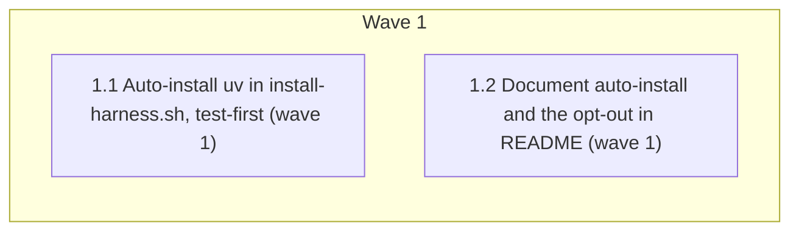

# install-harness.sh auto-installs uv and pre-fetches code-review-graph

<!-- AT-A-GLANCE:BEGIN (generated — do not edit; refreshed by render_plan.py --summarize) -->
## At a glance

**2 tasks · 1 waves · 4 files · 0/2 done**

| Wave | Task | Title | Files | Done (acceptance) |
|---|---|---|---|---|
| 1 | 1.1 | Auto-install uv in install-harness.sh, test-first (wave 1) | scripts/install-harness.sh, tests/lib.sh, tests/scripts/install-harness.test.sh | The test file exits 0, its summary line contains no `FAILED`, it prints `ok` for… |
| 1 | 1.2 | Document auto-install and the opt-out in README (wave 1) | README.md | `README.md` contains `--no-uv` and `CS_NO_UV`; doc-truth lint exits 0. |

### Progress
- [ ] 1.1 — Auto-install uv in install-harness.sh, test-first (wave 1)
- [ ] 1.2 — Document auto-install and the opt-out in README (wave 1)
<!-- AT-A-GLANCE:END -->

## 1. Motivation

`install-harness.sh` wires the `code-review-graph` MCP server through `uvx`, but on a machine
without `uv` it only warns, so the wired server fails to launch every session. The approved design
(`specs/install-uv-autoinstall/design.md`, D1–D6) makes the installer install `uv` after one
warning line, pre-fetch the package in the background, and offer an opt-out. Research:
`specs/install-uv-autoinstall/research-brief.md`.

## 2. Non-goals

- Installing uv through brew/apt, or on Windows.
- Checksum-pinning the astral.sh installer.
- Changing `.mcp.json` wiring, `deploy-harness.sh`, or building graph data.

## Global Constraints

- Work only in the worktree `.worktrees/feat/install-uv-autoinstall` on branch
  `feat/install-uv-autoinstall`; leave unrelated and untracked files untouched.
- Run `bash scripts/run-tests.sh` before the first `scripts/` edit and once after all tasks; record
  the full-suite result in SUMMARY prose, never as a `### Verify` row.
- No test may reach the network: `tests/lib.sh` exports `CS_NO_UV=1`; auto-install tests use a fake
  `curl` under `PATH=$fakebin:/usr/bin:/bin` with a temp `HOME`, per design §Tests.
- Bash stays compatible with macOS Bash 3.2 (no `mapfile`, no associative arrays, no `${var,,}`);
  `timeout` is not used (absent on macOS).
- `set -euo pipefail` stays on in `install-harness.sh`; every new variable expansion is `set -u`
  safe (`${VAR:-}`).
- Every uv-related failure is non-fatal: the installer still exits 0 (design D3).
- The default-path warning text is exactly
  `uvx not found — installing uv from astral.sh for the code-review-graph MCP server (skip with --no-uv)`.

## 3. Success Criteria

| ID | Behavior (observable) | Check (re-runnable) | Expected |
| --- | --- | --- | --- |
| SC-1 | Missing `uvx`, default flags: exactly one `uvx not found` line, then `Installed uv`; the fake curl was called; exit 0; no post-install `Install uv before that restart` line | `bash tests/scripts/install-harness.test.sh` | exit 0 — row "auto-install success" prints `ok` |
| SC-2 | uv install failure (fake curl exits 22) still exits 0 with `uv install failed` and the post-install warning | `bash tests/scripts/install-harness.test.sh` | exit 0 — row "auto-install failure" prints `ok` |
| SC-3 | `--no-uv`, `CS_NO_UV=1`, and `--dry-run` never call the fake curl, and the opt-out never calls the `uvx` pre-fetch within the 2 s poll window | `bash tests/scripts/install-harness.test.sh` | exit 0 — rows "--no-uv", "CS_NO_UV=1", "--dry-run", "pre-fetch opt-out" print `ok` |
| SC-4 | The test library opts every installer run out of the network by default | `grep -qx "export CS_NO_UV=1" tests/lib.sh` | exit 0 |
| SC-5 | README documents the `--no-uv` opt-out | `grep -q -e "--no-uv" README.md` | exit 0 |
| SC-6 | No `curl` on PATH: exit 0 with the `curl not found` warning | `bash tests/scripts/install-harness.test.sh` | exit 0 — row "no curl" prints `ok` |
| SC-7 | With `uvx` available and no opt-out, the installer launches `uvx code-review-graph --version` in the background | `bash tests/scripts/install-harness.test.sh` | exit 0 — row "pre-fetch runs by default" prints `ok` |
| SC-8 | Doc-truth lint still passes after the README edit | `bash scripts/lint-doc-truth.sh` | exit 0 |
| SC-9 | README documents the `CS_NO_UV=1` env opt-out | `grep -q "CS_NO_UV" README.md` | exit 0 |
| SC-10 | `install-harness.sh --help` output lists `--no-uv`, and `--dry-run` prints `would install uv` | `bash tests/scripts/install-harness.test.sh` | exit 0 — rows "--help documents --no-uv" and "--dry-run" print `ok` |

## 4. Tasks

### Task 1.1 — Auto-install uv in install-harness.sh, test-first (wave 1)

- **Files:** scripts/install-harness.sh, tests/lib.sh, tests/scripts/install-harness.test.sh
- **Action:** Test-first. (1) In `tests/lib.sh` add `export CS_NO_UV=1` with a one-line comment
  that installer tests must never reach the network. (2) In `tests/scripts/install-harness.test.sh`
  add the rows from design §Tests — "auto-install success", "pre-fetch runs by default",
  "auto-install failure", "no curl", "--no-uv", "CS_NO_UV=1", "--dry-run" (also asserts the output
  contains `would install uv`), "pre-fetch opt-out", and "--help documents --no-uv" (runs
  `bash "$INSTALL" --help` and asserts the output contains `--no-uv`) —
  using the PATH contract `env -u CS_NO_UV -u XDG_BIN_HOME -u XDG_DATA_HOME -u UV_INSTALL_DIR
  -u CARGO_DIST_FORCE_INSTALL_DIR -u UV_UNMANAGED_INSTALL HOME=$tmphome PATH=$fakebin:/usr/bin:/bin`,
  a fake `curl` that appends to `$tmphome/curl.log`, no-op `uvx` stubs that append to a log inside
  `$tmphome`, a single `POLL_TRIES=20` variable for the 0.1 s polling, `ln -sf` for the no-curl bin
  dir, and a skip when `env PATH=/usr/bin:/bin sh -c 'command -v uvx'` finds a system `uvx`.
  In the "auto-install success" row add a comment that the detached pre-fetch stub may still
  append to its log after cleanup and that this is harmless. Confirm the new rows fail. (3) In `scripts/install-harness.sh`: add `NO_UV="${CS_NO_UV:-0}"` to
  the config block, a `--no-uv` arg case and a `usage()` line; replace the preflight at `:126-131`
  with an `ensure_uv` function following the design diagram (first match wins: dry-run → opt-out →
  no curl → install); run the installer as
  `curl -LsSf https://astral.sh/uv/install.sh | env UV_PRINT_QUIET=1 sh >/dev/null 2>&1` inside an
  `if`; after it, prepend each set candidate dir in installer order (`UV_INSTALL_DIR`,
  `CARGO_DIST_FORCE_INSTALL_DIR`, `UV_UNMANAGED_INSTALL`, `XDG_BIN_HOME`, `XDG_DATA_HOME/../bin`,
  `$HOME/.local/bin`) to PATH and re-check `command -v uvx`; on success print `ok "Installed uv"`
  and the hint "open a new shell before restarting Claude Code". After preflight, when
  `UVX_MISSING=0`, not dry-run, and `NO_UV=0`, run
  `uvx code-review-graph --version </dev/null >/dev/null 2>&1 &` and
  `info "Pre-fetching code-review-graph in the background"`. Leave the post-install warning at
  `:328-330` unchanged.
- **Verify:** `bash tests/scripts/install-harness.test.sh`
- **Done:** The test file exits 0, its summary line contains no `FAILED`, it prints `ok` for each of
  the 9 new row titles above (or `skip` only via the system-`uvx` guard), and
  `bash -n scripts/install-harness.sh` exits 0.
- **Criteria:** SC-1, SC-2, SC-3, SC-4, SC-6, SC-7, SC-10
- **Interfaces:** Consumes the design's flag and env contract. Produces `--no-uv` and `CS_NO_UV=1`
  handling in `scripts/install-harness.sh`, the network opt-out in `tests/lib.sh`, and the new rows
  in `tests/scripts/install-harness.test.sh`.

### Task 1.2 — Document auto-install and the opt-out in README (wave 1)

- **Files:** README.md
- **Action:** At `README.md:89`, replace "uv is strongly recommended … the installer warns when it's
  missing" with: the installer installs uv from astral.sh when `uvx` is missing (one warning line
  first), pre-fetches code-review-graph in the background, and skips both with `--no-uv` or
  `CS_NO_UV=1`; uv's installer adds its bin dir to shell profiles, so open a new shell before
  restarting Claude Code. In the MCP section (`:110-115`), say the installer handles uv
  automatically and keep the manual `curl -LsSf https://astral.sh/uv/install.sh | sh` command as
  the fallback for `--no-uv` users.
- **Verify:** `bash scripts/lint-doc-truth.sh`
- **Done:** `README.md` contains `--no-uv` and `CS_NO_UV`; doc-truth lint exits 0.
- **Criteria:** SC-5, SC-8, SC-9
- **Interfaces:** Consumes the flag/env names in Global Constraints. Produces `README.md` sections.

## 5. Risks

- Remote script execution on every machine without `uvx` (accepted in design D1, What we do not claim).
- The 2 s poll window is the suite's only timing-dependent assertion; `POLL_TRIES` is one variable
  to raise if macOS CI flakes.
- README task runs in parallel with Task 1.1 against names fixed in Global Constraints; a rename in
  1.1 would desync — the task reviewer checks the names match.

### Assumption coverage

- A1 → SC-1
- A2 → SC-7
- A3 → SC-4

## 6. Status Log

- 2026-10-09 — plan written from approved design + research brief.
- 2026-10-09 — plan review round 1: SC-5 narrowed to README, SC-9 and SC-10 added, Task 1.1 Done
  rewritten without a hand count. Round 2 approved. Baseline `bash scripts/run-tests.sh`: ALL GREEN.
