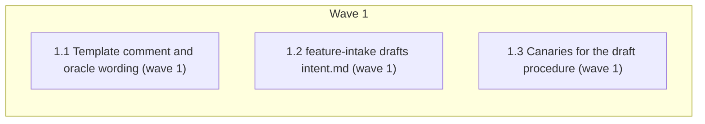

# Intake drafts intent.md from chat

<!-- AT-A-GLANCE:BEGIN (generated — do not edit; refreshed by render_plan.py --summarize) -->
## At a glance

**3 tasks · 1 waves · 6 files · 3/3 done**

| Wave | Task | Title | Files | Done (acceptance) |
|---|---|---|---|---|
| 1 | 1.1 | Template comment and oracle wording (wave 1) | templates/INTENT.template.md, rules/terminology.md, templates/structure/specs-README.md | SC-6, SC-7, SC-10 and SC-13 exit 0; SC-12 exits 1. |
| 1 | 1.2 | feature-intake drafts intent.md (wave 1) | skills/feature-intake/SKILL.md, skills/feature-intake/references/draft-intent.md | SC-1 through SC-5, SC-8, SC-9 and SC-14 exit 0. |
| 1 | 1.3 | Canaries for the draft procedure (wave 1) | skills/feature-intake/tests/intent-file-cases.md | SC-11 exits 0; IF-00 no longer expects a chat-only SUMMARY for a new slug. |

### Progress
- [x] 1.1 — Template comment and oracle wording (wave 1)
- [x] 1.2 — feature-intake drafts intent.md (wave 1)
- [x] 1.3 — Canaries for the draft procedure (wave 1)
<!-- AT-A-GLANCE:END -->

## 1. Motivation

A chat-only request today produces no `specs/<slug>/intent.md`, so specs differ by entry path.
Per the approved design (`design.md`, D1–D8), intake drafts intent.md from the template and the
chat for every new slug, auto-approves tiny + high, and otherwise waits for the user to approve in
chat or edit the file. Research: `research-brief.md`.

## 2. Non-goals

- No change to re-pin rules, intent-review, commit-gate, hooks, or scripts.
- No `Approved-by:` field, no C-n/Q-n IDs, no connector or GitHub path.

## Global Constraints

- Edit the source tree only. Never edit `.claude/`. Do not edit `VERSION` or `CHANGELOG.md`.
- Keep the prose lean (user preference): clear, complete, no restating what a capable model does
  anyway. `skills/feature-intake/SKILL.md` stays ≤600 words (budget).
- Do not use slash invocations (`/feature-intake`) in skill prose (runtime-neutral lint).
- Write git commands as inline code with `<slug>` placeholders; a fenced bash block must contain a
  `<placeholder>` (`scripts/lint-skill-bash.sh`).
- **Exact strings** (character for character):
  - new reference path: `skills/feature-intake/references/draft-intent.md`;
  - allowed-tools line: `allowed-tools: Read, Write, Edit, Grep, Glob, Bash(git log *), Bash(git diff *), Bash(git branch --show-current), Bash(git switch *), Bash(git add -- specs/*), Bash(git commit -m *), Bash(git config user.name), Bash(ls *), Bash(python3 scripts/verify_summary.py *), Bash(python3 runtime/run_state.py *)`;
  - draft section: `## Original request`;
  - assumption marker: `(assumed)`;
  - add command: `git add -- specs/<slug>/intent.md`;
  - commit command: `git commit -m "docs(specs): intent for <slug>" -- specs/<slug>/intent.md`;
  - auto-approval commit suffix and Intake notes text: `(auto-approved: tiny/high)` / `auto-approved: tiny/high`;
  - no-request fallback in `### Intent`: `none — intent.md is the request`.
- **Semantics** (design Architecture, Error behavior):
  - Entry: a slug with no SUMMARY follows `references/draft-intent.md` unless its intent.md is
    `Status: approved` and committed. SUMMARY + (`Intent-source:` or intent.md) → re-pin
    (unchanged). Approved and committed intent.md with no SUMMARY → today's Step 1.
  - Draft procedure, two cases keyed on the file: (1) absent → write from the template (`Author:`
    = git `user.name` or `unknown`, `Status: draft`, chat content, `(assumed)` proposals, append
    `## Original request` verbatim), classify, tiny + high → approve, commit, continue at Step 1
    with the Intake notes line; else ask and stop. (2) exists, not approved-and-committed → never
    rewritten from the template, never auto-approved; approval reply → set approved, commit,
    continue; change request (even with "approve") → edit, ask and stop; anything else → show,
    ask and stop. Ask-and-stop writes no SUMMARY and no commit.
  - Commit only intent.md on the current branch with the exact commands; skip when nothing to
    commit; a hook refusal → stop and report.
  - `### Intent`: pin line, then `## Original request` when present, else the chat request, else
    `none — intent.md is the request`. An approval or change reply is never recorded as the request.
  - Agent notes never go in `### Intent`; intent.md content comes only from the draft procedure or
    the user.
  - Step 5 "chat-only intake writes none" now applies only to legacy slugs (SUMMARY already
    exists, no intent.md); a new slug always gets a pin line.
  - `Author:` comes from `git config user.name` (granted exactly as `Bash(git config user.name)`),
    or `unknown` when it prints nothing.

## 3. Success Criteria

| ID | Behavior (observable) | Check (re-runnable) | Expected |
|---|---|---|---|
| SC-1 | feature-intake stays within the skill word budget | `python3 scripts/audit_skill_prompts.py` | exit 0 |
| SC-2 | feature-intake may run git add and git commit | `grep -qxF -- "allowed-tools: Read, Write, Edit, Grep, Glob, Bash(git log *), Bash(git diff *), Bash(git branch --show-current), Bash(git switch *), Bash(git add -- specs/*), Bash(git commit -m *), Bash(git config user.name), Bash(ls *), Bash(python3 scripts/verify_summary.py *), Bash(python3 runtime/run_state.py *)" skills/feature-intake/SKILL.md` | exit 0 |
| SC-3 | Every command the skill and its references instruct is granted | `python3 scripts/check_skill_tool_conformance.py` | exit 0 |
| SC-4 | SKILL.md points to the draft procedure | `grep -qF -- "references/draft-intent.md" skills/feature-intake/SKILL.md` | exit 0 |
| SC-5 | The draft procedure keeps the request verbatim and commits only the intent | `python3 -c "import sys;t=open('skills/feature-intake/references/draft-intent.md').read();sys.exit(0 if all(s in t for s in ['## Original request','(assumed)','git add -- specs/<slug>/intent.md','git commit -m \"docs(specs): intent for <slug>\" -- specs/<slug>/intent.md','auto-approved: tiny/high']) else 1)"` | exit 0 |
| SC-6 | The terminology hard exclusion allows an intent auto-approved by intake | `grep -qF -- "auto-approved by intake" rules/terminology.md` | exit 0 |
| SC-7 | The template comment names both authoring paths | `grep -qF -- "intake drafts" templates/INTENT.template.md` | exit 0 |
| SC-8 | Skill prose stays runtime-neutral | `python3 scripts/check_runtime_neutral_sources.py` | exit 0 |
| SC-9 | Bash in skills still lints clean | `bash scripts/lint-skill-bash.sh` | exit 0 |
| SC-10 | Doc paths stay truthful | `bash scripts/lint-doc-truth.sh` | exit 0 |
| SC-11 | The canaries cover the draft procedure | `grep -qF -- "DI-08" skills/feature-intake/tests/intent-file-cases.md` | exit 0 |
| SC-12 | The oracle wording no longer says intent.md is human-written | `grep -qF -- "human-written intent" rules/terminology.md` | exit 1 — phrase removed |
| SC-13 | The template keeps its header lines | `grep -qx -- "Author: <name>" templates/INTENT.template.md` | exit 0 |
| SC-14 | SKILL.md scopes the no-pin rule to legacy slugs | `grep -qF -- "legacy" skills/feature-intake/SKILL.md` | exit 0 |

The real-install trial (design scenarios 1–8) is run by the controller after the wave and recorded
in SUMMARY `### Not auto-verified` (truth, one trial each): a headless model run is not a <60s
re-runnable check. The full suite (`bash scripts/run-tests.sh`, design SC-2) runs at
finishing and is cited in SUMMARY prose, not as an SC row.

## 4. Tasks

### Task 1.1 — Template comment and oracle wording (wave 1)

- **Files:** templates/INTENT.template.md, rules/terminology.md, templates/structure/specs-README.md
- **Action:** Edit the template's opening comment to say a person copies it, or intake drafts it
  from chat and appends `## Original request`; keep every header line and section unchanged.
  In `rules/terminology.md` hard exclusion 1, replace "the human-written intent" with wording that
  intent.md is approved by a human or auto-approved by intake for tiny/high, that its
  `## Original request` (when present) is the verbatim request, and that editing a draft before
  approval is outside the exclusion. In `templates/structure/specs-README.md`, change the intent.md row's
  author cell `a human (optional)` to `a human, or intake from chat`.
- **Verify:** `grep -qF -- "auto-approved by intake" rules/terminology.md`
- **Done:** SC-6, SC-7, SC-10 and SC-13 exit 0; SC-12 exits 1.
- **Criteria:** SC-6, SC-7, SC-10, SC-12, SC-13
- **Interfaces:** Consumes design D2/D7. Produces `templates/INTENT.template.md`, `rules/terminology.md`, `templates/structure/specs-README.md`.

### Task 1.2 — feature-intake drafts intent.md (wave 1)

- **Files:** skills/feature-intake/SKILL.md, skills/feature-intake/references/draft-intent.md
- **Action:** Create `references/draft-intent.md` with the two-case procedure and commit mechanics
  from Global Constraints (Semantics), in lean prose. In SKILL.md: set the exact allowed-tools
  line; add the entry rule to Step 1 (new slug unless intent.md is approved and committed →
  follow `references/draft-intent.md`); scope Step 5's no-pin rule to legacy slugs (word
  `legacy`); change Step 5/6 so `### Intent` takes `## Original
  request` / chat / `none — intent.md is the request`, an approval or change reply is never the
  request, and intent.md content comes only from the draft procedure or the user. Trim wording
  elsewhere so the file stays ≤600 words (frontmatter counts); do not drop any instruction.
- **Verify:** `python3 scripts/check_skill_tool_conformance.py`
- **Done:** SC-1 through SC-5, SC-8, SC-9 and SC-14 exit 0.
- **Criteria:** SC-1, SC-2, SC-3, SC-4, SC-5, SC-8, SC-9, SC-14
- **Interfaces:** Consumes design Architecture and `templates/INTENT.template.md`. Produces `skills/feature-intake/SKILL.md`, `skills/feature-intake/references/draft-intent.md`.

### Task 1.3 — Canaries for the draft procedure (wave 1)

- **Files:** skills/feature-intake/tests/intent-file-cases.md
- **Action:** Rewrite the cases whose meaning changes on a new slug (IF-00, IF-02, IF-03, IF-04,
  IF-05, IF-09) to the draft-procedure expectation (draft written, or existing file shown, then
  stop; no SUMMARY), and update the Notes line about intent.md. Add cases `DI-01`..`DI-08` matching
  design Tests scenarios 1–8 (tiny/high auto-approve; normal draft stops; later approve commits and
  records `## Original request`; change request edits and stops; legacy slug unaffected; a person's
  draft never auto-approved; user sets approved and says done; approved-uncommitted with an
  ordinary request is shown, not rewritten). Keep the existing table format.
- **Verify:** `grep -qF -- "DI-08" skills/feature-intake/tests/intent-file-cases.md`
- **Done:** SC-11 exits 0; IF-00 no longer expects a chat-only SUMMARY for a new slug.
- **Criteria:** SC-11
- **Interfaces:** Consumes design Tests and Error behavior. Produces `skills/feature-intake/tests/intent-file-cases.md`.

## 5. Risks

- Commit-gate judges the whole index; an unrelated staged file can block the intent commit (stop and report — over-blocking only).
- The ≤600-word budget may force moving more of Step 1 into `references/`.
- Prose state logic: keep the two file-keyed cases; route new edge cases to "What we do not claim".

### Assumption coverage

- A1 → accepted risk: covered by the existing `tests/hooks/commit-gate-evidence.test.sh` (full suite at finishing) and real-install scenario 1
- A2 → accepted risk: proven by real-install scenario 1, recorded in SUMMARY
- A3 → accepted risk: proven by real-install scenario 3, recorded in SUMMARY
- A4 → SC-3 (the Codex renderers do not read allowed-tools: grep of `scripts/render_codex_adapter.py`, `scripts/render_skill_prompt.py`, 2026-10-10)

## 6. Status Log

- 2026-10-10 — draft written from approved design and Deep research brief.
- 2026-10-10 — tasks 1.1, 1.2, 1.3 complete; commits faaec1b, 4fffd03, 7b36684 (task reviews pass/approved; Minor fixes in 1380d38)
- 2026-10-10 — final review chain: trial fix f39accb; correctness fix rounds f679638, bb923dc, 8b994e2 (0 blocking); intent review no gap or material drift; context audit PASS
- 2026-10-10 — shipped: intent review re-run over 5fbd67c..8b994e2 (no gap); PR into sdlc
