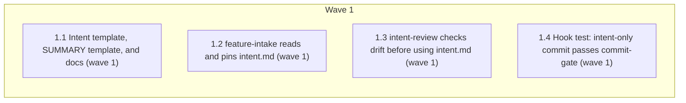

# intent.md as the workflow's entry artifact

<!-- AT-A-GLANCE:BEGIN (generated — do not edit; refreshed by render_plan.py --summarize) -->
## At a glance

**4 tasks · 1 waves · 11 files · 0/4 done**

| Wave | Task | Title | Files | Done (acceptance) |
|---|---|---|---|---|
| 1 | 1.1 | Intent template, SUMMARY template, and docs (wave 1) | templates/INTENT.template.md, templates/SUMMARY.template.md, templates/structure/specs-README.md, rules/terminology.md, skills/README.md | SC-1, SC-3, SC-9 and SC-11 return exit 0. |
| 1 | 1.2 | feature-intake reads and pins intent.md (wave 1) | skills/feature-intake/SKILL.md, skills/feature-intake/tests/intent-file-cases.md, skills/feature-intake/tests/README.md | SC-4, SC-7 and SC-10 return exit 0. |
| 1 | 1.3 | intent-review checks drift before using intent.md (wave 1) | skills/intent-review/SKILL.md, skills/intent-review/intent-reviewer-prompt.md | SC-5, SC-6, SC-8, SC-10 and SC-13 return exit 0, and `bash tests/scripts/final-r… |
| 1 | 1.4 | Hook test: intent-only commit passes commit-gate (wave 1) | tests/hooks/commit-gate-evidence.test.sh | SC-2 and SC-12 return exit 0. |

### Progress
- [ ] 1.1 — Intent template, SUMMARY template, and docs (wave 1)
- [ ] 1.2 — feature-intake reads and pins intent.md (wave 1)
- [ ] 1.3 — intent-review checks drift before using intent.md (wave 1)
- [ ] 1.4 — Hook test: intent-only commit passes commit-gate (wave 1)
<!-- AT-A-GLANCE:END -->

## 1. Motivation

Anyone can write `specs/<slug>/intent.md` to the AI-native SDLC playbook standard, set
`Status: approved`, commit it, and hand the slug to the team. `/feature-intake <slug>` pins the
file by commit SHA and starts the workflow from it; `/intent-review` judges the diff against it and
stops if the file changed after the pin. Chat-only requests keep working as today. Design:
`design.md` (approved 2026-10-10, D1–D6). Research: `research-brief.md` (Deep, reuse existing).

## 2. Non-goals

- An authoring helper that drafts intent.md with the author (E001).
- Any new script, gate, hook, or `allowed-tools` change; any change to `scripts/verify_summary.py`,
  `scripts/install-harness.sh`, `scripts/deploy-harness.sh`, `hooks/`, or `settings.json`.
- Changes to `CLAUDE.md` or the prompt-refactor eval corpus.

## Global Constraints

- Edit the source tree only. Never edit `.claude/`. Do not edit `VERSION` or `CHANGELOG.md`.
- Keep the prose lean (user note 2026-10-10): clear, easy to read, complete. Add only the lines
  the design needs; do not restate what a capable model does anyway.
- Do not change any skill's `allowed-tools` line.
- Write git commands in skills as inline code with `<pin>` / `<slug>` placeholders. If a fenced
  bash block is used, it must contain a `<placeholder>` so `scripts/lint-skill-bash.sh` treats it
  as illustrative.
- **Exact strings** (copy character for character, each on one line):
  - template header lines: `Author: <name>` and `Status: draft | approved`;
  - template sections: `## Problem`, `## Proposed outcome`, `## Affected users and systems`,
    `## Constraints`, `## Out of scope`, `## Open questions`, `## What success looks like`;
  - SUMMARY line: `Intent-source: specs/<slug>/intent.md @ <sha>`;
  - SUMMARY section: `### Intake notes`, placed directly after `### Intent`;
  - pin command: `git log -1 --format=%H --diff-filter=AM -- specs/<slug>/intent.md`;
  - drift/clean command: `git diff --exit-code <pin> -- specs/<slug>/intent.md`.
- **Semantics** (design Architecture and Error behavior):
  - Intake reads `Status` from the header line only. Not `approved` → stop. Empty pin → stop.
    Non-zero drift/clean command → stop and ask for the intent to be committed.
  - `### Intent` gets the `Intent-source:` line plus the chat request verbatim in full.
  - Re-pin (slug already has `Intent-source:`, or a chat-started slug gains intent.md): replace or
    add only that line, add a dated `### Intake notes` line with old → new SHA, keep every other
    SUMMARY section, re-check the lane (up freely; down only when a human narrows scope).
  - Chat request conflicting with intent.md → existing ambiguous-direction escalation.
  - `/intent-review`: when `### Intent` has `Intent-source:`, run the drift command first;
    non-zero (including 128) → stop, report drift, ask for intake to re-pin; zero → oracle is the
    intent.md text plus the chat request.
  - Agent-written notes go to `### Intake notes`, never `### Intent` or intent.md.

## 3. Success Criteria

| ID | Behavior (observable) | Check (re-runnable) | Expected |
|---|---|---|---|
| SC-1 | The intent template has both header lines and all seven sections | `python3 -c "import sys;t=open('templates/INTENT.template.md').read();sys.exit(0 if all(s in t for s in ['Author: <name>','Status: draft ','## Problem','## Proposed outcome','## Affected users and systems','## Constraints','## Out of scope','## Open questions','## What success looks like']) else 1)"` | exit 0 |
| SC-2 | A commit staging only `specs/<slug>/intent.md` passes commit-gate, and every existing evidence case still passes | `bash tests/hooks/commit-gate-evidence.test.sh` | exit 0 |
| SC-3 | The SUMMARY template has the `Intent-source:` form and the `### Intake notes` section | `python3 -c "import sys;t=open('templates/SUMMARY.template.md').read();sys.exit(0 if 'Intent-source: specs/<slug>/intent.md @ <sha>' in t and '### Intake notes' in t and t.index('### Intent')<t.index('### Intake notes') else 1)"` | exit 0 |
| SC-4 | feature-intake names the pin command | `grep -qF -- "git log -1 --format=%H --diff-filter=AM -- specs/<slug>/intent.md" skills/feature-intake/SKILL.md` | exit 0 |
| SC-5 | intent-review names the drift command | `grep -qF -- "git diff --exit-code <pin> -- specs/<slug>/intent.md" skills/intent-review/SKILL.md` | exit 0 |
| SC-6 | The reviewer prompt's INTENT input names the intent.md source | `grep -qF -- "specs/<slug>/intent.md" skills/intent-review/intent-reviewer-prompt.md` | exit 0 |
| SC-7 | feature-intake's `allowed-tools` line is unchanged | `grep -qxF -- "allowed-tools: Read, Write, Grep, Glob, Bash(git log *), Bash(git diff *), Bash(ls *), Bash(python3 scripts/verify_summary.py *), Bash(python3 runtime/run_state.py *)" skills/feature-intake/SKILL.md` | exit 0 |
| SC-8 | intent-review's `allowed-tools` line is unchanged | `grep -qxF -- "allowed-tools: Read, Grep, Glob, Agent, Task, Bash(git diff *), Bash(git log *)" skills/intent-review/SKILL.md` | exit 0 |
| SC-9 | The terminology hard exclusion covers intent.md | `grep -qF -- "specs/<slug>/intent.md" rules/terminology.md` | exit 0 |
| SC-10 | Bash in skills still lints clean | `bash scripts/lint-skill-bash.sh` | exit 0 |
| SC-11 | Doc paths and the hook table stay truthful | `bash scripts/lint-doc-truth.sh` | exit 0 |
| SC-12 | The intent-only commit cases exist in the evidence test file | `grep -qF -- "specs/demo/intent.md" tests/hooks/commit-gate-evidence.test.sh` | exit 0 |
| SC-13 | The existing intent-review contract strings still hold | `bash tests/scripts/intent-prompt-contract.test.sh` | exit 0 |

## 4. Tasks

### Task 1.1 — Intent template, SUMMARY template, and docs (wave 1)

- **Files:** templates/INTENT.template.md, templates/SUMMARY.template.md, templates/structure/specs-README.md, rules/terminology.md, skills/README.md
- **Action:**
  1. Write `templates/INTENT.template.md`: a one-line HTML comment saying where to copy it
     (`specs/<slug>/intent.md`; `.claude/templates/` in a consumer repo), that `Status: approved`
     plus a commit is the approval, and that no SUMMARY is needed to create it. Then the title
     `# Intent: <title>`, the two header lines, and the seven sections, each with a one-line
     italic hint. Use the exact strings from Global Constraints.
  2. In `templates/SUMMARY.template.md`, rewrite the comment under `### Intent` to allow either
     form: the chat request verbatim, or `Intent-source: specs/<slug>/intent.md @ <sha>` followed
     by the chat request verbatim. Keep "do NOT paraphrase". Add `### Intake notes` directly after
     `### Intent`, with a comment: agent-written intake notes (confidence reasoning, assumed
     defaults, re-pin lines); not part of the intent oracle; `- none` when empty.
  3. In `templates/structure/specs-README.md`, add an `intent.md` row: optional, human-written,
     from `templates/INTENT.template.md`, approved by `Status: approved` + commit, pinned by
     feature-intake, read by intent-review.
  4. In `rules/terminology.md`, extend hard exclusion 1 and the `### Intent` table row so the
     same rule covers `specs/<slug>/intent.md`.
  5. In `skills/README.md`, add one line where the workflow starts: feature-intake reads
     `specs/<slug>/intent.md` when it exists.
- **Verify:** `bash scripts/lint-doc-truth.sh`
- **Done:** SC-1, SC-3, SC-9 and SC-11 return exit 0.
- **Criteria:** SC-1, SC-3, SC-9, SC-11
- **Interfaces:** Consumes the design's template fields and SUMMARY form. Produces `templates/INTENT.template.md` and the `Intent-source:` / `### Intake notes` contract in `templates/SUMMARY.template.md`, read by Tasks 1.2 and 1.3.

### Task 1.2 — feature-intake reads and pins intent.md (wave 1)

- **Files:** skills/feature-intake/SKILL.md, skills/feature-intake/tests/intent-file-cases.md, skills/feature-intake/tests/README.md
- **Action:**
  1. Write `skills/feature-intake/tests/intent-file-cases.md` first, in the style of
     `confidence-escalation-cases.md`: cases for approved+committed (writes `Intent-source:` with
     the pin), `Status: draft` (stops), untracked (empty pin, stops), uncommitted edit (stops),
     deleted then re-created uncommitted (stops), re-pin (only the line changes, Intake notes
     line added), chat-started slug that gains intent.md, chat conflicting with intent.md
     (escalates). List the file in `skills/feature-intake/tests/README.md`.
  2. In `skills/feature-intake/SKILL.md`, add one short step before writing SUMMARY: when
     `specs/<slug>/intent.md` exists, apply the Global Constraints semantics (Status, pin command,
     drift/clean command, `Intent-source:` line, chat request verbatim, re-pin, conflict). Change
     step 5 so agent notes go to `### Intake notes`. Keep the frontmatter unchanged.
- **Verify:** `grep -qF -- "git log -1 --format=%H --diff-filter=AM -- specs/<slug>/intent.md" skills/feature-intake/SKILL.md`
- **Done:** SC-4, SC-7 and SC-10 return exit 0.
- **Criteria:** SC-4, SC-7, SC-10
- **Interfaces:** Consumes the `Intent-source:` / `### Intake notes` contract (Global Constraints). Produces the intake procedure in `skills/feature-intake/SKILL.md` and `skills/feature-intake/tests/intent-file-cases.md`.

### Task 1.3 — intent-review checks drift before using intent.md (wave 1)

- **Files:** skills/intent-review/SKILL.md, skills/intent-review/intent-reviewer-prompt.md
- **Action:**
  1. In `skills/intent-review/SKILL.md` step 1, add: when `### Intent` has an `Intent-source:`
     line, run the drift command; non-zero (including 128) → stop, report the intent changed or
     the pin is unreachable, ask for `/feature-intake <slug>` to re-pin; zero → the oracle is the
     intent.md text plus the chat request in `### Intent`. Keep the frontmatter unchanged.
  2. In `intent-reviewer-prompt.md`, change the INTENT input line so the controller pastes the
     pinned `specs/<slug>/intent.md` text (when `Intent-source:` is present) plus the chat request,
     verbatim, instead of only the `### Intent` block.
  3. Keep the strings the existing contract tests pin: `verbatim primary oracle` and
     `ask the user instead of reconstructing` in SKILL.md (`tests/scripts/intent-prompt-contract.test.sh`);
     `REVIEW_PACKAGE_PATH` and the `FORBIDDEN from reading` … `PLAN.md` line in the prompt
     (`tests/scripts/final-review-package-contract.test.sh`).
- **Verify:** `grep -qF -- "git diff --exit-code <pin> -- specs/<slug>/intent.md" skills/intent-review/SKILL.md`
- **Done:** SC-5, SC-6, SC-8, SC-10 and SC-13 return exit 0, and `bash tests/scripts/final-review-package-contract.test.sh` exits 0.
- **Criteria:** SC-5, SC-6, SC-8, SC-10, SC-13
- **Interfaces:** Consumes the `Intent-source:` line (Global Constraints). Produces the drift step in `skills/intent-review/SKILL.md` and the INTENT input in `skills/intent-review/intent-reviewer-prompt.md`.

### Task 1.4 — Hook test: intent-only commit passes commit-gate (wave 1)

- **Files:** tests/hooks/commit-gate-evidence.test.sh
- **Action:** Add two cases after the existing lane-evidence cases. Use the file's
  `lane_repo` helper (it copies `scripts/verify_summary.py`; plain `new_repo` does not, and the
  hook then prints "Lane evidence skipped"). In each case, first exclude the copied script from
  git (`printf '/scripts/\n' >> "$repo/.git/info/exclude"`) so strict's untracked-`.py` check does
  not fire on fixture files, then stage only `specs/demo/intent.md` (content with
  `Status: approved`).
  1. Standard: `run_hook`, then `assert_rc_contains 0 "Lane evidence... PASSED"`.
  2. Strict: `run_hook_args … --profile strict`, then `assert_rc_contains 0 "Lane evidence... PASSED"`
     (strict denies with exit 0 and a JSON deny, so exit code alone cannot tell pass from deny).
  Do not change `hooks/commit-gate.sh`.
- **Verify:** `bash tests/hooks/commit-gate-evidence.test.sh`
- **Done:** SC-2 and SC-12 return exit 0.
- **Criteria:** SC-2, SC-12
- **Interfaces:** Consumes the existing commit-gate hook, unchanged. Produces two regression cases in `tests/hooks/commit-gate-evidence.test.sh`.

## 5. Risks

- The new steps are prose; the model may skip them. Mitigation: controller dogfood run after the
  wave (deploy with `bash scripts/deploy-harness.sh` first, since skills load from `.claude/`),
  recorded in SUMMARY `### Not auto-verified` at truth tier, one trial.
- The reviewer may receive only the `Intent-source:` line instead of the intent text — the
  context-propagation audit must check delivery through `intent-reviewer-prompt.md`.

### Assumption coverage

- A1 → SC-2
- A2 → accepted risk: read from `hooks/branch-isolation-guard.sh:166`; re-observed in the dogfood commit on the work branch
- A3 → SC-7
- A4 → SC-8
- A5 → accepted risk: measured 2026-10-10 by the scratch-repo probe (research-brief Evidence Ledger); re-observed in the dogfood run
- A6 → accepted risk: confirmed in research-brief (`scripts/install-harness.sh:34`, `scripts/deploy-harness.sh:591`)
- A7 → accepted risk: an unreachable pin fails closed into a re-pin

## 6. Status Log

- 2026-10-10 — proposed; design approved, research brief written.
