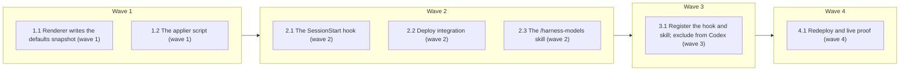

# Per-agent and per-skill model and effort configuration

<!-- AT-A-GLANCE:BEGIN (generated — do not edit; refreshed by render_plan.py --summarize) -->
## At a glance

**7 tasks · 4 waves · 19 files · 6/7 done**

| Wave | Task | Title | Files | Done (acceptance) |
|---|---|---|---|---|
| 1 | 1.1 | Renderer writes the defaults snapshot (wave 1) | scripts/render_agent_definitions.py, scripts/test_render_agent_definitions.py | New `defaults_out` tests pass; every existing test in the file passes unchanged. |
| 1 | 1.2 | The applier script (wave 1) | scripts/apply_model_config.py, scripts/test_apply_model_config.py | All SC-2…SC-10 filters select at least one test each and pass. |
| 2 | 2.1 | The SessionStart hook (wave 2) | hooks/model-config.sh, tests/hooks/model-config.test.sh | All cases pass; `bash scripts/check-hook-root-source.sh` exits 0. |
| 2 | 2.2 | Deploy integration (wave 2) | scripts/deploy-harness.sh, tests/scripts/model-config-deploy.test.sh | All cases pass; `bash tests/scripts/deploy-prune.test.sh`, `bash tests/scripts/c… |
| 2 | 2.3 | The /harness-models skill (wave 2) | skills/harness-models/SKILL.md, skills/README.md, scripts/test_harness_models_skill.py | The test exits 0, `skills/README.md` lists `harness-models`, and `python3 script… |
| 3 | 3.1 | Register the hook and skill; exclude from Codex (wave 3) | settings.json, harness-manifest.json, CLAUDE.md, tests/scripts/deploy-profile.test.sh, scripts/render_codex_adapter.py, scripts/test_render_codex_adapter.py | SC-15…SC-19 and SC-21 checks exit 0. |
| 4 | 4.1 | Redeploy and live proof (wave 4) | specs/model-effort-config/proof/run_proof.py, specs/model-effort-config/SUMMARY.md | Exit 0 with a key starting `claude-sonnet-` in the printed keys. |

### Progress
- [x] 1.1 — Renderer writes the defaults snapshot (wave 1)
- [x] 1.2 — The applier script (wave 1)
- [x] 2.1 — The SessionStart hook (wave 2)
- [x] 2.2 — Deploy integration (wave 2)
- [x] 2.3 — The /harness-models skill (wave 2)
- [x] 3.1 — Register the hook and skill; exclude from Codex (wave 3)
- [ ] 4.1 — Redeploy and live proof (wave 4)
<!-- AT-A-GLANCE:END -->

## 1. Motivation

A user cannot set `model`/`effort` per agent or skill without editing maintainer-owned or derived
files, and consumers cannot set it at all. This plan delivers `specs/model-effort-config/design.md`:
an optional root `harness-models.json`, one applier script, a SessionStart hook
(`startup|clear`), deploy integration, and a `/harness-models` skill. The main session's model and
effort stay the user's.

## 2. Non-goals

- Changing or reverting the main session's model or effort setting (design D10).
- Tiers, named profiles, or a `.local` layer (D2).
- Codex runtime configuration (D3). The new hook is excluded from the Codex adapter.
- New default models for any role.
- Fixing the pre-existing staged `.harness-source/` re-sync gap (design, Deploy integration).

## Global Constraints

- Plan-contract: 2
- Read `specs/model-effort-config/design.md` (Architecture, Applier interface, Data flow,
  Main-session boundary, Deploy integration, Error behavior, Decisions D1–D13) and
  `specs/model-effort-config/research-brief.md` (Evidence Ledger, Risks) before you edit. They
  are the spec.
- Work in the task worktree root. Edit only the files your task names. Never edit `.claude/`
  directly; Task 4.1 regenerates it with `bash scripts/deploy-harness.sh`. Never edit `VERSION`,
  `CHANGELOG.md`, `templates/`, `scripts/verify_summary.py` or
  `skills/visual-planner/render_plan.py`.
- The branch base is `34b0b10`. Before the first task, run
  `git merge-base --is-ancestor 34b0b10 HEAD` and confirm exit 0; otherwise stop and report. The
  remote is `github`.
- Python tests run with `/tmp/harness-tests-venv/bin/python` (the interpreter
  `scripts/run-tests.sh` prefers). If it is missing, create it once with
  `bash -c 'source tests/lib.sh && ensure_pyenv'` (the helper the shell suites already use), or
  with `uv venv /tmp/harness-tests-venv` and
  `uv pip install --python /tmp/harness-tests-venv/bin/python pytest pytest-cov` when `python3 -m venv`
  is unavailable. Record the commands you ran. The system `python3` has no pytest.
- The applier and every new script use the Python standard library only. Bash uses two-space
  indentation and `set -u`.
- A hook never derives the project root from its own location
  (`scripts/check-hook-root-source.sh`). Use `${CLAUDE_PROJECT_DIR:-$(git rev-parse --show-toplevel 2>/dev/null)}`.
  The hook may locate the applier as `$HOOK_DIR/../scripts/apply_model_config.py`.
- The applier never opens `settings.json`, `settings.local.json` or any user settings file for
  writing. No task registers a `PreModelSwitch` hook.
- Prose under `skills/`, `rules/` and `agents/` follows `skills/asd-ste100/SKILL.md`: one
  instruction per sentence, at most 20 words in an instruction, active voice, no new semicolon.
- Run shell commands as separate plain commands. Commit only your files: `git add -- <files>`,
  then `git commit -- <files>` in a separate call. Never use `git add -A`, `git reset` or
  `git stash`.
- Report an A5-related surprise (an agent change applying in the same headless session) as a
  finding; the user accepted the lag (SUMMARY Intake notes, 2026-10-17).

## 3. Success Criteria

| ID | Behavior (observable) | Check (re-runnable) | Expected |
|------|-------------------------|-----------------------|------------|
| SC-1 | `render_agent_definitions.py --defaults-out` writes a snapshot whose `agents` match the Claude bindings and whose `skills` holds one key per non-archived source skill | `/tmp/harness-tests-venv/bin/python -m pytest scripts/test_render_agent_definitions.py -q -k defaults_out` | exit 0 |
| SC-2 | A user file setting `coding` effort to `high` makes `--apply` change exactly that one line of `agents/coding.md` | `/tmp/harness-tests-venv/bin/python -m pytest scripts/test_apply_model_config.py -q -k agent_override` | exit 0 |
| SC-3 | Invalid JSON, an unknown top-level key, an unknown role or skill, an entry that is not an object, an entry key other than `model`/`effort` (for example `efort`), a non-string or `null` value, a bad model, a bad effort, or an unsupported `schema_version` makes `--check` and `--apply` exit 1 with one line per error and leaves every target's sha256 unchanged | `/tmp/harness-tests-venv/bin/python -m pytest scripts/test_apply_model_config.py -q -k invalid` | exit 0 |
| SC-4 | `reviewer` or `task-reviewer` with `effort: low` is rejected by `--check` | `/tmp/harness-tests-venv/bin/python -m pytest scripts/test_apply_model_config.py -q -k floor` | exit 0 |
| SC-5 | A second `--apply` with unchanged inputs reports 0 files written | `/tmp/harness-tests-venv/bin/python -m pytest scripts/test_apply_model_config.py -q -k idempotent` | exit 0 |
| SC-6 | `--show` prints one row per agent role and per skill with a non-empty value, with a source column, and one warning line per set `CLAUDE_CODE_EFFORT_LEVEL`, `CLAUDE_CODE_SUBAGENT_MODEL`, `CLAUDE_CODE_SUBAGENT_MODEL_FORCE` | `/tmp/harness-tests-venv/bin/python -m pytest scripts/test_apply_model_config.py -q -k show` | exit 0 |
| SC-7 | `--apply` and `--hook` leave `settings.json` and `settings.local.json` byte-identical | `/tmp/harness-tests-venv/bin/python -m pytest scripts/test_apply_model_config.py -q -k main_session_boundary` | exit 0 |
| SC-8 | A skill entry adds `effort: high` to its `SKILL.md`; removing the entry and re-applying restores the file byte for byte | `/tmp/harness-tests-venv/bin/python -m pytest scripts/test_apply_model_config.py -q -k skill_line` | exit 0 |
| SC-9 | A consumer skill not in the snapshot keeps a byte-identical file through `--apply` and `--hook`, and a user file naming it fails `--check` | `/tmp/harness-tests-venv/bin/python -m pytest scripts/test_apply_model_config.py -q -k consumer_skill` | exit 0 |
| SC-10 | A failed write part-way reports the files written and the failing file and exits 1 in `--apply`, exit 0 with a partial-apply warning in `--hook`; a re-run converges | `/tmp/harness-tests-venv/bin/python -m pytest scripts/test_apply_model_config.py -q -k partial_write` | exit 0 |
| SC-11 | The hook applies on `startup` and `clear`, leaves every target byte-identical on `resume`, `compact` and `fork`, exits 0 with the warning on an invalid file, exits 0 silently with no snapshot, and one `startup` run completes in under 1 s (budget) | `bash tests/hooks/model-config.test.sh` | exit 0 |
| SC-12 | No line under `hooks/` derives the repository root from the hook's own location | `bash scripts/check-hook-root-source.sh` | exit 0 |
| SC-13 | A deploy with `{"agents":{"coding":{"effort":"high"}}}` yields `.claude/agents/coding.md` with `effort: high` and that one-line diff against a default deploy; the consumer tree holds `scripts/apply_model_config.py` and `harness-models.defaults.json` and no `agents/*.json`; a consumer skill with `model: sonnet` is byte-identical after the deploy | `bash tests/scripts/model-config-deploy.test.sh` | exit 0 |
| SC-14 | A deploy with an invalid `harness-models.json` exits non-zero, prints the applier's errors, and creates or changes no file under the target's `.claude/`, also under `--dry-run` | `bash tests/scripts/model-config-deploy.test.sh` | exit 0 |
| SC-15 | `standard` and `strict` deploys register `model-config.sh` under SessionStart with matcher `startup\|clear`; `minimal` does not | `bash tests/scripts/deploy-profile.test.sh` | exit 0 |
| SC-16 | `settings.json` registers no `PreModelSwitch` hook | `python3 -c "import json,sys; sys.exit('PreModelSwitch' in json.load(open('settings.json'))['hooks'])"` | exit 0 |
| SC-17 | The Codex adapter's `hooks.json` registers no `model-config.sh`, and the render still matches the committed adapter | `/tmp/harness-tests-venv/bin/python -m pytest scripts/test_render_codex_adapter.py -q` | exit 0 |
| SC-18 | The manifest lists the new hook, profile membership and `harness-models` skill consistently with the files | `python3 scripts/check_manifest.py` | exit 0 |
| SC-19 | Documented paths exist and the CLAUDE.md hook table matches `settings.json` | `bash scripts/lint-doc-truth.sh` | exit 0 |
| SC-20 | `skills/harness-models/SKILL.md` names exactly the modes `show`, `check`, `apply`, each mapped to the applier flag of the same name | `/tmp/harness-tests-venv/bin/python -m pytest scripts/test_harness_models_skill.py -q` | exit 0 |
| SC-21 | With `harness-models` in the manifest, every command in its `SKILL.md` matches its `allowed-tools` | `python3 scripts/check_skill_tool_conformance.py` | exit 0 |
| SC-22 | In a consumer deployed with `test-runner` set to `sonnet`, one headless `claude -p` session that dispatches `test-runner` reports a `modelUsage` key starting `claude-sonnet-` (local only: needs an authenticated `claude`; runtime 30 s (prediction)) | `python3 specs/model-effort-config/proof/run_proof.py` | exit 0 — prints the model usage keys |

## 4. Tasks

### Task 1.1 — Renderer writes the defaults snapshot (wave 1)

- **Files:** scripts/render_agent_definitions.py, scripts/test_render_agent_definitions.py
- **Action:** Test first. Add `--defaults-out <file>` to `render_agent_definitions.py`. With
  `--runtime claude`, write
  `{"schema_version": 1, "agents": {<role>: {"model": ..., "effort"?: ...}}, "skills": {<name>: {}}}`
  as sorted, indented JSON with a trailing newline. `agents` comes from
  `runtimes.claude.roles` (omit `effort` when the binding has none). `skills` has one key per
  `skills/<name>/SKILL.md` outside `skills/_archive/`, holding the `model`/`effort` its
  frontmatter declares (empty object today). With `--output-dir`, render the agent files and
  write the snapshot; without it, write only the snapshot (exit 0). With `--check`,
  `--defaults-out` is an error (exit 1). With `--runtime codex`,
  `--defaults-out` is an error (exit 1). Do not change
  existing rendering output.
- **Verify:** `/tmp/harness-tests-venv/bin/python -m pytest scripts/test_render_agent_definitions.py -q`
- **Done:** New `defaults_out` tests pass; every existing test in the file passes unchanged.
- **Criteria:** SC-1
- **Interfaces:** Consumes: `agents/runtime-bindings.json`, `skills/*/SKILL.md`. Produces: `scripts/render_agent_definitions.py` `--defaults-out` snapshot JSON.
- **Seams:** `main()` CLI output file — catches: wrong role values, archived or missing skills, changed render bytes; misses: deploy wiring

### Task 1.2 — The applier script (wave 1)

- **Files:** scripts/apply_model_config.py, scripts/test_apply_model_config.py
- **Action:** Test first. Implement the applier per design "Applier interface", "Data flow",
  "Main-session boundary" and "Error behavior", standard library only:
  - CLI: `--show` (default) | `--check` | `--apply` | `--hook`; `--project-root` (required);
    `--claude-dir` (default `<project-root>/.claude`); `--defaults` (default
    `<claude-dir>/harness-models.defaults.json`).
  - Validate everything before any write: schema per design (optional `schema_version` = 1;
    top-level keys only `schema_version`, `agents`, `skills`; each entry an object holding only
    `model` and/or `effort`, each a string; anything else, `null` included, is an error); models `opus|sonnet|haiku|fable|inherit` or `^claude-[a-z0-9.-]+$`;
    efforts `low|medium|high|xhigh|max`; roles and skills must exist in the snapshot; review
    floor `medium` for `reviewer`/`task-reviewer` as a module constant.
  - Write: replace existing `model:`/`effort:` frontmatter lines in place; insert a missing line
    after the last present of `description:`, `tools:`, `model:`; delete a line that resolves to
    none; skip unchanged files; atomic write (temp file in the same directory, `os.replace`).
    `--show` on an invalid file prints the errors and exits 1; a missing or unreadable snapshot
    makes `--show`, `--check` and `--apply` exit 1 (the `invalid` tests cover both). Never touch
    files outside the targets. A target file that does not exist is skipped with a
    `missing target <path>` report line and does not change the exit code.
  - `--hook`: read SessionStart JSON from stdin; any `source` other than `startup`/`clear`
    exits 0 silently; a missing snapshot exits 0 silently; errors exit 0 with a one-line
    `hookSpecificOutput.additionalContext`; on a successful apply that changed files, print one
    line naming the count. The exact output is
    `{"hookSpecificOutput":{"hookEventName":"SessionStart","additionalContext":"<line>","reloadSkills":true}}`,
    with `reloadSkills` only when a skill file changed. Print nothing when nothing changed, and do
    not print `missing target` lines in hook mode. One test asserts
    `hookEventName == "SessionStart"`. SC-10's partial write is forced by monkeypatching the write
    helper (or `os.replace`) to fail on the Nth file, not by file permissions.
  - `--show`: one row per role and per skill with a non-empty value (target, model, effort,
    source `default|harness-models.json`), then one warning per set env var named in SC-6.
  - Report lines: `--apply` states that skill changes apply at the next invocation and agent
    changes apply from the next session in headless runs (research-brief A5).
  Tests use `tmp_path` fixture trees; name tests so the `-k` filters in SC-2…SC-10 select them.
- **Verify:** `/tmp/harness-tests-venv/bin/python -m pytest scripts/test_apply_model_config.py -q`
- **Done:** All SC-2…SC-10 filters select at least one test each and pass.
- **Criteria:** SC-2, SC-3, SC-4, SC-5, SC-6, SC-7, SC-8, SC-9, SC-10
- **Interfaces:** Consumes: snapshot JSON schema from design (Task 1.1 output shape), `harness-models.json`. Produces: `scripts/apply_model_config.py`.
- **Seams:** `apply_model_config.py` CLI exit code, stdout and target file bytes — catches: validation gaps, floor bypass, line-order drift, non-idempotence, settings writes, consumer-file edits; misses: Claude Code honouring the written frontmatter (covered by research-brief probes and SC-22)

### Task 2.1 — The SessionStart hook (wave 2)

- **Files:** hooks/model-config.sh, tests/hooks/model-config.test.sh
- **Action:** Test first. Write `hooks/model-config.sh` modelled on `hooks/session-knowledge.sh`:
  header comment with `Verifies:` / `Does not verify:` lines; `set -u`; `HOOK_DIR` from
  `BASH_SOURCE`; project root from `CLAUDE_PROJECT_DIR`, else `git rev-parse --show-toplevel`
  of the working directory; exit 0 silently when `python3` or
  `$HOOK_DIR/../scripts/apply_model_config.py` is missing; otherwise pipe stdin to
  `apply_model_config.py --hook --project-root "$ROOT"` and exit 0. The test file follows
  `tests/hooks/session-knowledge.test.sh` (`source ../lib.sh`). It builds an isolated temp repo
  whose `.claude/hooks/` and `.claude/scripts/` hold copies of the hook and the applier, runs that
  copy (the consumer path) with `CLAUDE_PROJECT_DIR` set to the temp repo, and asserts every SC-11 clause,
  including the 1 s (budget) bound on one `startup` run.
- **Verify:** `bash tests/hooks/model-config.test.sh`
- **Done:** All cases pass; `bash scripts/check-hook-root-source.sh` exits 0.
- **Criteria:** SC-11, SC-12
- **Interfaces:** Consumes: `scripts/apply_model_config.py`. Produces: `hooks/model-config.sh`.
- **Seams:** hook stdout and exit code with fixture stdin — catches: wrong source filtering, blocking exits, root resolution; misses: registration in settings

### Task 2.2 — Deploy integration (wave 2)

- **Files:** scripts/deploy-harness.sh, tests/scripts/model-config-deploy.test.sh
- **Action:** Test first. In `deploy-harness.sh` per design "Deploy integration": add
  `apply_model_config.py` to `CONSUMER_SCRIPTS`; before `preflight_protected`, render the
  snapshot from source to a temp file with `render_agent_definitions.py --defaults-out` and run
  `scripts/apply_model_config.py --check --project-root <target root> --defaults <temp>`,
  stopping on failure (also under `--dry-run`); skip both with a warning when the source has no
  applier; add a pipeline step after `rewrite_derived_paths` that copies the snapshot to
  `$OUT/harness-models.defaults.json` and runs `--apply --project-root <target root> --claude-dir "$OUT"`.
  Create the temp snapshot with `mktemp`, keep it until the apply step, and remove it in the
  existing cleanup path without changing the current `ERR` trap's behavior.
  The new test follows `tests/scripts/deploy-profile.test.sh` and asserts SC-13 and SC-14,
  including a consumer skill that survives the deploy and an invalid file under `--dry-run` with no
  prior `.claude/`.
- **Verify:** `bash tests/scripts/model-config-deploy.test.sh`
- **Done:** All cases pass; `bash tests/scripts/deploy-prune.test.sh`, `bash tests/scripts/consumer-subset.test.sh` and `bash tests/scripts/install-harness.test.sh` exit 0.
- **Criteria:** SC-13, SC-14
- **Interfaces:** Consumes: `scripts/apply_model_config.py`, `scripts/render_agent_definitions.py` `--defaults-out`. Produces: `scripts/deploy-harness.sh` check and apply steps.
- **Seams:** deploy into a temp target — catches: wrong step order, writes on invalid input, missing consumer files; misses: hook registration

### Task 2.3 — The /harness-models skill (wave 2)

- **Files:** skills/harness-models/SKILL.md, skills/README.md, scripts/test_harness_models_skill.py
- **Action:** Write a thin skill. Frontmatter: `name: harness-models`, a description naming
  `/harness-models show|check|apply`, and `allowed-tools` granting only the applier commands
  (`Bash(python3 scripts/apply_model_config.py *)`, `Bash(git rev-parse --show-toplevel)`), in
  the source form that deploy rewrites to `.claude/scripts/`.
  Body: first run `git rev-parse --show-toplevel`, then map `show` (default), `check`, `apply`
  to `--show`, `--check`, `--apply` with `--project-root <that literal path>` (no `$(...)` in the
  command, so the `allowed-tools` grant matches); relay the output verbatim; state that
  `apply` is the user's own mid-session action (D9) and that agent changes may apply from the
  next session. Add the skill to `skills/README.md` inventory. Test first: write
  `scripts/test_harness_models_skill.py`, which reads the SKILL.md body and asserts the mode set
  is exactly `show`, `check`, `apply`, each paired with the applier flag of the same name.
- **Verify:** `/tmp/harness-tests-venv/bin/python -m pytest scripts/test_harness_models_skill.py -q`
- **Done:** The test exits 0, `skills/README.md` lists `harness-models`, and
  `python3 scripts/check_runtime_neutral_sources.py --root .`, `bash scripts/check-allowed-tools.sh`
  and `bash scripts/lint-skill-bash.sh` exit 0. The skill text names no `.claude/` path and no
  vendor model ID.
- **Criteria:** SC-20
- **Interfaces:** Consumes: the applier CLI. Produces: `skills/harness-models/SKILL.md`.
- **Seams:** SKILL.md text read by the test — catches: a missing or extra mode, a mode mapped to the wrong flag; misses: runtime permission prompts

### Task 3.1 — Register the hook and skill; exclude from Codex (wave 3)

- **Files:** settings.json, harness-manifest.json, CLAUDE.md, tests/scripts/deploy-profile.test.sh, scripts/render_codex_adapter.py, scripts/test_render_codex_adapter.py
- **Action:** Test first for the profile and Codex changes.
  - `settings.json`: add a SessionStart group with `"matcher": "startup|clear"` running bare
    `hooks/model-config.sh`, with a `statusMessage`. Keep the existing `session-knowledge.sh`
    group unchanged.
  - `harness-manifest.json`: add `model-config.sh` to `hooks` (`wired: true`) and to
    `hook_profiles.standard` and `.strict`; add `harness-models` to `skills`.
  - `CLAUDE.md`: add the hook table row (with `Verifies:`/`Does not verify:` wording). In the
    "Hook profiles" paragraph change both occurrences of "all three" (for `standard` and for
    `strict`) to "all four".
  - `tests/scripts/deploy-profile.test.sh`: assert SC-15, and change the `standard`
    hook-command count check from 3 to 4 (there is no `strict` count check today).
  - `scripts/render_codex_adapter.py` (D3): in `expected_codex_hooks()`, skip any handler whose
    command basename is `model-config.sh`, and drop a group left with no handlers. Only the
    registration is excluded: the hook body and the `harness-models` skill still copy into the
    plugin, so `validate_sources()`, the inventory assertion and `scripts/codex_harness_doctor.py`
    stay unchanged. Add a test in `scripts/test_render_codex_adapter.py` that `hooks.json` holds no
    `model-config.sh` and no empty group. The committed `adapters/codex/plugin/hooks/hooks.json`
    stays byte-identical.
- **Verify:** `bash tests/scripts/deploy-profile.test.sh`
- **Done:** SC-15…SC-19 and SC-21 checks exit 0.
- **Criteria:** SC-15, SC-16, SC-17, SC-18, SC-19, SC-21
- **Interfaces:** Consumes: `hooks/model-config.sh`, `skills/harness-models/SKILL.md`. Produces: `settings.json` registration and `harness-manifest.json` entries.
- **Seams:** deploy-profile settings output and Codex render — catches: wrong profile membership, matcher, Codex leak, doc drift; misses: hook runtime behavior

### Task 4.1 — Redeploy and live proof (wave 4)

- **Files:** specs/model-effort-config/proof/run_proof.py, specs/model-effort-config/SUMMARY.md
- **Action:** Run `bash scripts/deploy-harness.sh` to regenerate this repo's `.claude/`. Write
  `run_proof.py` (standard library) with two modes. `--prepare` creates
  `${TMPDIR:-/tmp}/harness-model-effort-proof` (a fresh `git init` directory), writes its
  `harness-models.json` setting `test-runner` to `sonnet`, and runs
  `bash scripts/deploy-harness.sh --target <dir>`. The default mode runs `--prepare` first when
  that directory is missing, then runs one
  `claude -p --output-format json --allowedTools Agent` session there with the prompt on stdin
  that dispatches `test-runner` with a trivial prompt, exits 0 only when a `modelUsage` key starts
  with `claude-sonnet-`, and prints the keys, the deploy seconds (when it prepared) and the
  `claude -p` seconds separately. Run `--prepare`, then the
  default mode, so the timed run excludes the deploy. Record the result in SUMMARY `### Verify` and the
  model-call nondeterminism in `### Not auto-verified`.
- **Verify:** `python3 specs/model-effort-config/proof/run_proof.py`
- **Done:** Exit 0 with a key starting `claude-sonnet-` in the printed keys.
- **Criteria:** SC-22
- **Interfaces:** Consumes: the full feature. Produces: `specs/model-effort-config/proof/run_proof.py`.
- **Seams:** `claude -p` `modelUsage` — catches: the deployed frontmatter not reaching Claude Code; misses: interactive-mode reload timing

## 5. Risks

- A5: in headless runs a hook-written agent change applies from the next session (research-brief
  probes 5, 6, 8, 9). The user accepted this (option 1); the `--apply` report states it.
- `scripts/render_codex_adapter.py` renders every `settings.json` hook; Task 3.1 excludes only
  the registration. Codex installs still receive the inert hook body and the `harness-models`
  skill, which reports that the applier is missing (accepted under D3; keeps the Codex doctor's
  inventory unchanged).
- SC-22 makes a model call, needs an authenticated `claude`, and cannot run in CI; one run is
  truth for one role only, listed under SUMMARY `### Not auto-verified` with its measured time.
- Between wave 2 and wave 3, `hooks/model-config.sh` and `skills/harness-models/` exist on disk
  but not in `harness-manifest.json`, so `check_manifest.py` and `scripts/run-tests.sh` fail.
  Do not push the branch until wave 3 is committed.
- The full suite (`bash scripts/run-tests.sh`) is not an SC row (Guardrail 4); it runs at
  `finishing-a-development-branch` and in CI.
- `settings.json` and `hooks/` are high-blast; the CI strict gate requires a high-risk SUMMARY
  with re-runnable `### Verify` rows on this PR.
- Task 2.2 adds work to every deploy; a slow check would slow every re-sync.

### Assumption coverage

- A1 → SC-22
- A2 → accepted risk: proven by research-brief probe 3 (truth, 2026-10-17); not re-run automatically
- A3 → SC-11
- A4 → accepted risk: proven by research-brief probe 4 (truth, 2026-10-17); not re-run automatically
- A5 → accepted risk: false in print mode; user accepted the next-session lag on 2026-10-17
- A6 → accepted risk: proven by research-brief probe 1 (truth, 2026-10-17); not re-run automatically
- A7 → SC-11

## 6. Status Log

- 2026-10-17 — plan written; status proposed.
- 2026-10-17 — tasks 1.1, 1.2 complete; commits c572f54, bcba268
- 2026-10-17 — tasks 2.1, 2.2, 2.3 complete; commits 0cafe3a, 57eb40d, 47bd4e4
- 2026-10-17 — task 3.1 complete; commits 24d6c30, 0728ef5 (fix round on the Task 2.3 skill file)
